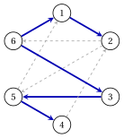
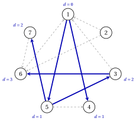
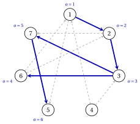

# Exercises · Graphs

**Exercises · Chapter 1** · each solution opens with a click · [:material-book-open-variant: Chapter 1: Graphs](../graphs/graphs/index.md) · [:material-file-pdf-box: Exercises, volume 1 (PDF)](../pdf/exercises-1-graphs.pdf)

!!! formula "Rules used in these exercises"

    The definitions and the algorithms of the chapter [«Graphs»](https://fabiofurini.github.io/network-optimization/graphs/graphs/), for a directed graph $G=(N,A)$ with $n=|N|$ and $m=|A|$.

    - **(G1)** <strong>Incidence matrix.</strong> The arcs are numbered $a_1,a_2,\dots,a_m$ in lexicographic order, and

        $$
        b_{ik}=+1 \text{ if $i$ is the tail of } a_k, \qquad b_{ik}=-1 \text{ if $i$ is the head of } a_k, \qquad
        b_{ik}=0 \text{ otherwise.}
        $$

    - **(G2)** <strong>Lists.</strong> The adjacency list $L(i)$ contains the successors of $i$, by increasing index.

    - **(G3)** <strong>Components.</strong> $R(i)$ is the set of the nodes reachable from $i$, $R'(i)$ the same set in the reversed graph, and the strongly connected component of $i$ is $S(i)=R(i)\cap R'(i)$.

    - **(G4)** <strong>Trees and rank.</strong> $n-1$ arcs form a spanning tree if and only if they are acyclic (or connect all the nodes); with $k$ connected components, $\rank(\mat{B})=n-k$.

    - **(G5)** <strong>Search.</strong> A node is labelled when it enters $\mathit{LIST}$. The BFS selects the first node of $\mathit{LIST}$, the DFS the last one; the selected node $i$ labels the first unlabelled node $j$ of $L(i)$, with $\mathit{pred}(j)=i$, or leaves $\mathit{LIST}$ if there is none.

!!! esercizio "Exercise 1.1: Representations of a graph"

    !!! esercizio "Exercise"

        We consider the directed graph $G=(N,A)$ with $N=\{1,2,\dots,5\}$ and the $7$ arcs

        $$
        A=\{(1,2),(1,3),(2,3),(2,4),(5,1),(5,3),(5,4)\},
        $$

        drawn below.

        { .fig loading=lazy  }

    **Questions**

    1. Number the arcs as in (G1) and write the node–arc incidence matrix $\mat{B}$.

    2. Write the adjacency lists and the arc list of $G$.

    3. Compute the out-degree and the in-degree of every node, and the vector $\mat{B}\vet{x}$ for $x_{ij}=1$ on every arc.

    4. How many entries do the adjacency matrix, the incidence matrix, the arc list and the adjacency lists store?

??? soluzione "Solution"

    We use the rules (G1)–(G5) of the box at the beginning of these exercises.

    1. The arcs in lexicographic order are $a_{1}=(1,2)$, $a_{2}=(1,3)$, $a_{3}=(2,3)$, $a_{4}=(2,4)$, $a_{5}=(5,1)$, $a_{6}=(5,3)$, $a_{7}=(5,4)$. Each column has $+1$ in the row of the tail and $-1$ in the row of the head:

        $$
        \begin{array}{c|rrrrrrr}
        & a_{1} & a_{2} & a_{3} & a_{4} & a_{5} & a_{6} & a_{7}\\ \hline
        1 & 1 & 1 & 0 & 0 & -1 & 0 & 0\\
        2 & -1 & 0 & 1 & 1 & 0 & 0 & 0\\
        3 & 0 & -1 & -1 & 0 & 0 & -1 & 0\\
        4 & 0 & 0 & 0 & -1 & 0 & 0 & -1\\
        5 & 0 & 0 & 0 & 0 & 1 & 1 & 1\\
        \end{array}
        $$

    2. The adjacency lists and the arc list are:

        
<table>
        <tr>
        <th>\(i\)</th>
        <th>\(L(i)\)</th>
        </tr>
        <tr>
        <td>\(1\)</td>
        <td>\(2,~3\)</td>
        </tr>
        <tr>
        <td>\(2\)</td>
        <td>\(3,~4\)</td>
        </tr>
        <tr>
        <td>\(3\)</td>
        <td>(empty)</td>
        </tr>
        <tr>
        <td>\(4\)</td>
        <td>(empty)</td>
        </tr>
        <tr>
        <td>\(5\)</td>
        <td>\(1,~3,~4\)</td>
        </tr>
        </table>

        
<table>
        <tr>
        <th>arc</th>
        <th>\(a_{1}\)</th>
        <th>\(a_{2}\)</th>
        <th>\(a_{3}\)</th>
        <th>\(a_{4}\)</th>
        <th>\(a_{5}\)</th>
        <th>\(a_{6}\)</th>
        <th>\(a_{7}\)</th>
        </tr>
        <tr>
        <td>tail</td>
        <td>\(1\)</td>
        <td>\(1\)</td>
        <td>\(2\)</td>
        <td>\(2\)</td>
        <td>\(5\)</td>
        <td>\(5\)</td>
        <td>\(5\)</td>
        </tr>
        <tr>
        <td>head</td>
        <td>\(2\)</td>
        <td>\(3\)</td>
        <td>\(3\)</td>
        <td>\(4\)</td>
        <td>\(1\)</td>
        <td>\(3\)</td>
        <td>\(4\)</td>
        </tr>
        </table>

    3. The degrees are the numbers of $+1$ and of $-1$ in each row of $\mat{B}$:

        
<table>
        <tr>
        <th>node \(i\)</th>
        <th>\(1\)</th>
        <th>\(2\)</th>
        <th>\(3\)</th>
        <th>\(4\)</th>
        <th>\(5\)</th>
        </tr>
        <tr>
        <td>\(\deg^+(i)\)</td>
        <td>\(2\)</td>
        <td>\(2\)</td>
        <td>\(0\)</td>
        <td>\(0\)</td>
        <td>\(3\)</td>
        </tr>
        <tr>
        <td>\(\deg^-(i)\)</td>
        <td>\(1\)</td>
        <td>\(1\)</td>
        <td>\(3\)</td>
        <td>\(2\)</td>
        <td>\(0\)</td>
        </tr>
        </table>

        Both rows add up to $m=7$. Row $i$ of $\mat{B}\vet{x}$ is $\deg^+(i)-\deg^-(i)$:

        $$
        \mat{B}\vet{x}=(1,\,1,\,-3,\,-2,\,3)' .
        $$

        Node $5$ has no entering arc, and nodes $3,4$ no leaving arc.

    4. The adjacency matrix stores $n^2=25$ entries, the incidence matrix $n\,m=35$, the arc list $2\,m=14$ and the adjacency lists $n+m=12$.

    !!! chiave ""

        Every column of $\mat{B}$ has one $+1$ and one $-1$, so its rows add up to zero; the adjacency lists are the smallest representation, with $12$ entries.

!!! esercizio "Exercise 1.2: Connected and strongly connected components"

    !!! esercizio "Exercise"

        We consider the directed graph $G=(N,A)$ with $N=\{1,2,\dots,8\}$ and the $11$ arcs

        $$
        A=\{(1,7),(2,3),(2,7),(3,1),(3,6),(4,5),(6,2),(6,7),(6,8),(7,8),(8,1)\},
        $$

        drawn below.

        { .fig loading=lazy  }

    **Questions**

    1. Find the connected components of $G$ (of its underlying undirected graph). Is $G$ weakly connected?

    2. Compute $R(1)$ and $R'(1)$, and the strongly connected component $S(1)$.

    3. Find all the strongly connected components of $G$. Is $G$ strongly connected?

??? soluzione "Solution"

    We use the rules (G1)–(G5) of the box at the beginning of these exercises.

    1. Ignoring the orientation, the vertices split into the components $\{1,2,3,6,7,8\}$, $\{4,5\}$: no edge joins two of them. $G$ has $k=2$ components, so it is not weakly connected.

    2. Following the arcs from $1$ we get $R(1)=\{1,7,8\}$; following them backwards (in the reversed graph) we get $R'(1)=\{1,2,3,6,7,8\}$. Hence

        $$
        S(1)=R(1)\cap R'(1)=\{1,7,8\}.
        $$

    3. For one node $h$ of each component (the smallest one not yet assigned), by (G3):

        $$
        \begin{array}{cccc}
        \hline {h} & {R(h)} & {R'(h)} & {S(h)} \\
        \hline {1} & {\{1,7,8\}} & {\{1,2,3,6,7,8\}} & {\{1,7,8\}} \\
        {2} & {\{1,2,3,6,7,8\}} & {\{2,3,6\}} & {\{2,3,6\}} \\
        {4} & {\{4,5\}} & {\{4\}} & {\{4\}} \\
        {5} & {\{5\}} & {\{4,5\}} & {\{5\}} \\
        \hline
        \end{array}
        $$

        The $4$ strongly connected components are $\{1,7,8\}$, $\{2,3,6\}$, $\{4\}$, $\{5\}$. There is more than one, so $G$ is not strongly connected.

    !!! chiave ""

        $G$ has $2$ connected components and $4$ strongly connected components; every strongly connected component lies inside a connected component.

!!! esercizio "Exercise 1.3: Trees and the rank of the incidence matrix"

    !!! esercizio "Exercise"

        We consider the directed graph $G=(N,A)$ with $N=\{1,2,\dots,6\}$ and the $9$ arcs

        $$
        A=\{(1,2),(2,5),(2,6),(3,5),(4,2),(5,1),(5,4),(6,1),(6,3)\},
        $$

        drawn below, and the two sets of $5$ arcs

        $$
        F_1=\{(1,2),(3,5),(5,4),(6,1),(6,3)\}, \qquad F_2=\{(2,5),(2,6),(3,5),(4,2),(6,3)\}.
        $$

        { .fig loading=lazy  }

    **Questions**

    1. Compute the rank of the node–arc incidence matrix $\mat{B}$ of $G$, without writing the matrix.

    2. Decide whether $F_1$ and $F_2$ are spanning trees of $G$.

    3. For the set that is not a spanning tree, find a cycle and a linear combination of its columns of $\mat{B}$ equal to $\vet{0}$.

    4. Find the fundamental cycle of the arc $(2,5)$ with respect to the spanning tree $F_1$, and its backward arcs.

    5. Remove from $G$ all the arcs incident to node $6$. What is the rank of the new incidence matrix?

??? soluzione "Solution"

    We use the rules (G1)–(G5) of the box at the beginning of these exercises.

    1. The underlying undirected graph is connected ($k=1$): by (G4), $\rank(\mat{B})=6-1=5$.

    2. $F_1$ has $5$ arcs and no cycle, so it is a spanning tree by (G4); its edges connect all the nodes.

        { .fig loading=lazy  }

        $F_2$ has $5$ arcs, but its edges have the components $\{1\}$, $\{2,3,4,5,6\}$: it does not connect all the nodes, so it contains a cycle and is not a spanning tree.

    3. The arcs of $F_2$ contain the cycle $2,5,3,6,2$. Traversing it, the arcs $(2,5)$ forward, $(3,5)$ backward, $(6,3)$ backward, $(2,6)$ backward give, with $+1$ for the forward arcs and $-1$ for the backward ones,

        $$
        \mat{B}_{a_{2}} -\mat{B}_{a_{4}} -\mat{B}_{a_{9}} -\mat{B}_{a_{3}}=\vet{0},
        $$

        with the arcs numbered as in (G1). The columns of $F_2$ are linearly dependent.

    4. In the tree $F_1$ the path from $5$ to $2$ is $5,3,6,1,2$. The fundamental cycle, written from the tail of $(2,5)$, is $2,5,3,6,1,2$; its backward arcs are $(3,5)$, $(6,3)$.

    5. Without the arcs incident to $6$, node $6$ is isolated and the graph has $k=2$ components $\{1,2,3,4,5\}$, $\{6\}$; hence the rank is $6-2=4$.

    !!! chiave ""

        $\rank(\mat{B})=5$; $F_1$ is a spanning tree, $F_2$ is not, and its columns satisfy a linear relation given by its cycle.

!!! esercizio "Exercise 1.4: Breadth-first search"

    !!! esercizio "Exercise"

        We consider the directed graph $G=(N,A)$ with $N=\{1,2,\dots,7\}$ and the $11$ arcs

        $$
        A=\{(1,4),(1,5),(2,1),(2,6),(3,1),(3,6),(5,3),(5,4),(5,7),(6,1),(7,6)\},
        $$

        drawn below.

        { .fig loading=lazy  }

    **Questions**

    1. Write the adjacency lists of $G$.

    2. Run the breadth-first search from $s=1$: give $\mathit{LIST}$ after every iteration and the labelling order.

    3. Draw the predecessor tree and give, for every labelled node $j$, the number $d(j)$ of arcs of the tree path from $1$ to $j$.

    4. Which nodes are not reachable from $1$? Give a directed path with the minimum number of arcs from $1$ to $6$.

??? soluzione "Solution"

    We use the rules (G1)–(G5) of the box at the beginning of these exercises.

    1. The successors of each node, by increasing index:

        
<table>
        <tr>
        <th>\(i\)</th>
        <th>\(L(i)\)</th>
        </tr>
        <tr>
        <td>\(1\)</td>
        <td>\(4,~5\)</td>
        </tr>
        <tr>
        <td>\(2\)</td>
        <td>\(1,~6\)</td>
        </tr>
        <tr>
        <td>\(3\)</td>
        <td>\(1,~6\)</td>
        </tr>
        <tr>
        <td>\(4\)</td>
        <td>(empty)</td>
        </tr>
        <tr>
        <td>\(5\)</td>
        <td>\(3,~4,~7\)</td>
        </tr>
        <tr>
        <td>\(6\)</td>
        <td>\(1\)</td>
        </tr>
        <tr>
        <td>\(7\)</td>
        <td>\(6\)</td>
        </tr>
        </table>

    2. The search selects the first node of $\mathit{LIST}$:

        
<table>
        <tr>
        <th>iteration</th>
        <th>selected \(i\)</th>
        <th>action</th>
        <th>\(\mathit{LIST}\)</th>
        </tr>
        <tr>
        <td>\(1\)</td>
        <td>\(1\)</td>
        <td>label \(4\), \(\mathit{pred}(4)=1\)</td>
        <td>\(1,4\)</td>
        </tr>
        <tr>
        <td>\(2\)</td>
        <td>\(1\)</td>
        <td>label \(5\), \(\mathit{pred}(5)=1\) (\(4\) is labelled)</td>
        <td>\(1,4,5\)</td>
        </tr>
        <tr>
        <td>\(3\)</td>
        <td>\(1\)</td>
        <td>remove \(1\) (\(4\), \(5\) are labelled)</td>
        <td>\(4,5\)</td>
        </tr>
        <tr>
        <td>\(4\)</td>
        <td>\(4\)</td>
        <td>remove \(4\)</td>
        <td>\(5\)</td>
        </tr>
        <tr>
        <td>\(5\)</td>
        <td>\(5\)</td>
        <td>label \(3\), \(\mathit{pred}(3)=5\)</td>
        <td>\(5,3\)</td>
        </tr>
        <tr>
        <td>\(6\)</td>
        <td>\(5\)</td>
        <td>label \(7\), \(\mathit{pred}(7)=5\) (\(3\), \(4\) are labelled)</td>
        <td>\(5,3,7\)</td>
        </tr>
        <tr>
        <td>\(7\)</td>
        <td>\(5\)</td>
        <td>remove \(5\) (\(3\), \(4\), \(7\) are labelled)</td>
        <td>\(3,7\)</td>
        </tr>
        <tr>
        <td>\(8\)</td>
        <td>\(3\)</td>
        <td>label \(6\), \(\mathit{pred}(6)=3\) (\(1\) is labelled)</td>
        <td>\(3,7,6\)</td>
        </tr>
        <tr>
        <td>\(9\)</td>
        <td>\(3\)</td>
        <td>remove \(3\) (\(1\), \(6\) are labelled)</td>
        <td>\(7,6\)</td>
        </tr>
        <tr>
        <td>\(10\)</td>
        <td>\(7\)</td>
        <td>remove \(7\) (\(6\) is labelled)</td>
        <td>\(6\)</td>
        </tr>
        <tr>
        <td>\(11\)</td>
        <td>\(6\)</td>
        <td>remove \(6\) (\(1\) is labelled)</td>
        <td>(empty)</td>
        </tr>
        </table>

        The labelling order is $1,4,5,3,7,6$.

    3. The arcs $(\mathit{pred}(j),j)$ are $(1,4)$, $(1,5)$, $(5,3)$, $(5,7)$, $(3,6)$ (blue); next to each node the value $d(j)$:

        { .fig loading=lazy  }

    4. Node $2$ is not labelled, so it is not reachable from $1$ by the correctness of the search. The BFS gives the minimum numbers of arcs: the tree path $1,5,3,6$ has $d(6)=3$ arcs, and no directed path from $1$ to $6$ is shorter.

    !!! chiave ""

        The BFS labels the nodes in the order $1,4,5,3,7,6$, in non-decreasing order of $d$; $R(1)=\{1,3,4,5,6,7\}$.

!!! esercizio "Exercise 1.5: Depth-first search"

    !!! esercizio "Exercise"

        We consider the directed graph $G=(N,A)$ with $N=\{1,2,\dots,7\}$ and the $11$ arcs

        $$
        A=\{(1,2),(1,5),(2,3),(2,7),(3,6),(3,7),(4,1),(4,3),(6,1),(6,2),(7,5)\},
        $$

        drawn below.

        { .fig loading=lazy  }

    **Questions**

    1. Run the depth-first search from $s=1$: give $\mathit{LIST}$ after every iteration and the labelling order.

    2. Draw the predecessor tree of the DFS.

    3. Compare the path from $1$ to $5$ in the DFS tree with the minimum number of arcs from $1$ to $5$.

??? soluzione "Solution"

    We use the rules (G1)–(G5) of the box at the beginning of these exercises.

    1. The adjacency lists are $L(1)=\{2,5\}$, $L(2)=\{3,7\}$, $L(3)=\{6,7\}$, $L(4)=\{1,3\}$, $L(5)=\emptyset$, $L(6)=\{1,2\}$, $L(7)=\{5\}$. The search selects the last node of $\mathit{LIST}$:

        
<table>
        <tr>
        <th>iteration</th>
        <th>selected \(i\)</th>
        <th>action</th>
        <th>\(\mathit{LIST}\)</th>
        </tr>
        <tr>
        <td>\(1\)</td>
        <td>\(1\)</td>
        <td>label \(2\), \(\mathit{pred}(2)=1\)</td>
        <td>\(1,2\)</td>
        </tr>
        <tr>
        <td>\(2\)</td>
        <td>\(2\)</td>
        <td>label \(3\), \(\mathit{pred}(3)=2\)</td>
        <td>\(1,2,3\)</td>
        </tr>
        <tr>
        <td>\(3\)</td>
        <td>\(3\)</td>
        <td>label \(6\), \(\mathit{pred}(6)=3\)</td>
        <td>\(1,2,3,6\)</td>
        </tr>
        <tr>
        <td>\(4\)</td>
        <td>\(6\)</td>
        <td>remove \(6\) (\(1\), \(2\) are labelled)</td>
        <td>\(1,2,3\)</td>
        </tr>
        <tr>
        <td>\(5\)</td>
        <td>\(3\)</td>
        <td>label \(7\), \(\mathit{pred}(7)=3\) (\(6\) is labelled)</td>
        <td>\(1,2,3,7\)</td>
        </tr>
        <tr>
        <td>\(6\)</td>
        <td>\(7\)</td>
        <td>label \(5\), \(\mathit{pred}(5)=7\)</td>
        <td>\(1,2,3,7,5\)</td>
        </tr>
        <tr>
        <td>\(7\)</td>
        <td>\(5\)</td>
        <td>remove \(5\)</td>
        <td>\(1,2,3,7\)</td>
        </tr>
        <tr>
        <td>\(8\)</td>
        <td>\(7\)</td>
        <td>remove \(7\) (\(5\) is labelled)</td>
        <td>\(1,2,3\)</td>
        </tr>
        <tr>
        <td>\(9\)</td>
        <td>\(3\)</td>
        <td>remove \(3\) (\(6\), \(7\) are labelled)</td>
        <td>\(1,2\)</td>
        </tr>
        <tr>
        <td>\(10\)</td>
        <td>\(2\)</td>
        <td>remove \(2\) (\(3\), \(7\) are labelled)</td>
        <td>\(1\)</td>
        </tr>
        <tr>
        <td>\(11\)</td>
        <td>\(1\)</td>
        <td>remove \(1\) (\(2\), \(5\) are labelled)</td>
        <td>(empty)</td>
        </tr>
        </table>

        The labelling order is $1,2,3,6,7,5$.

    2. The arcs $(\mathit{pred}(j),j)$ are $(1,2)$, $(2,3)$, $(3,6)$, $(3,7)$, $(7,5)$ (blue); next to each node its position $o(j)$ in the labelling order:

        { .fig loading=lazy  }

    3. The DFS tree reaches $5$ along $1,2,3,7,5$, with $4$ arcs, while the BFS from $1$ gives $d(5)=1$: the DFS tree does not give paths with the minimum number of arcs.

    !!! chiave ""

        The DFS labels the same nodes as the BFS, $R(1)=\{1,2,3,5,6,7\}$, but in the order $1,2,3,6,7,5$ and with a different predecessor tree.
