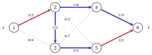
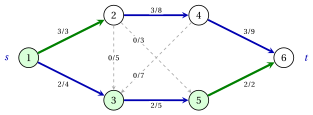
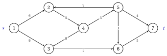
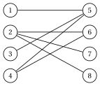
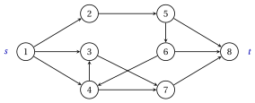

# Exercises · Maximum flow

**Exercises · Chapter 5** · each solution opens with a click · [:material-book-open-variant: Chapter 5: Maximum flow](../flows/maximum-flow/index.md) · [:material-file-pdf-box: Exercises, volume 3 (PDF)](../pdf/exercises-3-flows.pdf)

!!! formula "Rules used in these exercises"

    The definitions and the algorithms of the chapter [«Maximum flow»](https://fabiofurini.github.io/network-optimization/flows/maximum-flow/), for a directed graph $G=(N,A)$ without opposite arcs, with capacities $u_{ij}$, a source $s$ and a sink $t$.

    - **(M1)** <strong>Flows and cuts.</strong> A feasible flow has $0 \le x_{ij} \le u_{ij}$ and conservation at every node other than $s$ and $t$; its value $v$ is the net outflow of $s$. For every $s$–$t$ cut $(S,N \setminus S)$,

        $$
        v=x(\delta^+(S))-x(\delta^-(S)) \le u(S,N \setminus S)=\sum_{(i,j) \in \delta^+(S)} u_{ij} ,
        $$

        with equality if and only if the forward arcs of the cut are saturated and its backward arcs empty.

    - **(M2)** <strong>Residual network.</strong> For $(i,j) \in A$: the forward arc $(i,j)$ with $r_{ij}=u_{ij}-x_{ij}$ if $x_{ij}<u_{ij}$, the backward arc $(j,i)$ with $r_{ji}=x_{ij}$ if $x_{ij}>0$. Along an augmenting path $P$ the bottleneck is $\delta=\min_{(i,j) \in P} r_{ij}$: $x_{ij}$ grows by $\delta$ on the forward arcs of $P$ and decreases by $\delta$ on the arcs of $G$ whose backward arc is in $P$.

    - **(M3)** <strong>Search.</strong> The search of $G(\vet{x})$ from $s$ scans the residual arcs leaving each node by increasing index of the head, and stops as soon as $t$ is labelled; the augmenting path is the path of the predecessors. Ford–Fulkerson uses the depth-first search ($\mathit{LIST}$ is a stack), Edmonds–Karp the breadth-first search ($\mathit{LIST}$ is a queue).

    - **(M4)** <strong>Stop.</strong> If the search does not label $t$, the flow is maximum, and the set $S$ of the labelled nodes gives a minimum cut, with $v=u(S,N \setminus S)$.

    - **(M5)** <strong>Edmonds–Karp.</strong> The distances $d_{\vet{x}}(i)$ (fewest arcs from $s$ in $G(\vet{x})$) never decrease; an arc of $P$ with $r_{ij}=\delta$ is critical; at most $n\,m$ augmentations.

    - **(M6)** <strong>Applications.</strong> Matching: arcs $(s,i)$, $(i,j)$, $(j,t)$ with capacity $1$, the edges with flow $1$ form a maximum matching. With all capacities $1$, the maximum value is the maximum number of arc-disjoint paths from $s$ to $t$, and the minimum number of arcs whose removal leaves no such path.

!!! esercizio "Exercise 5.1: The residual network"

    !!! esercizio "Exercise"

        We consider the network $G=(N,A)$ with $N=\{1,2,\dots,6\}$, source $s=1$, sink $t=6$, the $9$ arcs

        $$
        A=\{(1,2),(1,3),(2,3),(2,4),(2,5),(3,5),(4,3),(4,6),(5,6)\},
        $$

        and the capacities $u_{ij}$ of the table. A method that only increases the flows has stopped at the flow $\bar{\vet{x}}$ of the table, drawn with $\bar{x}_{ij}/u_{ij}$ on the arcs.

        
<table>
        <tr>
        <th>arc</th>
        <th>\((1,2)\)</th>
        <th>\((1,3)\)</th>
        <th>\((2,3)\)</th>
        <th>\((2,4)\)</th>
        <th>\((2,5)\)</th>
        <th>\((3,5)\)</th>
        <th>\((4,3)\)</th>
        <th>\((4,6)\)</th>
        <th>\((5,6)\)</th>
        </tr>
        <tr>
        <td>\(u_{ij}\)</td>
        <td>\(3\)</td>
        <td>\(4\)</td>
        <td>\(5\)</td>
        <td>\(8\)</td>
        <td>\(3\)</td>
        <td>\(5\)</td>
        <td>\(7\)</td>
        <td>\(9\)</td>
        <td>\(2\)</td>
        </tr>
        <tr>
        <td>\(\bar{x}_{ij}\)</td>
        <td>\(3\)</td>
        <td>\(0\)</td>
        <td>\(2\)</td>
        <td>\(1\)</td>
        <td>\(0\)</td>
        <td>\(2\)</td>
        <td>\(0\)</td>
        <td>\(1\)</td>
        <td>\(2\)</td>
        </tr>
        </table>

        { .fig loading=lazy  }

    **Questions**

    1. Check that $\bar{\vet{x}}$ is a feasible flow and compute its value.

    2. Draw the residual network $G(\bar{\vet{x}})$, with the residual capacities.

    3. Find the augmenting path given by the depth-first search of (M3), its bottleneck, and the flow after the augmentation.

    4. Prove that the new flow is maximum.

??? soluzione "Solution"

    We use the rules (M1)–(M6) of the box at the beginning of these exercises.

    1. All the flows are between $0$ and the capacity. At the nodes $2,\dots,5$ the inflow equals the outflow: node $2$: $3=2+1+0$, node $3$: $0+2+0=2$, node $4$: $1=0+1$, node $5$: $0+2=2$. The value is the net outflow of $s=1$:

        $$
        v=\bar{x}_{12}+\bar{x}_{13}=3+0=3.
        $$

    2. Every arc with $\bar{x}_{ij}<u_{ij}$ gives a forward arc with $r_{ij}=u_{ij}-\bar{x}_{ij}$, every arc with $\bar{x}_{ij}>0$ a backward arc $(j,i)$ with $r_{ji}=\bar{x}_{ij}$. The residual network has $13$ arcs; the backward ones, dashed, are $(2,1)$, $(3,2)$, $(4,2)$, $(5,3)$, $(6,4)$, $(6,5)$.

        { .fig loading=lazy  }

    3. The depth-first search labels $1,3,2,4,6$, in this order, and finds

        $$
        P=1,3,2,4,6, \qquad \delta=\min\{4,2,7,8\}=2,
        $$

        through the backward arc $(3,2)$: the flow on $(2,3)$ decreases. The new flow is

        
<table>
        <tr>
        <th>arc</th>
        <th>\((1,2)\)</th>
        <th>\((1,3)\)</th>
        <th>\((2,3)\)</th>
        <th>\((2,4)\)</th>
        <th>\((2,5)\)</th>
        <th>\((3,5)\)</th>
        <th>\((4,3)\)</th>
        <th>\((4,6)\)</th>
        <th>\((5,6)\)</th>
        </tr>
        <tr>
        <td>\(\tilde{x}_{ij}\)</td>
        <td>\(3\)</td>
        <td>\(2\)</td>
        <td>\(0\)</td>
        <td>\(3\)</td>
        <td>\(0\)</td>
        <td>\(2\)</td>
        <td>\(0\)</td>
        <td>\(3\)</td>
        <td>\(2\)</td>
        </tr>
        </table>

        with value $3+2=5$.

    4. In $G(\tilde{\vet{x}})$ the search from $1$ labels only the nodes of $S=\{1,3,5\}$, so there is no augmenting path. For $S=\{1,3,5\}$ the forward arcs $(1,2)$, $(5,6)$ are saturated, and the backward arcs $(2,3)$, $(2,5)$, $(4,3)$ are empty. Hence

        $$
        u(S,N \setminus S)=3+2=5=v,
        $$

        and by (M1) no flow has a larger value: $\tilde{\vet{x}}$ is maximum (the forward arcs of the cut are green, the nodes of $S$ shaded).

        { .fig loading=lazy  }

    !!! chiave ""

        The flow $\bar{\vet{x}}$ of value $3$ cannot be improved with forward arcs only; one augmentation through the backward arc $(3,2)$ reaches the maximum value $5$, certified by the cut $S=\{1,3,5\}$.

!!! esercizio "Exercise 5.2: The Ford--Fulkerson algorithm"

    !!! esercizio "Exercise"

        We consider the network $G=(N,A)$ with $N=\{1,2,\dots,7\}$, source $s=1$, sink $t=7$, the $10$ arcs

        $$
        A=\{(1,2),(1,3),(2,4),(3,6),(4,3),(4,5),(5,2),(5,6),(5,7),(6,7)\},
        $$

        and the capacities of the table, also next to the arcs in the figure.

        
<table>
        <tr>
        <th>arc</th>
        <th>\((1,2)\)</th>
        <th>\((1,3)\)</th>
        <th>\((2,4)\)</th>
        <th>\((3,6)\)</th>
        <th>\((4,3)\)</th>
        <th>\((4,5)\)</th>
        <th>\((5,2)\)</th>
        <th>\((5,6)\)</th>
        <th>\((5,7)\)</th>
        <th>\((6,7)\)</th>
        </tr>
        <tr>
        <td>\(u_{ij}\)</td>
        <td>\(6\)</td>
        <td>\(9\)</td>
        <td>\(5\)</td>
        <td>\(2\)</td>
        <td>\(8\)</td>
        <td>\(5\)</td>
        <td>\(9\)</td>
        <td>\(1\)</td>
        <td>\(4\)</td>
        <td>\(5\)</td>
        </tr>
        </table>

        { .fig loading=lazy  }

    **Questions**

    1. Run the Ford–Fulkerson algorithm from the zero flow, with the depth-first search of (M3): for every iteration give the augmenting path, its residual capacities, $\delta$ and the new value.

    2. Give the maximum flow and a minimum cut, and check that the value equals the capacity of the cut.

    3. Which iteration uses a backward arc, and which flow of $G$ does it decrease?

??? soluzione "Solution"

    We use the rules (M1)–(M6) of the box at the beginning of these exercises.

    1. <strong>Iteration 1</strong>  The search labels the nodes $1,2,4,3,6,7$, in this order. The augmenting path is $P=1,2,4,3,6,7$; its residual capacities are $6,5,8,2,5$, so $\delta=2$. New flows: $x_{12}=0+2=2$, $x_{24}=0+2=2$, $x_{43}=0+2=2$, $x_{36}=0+2=2$, $x_{67}=0+2=2$; the value becomes $v=2$.

        <strong>Iteration 2</strong>  The search labels the nodes $1,2,4,3,5,6,7$, in this order. The augmenting path is $P=1,2,4,5,6,7$; its residual capacities are $4,3,5,1,3$, so $\delta=1$. New flows: $x_{12}=2+1=3$, $x_{24}=2+1=3$, $x_{45}=0+1=1$, $x_{56}=0+1=1$, $x_{67}=2+1=3$; the value becomes $v=3$.

        <strong>Iteration 3</strong>  The search labels the nodes $1,2,4,3,5,7$, in this order. The augmenting path is $P=1,2,4,5,7$; its residual capacities are $3,2,4,4$, so $\delta=2$. New flows: $x_{12}=3+2=5$, $x_{24}=3+2=5$, $x_{45}=1+2=3$, $x_{57}=0+2=2$; the value becomes $v=5$.

        <strong>Iteration 4</strong>  The search labels the nodes $1,2,3,4,5,7$, in this order. The augmenting path is $P=1,3,4,5,7$; its residual capacities are $9,2,2,2$, so $\delta=2$. It uses the backward arc $(3,4)$. New flows: $x_{13}=0+2=2$, $x_{43}=2-2=0$, $x_{45}=3+2=5$, $x_{57}=2+2=4$; the value becomes $v=7$.

        <strong>Iteration 5</strong>  The search labels only the nodes of $S=\{1,2,3\}$: $t$ is not labelled, and the algorithm stops with $v=7$.

        In short:

        
<table>
        <tr>
        <th>iteration</th>
        <th>augmenting path</th>
        <th>\(r_{ij}\) on \(P\)</th>
        <th>backward arcs</th>
        <th>\(\delta\)</th>
        <th>\(v\)</th>
        </tr>
        <tr>
        <td>\(1\)</td>
        <td>\(1,2,4,3,6,7\)</td>
        <td>\(6,5,8,2,5\)</td>
        <td>–</td>
        <td>\(2\)</td>
        <td>\(2\)</td>
        </tr>
        <tr>
        <td>\(2\)</td>
        <td>\(1,2,4,5,6,7\)</td>
        <td>\(4,3,5,1,3\)</td>
        <td>–</td>
        <td>\(1\)</td>
        <td>\(3\)</td>
        </tr>
        <tr>
        <td>\(3\)</td>
        <td>\(1,2,4,5,7\)</td>
        <td>\(3,2,4,4\)</td>
        <td>–</td>
        <td>\(2\)</td>
        <td>\(5\)</td>
        </tr>
        <tr>
        <td>\(4\)</td>
        <td>\(1,3,4,5,7\)</td>
        <td>\(9,2,2,2\)</td>
        <td>\((3,4)\)</td>
        <td>\(2\)</td>
        <td>\(7\)</td>
        </tr>
        </table>

    2. The maximum flow is

        
<table>
        <tr>
        <th>arc</th>
        <th>\((1,2)\)</th>
        <th>\((1,3)\)</th>
        <th>\((2,4)\)</th>
        <th>\((3,6)\)</th>
        <th>\((4,3)\)</th>
        <th>\((4,5)\)</th>
        <th>\((5,2)\)</th>
        <th>\((5,6)\)</th>
        <th>\((5,7)\)</th>
        <th>\((6,7)\)</th>
        </tr>
        <tr>
        <td>\(\tilde{x}_{ij}\)</td>
        <td>\(5\)</td>
        <td>\(2\)</td>
        <td>\(5\)</td>
        <td>\(2\)</td>
        <td>\(0\)</td>
        <td>\(5\)</td>
        <td>\(0\)</td>
        <td>\(1\)</td>
        <td>\(4\)</td>
        <td>\(3\)</td>
        </tr>
        <tr>
        <td>\(u_{ij}\)</td>
        <td>\(6\)</td>
        <td>\(9\)</td>
        <td>\(5\)</td>
        <td>\(2\)</td>
        <td>\(8\)</td>
        <td>\(5\)</td>
        <td>\(9\)</td>
        <td>\(1\)</td>
        <td>\(4\)</td>
        <td>\(5\)</td>
        </tr>
        </table>

        with value $\tilde{v}=7$. The last search labels $S=\{1,2,3\}$. For $S=\{1,2,3\}$ the forward arcs $(2,4)$, $(3,6)$ are saturated, and the backward arcs $(4,3)$, $(5,2)$ are empty. Hence

        $$
        u(S,N \setminus S)=5+2=7=v,
        $$

        so the flow is maximum and the cut is minimum. In the figure the forward arcs of the cut are green and the nodes of $S$ shaded.

        { .fig loading=lazy  }

        <strong>Uniqueness.</strong> The minimum cuts, of capacity $7$, are $S=\{1,2,3\}$, $S=\{1,2,3,4\}$, $S=\{1,2,3,4,5\}$. By (M1) every maximum flow saturates their forward arcs and empties their backward arcs: $x_{24}=5$, $x_{36}=2$, $x_{43}=0$, $x_{45}=5$, $x_{52}=0$, $x_{56}=1$, $x_{57}=4$. Conservation then fixes the other arcs: at node $2$, $x_{12}=5$; at node $3$, $x_{13}=2$; at node $6$, $x_{67}=3$. Hence $\tilde{\vet{x}}$ is the only maximum flow.

    3. Iteration $4$ uses the backward arc $(3,4)$: the flow on $(4,3)$ decreases by $\delta=2$, undoing part of an earlier choice of the depth-first search.

    !!! chiave ""

        Ford–Fulkerson makes $4$ augmentations and reaches $\tilde{v}=7$; the last search gives the minimum cut $S=\{1,2,3\}$ of capacity $7$.

!!! esercizio "Exercise 5.3: The Edmonds--Karp algorithm"

    !!! esercizio "Exercise"

        We consider the network $G=(N,A)$ with $N=\{1,2,\dots,7\}$, source $s=1$, sink $t=7$, the $10$ arcs

        $$
        A=\{(1,2),(1,3),(2,4),(2,5),(3,4),(3,6),(4,6),(5,4),(5,7),(6,7)\},
        $$

        and the capacities of the table, also next to the arcs in the figure.

        
<table>
        <tr>
        <th>arc</th>
        <th>\((1,2)\)</th>
        <th>\((1,3)\)</th>
        <th>\((2,4)\)</th>
        <th>\((2,5)\)</th>
        <th>\((3,4)\)</th>
        <th>\((3,6)\)</th>
        <th>\((4,6)\)</th>
        <th>\((5,4)\)</th>
        <th>\((5,7)\)</th>
        <th>\((6,7)\)</th>
        </tr>
        <tr>
        <td>\(u_{ij}\)</td>
        <td>\(5\)</td>
        <td>\(5\)</td>
        <td>\(5\)</td>
        <td>\(7\)</td>
        <td>\(1\)</td>
        <td>\(1\)</td>
        <td>\(2\)</td>
        <td>\(4\)</td>
        <td>\(9\)</td>
        <td>\(2\)</td>
        </tr>
        </table>

        { .fig loading=lazy  }

    **Questions**

    1. Run the Edmonds–Karp algorithm from the zero flow: for every iteration give the augmenting path, its number of arcs, its residual capacities, $\delta$ and the new value.

    2. Give the distances $d_{\vet{x}}(i)$ of all the nodes in the residual network before each search, check that they never decrease, and list the critical arcs of every augmentation.

    3. Give the maximum flow and a minimum cut. On this network the Ford–Fulkerson algorithm with the depth-first search makes $4$ augmentations: compare.

??? soluzione "Solution"

    We use the rules (M1)–(M6) of the box at the beginning of these exercises.

    1. <strong>Iteration 1</strong>  The search labels the nodes $1,2,3,4,5,6,7$, in this order. The augmenting path is $P=1,2,5,7$, with $3$ arcs; its residual capacities are $5,7,9$, so $\delta=5$. New flows: $x_{12}=0+5=5$, $x_{25}=0+5=5$, $x_{57}=0+5=5$; the value becomes $v=5$.

        <strong>Iteration 2</strong>  The search labels the nodes $1,3,4,6,7$, in this order. The augmenting path is $P=1,3,6,7$, with $3$ arcs; its residual capacities are $5,1,2$, so $\delta=1$. New flows: $x_{13}=0+1=1$, $x_{36}=0+1=1$, $x_{67}=0+1=1$; the value becomes $v=6$.

        <strong>Iteration 3</strong>  The search labels the nodes $1,3,4,6,7$, in this order. The augmenting path is $P=1,3,4,6,7$, with $4$ arcs; its residual capacities are $4,1,2,1$, so $\delta=1$. New flows: $x_{13}=1+1=2$, $x_{34}=0+1=1$, $x_{46}=0+1=1$, $x_{67}=1+1=2$; the value becomes $v=7$.

        <strong>Iteration 4</strong>  The search labels only the nodes of $S=\{1,3\}$: $t$ is not labelled, and the algorithm stops with $v=7$.

    2. The distances are computed by a full breadth-first search of the residual network:

        
<table>
        <tr>
        <th>before the search</th>
        <th>\(d(1)\)</th>
        <th>\(d(2)\)</th>
        <th>\(d(3)\)</th>
        <th>\(d(4)\)</th>
        <th>\(d(5)\)</th>
        <th>\(d(6)\)</th>
        <th>\(d(7)\)</th>
        </tr>
        <tr>
        <td>iteration \(1\)</td>
        <td>\(0\)</td>
        <td>\(1\)</td>
        <td>\(1\)</td>
        <td>\(2\)</td>
        <td>\(2\)</td>
        <td>\(2\)</td>
        <td>\(3\)</td>
        </tr>
        <tr>
        <td>iteration \(2\)</td>
        <td>\(0\)</td>
        <td>\(5\)</td>
        <td>\(1\)</td>
        <td>\(2\)</td>
        <td>\(4\)</td>
        <td>\(2\)</td>
        <td>\(3\)</td>
        </tr>
        <tr>
        <td>iteration \(3\)</td>
        <td>\(0\)</td>
        <td>\(6\)</td>
        <td>\(1\)</td>
        <td>\(2\)</td>
        <td>\(5\)</td>
        <td>\(3\)</td>
        <td>\(4\)</td>
        </tr>
        <tr>
        <td>stop</td>
        <td>\(0\)</td>
        <td>\(\infty\)</td>
        <td>\(1\)</td>
        <td>\(\infty\)</td>
        <td>\(\infty\)</td>
        <td>\(\infty\)</td>
        <td>\(\infty\)</td>
        </tr>
        </table>

        Every column is non-decreasing, as (M5) states. The critical arcs, with $r_{ij}=\delta$, are: iteration $1$: $(1,2)$; iteration $2$: $(3,6)$; iteration $3$: $(3,4)$, $(6,7)$.

    3. The maximum flow is

        
<table>
        <tr>
        <th>arc</th>
        <th>\((1,2)\)</th>
        <th>\((1,3)\)</th>
        <th>\((2,4)\)</th>
        <th>\((2,5)\)</th>
        <th>\((3,4)\)</th>
        <th>\((3,6)\)</th>
        <th>\((4,6)\)</th>
        <th>\((5,4)\)</th>
        <th>\((5,7)\)</th>
        <th>\((6,7)\)</th>
        </tr>
        <tr>
        <td>\(\tilde{x}_{ij}\)</td>
        <td>\(5\)</td>
        <td>\(2\)</td>
        <td>\(0\)</td>
        <td>\(5\)</td>
        <td>\(1\)</td>
        <td>\(1\)</td>
        <td>\(1\)</td>
        <td>\(0\)</td>
        <td>\(5\)</td>
        <td>\(2\)</td>
        </tr>
        <tr>
        <td>\(u_{ij}\)</td>
        <td>\(5\)</td>
        <td>\(5\)</td>
        <td>\(5\)</td>
        <td>\(7\)</td>
        <td>\(1\)</td>
        <td>\(1\)</td>
        <td>\(2\)</td>
        <td>\(4\)</td>
        <td>\(9\)</td>
        <td>\(2\)</td>
        </tr>
        </table>

        with value $\tilde{v}=7$. The last search labels $S=\{1,3\}$. For $S=\{1,3\}$ the forward arcs $(1,2)$, $(3,4)$, $(3,6)$ are saturated, and there are no backward arcs. Hence

        $$
        u(S,N \setminus S)=5+1+1=7=v,
        $$

        so the cut is minimum (forward arcs in green, nodes of $S$ shaded).

        { .fig loading=lazy  }

        Edmonds–Karp needs $3$ augmentations, against the $4$ of Ford–Fulkerson; both are far below the bound $n\,m=70$ of (M5).

        <strong>Uniqueness.</strong> The minimum cuts, of capacity $7$, are $S=\{1,3\}$, $S=\{1,3,4,6\}$. By (M1) every maximum flow saturates their forward arcs and empties their backward arcs: $x_{12}=5$, $x_{24}=0$, $x_{34}=1$, $x_{36}=1$, $x_{54}=0$, $x_{67}=2$. Conservation then fixes the other arcs: at node $1$, $x_{13}=2$; at node $2$, $x_{25}=5$; at node $4$, $x_{46}=1$; at node $5$, $x_{57}=5$. Hence $\tilde{\vet{x}}$ is the only maximum flow.

    !!! chiave ""

        Edmonds–Karp reaches $\tilde{v}=7$ in $3$ augmentations along paths with $3,3,4$ arcs; the distances never decrease, and the cut $S=\{1,3\}$ is minimum.

!!! esercizio "Exercise 5.4: Minimum cuts"

    !!! esercizio "Exercise"

        We consider the network $G=(N,A)$ with $N=\{1,2,\dots,6\}$, source $s=1$, sink $t=6$, the $8$ arcs

        $$
        A=\{(1,2),(1,3),(2,4),(3,4),(4,5),(4,6),(5,3),(5,6)\},
        $$

        and the integer capacities of the table, also next to the arcs in the figure.

        
<table>
        <tr>
        <th>arc</th>
        <th>\((1,2)\)</th>
        <th>\((1,3)\)</th>
        <th>\((2,4)\)</th>
        <th>\((3,4)\)</th>
        <th>\((4,5)\)</th>
        <th>\((4,6)\)</th>
        <th>\((5,3)\)</th>
        <th>\((5,6)\)</th>
        </tr>
        <tr>
        <td>\(u_{ij}\)</td>
        <td>\(7\)</td>
        <td>\(2\)</td>
        <td>\(7\)</td>
        <td>\(9\)</td>
        <td>\(4\)</td>
        <td>\(8\)</td>
        <td>\(1\)</td>
        <td>\(8\)</td>
        </tr>
        </table>

        { .fig loading=lazy  }

    **Questions**

    1. List the $s$–$t$ cuts with their capacities, and find all the minimum cuts.

    2. Check that the flow $\vet{x}$ below is maximum.

        
<table>
        <tr>
        <th>arc</th>
        <th>\((1,2)\)</th>
        <th>\((1,3)\)</th>
        <th>\((2,4)\)</th>
        <th>\((3,4)\)</th>
        <th>\((4,5)\)</th>
        <th>\((4,6)\)</th>
        <th>\((5,3)\)</th>
        <th>\((5,6)\)</th>
        </tr>
        <tr>
        <td>\(x_{ij}\)</td>
        <td>\(7\)</td>
        <td>\(2\)</td>
        <td>\(7\)</td>
        <td>\(2\)</td>
        <td>\(1\)</td>
        <td>\(8\)</td>
        <td>\(0\)</td>
        <td>\(1\)</td>
        </tr>
        </table>

    3. Prove that, with integer capacities, raising $u_{ij}$ by one unit raises the maximum value if and only if $(i,j)$ is a forward arc of every minimum cut.

    4. For which arcs of this network does raising the capacity by one unit raise the maximum value?

??? soluzione "Solution"

    We use the rules (M1)–(M6) of the box at the beginning of these exercises.

    1. There are $2^{4}=16$ cuts; next to each set $S$, its capacity:

        $$
        \begin{array}{cc|cc|cc|cc}
        \hline {S} & {u} & {S} & {u} & {S} & {u} & {S} & {u} \\
        \hline {\{1\}} & {9} & {\{1,2\}} & {9} & {\{1,3\}} & {16} & {\{1,4\}} & {21} \\
        {\{1,5\}} & {18} & {\{1,2,3\}} & {16} & {\{1,2,4\}} & {14} & {\{1,2,5\}} & {18} \\
        {\{1,3,4\}} & {19} & {\{1,3,5\}} & {24} & {\{1,4,5\}} & {26} & {\{1,2,3,4\}} & {12} \\
        {\{1,2,3,5\}} & {24} & {\{1,2,4,5\}} & {19} & {\{1,3,4,5\}} & {23} & {\{1,2,3,4,5\}} & {16} \\
        \hline
        \end{array}
        $$

        The minimum capacity is $9$, attained by the $2$ cuts $S=\{1\}$, $S=\{1,2\}$.

    2. The flow is feasible: every arc carries a flow between $0$ and its capacity, and at every node other than $1$ and $6$ the inflow equals the outflow. Its value is $9$, equal to the minimum cut capacity: by (M1) no flow is better. For example, for $S=\{1\}$ the forward arcs $(1,2)$, $(1,3)$ are saturated and the backward arcs do not exist.

    3. Let $\tilde{v}$ be the maximum value and $\vet{u}'$ the capacities with $u'_{ij}=u_{ij}+1$. The capacity of a cut grows by $1$ if $(i,j)$ is one of its forward arcs, and does not change otherwise.

        - If $(i,j)$ is a forward arc of every minimum cut, every minimum cut gets capacity $\tilde{v}+1$. Every other cut had an integer capacity larger than $\tilde{v}$, so at least $\tilde{v}+1$, and it does not decrease. The new minimum cut capacity is $\tilde{v}+1$, and by the max-flow min-cut theorem so is the new maximum value.

        - If a minimum cut $(S,N \setminus S)$ does not have $(i,j)$ as a forward arc, its capacity stays $\tilde{v}$, and every flow for $\vet{u}'$ has value at most $\tilde{v}$ by (M1). The old maximum flow is still feasible, so the maximum value stays $\tilde{v}$.

        With fractional capacities the first part fails: a cut that is not minimum may be less than one unit above $\tilde{v}$.

    4. By question 3, we look for the arcs that are forward arcs of all the minimum cuts:

        
<table>
        <tr>
        <th>arc</th>
        <th>forward arc of</th>
        <th>maximum value with \(u_{ij}+1\)</th>
        </tr>
        <tr>
        <td>\((1,2)\)</td>
        <td>\(S=\{1\}\)</td>
        <td>\(9\)</td>
        </tr>
        <tr>
        <td>\((1,3)\)</td>
        <td>every minimum cut</td>
        <td>\(10\)</td>
        </tr>
        <tr>
        <td>\((2,4)\)</td>
        <td>\(S=\{1,2\}\)</td>
        <td>\(9\)</td>
        </tr>
        <tr>
        <td>\((3,4)\)</td>
        <td>no minimum cut</td>
        <td>\(9\)</td>
        </tr>
        <tr>
        <td>\((4,5)\)</td>
        <td>no minimum cut</td>
        <td>\(9\)</td>
        </tr>
        <tr>
        <td>\((4,6)\)</td>
        <td>no minimum cut</td>
        <td>\(9\)</td>
        </tr>
        <tr>
        <td>\((5,3)\)</td>
        <td>no minimum cut</td>
        <td>\(9\)</td>
        </tr>
        <tr>
        <td>\((5,6)\)</td>
        <td>no minimum cut</td>
        <td>\(9\)</td>
        </tr>
        </table>

        The maximum value grows only for the arc $(1,3)$, from $9$ to $10$. The arcs $(1,2)$, $(2,4)$ belong to some minimum cuts but not to all, and raising them changes nothing.

    !!! chiave ""

        The maximum value is $9$, with $2$ minimum cuts; only the arc $(1,3)$ belongs to all of them, and only raising its capacity raises the maximum value.

!!! esercizio "Exercise 5.5: Maximum matching"

    !!! esercizio "Exercise"

        Four workers $V_1=\{1,2,3,4\}$ and four jobs $V_2=\{5,6,7,8\}$ form the bipartite graph $H=(V_1 \cup V_2,E)$, with an edge $\{i,j\}$ when worker $i$ can do job $j$:

        $$
        E=\big\{\{1,5\},\{2,6\},\{2,7\},\{2,8\},\{3,5\},\{4,5\},\{4,6\}\big\}.
        $$

        { .fig loading=lazy  }

    **Questions**

    1. Build the network of $H$ (M6), with the nodes in the order $s,1,2,\dots,8,t$.

    2. Run the Edmonds–Karp algorithm on it from the zero flow.

    3. Give a maximum matching and the minimum cut found at the stop.

    4. Let $S$ be the set labelled by the last search, and $C=(V_1 \setminus S) \cup (V_2 \cap S)$. Check that every edge has an endpoint in $C$, and deduce again that no matching has more edges than the one found.

??? soluzione "Solution"

    We use the rules (M1)–(M6) of the box at the beginning of these exercises.

    1. The network has the arcs $(s,i)$ for $i \in V_1$, the arcs $(i,j)$ for the $7$ edges, and the arcs $(j,t)$ for $j \in V_2$, all with capacity $1$: $15$ arcs in all.

    2. <strong>Iteration 1</strong>  The search labels the nodes $s,1,2,3,4,5,6,7,8,t$, in this order. The augmenting path is $P=s,1,5,t$, with $3$ arcs; its residual capacities are $1,1,1$, so $\delta=1$. New flows: $x_{s1}=0+1=1$, $x_{15}=0+1=1$, $x_{5t}=0+1=1$; the value becomes $v=1$.

        <strong>Iteration 2</strong>  The search labels the nodes $s,2,3,4,6,7,8,5,t$, in this order. The augmenting path is $P=s,2,6,t$, with $3$ arcs; its residual capacities are $1,1,1$, so $\delta=1$. New flows: $x_{s2}=0+1=1$, $x_{26}=0+1=1$, $x_{6t}=0+1=1$; the value becomes $v=2$.

        <strong>Iteration 3</strong>  The search labels the nodes $s,3,4,5,6,1,2,7,8,t$, in this order. The augmenting path is $P=s,4,6,2,7,t$, with $5$ arcs; its residual capacities are $1,1,1,1,1$, so $\delta=1$. It uses the backward arc $(6,2)$. New flows: $x_{s4}=0+1=1$, $x_{46}=0+1=1$, $x_{26}=1-1=0$, $x_{27}=0+1=1$, $x_{7t}=0+1=1$; the value becomes $v=3$.

        <strong>Iteration 4</strong>  The search labels only the nodes of $S=\{s,1,3,5\}$: $t$ is not labelled, and the algorithm stops with $v=3$.

    3. The edges with flow $1$ give the matching $M=\{\{1,5\},\{2,7\},\{4,6\}\}$, with $3$ edges; it is not the only maximum matching (there are $4$). Iteration $3$ reassigns jobs through the backward arc $(6,2)$. The last search labels $S=\{s,1,3,5\}$; the forward arcs of the cut are $(s,2)$, $(s,4)$, $(5,t)$, with capacity $3=|M|$, so the matching is maximum.

        { .fig loading=lazy  }

    4. Here $C=\{2,4,5\}$, with $3$ nodes. Every edge $\{i,j\}$ has $i \in C$ or $j \in C$: $\{1,5\}$ by $5$, $\{2,6\}$ by $2$, $\{2,7\}$ by $2$, $\{2,8\}$ by $2$, $\{3,5\}$ by $5$, $\{4,5\}$ by $4$, $\{4,6\}$ by $4$. The edges of a matching have no common endpoint, so each of them uses a different node of $C$: no matching has more than $|C|=3$ edges.

    !!! chiave ""

        The maximum matching has $3$ edges, one job stays free; the cut of the last search and the $3$ nodes of $C$ certify that no larger matching exists.

!!! esercizio "Exercise 5.6: Arc-disjoint paths"

    !!! esercizio "Exercise"

        We consider the directed graph $G=(N,A)$ with $N=\{1,2,\dots,8\}$ and the $12$ arcs

        $$
        A=\{(1,2),(1,3),(1,4),(2,5),(3,7),(4,3),(4,7),(5,6),(5,8),(6,4),(6,8),(7,8)\}.
        $$

        We look for paths from $s=1$ to $t=8$ with no common arc.

        { .fig loading=lazy  }

    **Questions**

    1. Give every arc the capacity $1$ and run the Edmonds–Karp algorithm from the zero flow.

    2. Decompose the maximum flow into arc-disjoint paths from $1$ to $8$.

    3. Find a minimum set of arcs whose removal leaves no path from $1$ to $8$. Is the set of the arcs leaving node $1$ such a minimum set?

??? soluzione "Solution"

    We use the rules (M1)–(M6) of the box at the beginning of these exercises.

    1. <strong>Iteration 1</strong>  The search labels the nodes $1,2,3,4,5,7,6,8$, in this order. The augmenting path is $P=1,2,5,8$, with $3$ arcs; its residual capacities are $1,1,1$, so $\delta=1$. New flows: $x_{12}=0+1=1$, $x_{25}=0+1=1$, $x_{58}=0+1=1$; the value becomes $v=1$.

        <strong>Iteration 2</strong>  The search labels the nodes $1,3,4,7,8$, in this order. The augmenting path is $P=1,3,7,8$, with $3$ arcs; its residual capacities are $1,1,1$, so $\delta=1$. New flows: $x_{13}=0+1=1$, $x_{37}=0+1=1$, $x_{78}=0+1=1$; the value becomes $v=2$.

        <strong>Iteration 3</strong>  The search labels only the nodes of $S=\{1,3,4,7\}$: $t$ is not labelled, and the algorithm stops with $v=2$.

    2. The arcs with flow $1$ are $(1,2)$, $(1,3)$, $(2,5)$, $(3,7)$, $(5,8)$, $(7,8)$. Following them from $1$, each arc once, gives the paths

        $$
        1,2,5,8, \qquad 1,3,7,8,
        $$

        with no common arc. By (M6) no family of arc-disjoint paths has more than $2$ paths.

    3. The last search labels $S=\{1,3,4,7\}$, and the forward arcs of the cut are $(1,2)$, $(7,8)$: removing these $2$ arcs leaves no path from $1$ to $8$, since every such path leaves $S$ through one of them. Fewer arcs are not enough, because each of the $2$ arc-disjoint paths needs its own removed arc. The $3$ arcs leaving node $1$ also disconnect $1$ from $8$, but they are not a minimum set: the cut $S=\{1\}$ has capacity $3>2$. The minimum cuts are $S=\{1,3,4,7\}$, $S=\{1,2,3,4,7\}$.

    !!! chiave ""

        At most $2$ arc-disjoint paths go from $1$ to $8$, and the $2$ arcs of the cut $S=\{1,3,4,7\}$ disconnect them.
