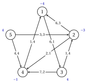

# Exercises · Minimum cost flow

**Exercises · Chapter 6** · each solution opens with a click · [:material-book-open-variant: Chapter 6: Minimum cost flow](../flows/min-cost-flow/index.md) · [:material-file-pdf-box: Exercises, volume 3 (PDF)](../pdf/exercises-3-flows.pdf)

!!! formula "Rules used in these exercises"

    The definitions and the algorithms of the chapter [«Minimum cost flow»](https://fabiofurini.github.io/network-optimization/flows/min-cost-flow/), for a balanced network $G=(N,A)$ with zero lower bounds, capacities $u_{ij}$ and costs $c_{ij}$; the arcs are in lexicographic order.

    - **(M1)** <strong>Residual network.</strong> For $(i,j) \in A$: the forward arc $(i,j)$ with $r_{ij}=u_{ij}-x_{ij}$ and cost $c_{ij}$ if $x_{ij}<u_{ij}$; the backward arc $(j,i)$ with $r_{ji}=x_{ij}$ and cost $-c_{ij}$ if $x_{ij}>0$. A cycle $W$ of $G(\vet{x})$ has cost $c(W)$, the sum of the costs, and residual capacity $r(W)$, the minimum of the $r$; augmenting by $\theta \le r(W)$ changes the cost by $\theta\,c(W)$.

    - **(M2)** <strong>Optimality.</strong> A feasible flow is optimal if and only if $G(\vet{x})$ has no negative cycle, if and only if some $\vet{\pi}$ gives $c^x_{ij}-\pi_i+\pi_j \ge 0$ on every arc of $G(\vet{x})$, that is $\bar{c}_{ij}=c_{ij}-\pi_i+\pi_j>0 \Rightarrow x_{ij}=0$ and $\bar{c}_{ij}<0 \Rightarrow x_{ij}=u_{ij}$.

    - **(M3)** <strong>Bellman–Ford on $G(\vet{x})$.</strong> $d^0(j)=0$ for every $j$ and

        $$
        d^k(j)=\min\Big\{ d^{k-1}(j),\ \min_{(i,j) \in A(\vet{x})} \big(d^{k-1}(i)+c^x_{ij}\big)\Big\};
        $$

        ties go to the smallest tail, and a predecessor changes only on a strict decrease. If $d^k=d^{k-1}$, stop: no negative cycle, and $\pi_i=-d^k(i)$, shifted so that $\pi_n=0$. If $d^n \neq d^{n-1}$: $j$ is the smallest node with $d^n(j)<d^{n-1}(j)$, the walk is read backwards from row $n$ to row $1$, and the cycle is the piece between the two occurrences of the first node met twice, reading the walk from its first node.

    - **(M4)** <strong>Cycle canceling.</strong> Augment along the cycle of (M3) by $\theta=r(W)$, until (M3) finds no negative cycle.

    - **(M5)** <strong>First feasible flow and decomposition.</strong> Arcs $(s,i)$ with capacity $b_i$ for $b_i>0$, arcs $(i,t)$ with capacity $-b_i$ for $b_i<0$; the Edmonds–Karp algorithm: breadth-first search from $s$, the arcs leaving a node scanned by increasing head ($s$ first, $t$ last). A circulation is decomposed starting from its first arc with $y>0$ in lexicographic order and leaving every node along its arc with $y>0$ of smallest head.

    - **(M6)** <strong>Successive shortest paths.</strong> Start with $\vet{x}=\vet{0}$, $\vet{\pi}=\vet{0}$, $\vet{e}=\vet{b}$; $s$ is the node of smallest index with $e_s>0$; Dijkstra from $s$ with lengths $c^x_{ij}-\pi_i+\pi_j$ (smallest index on ties); $t$ is the node with $e_t<0$ of smallest distance (smallest index on ties); $\pi_i:=\pi_i-\min\{d(i),d(t)\}$ and $\delta=\min\{e_s,-e_t,r(P)\}$.

!!! esercizio "Exercise 6.1: The residual network"

    !!! esercizio "Exercise"

        We consider the network $G=(N,A)$ with $N=\{1,2,\dots,5\}$, the $7$ arcs

        $$
        A=\{(1,3),(1,4),(2,1),(2,3),(4,3),(5,1),(5,2)\},
        $$

        zero lower bounds and the balances $b_1=0$, $b_2=2$, $b_3=-2$, $b_4=-2$, $b_5=2$. Costs and capacities are given in the table and, as $c_{ij},u_{ij}$, in the figure; the balances are next to the nodes. The table also gives a feasible flow $\bar{\vet{x}}$.

        
<table>
        <tr>
        <th>arc \((i,j)\)</th>
        <th>\((1,3)\)</th>
        <th>\((1,4)\)</th>
        <th>\((2,1)\)</th>
        <th>\((2,3)\)</th>
        <th>\((4,3)\)</th>
        <th>\((5,1)\)</th>
        <th>\((5,2)\)</th>
        </tr>
        <tr>
        <td>\(c_{ij}\)</td>
        <td>\(6\)</td>
        <td>\(1\)</td>
        <td>\(3\)</td>
        <td>\(2\)</td>
        <td>\(5\)</td>
        <td>\(4\)</td>
        <td>\(3\)</td>
        </tr>
        <tr>
        <td>\(u_{ij}\)</td>
        <td>\(2\)</td>
        <td>\(3\)</td>
        <td>\(3\)</td>
        <td>\(2\)</td>
        <td>\(1\)</td>
        <td>\(2\)</td>
        <td>\(3\)</td>
        </tr>
        <tr>
        <td>\(\bar{x}_{ij}\)</td>
        <td>\(0\)</td>
        <td>\(3\)</td>
        <td>\(2\)</td>
        <td>\(1\)</td>
        <td>\(1\)</td>
        <td>\(1\)</td>
        <td>\(1\)</td>
        </tr>
        </table>

        { .fig loading=lazy  }

        The sequences $W_1=1,2,3,4,1$ and $W_2=1,3,2,1$ are cycles of the residual network $G(\bar{\vet{x}})$.

    **Questions**

    1. Build $G(\bar{\vet{x}})$: for every arc of $A$ give its forward and backward arcs, with residual capacity and cost.

    2. Compute the cost $c(W)$ and the residual capacity $r(W)$ of $W_1$ and of $W_2$. Which of the two cycles can lower the cost of $\bar{\vet{x}}$?

    3. Augment $\bar{\vet{x}}$ along that cycle by $\theta=r(W)$. Give the new flow, check that it is feasible, and compute its cost in two ways.

??? soluzione "Solution"

    We use the rules (M1)–(M6) of the box at the beginning of these exercises.

    1. By (M1) the arc $(i,j)$ gives the forward arc if $\bar{x}_{ij}<u_{ij}$ and the backward arc $(j,i)$ if $\bar{x}_{ij}>0$; each entry is $r,c$:

        
<table>
        <tr>
        <th>arc \((i,j)\)</th>
        <th>\((1,3)\)</th>
        <th>\((1,4)\)</th>
        <th>\((2,1)\)</th>
        <th>\((2,3)\)</th>
        <th>\((4,3)\)</th>
        <th>\((5,1)\)</th>
        <th>\((5,2)\)</th>
        </tr>
        <tr>
        <td>\(\bar{x}_{ij}\)</td>
        <td>\(0\)</td>
        <td>\(3\)</td>
        <td>\(2\)</td>
        <td>\(1\)</td>
        <td>\(1\)</td>
        <td>\(1\)</td>
        <td>\(1\)</td>
        </tr>
        <tr>
        <td>forward \((i,j)\): \(r,c\)</td>
        <td>\(2,6\)</td>
        <td>–</td>
        <td>\(1,3\)</td>
        <td>\(1,2\)</td>
        <td>–</td>
        <td>\(1,4\)</td>
        <td>\(2,3\)</td>
        </tr>
        <tr>
        <td>backward \((j,i)\): \(r,c\)</td>
        <td>–</td>
        <td>\(3,-1\)</td>
        <td>\(2,-3\)</td>
        <td>\(1,-2\)</td>
        <td>\(1,-5\)</td>
        <td>\(1,-4\)</td>
        <td>\(1,-3\)</td>
        </tr>
        </table>

        $G(\bar{\vet{x}})$ has $11$ arcs.

    2. The cycle $W_1=1,2,3,4,1$ uses the arcs $(1,2)$ backward of $(2,1)$, $(2,3)$ forward, $(3,4)$ backward of $(4,3)$, $(4,1)$ backward of $(1,4)$:

        $$
        c(W)=-3+2-5-1=-7, \qquad r(W)=\min\{2,1,1,3\}=1.
        $$

        The cycle $W_2=1,3,2,1$ uses the arcs $(1,3)$ forward, $(3,2)$ backward of $(2,3)$, $(2,1)$ forward:

        $$
        c(W)=6-2+3=7, \qquad r(W)=\min\{2,1,1\}=1.
        $$

        Only the negative cycle $W_1$ lowers the cost: augmenting along it by $\theta$ changes the cost by $\theta\,c(W)<0$, while $W_2$ would raise it.

    3. With $\theta=1$, $x_{ij}$ grows by $1$ on the forward arcs of the cycle and decreases by $1$ on the arcs whose backward arc is in the cycle:

        
<table>
        <tr>
        <th>arc \((i,j)\)</th>
        <th>\((1,3)\)</th>
        <th>\((1,4)\)</th>
        <th>\((2,1)\)</th>
        <th>\((2,3)\)</th>
        <th>\((4,3)\)</th>
        <th>\((5,1)\)</th>
        <th>\((5,2)\)</th>
        </tr>
        <tr>
        <td>\(\bar{x}_{ij}\)</td>
        <td>\(0\)</td>
        <td>\(3\)</td>
        <td>\(2\)</td>
        <td>\(1\)</td>
        <td>\(1\)</td>
        <td>\(1\)</td>
        <td>\(1\)</td>
        </tr>
        <tr>
        <td>\(x'_{ij}\)</td>
        <td>\(0\)</td>
        <td>\(2\)</td>
        <td>\(1\)</td>
        <td>\(2\)</td>
        <td>\(0\)</td>
        <td>\(1\)</td>
        <td>\(1\)</td>
        </tr>
        </table>

        The bounds hold, and every node keeps its outflow minus inflow, equal to $b_i$: $\vet{x}'$ is feasible. Directly, $\vet{c}'\vet{x}'=6\cdot 0+1\cdot 2+3\cdot 1+2\cdot 2+5\cdot 0+4\cdot 1+3\cdot 1=16$; with (M1), $\vet{c}'\bar{\vet{x}}+\theta\,c(W)=23+1\cdot(-7)=16$. The arcs that change are $(1,4)$, $(2,1)$, $(2,3)$, $(4,3)$.

    !!! chiave ""

        $G(\bar{\vet{x}})$ has $11$ arcs; the cycle $1,2,3,4,1$ costs $-7$ with residual capacity $1$, and augmenting along it lowers the cost from $23$ to $16$: $\bar{\vet{x}}$ is not optimal.

!!! esercizio "Exercise 6.2: Optimality conditions"

    !!! esercizio "Exercise"

        We consider the network $G=(N,A)$ with $N=\{1,2,\dots,5\}$, the $8$ arcs

        $$
        A=\{(1,3),(2,3),(2,5),(4,2),(4,3),(4,5),(5,1),(5,3)\},
        $$

        zero lower bounds and the balances $b_1=0$, $b_2=0$, $b_3=-5$, $b_4=6$, $b_5=-1$. Costs and capacities are given in the table and, as $c_{ij},u_{ij}$, in the figure; the balances are next to the nodes. The table also gives a feasible flow $\tilde{\vet{x}}$, claimed to be optimal.

        
<table>
        <tr>
        <th>arc \((i,j)\)</th>
        <th>\((1,3)\)</th>
        <th>\((2,3)\)</th>
        <th>\((2,5)\)</th>
        <th>\((4,2)\)</th>
        <th>\((4,3)\)</th>
        <th>\((4,5)\)</th>
        <th>\((5,1)\)</th>
        <th>\((5,3)\)</th>
        </tr>
        <tr>
        <td>\(c_{ij}\)</td>
        <td>\(1\)</td>
        <td>\(8\)</td>
        <td>\(6\)</td>
        <td>\(4\)</td>
        <td>\(4\)</td>
        <td>\(6\)</td>
        <td>\(7\)</td>
        <td>\(3\)</td>
        </tr>
        <tr>
        <td>\(u_{ij}\)</td>
        <td>\(1\)</td>
        <td>\(1\)</td>
        <td>\(2\)</td>
        <td>\(3\)</td>
        <td>\(2\)</td>
        <td>\(4\)</td>
        <td>\(1\)</td>
        <td>\(3\)</td>
        </tr>
        <tr>
        <td>\(\tilde{x}_{ij}\)</td>
        <td>\(0\)</td>
        <td>\(0\)</td>
        <td>\(0\)</td>
        <td>\(0\)</td>
        <td>\(2\)</td>
        <td>\(4\)</td>
        <td>\(0\)</td>
        <td>\(3\)</td>
        </tr>
        </table>

        { .fig loading=lazy  }

    **Questions**

    1. Build the residual network $G(\tilde{\vet{x}})$.

    2. Run Bellman–Ford on $G(\tilde{\vet{x}})$ from $d^0=\vet{0}$, as in (M3). What do you conclude?

    3. Give the potentials $\vet{\pi}$ of (M3), compute the reduced costs $\bar{c}_{ij}$ of the arcs of $A$, and check the conditions of (M2) arc by arc.

??? soluzione "Solution"

    We use the rules (M1)–(M6) of the box at the beginning of these exercises.

    1. Each entry is $r,c$ of the residual arc:

        
<table>
        <tr>
        <th>arc \((i,j)\)</th>
        <th>\((1,3)\)</th>
        <th>\((2,3)\)</th>
        <th>\((2,5)\)</th>
        <th>\((4,2)\)</th>
        <th>\((4,3)\)</th>
        <th>\((4,5)\)</th>
        <th>\((5,1)\)</th>
        <th>\((5,3)\)</th>
        </tr>
        <tr>
        <td>\(\tilde{x}_{ij}\)</td>
        <td>\(0\)</td>
        <td>\(0\)</td>
        <td>\(0\)</td>
        <td>\(0\)</td>
        <td>\(2\)</td>
        <td>\(4\)</td>
        <td>\(0\)</td>
        <td>\(3\)</td>
        </tr>
        <tr>
        <td>forward \((i,j)\): \(r,c\)</td>
        <td>\(1,1\)</td>
        <td>\(1,8\)</td>
        <td>\(2,6\)</td>
        <td>\(3,4\)</td>
        <td>–</td>
        <td>–</td>
        <td>\(1,7\)</td>
        <td>–</td>
        </tr>
        <tr>
        <td>backward \((j,i)\): \(r,c\)</td>
        <td>–</td>
        <td>–</td>
        <td>–</td>
        <td>–</td>
        <td>\(2,-4\)</td>
        <td>\(4,-6\)</td>
        <td>–</td>
        <td>\(3,-3\)</td>
        </tr>
        </table>

        $G(\tilde{\vet{x}})$ has $8$ arcs.

    2. Each row is a pass; next to a label that decreased, its new predecessor:

        $$
        \begin{array}{c|ccccc}
        \hline {k} & {d^k(1)} & {d^k(2)} & {d^k(3)} & {d^k(4)} & {d^k(5)} \\
        \hline {0} & {0} & {0} & {0} & {0} & {0} \\
        {1} & {0} & {0} & {0} & {-6} ({5}) & {-3} ({3}) \\
        {2} & {0} & {-2} ({4}) & {0} & {-9} ({5}) & {-3} \\
        {3} & {0} & {-5} ({4}) & {0} & {-9} & {-3} \\
        {4} & {0} & {-5} & {0} & {-9} & {-3} \\
        \hline
        \end{array}
        $$

        Pass $4$ repeats the labels of pass $3$: $G(\tilde{\vet{x}})$ has no negative cycle, and by (M2) $\tilde{\vet{x}}$ is optimal, of cost $41$ (Gurobi confirms it).

    3. With $\pi_i=-d^4(i)$, shifted so that $\pi_5=0$: $\vet{\pi}=(-3,\,2,\,-3,\,6,\,0)$. The reduced costs are

        
<table>
        <tr>
        <th>arc \((i,j)\)</th>
        <th>\((1,3)\)</th>
        <th>\((2,3)\)</th>
        <th>\((2,5)\)</th>
        <th>\((4,2)\)</th>
        <th>\((4,3)\)</th>
        <th>\((4,5)\)</th>
        <th>\((5,1)\)</th>
        <th>\((5,3)\)</th>
        </tr>
        <tr>
        <td>\(\tilde{x}_{ij}\)</td>
        <td>\(0\)</td>
        <td>\(0\)</td>
        <td>\(0\)</td>
        <td>\(0\)</td>
        <td>\(2\)</td>
        <td>\(4\)</td>
        <td>\(0\)</td>
        <td>\(3\)</td>
        </tr>
        <tr>
        <td>\(u_{ij}\)</td>
        <td>\(1\)</td>
        <td>\(1\)</td>
        <td>\(2\)</td>
        <td>\(3\)</td>
        <td>\(2\)</td>
        <td>\(4\)</td>
        <td>\(1\)</td>
        <td>\(3\)</td>
        </tr>
        <tr>
        <td>\(\bar{c}_{ij}\)</td>
        <td>\(1\)</td>
        <td>\(3\)</td>
        <td>\(4\)</td>
        <td>\(0\)</td>
        <td>\(-5\)</td>
        <td>\(0\)</td>
        <td>\(4\)</td>
        <td>\(0\)</td>
        </tr>
        </table>

        - the arcs with $\bar{c}_{ij}>0$, $(1,3)$, $(2,3)$, $(2,5)$, $(5,1)$, are empty;

        - the arc with $\bar{c}_{ij}<0$, $(4,3)$, is saturated;

        - no arc is strictly between its bounds.

        The conditions of (M2) hold on every arc: $\vet{\pi}$ certifies the optimality of $\tilde{\vet{x}}$.

    !!! chiave ""

        Bellman–Ford on $G(\tilde{\vet{x}})$ stops after $4$ passes without negative cycles; $\vet{\pi}=(-3,\,2,\,-3,\,6,\,0)$ gives reduced costs that satisfy (M2), and $\tilde{\vet{x}}$ is optimal with cost $41$.

!!! esercizio "Exercise 6.3: The cycle-canceling algorithm"

    !!! esercizio "Exercise"

        We consider the network $G=(N,A)$ with $N=\{1,2,\dots,5\}$, the $8$ arcs

        $$
        A=\{(1,2),(1,3),(1,4),(1,5),(2,4),(3,2),(4,5),(5,2)\},
        $$

        zero lower bounds and the balances $b_1=5$, $b_2=-2$, $b_3=1$, $b_4=0$, $b_5=-4$. Costs and capacities are given in the table and, as $c_{ij},u_{ij}$, in the figure; the balances are next to the nodes. The table also gives a feasible flow $\vet{x}^0$.

        
<table>
        <tr>
        <th>arc \((i,j)\)</th>
        <th>\((1,2)\)</th>
        <th>\((1,3)\)</th>
        <th>\((1,4)\)</th>
        <th>\((1,5)\)</th>
        <th>\((2,4)\)</th>
        <th>\((3,2)\)</th>
        <th>\((4,5)\)</th>
        <th>\((5,2)\)</th>
        </tr>
        <tr>
        <td>\(c_{ij}\)</td>
        <td>\(2\)</td>
        <td>\(6\)</td>
        <td>\(7\)</td>
        <td>\(1\)</td>
        <td>\(2\)</td>
        <td>\(1\)</td>
        <td>\(1\)</td>
        <td>\(5\)</td>
        </tr>
        <tr>
        <td>\(u_{ij}\)</td>
        <td>\(1\)</td>
        <td>\(1\)</td>
        <td>\(1\)</td>
        <td>\(4\)</td>
        <td>\(3\)</td>
        <td>\(1\)</td>
        <td>\(2\)</td>
        <td>\(1\)</td>
        </tr>
        <tr>
        <td>\(x^0_{ij}\)</td>
        <td>\(1\)</td>
        <td>\(0\)</td>
        <td>\(1\)</td>
        <td>\(3\)</td>
        <td>\(1\)</td>
        <td>\(1\)</td>
        <td>\(2\)</td>
        <td>\(1\)</td>
        </tr>
        </table>

        { .fig loading=lazy  }

    **Questions**

    1. Run the cycle-canceling algorithm from $\vet{x}^0$ with the rules (M3) and (M4). For every iteration give the residual network, the table of Bellman–Ford, the cycle and the new flow.

    2. Give the optimal flow, its cost and the potentials that certify it.

    3. How many iterations does the bound $\vet{c}'\vet{x}^0-z(\mathrm{MCF})$ allow?

??? soluzione "Solution"

    We use the rules (M1)–(M6) of the box at the beginning of these exercises.

    1. <strong>Iteration 1</strong>  The flow costs $22$, and $G(\vet{x}^0)$ is

        
<table>
        <tr>
        <th>arc \((i,j)\)</th>
        <th>\((1,2)\)</th>
        <th>\((1,3)\)</th>
        <th>\((1,4)\)</th>
        <th>\((1,5)\)</th>
        <th>\((2,4)\)</th>
        <th>\((3,2)\)</th>
        <th>\((4,5)\)</th>
        <th>\((5,2)\)</th>
        </tr>
        <tr>
        <td>\(x^0_{ij}\)</td>
        <td>\(1\)</td>
        <td>\(0\)</td>
        <td>\(1\)</td>
        <td>\(3\)</td>
        <td>\(1\)</td>
        <td>\(1\)</td>
        <td>\(2\)</td>
        <td>\(1\)</td>
        </tr>
        <tr>
        <td>forward \((i,j)\): \(r,c\)</td>
        <td>–</td>
        <td>\(1,6\)</td>
        <td>–</td>
        <td>\(1,1\)</td>
        <td>\(2,2\)</td>
        <td>–</td>
        <td>–</td>
        <td>–</td>
        </tr>
        <tr>
        <td>backward \((j,i)\): \(r,c\)</td>
        <td>\(1,-2\)</td>
        <td>–</td>
        <td>\(1,-7\)</td>
        <td>\(3,-1\)</td>
        <td>\(1,-2\)</td>
        <td>\(1,-1\)</td>
        <td>\(2,-1\)</td>
        <td>\(1,-5\)</td>
        </tr>
        </table>

        Bellman–Ford gives (in bold the entries read backwards):

        $$
        \begin{array}{c|ccccc}
        \hline {k} & {d^k(1)} & {d^k(2)} & {d^k(3)} & {d^k(4)} & {d^k(5)} \\
        \hline {0} & {0} & {0} & {0} & {0} & {0} \\
        {1} & {-7} ({4}) & {-2} ({4}) & {-1} ({2}) & {\mathbf{-1}} ({\mathbf{5}}) & {-5} ({2}) \\
        {2} & {-8} ({4}) & {\mathbf{-3}} ({\mathbf{4}}) & {-3} ({2}) & {-6} ({5}) & {-7} ({2}) \\
        {3} & {-13} ({4}) & {-8} ({4}) & {-4} ({2}) & {-8} ({5}) & {\mathbf{-8}} ({\mathbf{2}}) \\
        {4} & {-15} ({4}) & {-10} ({4}) & {-9} ({2}) & {\mathbf{-9}} ({\mathbf{5}}) & {-13} ({2}) \\
        {5} & {\mathbf{-16}} ({\mathbf{4}}) & {-11} ({4}) & {-11} ({2}) & {-14} ({5}) & {-15} ({2}) \\
        \hline
        \end{array}
        $$

        In pass $5$ the smallest node whose label decreases is $j=1$; the walk is $5,4,2,5,4,1$, and the cycle is $W=5,4,2,5$, with the arcs $(5,4)$ backward of $(4,5)$, $(4,2)$ backward of $(2,4)$, $(2,5)$ backward of $(5,2)$:

        $$
        c(W)=-1-2-5=-8, \qquad r(W)=\min\{2,1,1\}=1.
        $$

        Augmenting by $\theta=1$ gives the flow $\vet{x}^1$ of cost $22+1\cdot(-8)=14$.

        <strong>Iteration 2</strong>  The flow costs $14$, and $G(\vet{x}^1)$ is

        
<table>
        <tr>
        <th>arc \((i,j)\)</th>
        <th>\((1,2)\)</th>
        <th>\((1,3)\)</th>
        <th>\((1,4)\)</th>
        <th>\((1,5)\)</th>
        <th>\((2,4)\)</th>
        <th>\((3,2)\)</th>
        <th>\((4,5)\)</th>
        <th>\((5,2)\)</th>
        </tr>
        <tr>
        <td>\(x^1_{ij}\)</td>
        <td>\(1\)</td>
        <td>\(0\)</td>
        <td>\(1\)</td>
        <td>\(3\)</td>
        <td>\(0\)</td>
        <td>\(1\)</td>
        <td>\(1\)</td>
        <td>\(0\)</td>
        </tr>
        <tr>
        <td>forward \((i,j)\): \(r,c\)</td>
        <td>–</td>
        <td>\(1,6\)</td>
        <td>–</td>
        <td>\(1,1\)</td>
        <td>\(3,2\)</td>
        <td>–</td>
        <td>\(1,1\)</td>
        <td>\(1,5\)</td>
        </tr>
        <tr>
        <td>backward \((j,i)\): \(r,c\)</td>
        <td>\(1,-2\)</td>
        <td>–</td>
        <td>\(1,-7\)</td>
        <td>\(3,-1\)</td>
        <td>–</td>
        <td>\(1,-1\)</td>
        <td>\(1,-1\)</td>
        <td>–</td>
        </tr>
        </table>

        Bellman–Ford gives (in bold the entries read backwards):

        $$
        \begin{array}{c|ccccc}
        \hline {k} & {d^k(1)} & {d^k(2)} & {d^k(3)} & {d^k(4)} & {d^k(5)} \\
        \hline {0} & {0} & {0} & {0} & {0} & {0} \\
        {1} & {-7} ({4}) & {0} & {-1} ({2}) & {\mathbf{-1}} ({\mathbf{5}}) & {0} \\
        {2} & {\mathbf{-8}} ({\mathbf{4}}) & {0} & {-1} & {-1} & {-6} ({1}) \\
        {3} & {-8} & {-1} ({5}) & {-2} ({1}) & {-7} ({5}) & {\mathbf{-7}} ({\mathbf{1}}) \\
        {4} & {-14} ({4}) & {-2} ({5}) & {-2} & {\mathbf{-8}} ({\mathbf{5}}) & {-7} \\
        {5} & {\mathbf{-15}} ({\mathbf{4}}) & {-2} & {-8} ({1}) & {-8} & {-13} ({1}) \\
        \hline
        \end{array}
        $$

        In pass $5$ the smallest node whose label decreases is $j=1$; the walk is $5,4,1,5,4,1$, and the cycle is $W=5,4,1,5$, with the arcs $(5,4)$ backward of $(4,5)$, $(4,1)$ backward of $(1,4)$, $(1,5)$ forward:

        $$
        c(W)=-1-7+1=-7, \qquad r(W)=\min\{1,1,1\}=1.
        $$

        Augmenting by $\theta=1$ gives the flow $\vet{x}^2$ of cost $14+1\cdot(-7)=7$.

        <strong>Iteration 3</strong>  $G(\vet{x}^2)$ is

        
<table>
        <tr>
        <th>arc \((i,j)\)</th>
        <th>\((1,2)\)</th>
        <th>\((1,3)\)</th>
        <th>\((1,4)\)</th>
        <th>\((1,5)\)</th>
        <th>\((2,4)\)</th>
        <th>\((3,2)\)</th>
        <th>\((4,5)\)</th>
        <th>\((5,2)\)</th>
        </tr>
        <tr>
        <td>\(x^2_{ij}\)</td>
        <td>\(1\)</td>
        <td>\(0\)</td>
        <td>\(0\)</td>
        <td>\(4\)</td>
        <td>\(0\)</td>
        <td>\(1\)</td>
        <td>\(0\)</td>
        <td>\(0\)</td>
        </tr>
        <tr>
        <td>forward \((i,j)\): \(r,c\)</td>
        <td>–</td>
        <td>\(1,6\)</td>
        <td>\(1,7\)</td>
        <td>–</td>
        <td>\(3,2\)</td>
        <td>–</td>
        <td>\(2,1\)</td>
        <td>\(1,5\)</td>
        </tr>
        <tr>
        <td>backward \((j,i)\): \(r,c\)</td>
        <td>\(1,-2\)</td>
        <td>–</td>
        <td>–</td>
        <td>\(4,-1\)</td>
        <td>–</td>
        <td>\(1,-1\)</td>
        <td>–</td>
        <td>–</td>
        </tr>
        </table>

        and Bellman–Ford gives

        $$
        \begin{array}{c|ccccc}
        \hline {k} & {d^k(1)} & {d^k(2)} & {d^k(3)} & {d^k(4)} & {d^k(5)} \\
        \hline {0} & {0} & {0} & {0} & {0} & {0} \\
        {1} & {-2} ({2}) & {0} & {-1} ({2}) & {0} & {0} \\
        {2} & {-2} & {0} & {-1} & {0} & {0} \\
        \hline
        \end{array}
        $$

        Pass $2$ repeats the labels: no negative cycle, <code>STOP</code>.

    2. The last flow is optimal:

        
<table>
        <tr>
        <th>arc \((i,j)\)</th>
        <th>\((1,2)\)</th>
        <th>\((1,3)\)</th>
        <th>\((1,4)\)</th>
        <th>\((1,5)\)</th>
        <th>\((2,4)\)</th>
        <th>\((3,2)\)</th>
        <th>\((4,5)\)</th>
        <th>\((5,2)\)</th>
        </tr>
        <tr>
        <td>\(\tilde{x}_{ij}\)</td>
        <td>\(1\)</td>
        <td>\(0\)</td>
        <td>\(0\)</td>
        <td>\(4\)</td>
        <td>\(0\)</td>
        <td>\(1\)</td>
        <td>\(0\)</td>
        <td>\(0\)</td>
        </tr>
        </table>

        with cost $z(\mathrm{MCF})=7$ (Gurobi confirms it). The labels of the last table give, shifted so that $\pi_5=0$, the potentials $\vet{\pi}=(2,\,0,\,1,\,0,\,0)$; the reduced costs of the arcs of the last residual network are all non-negative, as (M2) requires.

    3. The cost goes from $22$ to $7$ and every iteration lowers it by at least $1$: at most $22-7=15$ iterations. The algorithm needs $2$, lowering the cost by $8$ and $7$.

    !!! chiave ""

        Two cycles are canceled, $5,4,2,5$ and $5,4,1,5$; the cost goes from $22$ to $14$ and $7$, the optimal value, certified by $\vet{\pi}=(2,\,0,\,1,\,0,\,0)$.

!!! esercizio "Exercise 6.4: The successive shortest path algorithm"

    !!! esercizio "Exercise"

        We consider the network $G=(N,A)$ with $N=\{1,2,\dots,5\}$, the $8$ arcs

        $$
        A=\{(2,4),(2,5),(3,2),(3,5),(4,1),(4,3),(5,1),(5,4)\},
        $$

        zero lower bounds and the balances $b_1=-3$, $b_2=3$, $b_3=-3$, $b_4=3$, $b_5=0$. Costs and capacities are given in the table and, as $c_{ij},u_{ij}$, in the figure; the balances are next to the nodes.

        
<table>
        <tr>
        <th>arc \((i,j)\)</th>
        <th>\((2,4)\)</th>
        <th>\((2,5)\)</th>
        <th>\((3,2)\)</th>
        <th>\((3,5)\)</th>
        <th>\((4,1)\)</th>
        <th>\((4,3)\)</th>
        <th>\((5,1)\)</th>
        <th>\((5,4)\)</th>
        </tr>
        <tr>
        <td>\(c_{ij}\)</td>
        <td>\(4\)</td>
        <td>\(4\)</td>
        <td>\(5\)</td>
        <td>\(5\)</td>
        <td>\(6\)</td>
        <td>\(1\)</td>
        <td>\(4\)</td>
        <td>\(1\)</td>
        </tr>
        <tr>
        <td>\(u_{ij}\)</td>
        <td>\(2\)</td>
        <td>\(3\)</td>
        <td>\(2\)</td>
        <td>\(2\)</td>
        <td>\(2\)</td>
        <td>\(3\)</td>
        <td>\(3\)</td>
        <td>\(1\)</td>
        </tr>
        </table>

        { .fig loading=lazy  }

    **Questions**

    1. Run the successive shortest path algorithm with the rules (M6). For every iteration give $s$, the reduced costs, the distances of Dijkstra's algorithm, $t$, the path $P$, $\delta$ and the new potentials.

    2. Give the optimal flow and its cost, and check its optimality with the final potentials.

    3. Compare the number of iterations with the bound $D=\sum_{i: b_i>0} b_i$.

??? soluzione "Solution"

    We use the rules (M1)–(M6) of the box at the beginning of these exercises.

    1. We start from $\vet{x}=\vet{0}$ and $\vet{\pi}=\vet{0}$.

        <strong>Iteration 1</strong>  $s=2$, with $\vet{\pi}=(0,\,0,\,0,\,0,\,0)$ and $\vet{e}=(-3,\,3,\,-3,\,3,\,0)$. The reduced costs of the arcs of $A$ (forward arc: $\bar{c}_{ij}$ if $x_{ij}<u_{ij}$; backward arc: $-\bar{c}_{ij}$ if $x_{ij}>0$) are

        
<table>
        <tr>
        <th>arc \((i,j)\)</th>
        <th>\((2,4)\)</th>
        <th>\((2,5)\)</th>
        <th>\((3,2)\)</th>
        <th>\((3,5)\)</th>
        <th>\((4,1)\)</th>
        <th>\((4,3)\)</th>
        <th>\((5,1)\)</th>
        <th>\((5,4)\)</th>
        </tr>
        <tr>
        <td>\(x_{ij}\)</td>
        <td>\(0\)</td>
        <td>\(0\)</td>
        <td>\(0\)</td>
        <td>\(0\)</td>
        <td>\(0\)</td>
        <td>\(0\)</td>
        <td>\(0\)</td>
        <td>\(0\)</td>
        </tr>
        <tr>
        <td>\(\bar{c}_{ij}\)</td>
        <td>\(4\)</td>
        <td>\(4\)</td>
        <td>\(5\)</td>
        <td>\(5\)</td>
        <td>\(6\)</td>
        <td>\(1\)</td>
        <td>\(4\)</td>
        <td>\(1\)</td>
        </tr>
        </table>

        Dijkstra from $s$ makes the nodes permanent in the order 2,4,5,3,1, with distances $d=(8,\,0,\,5,\,4,\,4)$. The deficit nodes are $1$, $3$: $t=3$, with the path $P=2,4,3$ of reduced cost $5$ and cost $c(P)=5$. Then $\delta=\min\{3,3,2,3\}=2$, the new potentials are $\vet{\pi}=(-5,\,0,\,-5,\,-4,\,-4)$, and the cost becomes $10$.

        <strong>Iteration 2</strong>  $s=2$, with $\vet{\pi}=(-5,\,0,\,-5,\,-4,\,-4)$ and $\vet{e}=(-3,\,1,\,-1,\,3,\,0)$. The reduced costs of the arcs of $A$ (forward arc: $\bar{c}_{ij}$ if $x_{ij}<u_{ij}$; backward arc: $-\bar{c}_{ij}$ if $x_{ij}>0$) are

        
<table>
        <tr>
        <th>arc \((i,j)\)</th>
        <th>\((2,4)\)</th>
        <th>\((2,5)\)</th>
        <th>\((3,2)\)</th>
        <th>\((3,5)\)</th>
        <th>\((4,1)\)</th>
        <th>\((4,3)\)</th>
        <th>\((5,1)\)</th>
        <th>\((5,4)\)</th>
        </tr>
        <tr>
        <td>\(x_{ij}\)</td>
        <td>\(2\)</td>
        <td>\(0\)</td>
        <td>\(0\)</td>
        <td>\(0\)</td>
        <td>\(0\)</td>
        <td>\(2\)</td>
        <td>\(0\)</td>
        <td>\(0\)</td>
        </tr>
        <tr>
        <td>\(\bar{c}_{ij}\)</td>
        <td>\(0\)</td>
        <td>\(0\)</td>
        <td>\(10\)</td>
        <td>\(6\)</td>
        <td>\(5\)</td>
        <td>\(0\)</td>
        <td>\(3\)</td>
        <td>\(1\)</td>
        </tr>
        </table>

        Dijkstra from $s$ makes the nodes permanent in the order 2,5,4,3,1, with distances $d=(3,\,0,\,1,\,1,\,0)$. The deficit nodes are $1$, $3$: $t=3$, with the path $P=2,5,4,3$ of reduced cost $1$ and cost $c(P)=6$. Then $\delta=\min\{1,1,3,1,1\}=1$, the new potentials are $\vet{\pi}=(-6,\,0,\,-6,\,-5,\,-4)$, and the cost becomes $16$.

        <strong>Iteration 3</strong>  $s=4$, with $\vet{\pi}=(-6,\,0,\,-6,\,-5,\,-4)$ and $\vet{e}=(-3,\,0,\,0,\,3,\,0)$. The reduced costs of the arcs of $A$ (forward arc: $\bar{c}_{ij}$ if $x_{ij}<u_{ij}$; backward arc: $-\bar{c}_{ij}$ if $x_{ij}>0$) are

        
<table>
        <tr>
        <th>arc \((i,j)\)</th>
        <th>\((2,4)\)</th>
        <th>\((2,5)\)</th>
        <th>\((3,2)\)</th>
        <th>\((3,5)\)</th>
        <th>\((4,1)\)</th>
        <th>\((4,3)\)</th>
        <th>\((5,1)\)</th>
        <th>\((5,4)\)</th>
        </tr>
        <tr>
        <td>\(x_{ij}\)</td>
        <td>\(2\)</td>
        <td>\(1\)</td>
        <td>\(0\)</td>
        <td>\(0\)</td>
        <td>\(0\)</td>
        <td>\(3\)</td>
        <td>\(0\)</td>
        <td>\(1\)</td>
        </tr>
        <tr>
        <td>\(\bar{c}_{ij}\)</td>
        <td>\(-1\)</td>
        <td>\(0\)</td>
        <td>\(11\)</td>
        <td>\(7\)</td>
        <td>\(5\)</td>
        <td>\(0\)</td>
        <td>\(2\)</td>
        <td>\(0\)</td>
        </tr>
        </table>

        Dijkstra from $s$ makes the nodes permanent in the order 4,5,2,1, with distances $d=(2,\,0,\,+\infty,\,0,\,0)$. The deficit node is $1$: $t=1$, with the path $P=4,5,1$ of reduced cost $2$ and cost $c(P)=3$. Then $\delta=\min\{3,3,1,3\}=1$, the new potentials are $\vet{\pi}=(-8,\,0,\,-8,\,-5,\,-4)$, and the cost becomes $19$.

        <strong>Iteration 4</strong>  $s=4$, with $\vet{\pi}=(-8,\,0,\,-8,\,-5,\,-4)$ and $\vet{e}=(-2,\,0,\,0,\,2,\,0)$. The reduced costs of the arcs of $A$ (forward arc: $\bar{c}_{ij}$ if $x_{ij}<u_{ij}$; backward arc: $-\bar{c}_{ij}$ if $x_{ij}>0$) are

        
<table>
        <tr>
        <th>arc \((i,j)\)</th>
        <th>\((2,4)\)</th>
        <th>\((2,5)\)</th>
        <th>\((3,2)\)</th>
        <th>\((3,5)\)</th>
        <th>\((4,1)\)</th>
        <th>\((4,3)\)</th>
        <th>\((5,1)\)</th>
        <th>\((5,4)\)</th>
        </tr>
        <tr>
        <td>\(x_{ij}\)</td>
        <td>\(2\)</td>
        <td>\(1\)</td>
        <td>\(0\)</td>
        <td>\(0\)</td>
        <td>\(0\)</td>
        <td>\(3\)</td>
        <td>\(1\)</td>
        <td>\(0\)</td>
        </tr>
        <tr>
        <td>\(\bar{c}_{ij}\)</td>
        <td>\(-1\)</td>
        <td>\(0\)</td>
        <td>\(13\)</td>
        <td>\(9\)</td>
        <td>\(3\)</td>
        <td>\(-2\)</td>
        <td>\(0\)</td>
        <td>\(0\)</td>
        </tr>
        </table>

        Dijkstra from $s$ makes the nodes permanent in the order 4,2,5,1, with distances $d=(1,\,1,\,+\infty,\,0,\,1)$. The deficit node is $1$: $t=1$, with the path $P=4,2,5,1$ of reduced cost $1$ and cost $c(P)=4$. Then $\delta=\min\{2,2,2,2,2\}=2$, the new potentials are $\vet{\pi}=(-9,\,-1,\,-9,\,-5,\,-5)$, and the cost becomes $27$.

        Now $\vet{e}=\vet{0}$: <code>STOP</code>.

    2. The final flow is

        
<table>
        <tr>
        <th>arc \((i,j)\)</th>
        <th>\((2,4)\)</th>
        <th>\((2,5)\)</th>
        <th>\((3,2)\)</th>
        <th>\((3,5)\)</th>
        <th>\((4,1)\)</th>
        <th>\((4,3)\)</th>
        <th>\((5,1)\)</th>
        <th>\((5,4)\)</th>
        </tr>
        <tr>
        <td>\(\tilde{x}_{ij}\)</td>
        <td>\(0\)</td>
        <td>\(3\)</td>
        <td>\(0\)</td>
        <td>\(0\)</td>
        <td>\(0\)</td>
        <td>\(3\)</td>
        <td>\(3\)</td>
        <td>\(0\)</td>
        </tr>
        </table>

        with cost $27$ (Gurobi confirms it). Shifted so that $\pi_5=0$, the final potentials are $\vet{\pi}=(-4,\,4,\,-4,\,0,\,0)$, with reduced costs

        
<table>
        <tr>
        <th>arc \((i,j)\)</th>
        <th>\((2,4)\)</th>
        <th>\((2,5)\)</th>
        <th>\((3,2)\)</th>
        <th>\((3,5)\)</th>
        <th>\((4,1)\)</th>
        <th>\((4,3)\)</th>
        <th>\((5,1)\)</th>
        <th>\((5,4)\)</th>
        </tr>
        <tr>
        <td>\(\bar{c}_{ij}\)</td>
        <td>\(0\)</td>
        <td>\(0\)</td>
        <td>\(13\)</td>
        <td>\(9\)</td>
        <td>\(2\)</td>
        <td>\(-3\)</td>
        <td>\(0\)</td>
        <td>\(1\)</td>
        </tr>
        </table>

        Every arc with $\bar{c}_{ij}>0$ is empty and every arc with $\bar{c}_{ij}<0$ is saturated: (M2) holds.

    3. The total supply is $D=6$ and the algorithm needs $4$ iterations, since the amounts $\delta$ are $2$, $1$, $1$, $2$, which add up to $6$.

    !!! chiave ""

        The successive shortest path algorithm sends the $6$ units along $4$ paths, of costs $5$, $6$, $3$, $4$; the optimal cost is $27$.

!!! esercizio "Exercise 6.5: A first feasible flow and the decomposition"

    !!! esercizio "Exercise"

        We consider the network $G=(N,A)$ with $N=\{1,2,\dots,5\}$, the $8$ arcs

        $$
        A=\{(1,3),(2,1),(2,4),(3,2),(3,4),(4,1),(5,2),(5,4)\},
        $$

        zero lower bounds and the balances $b_1=-4$, $b_2=-3$, $b_3=4$, $b_4=-1$, $b_5=4$. Costs and capacities are given in the table and, as $c_{ij},u_{ij}$, in the figure; the balances are next to the nodes. The table also gives the optimal flow $\tilde{\vet{x}}$, computed with an LP solver.

        
<table>
        <tr>
        <th>arc \((i,j)\)</th>
        <th>\((1,3)\)</th>
        <th>\((2,1)\)</th>
        <th>\((2,4)\)</th>
        <th>\((3,2)\)</th>
        <th>\((3,4)\)</th>
        <th>\((4,1)\)</th>
        <th>\((5,2)\)</th>
        <th>\((5,4)\)</th>
        </tr>
        <tr>
        <td>\(c_{ij}\)</td>
        <td>\(6\)</td>
        <td>\(6\)</td>
        <td>\(2\)</td>
        <td>\(1\)</td>
        <td>\(7\)</td>
        <td>\(1\)</td>
        <td>\(3\)</td>
        <td>\(4\)</td>
        </tr>
        <tr>
        <td>\(u_{ij}\)</td>
        <td>\(1\)</td>
        <td>\(3\)</td>
        <td>\(1\)</td>
        <td>\(4\)</td>
        <td>\(2\)</td>
        <td>\(4\)</td>
        <td>\(3\)</td>
        <td>\(4\)</td>
        </tr>
        <tr>
        <td>\(\tilde{x}_{ij}\)</td>
        <td>\(0\)</td>
        <td>\(0\)</td>
        <td>\(1\)</td>
        <td>\(4\)</td>
        <td>\(0\)</td>
        <td>\(4\)</td>
        <td>\(0\)</td>
        <td>\(4\)</td>
        </tr>
        </table>

        { .fig loading=lazy  }

    **Questions**

    1. Build the auxiliary network of (M5) and compute a maximum flow with the Edmonds–Karp algorithm. Does the network have a feasible flow? Give the flow $\vet{x}^0$ on the arcs of $A$ and its cost.

    2. Write the circulation $\vet{y}$ on $G(\vet{x}^0)$ such that $\tilde{\vet{x}}$ is $\vet{x}^0$ augmented by $\vet{y}$, and decompose it into cycles with the rule of (M5).

    3. Check that $\sum_h \theta_h\,c(W_h)=\vet{c}'\tilde{\vet{x}}-\vet{c}'\vet{x}^0$. Why does a decomposition of $\tilde{\vet{x}}-\vet{x}$ contain a negative cycle whenever a feasible flow $\vet{x}$ is not optimal?

??? soluzione "Solution"

    We use the rules (M1)–(M6) of the box at the beginning of these exercises.

    1. The new arcs are $(s,3)$ with capacity $4$, $(s,5)$ with capacity $4$, $(1,t)$ with capacity $4$, $(2,t)$ with capacity $3$, $(4,t)$ with capacity $1$, and $D=8$. The augmenting paths of the Edmonds–Karp algorithm are

        
<table>
        <tr>
        <th>path</th>
        <th>nodes</th>
        <th>units</th>
        </tr>
        <tr>
        <td>\(1\)</td>
        <td>\(s,3,2,t\)</td>
        <td>\(3\)</td>
        </tr>
        <tr>
        <td>\(2\)</td>
        <td>\(s,3,4,t\)</td>
        <td>\(1\)</td>
        </tr>
        <tr>
        <td>\(3\)</td>
        <td>\(s,5,2,1,t\)</td>
        <td>\(3\)</td>
        </tr>
        <tr>
        <td>\(4\)</td>
        <td>\(s,5,4,1,t\)</td>
        <td>\(1\)</td>
        </tr>
        </table>

        The value is $8=D$: the network has a feasible flow, the restriction to $A$

        
<table>
        <tr>
        <th>arc \((i,j)\)</th>
        <th>\((1,3)\)</th>
        <th>\((2,1)\)</th>
        <th>\((2,4)\)</th>
        <th>\((3,2)\)</th>
        <th>\((3,4)\)</th>
        <th>\((4,1)\)</th>
        <th>\((5,2)\)</th>
        <th>\((5,4)\)</th>
        </tr>
        <tr>
        <td>\(x^0_{ij}\)</td>
        <td>\(0\)</td>
        <td>\(3\)</td>
        <td>\(0\)</td>
        <td>\(3\)</td>
        <td>\(1\)</td>
        <td>\(1\)</td>
        <td>\(3\)</td>
        <td>\(1\)</td>
        </tr>
        </table>

        with cost $42$.

    2. By the lemma on the difference of two feasible flows, $\vet{y}$ is positive on the forward arc $(i,j)$ with $y_{ij}=\tilde{x}_{ij}-x^0_{ij}$ when $\tilde{x}_{ij}>x^0_{ij}$, and on the backward arc $(j,i)$ with $y_{ji}=x^0_{ij}-\tilde{x}_{ij}$ when $\tilde{x}_{ij}<x^0_{ij}$:

        $$
        y_{12}=3,\qquad y_{24}=1,\qquad y_{25}=3,\qquad y_{32}=1,\qquad y_{41}=3,\qquad y_{43}=1,\qquad y_{54}=3.
        $$

        Starting from the first arc with $y>0$ and leaving every node along its arc with $y>0$ of smallest head:

        
<table>
        <tr>
        <th>\(h\)</th>
        <th>cycle \(W_h\)</th>
        <th>\(\theta_h\)</th>
        <th>\(c(W_h)\)</th>
        </tr>
        <tr>
        <td>\(1\)</td>
        <td>\(1,2,4,1\)</td>
        <td>\(1\)</td>
        <td>\(-6+2+1=-3\)</td>
        </tr>
        <tr>
        <td>\(2\)</td>
        <td>\(1,2,5,4,1\)</td>
        <td>\(2\)</td>
        <td>\(-6-3+4+1=-4\)</td>
        </tr>
        <tr>
        <td>\(3\)</td>
        <td>\(2,5,4,3,2\)</td>
        <td>\(1\)</td>
        <td>\(-3+4-7+1=-5\)</td>
        </tr>
        </table>

    3. Indeed

        $$
        \sum_h \theta_h\,c(W_h)=1\cdot(-3)+2\cdot(-4)+1\cdot(-5)=-16=26-42.
        $$

        If $\vet{x}$ is not optimal, $\vet{c}'\tilde{\vet{x}}-\vet{c}'\vet{x}<0$: a sum of terms $\theta_h\,c(W_h)$ with $\theta_h>0$ is negative only if some $c(W_h)$ is negative. This is the argument behind the negative cycle optimality conditions.

    !!! chiave ""

        The maximum flow has value $8$ and gives a feasible flow of cost $42$; the difference with the optimal flow, of cost $26$, splits into $3$ cycles of $G(\vet{x}^0)$ whose costs add up to $-16$.

!!! esercizio "Exercise 6.6: A counterexample and a proof"

    !!! esercizio "Exercise"

        We consider the network $G=(N,A)$ with $N=\{1,2,\dots,5\}$, the $6$ arcs

        $$
        A=\{(1,3),(2,3),(2,4),(3,4),(3,5),(4,5)\},
        $$

        zero lower bounds and the balances $b_1=1$, $b_2=1$, $b_3=0$, $b_4=0$, $b_5=-2$. Costs and capacities are given in the table and, as $c_{ij},u_{ij}$, in the figure; the balances are next to the nodes.

        
<table>
        <tr>
        <th>arc \((i,j)\)</th>
        <th>\((1,3)\)</th>
        <th>\((2,3)\)</th>
        <th>\((2,4)\)</th>
        <th>\((3,4)\)</th>
        <th>\((3,5)\)</th>
        <th>\((4,5)\)</th>
        </tr>
        <tr>
        <td>\(c_{ij}\)</td>
        <td>\(1\)</td>
        <td>\(2\)</td>
        <td>\(3\)</td>
        <td>\(2\)</td>
        <td>\(5\)</td>
        <td>\(1\)</td>
        </tr>
        <tr>
        <td>\(u_{ij}\)</td>
        <td>\(1\)</td>
        <td>\(1\)</td>
        <td>\(1\)</td>
        <td>\(1\)</td>
        <td>\(1\)</td>
        <td>\(1\)</td>
        </tr>
        </table>

        { .fig loading=lazy  }

        In the successive shortest path algorithm, a student runs Dijkstra's algorithm with the costs $c^x_{ij}$ of the residual network as lengths, instead of the reduced costs.

    **Questions**

    1. Run the first iteration of the successive shortest path algorithm with the rules (M6).

    2. In the second iteration, run Dijkstra's algorithm from $s$ with the lengths $c^x_{ij}$, as the student does. Compare its labels with the true minimum costs of the paths from $s$, and give the flow that the student obtains and its cost.

    3. Complete the second iteration with the reduced costs, and give the optimal flow.

    4. Prove: if $\tilde{\vet{x}}$ is an optimal flow and every cycle of $G(\tilde{\vet{x}})$ has positive cost, then $\tilde{\vet{x}}$ is the only optimal flow.

??? soluzione "Solution"

    We use the rules (M1)–(M6) of the box at the beginning of these exercises.

    1. We start from $\vet{x}=\vet{0}$ and $\vet{\pi}=\vet{0}$.

        <strong>Iteration 1</strong>  $s=1$, with $\vet{\pi}=(0,\,0,\,0,\,0,\,0)$ and $\vet{e}=(1,\,1,\,0,\,0,\,-2)$. The reduced costs of the arcs of $A$ (forward arc: $\bar{c}_{ij}$ if $x_{ij}<u_{ij}$; backward arc: $-\bar{c}_{ij}$ if $x_{ij}>0$) are

        
<table>
        <tr>
        <th>arc \((i,j)\)</th>
        <th>\((1,3)\)</th>
        <th>\((2,3)\)</th>
        <th>\((2,4)\)</th>
        <th>\((3,4)\)</th>
        <th>\((3,5)\)</th>
        <th>\((4,5)\)</th>
        </tr>
        <tr>
        <td>\(x_{ij}\)</td>
        <td>\(0\)</td>
        <td>\(0\)</td>
        <td>\(0\)</td>
        <td>\(0\)</td>
        <td>\(0\)</td>
        <td>\(0\)</td>
        </tr>
        <tr>
        <td>\(\bar{c}_{ij}\)</td>
        <td>\(1\)</td>
        <td>\(2\)</td>
        <td>\(3\)</td>
        <td>\(2\)</td>
        <td>\(5\)</td>
        <td>\(1\)</td>
        </tr>
        </table>

        Dijkstra from $s$ makes the nodes permanent in the order 1,3,4,5, with distances $d=(0,\,+\infty,\,1,\,3,\,4)$. The deficit node is $5$: $t=5$, with the path $P=1,3,4,5$ of reduced cost $4$ and cost $c(P)=4$. Then $\delta=\min\{1,2,1,1,1\}=1$, the new potentials are $\vet{\pi}=(0,\,-4,\,-1,\,-3,\,-4)$, and the cost becomes $4$.

        Node $1$ has sent its unit; now $e_2>0$, so the second iteration starts from $s=2$.

    2. After the first iteration the residual network is

        
<table>
        <tr>
        <th>arc \((i,j)\)</th>
        <th>\((1,3)\)</th>
        <th>\((2,3)\)</th>
        <th>\((2,4)\)</th>
        <th>\((3,4)\)</th>
        <th>\((3,5)\)</th>
        <th>\((4,5)\)</th>
        </tr>
        <tr>
        <td>\(x^1_{ij}\)</td>
        <td>\(1\)</td>
        <td>\(0\)</td>
        <td>\(0\)</td>
        <td>\(1\)</td>
        <td>\(0\)</td>
        <td>\(1\)</td>
        </tr>
        <tr>
        <td>forward \((i,j)\): \(r,c\)</td>
        <td>–</td>
        <td>\(1,2\)</td>
        <td>\(1,3\)</td>
        <td>–</td>
        <td>\(1,5\)</td>
        <td>–</td>
        </tr>
        <tr>
        <td>backward \((j,i)\): \(r,c\)</td>
        <td>\(1,-1\)</td>
        <td>–</td>
        <td>–</td>
        <td>\(1,-2\)</td>
        <td>–</td>
        <td>\(1,-1\)</td>
        </tr>
        </table>

        and its arcs $(3,1)$, $(4,3)$, $(5,4)$ have negative cost. Dijkstra with these lengths makes the nodes permanent in the order $2,3,1,4,5$ and gives the labels $(1,\,0,\,2,\,3,\,7)$. The true minimum costs from $2$, computed with Bellman–Ford ($G(\vet{x}^1)$ has no negative cycle), are $(0,\,0,\,1,\,3,\,6)$.

        - Node $3$ becomes permanent with label $2$; later node $4$, with label $3$, offers $3-2=1$ along the negative arc $(4,3)$, but node $3$ is already permanent and is not updated.

        - Hence the label of $t=5$ is $7$, through the path $2,3,5$, instead of $6$, the cost of $2,4,3,5$.

        Augmenting along $2,3,5$ by $\delta=1$ the student obtains the feasible flow

        
<table>
        <tr>
        <th>arc \((i,j)\)</th>
        <th>\((1,3)\)</th>
        <th>\((2,3)\)</th>
        <th>\((2,4)\)</th>
        <th>\((3,4)\)</th>
        <th>\((3,5)\)</th>
        <th>\((4,5)\)</th>
        </tr>
        <tr>
        <td>\(x_{ij}\)</td>
        <td>\(1\)</td>
        <td>\(1\)</td>
        <td>\(0\)</td>
        <td>\(1\)</td>
        <td>\(1\)</td>
        <td>\(1\)</td>
        </tr>
        </table>

        of cost $11$, which is not optimal.

    3. With the reduced costs all the lengths are non-negative:

        <strong>Iteration 2</strong>  $s=2$, with $\vet{\pi}=(0,\,-4,\,-1,\,-3,\,-4)$ and $\vet{e}=(0,\,1,\,0,\,0,\,-1)$. The reduced costs of the arcs of $A$ (forward arc: $\bar{c}_{ij}$ if $x_{ij}<u_{ij}$; backward arc: $-\bar{c}_{ij}$ if $x_{ij}>0$) are

        
<table>
        <tr>
        <th>arc \((i,j)\)</th>
        <th>\((1,3)\)</th>
        <th>\((2,3)\)</th>
        <th>\((2,4)\)</th>
        <th>\((3,4)\)</th>
        <th>\((3,5)\)</th>
        <th>\((4,5)\)</th>
        </tr>
        <tr>
        <td>\(x_{ij}\)</td>
        <td>\(1\)</td>
        <td>\(0\)</td>
        <td>\(0\)</td>
        <td>\(1\)</td>
        <td>\(0\)</td>
        <td>\(1\)</td>
        </tr>
        <tr>
        <td>\(\bar{c}_{ij}\)</td>
        <td>\(0\)</td>
        <td>\(5\)</td>
        <td>\(4\)</td>
        <td>\(0\)</td>
        <td>\(2\)</td>
        <td>\(0\)</td>
        </tr>
        </table>

        Dijkstra from $s$ makes the nodes permanent in the order 2,4,3,1,5, with distances $d=(4,\,0,\,4,\,4,\,6)$. The deficit node is $5$: $t=5$, with the path $P=2,4,3,5$ of reduced cost $6$ and cost $c(P)=6$. Then $\delta=\min\{1,1,1,1,1\}=1$, the new potentials are $\vet{\pi}=(-4,\,-4,\,-5,\,-7,\,-10)$, and the cost becomes $10$.

        Now $\vet{e}=\vet{0}$, and the optimal flow is

        
<table>
        <tr>
        <th>arc \((i,j)\)</th>
        <th>\((1,3)\)</th>
        <th>\((2,3)\)</th>
        <th>\((2,4)\)</th>
        <th>\((3,4)\)</th>
        <th>\((3,5)\)</th>
        <th>\((4,5)\)</th>
        </tr>
        <tr>
        <td>\(\tilde{x}_{ij}\)</td>
        <td>\(1\)</td>
        <td>\(0\)</td>
        <td>\(1\)</td>
        <td>\(0\)</td>
        <td>\(1\)</td>
        <td>\(1\)</td>
        </tr>
        </table>

        of cost $10$ (Gurobi confirms it). The path of the second iteration costs $c(P)=6$, the true minimum cost.

    4. Let $\vet{x}'$ be an optimal flow. By the lemma on the difference of two feasible flows, $\vet{c}'\vet{x}'-\vet{c}'\tilde{\vet{x}}=\sum_{h=1}^{k}\theta_h\,c(W_h)$ for a decomposition of the circulation $\vet{y}$ into cycles $W_h$ of $G(\tilde{\vet{x}})$ with $\theta_h>0$. The left-hand side is $0$, since both flows are optimal, and every term on the right is positive by assumption. Hence the sum has no terms: $\vet{y}=\vet{0}$ and $\vet{x}'=\tilde{\vet{x}}$.

    !!! chiave ""

        With the costs $c^x_{ij}$, Dijkstra's algorithm gives node $5$ the label $7$ instead of $6$, and the student ends with cost $11$; the reduced costs make the lengths non-negative, and the algorithm ends with the optimal cost $10$.
