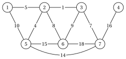
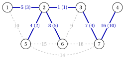
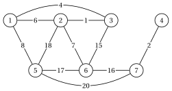
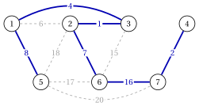
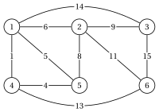
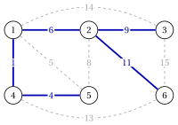
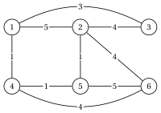
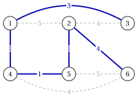
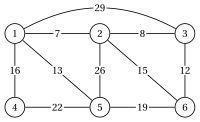
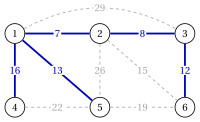

# Exercises · Minimum spanning trees

**Exercises · Chapter 2** · each solution opens with a click · [:material-book-open-variant: Chapter 2: Spanning trees](../trees-and-paths/minimum-spanning-trees/index.md) · [:material-file-pdf-box: Exercises, volume 2 (PDF)](../pdf/exercises-2-trees-and-paths.pdf)

!!! formula "Rules used in these exercises"

    The definitions and the algorithms of the chapter [«Minimum spanning trees»](https://fabiofurini.github.io/network-optimization/trees-and-paths/minimum-spanning-trees/), for a connected undirected graph $G=(V,E)$ with $n=|V|$, $m=|E|$ and weights $w_e$.

    - **(M1)** <strong>Cut property.</strong> If no edge of $F$ crosses $\delta(S)$ and $F$ is contained in a minimum spanning tree, adding a lightest edge of $\delta(S)$ keeps this property; a unique lightest edge of $\delta(S)$ is in every minimum spanning tree.

    - **(M2)** <strong>Cycle property.</strong> A heaviest edge of a cycle can be left out; an edge strictly heavier than the other edges of a cycle is in no minimum spanning tree.

    - **(M3)** <strong>Optimality.</strong> A spanning tree $T$ is optimal if and only if $w_e \ge w_f$ for every $e \notin T$ and every $f$ of its fundamental cycle $C(T,e)$; it is the unique optimum if and only if all these inequalities are strict.

    - **(M4)** <strong>Kruskal.</strong> The edges are scanned by non-decreasing weight, ties in lexicographic order of $\{u,v\}$, $u<v$; an edge is accepted if its endpoints are in different components of $(V,F)$.

    - **(M5)** <strong>Prim.</strong> From $s=1$: select $v \notin S$ with minimum $d(v)$, ties by the smallest index, add $\{\mathit{pred}(v),v\}$; then $d(u):=w_{vu}$, $\mathit{pred}(u):=v$ for every $u \notin S$ adjacent to $v$ with $w_{vu}<d(u)$.

!!! esercizio "Exercise 2.1: Kruskal's algorithm"

    !!! esercizio "Exercise"

        We consider the undirected graph $G=(V,E)$ with $V=\{1,2,\dots,7\}$ and the $11$ edges with the weights

        
<table>
        <tr>
        <th>edge</th>
        <th>\(\{1,2\}\)</th>
        <th>\(\{1,5\}\)</th>
        <th>\(\{2,3\}\)</th>
        <th>\(\{2,5\}\)</th>
        <th>\(\{2,6\}\)</th>
        <th>\(\{3,6\}\)</th>
        </tr>
        <tr>
        <td>\(w_e\)</td>
        <td>\(5\)</td>
        <td>\(10\)</td>
        <td>\(1\)</td>
        <td>\(4\)</td>
        <td>\(8\)</td>
        <td>\(9\)</td>
        </tr>
        <tr>
        <td>edge</td>
        <td>\(\{3,7\}\)</td>
        <td>\(\{4,7\}\)</td>
        <td>\(\{5,6\}\)</td>
        <td>\(\{5,7\}\)</td>
        <td>\(\{6,7\}\)</td>
        </tr>
        <tr>
        <td>\(w_e\)</td>
        <td>\(7\)</td>
        <td>\(16\)</td>
        <td>\(15\)</td>
        <td>\(14\)</td>
        <td>\(18\)</td>
        </tr>
        </table>

        drawn below.

        { .fig loading=lazy  }

    **Questions**

    1. Sort the edges as in (M4).

    2. Run Kruskal's algorithm: for every scanned edge, say whether it is accepted or rejected and give the components of $(V,F)$.

    3. Draw the minimum spanning tree and give its weight.

    4. For every rejected edge, give a cycle of which it is the heaviest edge.

??? soluzione "Solution"

    We use the rules (M1)–(M5) of the box at the beginning of these exercises.

    1. By non-decreasing weight: $\{2,3\},~\{2,5\},~\{1,2\},~\{3,7\},~\{2,6\},~\{3,6\},~\{1,5\},~\{5,7\},~\{5,6\},~\{4,7\},~\{6,7\}$, with weights $1,4,5,7,8,9,10,14,15,16,18$.

    2. Each row is one scanned edge:

        
<table>
        <tr>
        <th>\(k\)</th>
        <th>edge \(e_k\)</th>
        <th>\(w_{e_k}\)</th>
        <th>decision and components of \((V,F)\)</th>
        </tr>
        <tr>
        <td>\(1\)</td>
        <td>\(\{2,3\}\)</td>
        <td>\(1\)</td>
        <td>accept: \(\{1\},\{2,3\},\{4\},\{5\},\{6\},\{7\}\)</td>
        </tr>
        <tr>
        <td>\(2\)</td>
        <td>\(\{2,5\}\)</td>
        <td>\(4\)</td>
        <td>accept: \(\{1\},\{2,3,5\},\{4\},\{6\},\{7\}\)</td>
        </tr>
        <tr>
        <td>\(3\)</td>
        <td>\(\{1,2\}\)</td>
        <td>\(5\)</td>
        <td>accept: \(\{1,2,3,5\},\{4\},\{6\},\{7\}\)</td>
        </tr>
        <tr>
        <td>\(4\)</td>
        <td>\(\{3,7\}\)</td>
        <td>\(7\)</td>
        <td>accept: \(\{1,2,3,5,7\},\{4\},\{6\}\)</td>
        </tr>
        <tr>
        <td>\(5\)</td>
        <td>\(\{2,6\}\)</td>
        <td>\(8\)</td>
        <td>accept: \(\{1,2,3,5,6,7\},\{4\}\)</td>
        </tr>
        <tr>
        <td>\(6\)</td>
        <td>\(\{3,6\}\)</td>
        <td>\(9\)</td>
        <td>reject (\(3\) and \(6\) are both in \(\{1,2,3,5,6,7\}\))</td>
        </tr>
        <tr>
        <td>\(7\)</td>
        <td>\(\{1,5\}\)</td>
        <td>\(10\)</td>
        <td>reject (\(1\) and \(5\) are both in \(\{1,2,3,5,6,7\}\))</td>
        </tr>
        <tr>
        <td>\(8\)</td>
        <td>\(\{5,7\}\)</td>
        <td>\(14\)</td>
        <td>reject (\(5\) and \(7\) are both in \(\{1,2,3,5,6,7\}\))</td>
        </tr>
        <tr>
        <td>\(9\)</td>
        <td>\(\{5,6\}\)</td>
        <td>\(15\)</td>
        <td>reject (\(5\) and \(6\) are both in \(\{1,2,3,5,6,7\}\))</td>
        </tr>
        <tr>
        <td>\(10\)</td>
        <td>\(\{4,7\}\)</td>
        <td>\(16\)</td>
        <td>accept: \(\{1,2,3,4,5,6,7\}\)</td>
        </tr>
        </table>

        The algorithm stops after $10$ of the $11$ edges, when $|F|=6$. The edges $\{6,7\}$ are never scanned.

    3. The tree is $F=\{\{1,2\},\allowbreak \{2,3\},\allowbreak \{2,5\},\allowbreak \{2,6\},\allowbreak \{3,7\},\allowbreak \{4,7\}\}$, of weight $5+1+4+8+7+16=41$; on each tree edge, the weight and in brackets the step of its acceptance:

        { .fig loading=lazy  }

    4. A rejected edge joins two vertices already connected by $F$, and the path of $F$ between them uses only edges scanned before it, so lighter ones: $\{3,6\}$, of weight $9$, closes the cycle $3,2,6,3$ with tree edges of weights $1,~8$; $\{1,5\}$, of weight $10$, closes the cycle $1,2,5,1$ with tree edges of weights $5,~4$; $\{5,7\}$, of weight $14$, closes the cycle $5,2,3,7,5$ with tree edges of weights $4,~1,~7$; $\{5,6\}$, of weight $15$, closes the cycle $5,2,6,5$ with tree edges of weights $4,~8$. By (M2) none of these edges is in a minimum spanning tree.

    !!! chiave ""

        Kruskal's algorithm accepts $\{2,3\},\allowbreak \{2,5\},\allowbreak \{1,2\},\allowbreak \{3,7\},\allowbreak \{2,6\},\allowbreak \{4,7\}$ in this order and finds the minimum spanning tree of weight $41$; it is unique, since the weights are distinct.

!!! esercizio "Exercise 2.2: Prim's algorithm"

    !!! esercizio "Exercise"

        We consider the undirected graph $G=(V,E)$ with $V=\{1,2,\dots,7\}$ and the $11$ edges with the weights

        
<table>
        <tr>
        <th>edge</th>
        <th>\(\{1,2\}\)</th>
        <th>\(\{1,3\}\)</th>
        <th>\(\{1,5\}\)</th>
        <th>\(\{2,3\}\)</th>
        <th>\(\{2,5\}\)</th>
        <th>\(\{2,6\}\)</th>
        </tr>
        <tr>
        <td>\(w_e\)</td>
        <td>\(6\)</td>
        <td>\(4\)</td>
        <td>\(8\)</td>
        <td>\(1\)</td>
        <td>\(18\)</td>
        <td>\(7\)</td>
        </tr>
        <tr>
        <td>edge</td>
        <td>\(\{3,6\}\)</td>
        <td>\(\{4,7\}\)</td>
        <td>\(\{5,6\}\)</td>
        <td>\(\{5,7\}\)</td>
        <td>\(\{6,7\}\)</td>
        </tr>
        <tr>
        <td>\(w_e\)</td>
        <td>\(15\)</td>
        <td>\(2\)</td>
        <td>\(17\)</td>
        <td>\(20\)</td>
        <td>\(16\)</td>
        </tr>
        </table>

        drawn below.

        { .fig loading=lazy  }

    **Questions**

    1. Run Prim's algorithm from $s=1$: after every iteration, give the selected vertex, the added edge and the labels $d(v)$ and $\mathit{pred}(v)$ of the vertices outside $S$.

    2. Which labels decrease during the execution, and why?

    3. Draw the minimum spanning tree and give its weight.

    4. In which order does Kruskal's algorithm accept the same edges?

??? soluzione "Solution"

    We use the rules (M1)–(M5) of the box at the beginning of these exercises.

    1. Each row shows $d(v)$ after the update, with $\mathit{pred}(v)$ in brackets; a dash marks the vertices in $S$:

        
<table>
        <tr>
        <th>it.</th>
        <th>selected</th>
        <th>added edge</th>
        <th>\(d(2)\)</th>
        <th>\(d(3)\)</th>
        <th>\(d(4)\)</th>
        <th>\(d(5)\)</th>
        <th>\(d(6)\)</th>
        <th>\(d(7)\)</th>
        </tr>
        <tr>
        <td>\(0\)</td>
        <td>\(1\)</td>
        <td>–</td>
        <td>\(6~(1)\)</td>
        <td>\(4~(1)\)</td>
        <td>\(\infty\)</td>
        <td>\(8~(1)\)</td>
        <td>\(\infty\)</td>
        <td>\(\infty\)</td>
        </tr>
        <tr>
        <td>\(1\)</td>
        <td>\(3\)</td>
        <td>\(\{1,3\}\)</td>
        <td>\(1~(3)\)</td>
        <td>–</td>
        <td>\(\infty\)</td>
        <td>\(8~(1)\)</td>
        <td>\(15~(3)\)</td>
        <td>\(\infty\)</td>
        </tr>
        <tr>
        <td>\(2\)</td>
        <td>\(2\)</td>
        <td>\(\{2,3\}\)</td>
        <td>–</td>
        <td>–</td>
        <td>\(\infty\)</td>
        <td>\(8~(1)\)</td>
        <td>\(7~(2)\)</td>
        <td>\(\infty\)</td>
        </tr>
        <tr>
        <td>\(3\)</td>
        <td>\(6\)</td>
        <td>\(\{2,6\}\)</td>
        <td>–</td>
        <td>–</td>
        <td>\(\infty\)</td>
        <td>\(8~(1)\)</td>
        <td>–</td>
        <td>\(16~(6)\)</td>
        </tr>
        <tr>
        <td>\(4\)</td>
        <td>\(5\)</td>
        <td>\(\{1,5\}\)</td>
        <td>–</td>
        <td>–</td>
        <td>\(\infty\)</td>
        <td>–</td>
        <td>–</td>
        <td>\(16~(6)\)</td>
        </tr>
        <tr>
        <td>\(5\)</td>
        <td>\(7\)</td>
        <td>\(\{6,7\}\)</td>
        <td>–</td>
        <td>–</td>
        <td>\(2~(7)\)</td>
        <td>–</td>
        <td>–</td>
        <td>–</td>
        </tr>
        <tr>
        <td>\(6\)</td>
        <td>\(4\)</td>
        <td>\(\{4,7\}\)</td>
        <td>–</td>
        <td>–</td>
        <td>–</td>
        <td>–</td>
        <td>–</td>
        <td>–</td>
        </tr>
        </table>

        The vertices enter $S$ in the order $1,3,2,6,5,7,4$.

    2. A label decreases when the vertex just inserted has a lighter edge towards $u$: at iteration $1$, $d(2)$ drops from $6$ to $1$ (edge $\{2,3\}$); at iteration $1$, $d(6)$ drops from $\infty$ to $15$ (edge $\{3,6\}$); at iteration $2$, $d(6)$ drops from $15$ to $7$ (edge $\{2,6\}$); at iteration $3$, $d(7)$ drops from $\infty$ to $16$ (edge $\{6,7\}$); at iteration $5$, $d(4)$ drops from $\infty$ to $2$ (edge $\{4,7\}$).

    3. The tree is $F=\{\{1,3\},\allowbreak \{1,5\},\allowbreak \{2,3\},\allowbreak \{2,6\},\allowbreak \{4,7\},\allowbreak \{6,7\}\}$, of weight $38$:

        { .fig loading=lazy  }

    4. Kruskal's algorithm accepts the edges by non-decreasing weight: $\{2,3\},\allowbreak \{4,7\},\allowbreak \{1,3\},\allowbreak \{2,6\},\allowbreak \{1,5\},\allowbreak \{6,7\}$. The tree is the same, because the weights are distinct and the minimum spanning tree is unique; only the order changes.

    !!! chiave ""

        Prim's algorithm from $1$ adds $\{1,3\},\allowbreak \{2,3\},\allowbreak \{2,6\},\allowbreak \{1,5\},\allowbreak \{6,7\},\allowbreak \{4,7\}$; the minimum spanning tree weighs $38$, as found by Kruskal's algorithm.

!!! esercizio "Exercise 2.3: Cut and cycle properties"

    !!! esercizio "Exercise"

        We consider the undirected graph $G=(V,E)$ with $V=\{1,2,\dots,6\}$ and the $10$ edges with the weights

        
<table>
        <tr>
        <th>edge</th>
        <th>\(\{1,2\}\)</th>
        <th>\(\{1,3\}\)</th>
        <th>\(\{1,4\}\)</th>
        <th>\(\{1,5\}\)</th>
        <th>\(\{2,3\}\)</th>
        <th>\(\{2,5\}\)</th>
        </tr>
        <tr>
        <td>\(w_e\)</td>
        <td>\(6\)</td>
        <td>\(14\)</td>
        <td>\(1\)</td>
        <td>\(5\)</td>
        <td>\(9\)</td>
        <td>\(8\)</td>
        </tr>
        <tr>
        <td>edge</td>
        <td>\(\{2,6\}\)</td>
        <td>\(\{3,6\}\)</td>
        <td>\(\{4,5\}\)</td>
        <td>\(\{4,6\}\)</td>
        </tr>
        <tr>
        <td>\(w_e\)</td>
        <td>\(11\)</td>
        <td>\(15\)</td>
        <td>\(4\)</td>
        <td>\(13\)</td>
        </tr>
        </table>

        drawn below. We also consider the spanning tree $T_0=\{\{1,2\},\allowbreak \{1,3\},\allowbreak \{1,4\},\allowbreak \{1,5\},\allowbreak \{3,6\}\}$.

        { .fig loading=lazy  }

    **Questions**

    1. Find the cut $\delta(\{1,2\})$. Which of its edges belongs to every minimum spanning tree?

    2. Find a cycle that contains the edge $\{2,5\}$ and use it to show that $\{2,5\}$ is in no minimum spanning tree.

    3. Is $T_0$ a minimum spanning tree? List the pairs $(e,f)$, $e \notin T_0$, $f \in C(T_0,e)$, that violate the cycle condition (M3).

    4. Improve $T_0$ with the exchange of the violating pair with the largest difference $w_f-w_e$, and give the new weight. What is the weight of a minimum spanning tree?

??? soluzione "Solution"

    We use the rules (M1)–(M5) of the box at the beginning of these exercises.

    1. $\delta(\{1,2\})=\{\{1,3\},\allowbreak \{1,4\},\allowbreak \{1,5\},\allowbreak \{2,3\},\allowbreak \{2,5\},\allowbreak \{2,6\}\}$, with weights $14,1,5,9,8,11$. The edge $\{1,4\}$ is the unique lightest one, so it belongs to every minimum spanning tree by (M1).

    2. The cycle $2,1,4,5,2$ uses the edges $\{1,2\},\allowbreak \{1,4\},\allowbreak \{4,5\},\allowbreak \{2,5\}$, with weights $6,1,4,8$. The edge $\{2,5\}$, of weight $8$, is strictly the heaviest, so it is in no minimum spanning tree by (M2).

    3. $T_0$ weighs $41$. For every edge $e$ outside $T_0$ we compare $w_e$ with the edges of its fundamental cycle; the violating pairs, with $w_f>w_e$, are $(\{2,3\},\{1,3\})$, $(\{2,6\},\{1,3\})$, $(\{2,6\},\{3,6\})$, $(\{4,5\},\{1,5\})$, $(\{4,6\},\{1,3\})$, $(\{4,6\},\{3,6\})$. By (M3), $T_0$ is not optimal.

    4. The largest difference is given by $e=\{2,3\}$ and $f=\{1,3\}$, with $w_f-w_e=14-9=5$: the edge $f$ lies on $C(T_0,e)$, whose edges are $\{1,2\},\allowbreak \{1,3\},\allowbreak \{2,3\}$. The exchange gives the spanning tree $\{\{1,2\},\allowbreak \{1,4\},\allowbreak \{1,5\},\allowbreak \{2,3\},\allowbreak \{3,6\}\}$ of weight $41-5=36$. Kruskal's algorithm gives the minimum spanning tree $\{\{1,2\},\allowbreak \{1,4\},\allowbreak \{2,3\},\allowbreak \{2,6\},\allowbreak \{4,5\}\}$, of weight $31$:

        { .fig loading=lazy  }

    !!! chiave ""

        $\{1,4\}$ is forced by a cut, $\{2,5\}$ is excluded by a cycle; $T_0$ (weight $41$) violates the cycle condition, and the optimum weighs $31$.

!!! esercizio "Exercise 2.4: Uniqueness and ties"

    !!! esercizio "Exercise"

        We consider the undirected graph $G=(V,E)$ with $V=\{1,2,\dots,6\}$ and the $9$ edges with the weights

        
<table>
        <tr>
        <th>edge</th>
        <th>\(\{1,2\}\)</th>
        <th>\(\{1,3\}\)</th>
        <th>\(\{1,4\}\)</th>
        <th>\(\{2,3\}\)</th>
        <th>\(\{2,5\}\)</th>
        <th>\(\{2,6\}\)</th>
        </tr>
        <tr>
        <td>\(w_e\)</td>
        <td>\(5\)</td>
        <td>\(3\)</td>
        <td>\(1\)</td>
        <td>\(4\)</td>
        <td>\(1\)</td>
        <td>\(4\)</td>
        </tr>
        <tr>
        <td>edge</td>
        <td>\(\{4,5\}\)</td>
        <td>\(\{4,6\}\)</td>
        <td>\(\{5,6\}\)</td>
        </tr>
        <tr>
        <td>\(w_e\)</td>
        <td>\(1\)</td>
        <td>\(4\)</td>
        <td>\(5\)</td>
        </tr>
        </table>

        drawn below.

        { .fig loading=lazy  }

    **Questions**

    1. Find a minimum spanning tree $T$ with Kruskal's algorithm, and its weight.

    2. Using the fundamental cuts of $T$, find the edges that belong to every minimum spanning tree.

    3. Using the fundamental cycles of $T$, find the edges that belong to no minimum spanning tree.

    4. Is the minimum spanning tree unique? Give another one, if it exists, and the number of minimum spanning trees.

??? soluzione "Solution"

    We use the rules (M1)–(M5) of the box at the beginning of these exercises.

    1. Kruskal's algorithm, with ties in lexicographic order:

        
<table>
        <tr>
        <th>\(k\)</th>
        <th>edge \(e_k\)</th>
        <th>\(w_{e_k}\)</th>
        <th>decision and components of \((V,F)\)</th>
        </tr>
        <tr>
        <td>\(1\)</td>
        <td>\(\{1,4\}\)</td>
        <td>\(1\)</td>
        <td>accept: \(\{1,4\},\{2\},\{3\},\{5\},\{6\}\)</td>
        </tr>
        <tr>
        <td>\(2\)</td>
        <td>\(\{2,5\}\)</td>
        <td>\(1\)</td>
        <td>accept: \(\{1,4\},\{2,5\},\{3\},\{6\}\)</td>
        </tr>
        <tr>
        <td>\(3\)</td>
        <td>\(\{4,5\}\)</td>
        <td>\(1\)</td>
        <td>accept: \(\{1,2,4,5\},\{3\},\{6\}\)</td>
        </tr>
        <tr>
        <td>\(4\)</td>
        <td>\(\{1,3\}\)</td>
        <td>\(3\)</td>
        <td>accept: \(\{1,2,3,4,5\},\{6\}\)</td>
        </tr>
        <tr>
        <td>\(5\)</td>
        <td>\(\{2,3\}\)</td>
        <td>\(4\)</td>
        <td>reject (\(2\) and \(3\) are both in \(\{1,2,3,4,5\}\))</td>
        </tr>
        <tr>
        <td>\(6\)</td>
        <td>\(\{2,6\}\)</td>
        <td>\(4\)</td>
        <td>accept: \(\{1,2,3,4,5,6\}\)</td>
        </tr>
        </table>

        $T=\{\{1,3\},\allowbreak \{1,4\},\allowbreak \{2,5\},\allowbreak \{2,6\},\allowbreak \{4,5\}\}$, of weight $10$.

        { .fig loading=lazy  }

    2. An edge of $T$ is in every minimum spanning tree if and only if it is strictly the lightest of its fundamental cut (the component $S_e$ of $T\setminus\{e\}$ with the smaller endpoint):

        
<table>
        <tr>
        <th>\(e \in T\)</th>
        <th>\(w_e\)</th>
        <th>\(S_e\)</th>
        <th>weights of the other edges of \(\delta(S_e)\)</th>
        <th>strictly lightest?</th>
        </tr>
        <tr>
        <td>\(\{1,3\}\)</td>
        <td>\(3\)</td>
        <td>\(\{1,2,4,5,6\}\)</td>
        <td>\(4\)</td>
        <td>yes</td>
        </tr>
        <tr>
        <td>\(\{1,4\}\)</td>
        <td>\(1\)</td>
        <td>\(\{1,3\}\)</td>
        <td>\(5\), \(4\)</td>
        <td>yes</td>
        </tr>
        <tr>
        <td>\(\{2,5\}\)</td>
        <td>\(1\)</td>
        <td>\(\{2,6\}\)</td>
        <td>\(5\), \(4\), \(4\), \(5\)</td>
        <td>yes</td>
        </tr>
        <tr>
        <td>\(\{2,6\}\)</td>
        <td>\(4\)</td>
        <td>\(\{1,2,3,4,5\}\)</td>
        <td>\(4\), \(5\)</td>
        <td>no: \(\{4,6\}\)</td>
        </tr>
        <tr>
        <td>\(\{4,5\}\)</td>
        <td>\(1\)</td>
        <td>\(\{1,3,4\}\)</td>
        <td>\(5\), \(4\), \(4\)</td>
        <td>yes</td>
        </tr>
        </table>

        The edges in every minimum spanning tree are $\{1,3\},\allowbreak \{1,4\},\allowbreak \{2,5\},\allowbreak \{4,5\}$.

    3. An edge outside $T$ is in no minimum spanning tree if and only if it is strictly the heaviest of its fundamental cycle:

        
<table>
        <tr>
        <th>\(e \notin T\)</th>
        <th>\(w_e\)</th>
        <th>tree edges of \(C(T,e)\)</th>
        <th>their weights</th>
        <th>strictly heaviest?</th>
        </tr>
        <tr>
        <td>\(\{1,2\}\)</td>
        <td>\(5\)</td>
        <td>\(\{1,4\},\allowbreak \{4,5\},\allowbreak \{2,5\}\)</td>
        <td>\(1\), \(1\), \(1\)</td>
        <td>yes</td>
        </tr>
        <tr>
        <td>\(\{2,3\}\)</td>
        <td>\(4\)</td>
        <td>\(\{2,5\},\allowbreak \{4,5\},\allowbreak \{1,4\},\allowbreak \{1,3\}\)</td>
        <td>\(1\), \(1\), \(1\), \(3\)</td>
        <td>yes</td>
        </tr>
        <tr>
        <td>\(\{4,6\}\)</td>
        <td>\(4\)</td>
        <td>\(\{4,5\},\allowbreak \{2,5\},\allowbreak \{2,6\}\)</td>
        <td>\(1\), \(1\), \(4\)</td>
        <td>no: \(\{2,6\}\)</td>
        </tr>
        <tr>
        <td>\(\{5,6\}\)</td>
        <td>\(5\)</td>
        <td>\(\{2,5\},\allowbreak \{2,6\}\)</td>
        <td>\(1\), \(4\)</td>
        <td>yes</td>
        </tr>
        </table>

        The edges in no minimum spanning tree are $\{1,2\},\allowbreak \{2,3\},\allowbreak \{5,6\}$.

    4. Some inequality is not strict, so by (M3) the optimum is not unique. For example $\{\{1,3\},\allowbreak \{1,4\},\allowbreak \{2,5\},\allowbreak \{4,5\},\allowbreak \{4,6\}\}$ also weighs $10$. Enumerating the $64$ spanning trees, exactly $2$ have weight $10$.

    !!! chiave ""

        The minimum weight is $10$, attained by $2$ spanning trees; the ties in the fundamental cuts and cycles of one optimal tree tell which edges are forced and which are excluded.

!!! esercizio "Exercise 2.5: Modelling with minimum spanning trees"

    !!! esercizio "Exercise"

        A company wants to connect its $6$ buildings $1,2,\dots,6$ with a fibre network. A direct link can be built between the pairs below, and $w_e$ is its cost (in thousands of euros):

        
<table>
        <tr>
        <th>edge</th>
        <th>\(\{1,2\}\)</th>
        <th>\(\{1,3\}\)</th>
        <th>\(\{1,4\}\)</th>
        <th>\(\{1,5\}\)</th>
        <th>\(\{2,3\}\)</th>
        <th>\(\{2,5\}\)</th>
        </tr>
        <tr>
        <td>\(w_e\)</td>
        <td>\(7\)</td>
        <td>\(29\)</td>
        <td>\(16\)</td>
        <td>\(13\)</td>
        <td>\(8\)</td>
        <td>\(26\)</td>
        </tr>
        <tr>
        <td>edge</td>
        <td>\(\{2,6\}\)</td>
        <td>\(\{3,6\}\)</td>
        <td>\(\{4,5\}\)</td>
        <td>\(\{5,6\}\)</td>
        </tr>
        <tr>
        <td>\(w_e\)</td>
        <td>\(15\)</td>
        <td>\(12\)</td>
        <td>\(22\)</td>
        <td>\(19\)</td>
        </tr>
        </table>

        Every building must be able to reach every other one, possibly through other buildings.

        { .fig loading=lazy  }

        Each link $e$ also works with probability $p_e$, independently of the others:

        
<table>
        <tr>
        <th>link</th>
        <th>\(\{1,2\}\)</th>
        <th>\(\{1,3\}\)</th>
        <th>\(\{1,4\}\)</th>
        <th>\(\{1,5\}\)</th>
        <th>\(\{2,3\}\)</th>
        </tr>
        <tr>
        <td>\(p_e\)</td>
        <td>\(0.97\)</td>
        <td>\(0.90\)</td>
        <td>\(0.91\)</td>
        <td>\(0.84\)</td>
        <td>\(0.94\)</td>
        </tr>
        <tr>
        <td>link</td>
        <td>\(\{2,5\}\)</td>
        <td>\(\{2,6\}\)</td>
        <td>\(\{3,6\}\)</td>
        <td>\(\{4,5\}\)</td>
        <td>\(\{5,6\}\)</td>
        </tr>
        <tr>
        <td>\(p_e\)</td>
        <td>\(0.96\)</td>
        <td>\(0.93\)</td>
        <td>\(0.85\)</td>
        <td>\(0.81\)</td>
        <td>\(0.98\)</td>
        </tr>
        </table>

    **Questions**

    1. Model the cheapest network as a graph problem and solve it.

    2. For security reasons, buildings $2$ and $6$ must be linked directly. How do you find the cheapest network, and what does it cost?

    3. A network with $n-1$ links works if all its links work. Model the most reliable network as a minimum spanning tree problem, solve it and give its probability of working.

??? soluzione "Solution"

    We use the rules (M1)–(M5) of the box at the beginning of these exercises.

    1. The buildings are the vertices and the possible links the edges of $G$, with weights $w_e$. A cheapest network is connected, and it has no cycle: removing an edge of a cycle keeps it connected and lowers the cost, since the costs are positive. Hence it is a minimum spanning tree. Kruskal's algorithm gives

        $$
        T=\{\{1,2\},\allowbreak \{1,4\},\allowbreak \{1,5\},\allowbreak \{2,3\},\allowbreak \{3,6\}\}, \qquad w(T)=56.
        $$

        { .fig loading=lazy  }

    2. Every spanning tree that contains $\{2,6\}$ changes its weight by the same amount if $w_{26}$ changes. Setting $w_{26}=0$, below every other weight, Kruskal's algorithm accepts $\{2,6\}$ first and returns the cheapest tree containing it: $\{\{1,2\},\allowbreak \{1,4\},\allowbreak \{1,5\},\allowbreak \{2,3\},\allowbreak \{2,6\}\}$, with the original costs $w=59$, that is $3$ more than $T$.

    3. The network works with probability $\prod_{e \in T} p_e$. Maximizing it is the same as minimizing $\sum_{e \in T} (-\log p_e)$, a minimum spanning tree problem with weights $-\log p_e$. These weights have the order of $-p_e$, and Kruskal's algorithm uses only the order: it scans the links by non-increasing reliability and gives

        $$
        \{\{1,2\},\allowbreak \{1,4\},\allowbreak \{2,3\},\allowbreak \{2,5\},\allowbreak \{5,6\}\}, \qquad \prod_{e} p_e=0.97 \cdot 0.91 \cdot 0.94 \cdot 0.96 \cdot 0.98 \approx 0.7806.
        $$

    !!! chiave ""

        Cheapest network: a minimum spanning tree of cost $56$; with the forced link $\{2,6\}$ it costs $59$; the most reliable network is a maximum spanning tree for $p_e$.
