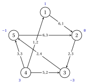
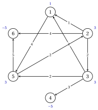
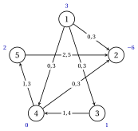
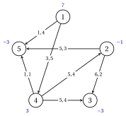

# Exercises · Network flow models

**Exercises · Chapter 4** · each solution opens with a click · [:material-book-open-variant: Chapter 4: Flow models](../flows/network-flow-models/index.md) · [:material-file-pdf-box: Exercises, volume 3 (PDF)](../pdf/exercises-3-flows.pdf)

!!! formula "Rules used in these exercises"

    The definitions and the results of the chapter [«Network flow models»](https://fabiofurini.github.io/network-optimization/flows/network-flow-models/), for a network $G=(N,A)$ with balances $b_i$, lower bounds $l_{ij}$, capacities $u_{ij}$ and costs $c_{ij}$.

    - **(F1)** <strong>Model.</strong> The arcs are numbered $a_1,a_2,\dots,a_m$ in lexicographic order; $\mat{B}$ has $+1$ in the tail and $-1$ in the head of every arc, and the $\mathrm{MCF}$ model is

        $$
        \min\{\vet{c}'\vet{x} : \mat{B}\vet{x}=\vet{b},~\vet{l} \le \vet{x} \le \vet{u}\},
        $$

        where row $i$ of $\mat{B}\vet{x}$ is the outflow minus the inflow of node $i$.

    - **(F2)** <strong>Feasibility.</strong> A network with a feasible flow has $\sum_{i \in N} b_i=0$ and, for every $S \subseteq N$, $\sum_{i \in S} b_i \le u(\delta^+(S))-l(\delta^-(S))$.

    - **(F3)** <strong>Lower bounds.</strong> With $\vet{x}=\vet{l}+\vet{x}'$: $\vet{b}'=\vet{b}-\mat{B}\vet{l}$, $\vet{u}'=\vet{u}-\vet{l}$, and $\vet{c}'\vet{x}=\vet{c}'\vet{x}'+\vet{c}'\vet{l}$.

    - **(F4)** <strong>Dummy node.</strong> If $e=\sum_{i \in N} b_i>0$, a dummy node $d$ with $b_d=-e$ and arcs $(i,d)$ from the supply nodes, with cost $0$ and capacity $+\infty$; the flow on $(i,d)$ is the unused supply of $i$.

    - **(F5)** <strong>Total unimodularity.</strong> Every square submatrix of $\mat{B}$ has determinant $0$ or $\pm 1$: a zero column gives $0$, a column with one nonzero entry is expanded, columns with $+1$ and $-1$ give $0$. With integer $\vet{b}$, $\vet{l}$, $\vet{u}$ every vertex of $\{\mat{B}\vet{x}=\vet{b},~\vet{l} \le \vet{x} \le \vet{u}\}$ is integer.

!!! esercizio "Exercise 4.1: The minimum cost flow model"

    !!! esercizio "Exercise"

        We consider the network $G=(N,A)$ with $N=\{1,2,\dots,5\}$, the $7$ arcs

        $$
        A=\{(1,2),(2,3),(3,5),(4,1),(4,3),(4,5),(5,2)\},
        $$

        zero lower bounds and the balances $b_1=1$, $b_2=0$, $b_3=-3$, $b_4=3$, $b_5=-1$. Costs and capacities are given in the table and, as $c_{ij},u_{ij}$, in the figure; the balances are next to the nodes.

        
<table>
        <tr>
        <th>arc</th>
        <th>\((1,2)\)</th>
        <th>\((2,3)\)</th>
        <th>\((3,5)\)</th>
        <th>\((4,1)\)</th>
        <th>\((4,3)\)</th>
        <th>\((4,5)\)</th>
        <th>\((5,2)\)</th>
        </tr>
        <tr>
        <td>\(c_{ij}\)</td>
        <td>\(6\)</td>
        <td>\(2\)</td>
        <td>\(2\)</td>
        <td>\(1\)</td>
        <td>\(5\)</td>
        <td>\(3\)</td>
        <td>\(6\)</td>
        </tr>
        <tr>
        <td>\(u_{ij}\)</td>
        <td>\(1\)</td>
        <td>\(3\)</td>
        <td>\(4\)</td>
        <td>\(2\)</td>
        <td>\(2\)</td>
        <td>\(3\)</td>
        <td>\(3\)</td>
        </tr>
        </table>

        { .fig loading=lazy  }

        Two flows are proposed:

        
<table>
        <tr>
        <th>arc</th>
        <th>\((1,2)\)</th>
        <th>\((2,3)\)</th>
        <th>\((3,5)\)</th>
        <th>\((4,1)\)</th>
        <th>\((4,3)\)</th>
        <th>\((4,5)\)</th>
        <th>\((5,2)\)</th>
        </tr>
        <tr>
        <td>\(\bar{x}_{ij}\)</td>
        <td>\(1\)</td>
        <td>\(3\)</td>
        <td>\(2\)</td>
        <td>\(0\)</td>
        <td>\(2\)</td>
        <td>\(1\)</td>
        <td>\(2\)</td>
        </tr>
        <tr>
        <td>\(\hat{x}_{ij}\)</td>
        <td>\(1\)</td>
        <td>\(3\)</td>
        <td>\(3\)</td>
        <td>\(0\)</td>
        <td>\(2\)</td>
        <td>\(1\)</td>
        <td>\(2\)</td>
        </tr>
        </table>

    **Questions**

    1. Classify the nodes into supply, demand and transshipment nodes, and check that the network is balanced.

    2. Number the arcs as in (F1), write the incidence matrix $\mat{B}$ and the $\mathrm{MCF}$ model explicitly.

    3. Decide whether $\bar{\vet{x}}$ and $\hat{\vet{x}}$ are feasible flows, and compute the cost of the feasible one.

??? soluzione "Solution"

    We use the rules (F1)–(F5) of the box at the beginning of these exercises.

    1. By the sign of the balances: nodes $1,4$ are supply nodes; nodes $3,5$ are demand nodes; node $2$ is a transshipment node. The total supply is $4$, equal to the total demand, so $\sum_{i \in N} b_i=0$.

    2. The arcs in lexicographic order are $a_{1}=(1,2)$, $a_{2}=(2,3)$, $a_{3}=(3,5)$, $a_{4}=(4,1)$, $a_{5}=(4,3)$, $a_{6}=(4,5)$, $a_{7}=(5,2)$. The incidence matrix is

        $$
        \begin{array}{c|rrrrrrr}
        & a_{1} & a_{2} & a_{3} & a_{4} & a_{5} & a_{6} & a_{7}\\ \hline
        1 & 1 & 0 & 0 & -1 & 0 & 0 & 0\\
        2 & -1 & 1 & 0 & 0 & 0 & 0 & -1\\
        3 & 0 & -1 & 1 & 0 & -1 & 0 & 0\\
        4 & 0 & 0 & 0 & 1 & 1 & 1 & 0\\
        5 & 0 & 0 & -1 & 0 & 0 & -1 & 1\\
        \end{array}
        $$

        and the $\mathrm{MCF}$ model has one equation per node (one row of $\mat{B}$):

        $\begin{array}{rrrrrrrrcr} \min & 6x_{12} & +2x_{23} & +2x_{35} & +x_{41} & +5x_{43} & +3x_{45} & +6x_{52} & & \\[1ex] \text{subject to} & x_{12} &  &  & -x_{41} &  &  &  & = & 1\\ & -x_{12} & +x_{23} &  &  &  &  & -x_{52} & = & 0\\ &  & -x_{23} & +x_{35} &  & -x_{43} &  &  & = & -3\\ &  &  &  & x_{41} & +x_{43} & +x_{45} &  & = & 3\\ &  &  & -x_{35} &  &  & -x_{45} & +x_{52} & = & -1\\ \end{array}$

        together with $0 \le x_{12} \le 1$, $0 \le x_{23} \le 3$, $0 \le x_{35} \le 4$, $0 \le x_{41} \le 2$, $0 \le x_{43} \le 2$, $0 \le x_{45} \le 3$, $0 \le x_{52} \le 3$.

    3. We compute the outflow minus the inflow of every node, and compare it with $\vet{b}$:

        $$
        \mat{B}\bar{\vet{x}}=(1,\,0,\,-3,\,3,\,-1)', \qquad \mat{B}\hat{\vet{x}}=(1,\,0,\,-2,\,3,\,-2)', \qquad \vet{b}=(1,\,0,\,-3,\,3,\,-1)'.
        $$

        Both flows respect the bounds. The flow $\bar{\vet{x}}$ is feasible; $\hat{\vet{x}}$ is not, because it sends one more unit on $(3,5)$ and conservation fails at nodes $3$ and $5$. The cost of $\bar{\vet{x}}$ is

        $$
        6\cdot 1+2\cdot 3+2\cdot 2+1\cdot 0+5\cdot 2+3\cdot 1+6\cdot 2=41,
        $$

        and the arcs $(1,2)$, $(2,3)$, $(4,3)$ are at capacity.

    !!! chiave ""

        The $\mathrm{MCF}$ model has $7$ variables and $5$ equations with matrix $\mat{B}$; $\bar{\vet{x}}$ is feasible with cost $41$, while $\hat{\vet{x}}$ violates conservation at nodes $3$ and $5$.

!!! esercizio "Exercise 4.2: Feasibility conditions"

    !!! esercizio "Exercise"

        We consider the network $G=(N,A)$ with $N=\{1,2,\dots,6\}$, the $9$ arcs

        $$
        A=\{(1,5),(2,1),(2,3),(2,6),(3,1),(3,4),(3,5),(5,2),(5,6)\},
        $$

        zero lower bounds, the capacities $u_{ij}$ of the table (next to the arcs in the figure) and the balances

        $$
        b_1=1,\qquad b_2=3,\qquad b_3=3,\qquad b_4=-5,\qquad b_5=3,\qquad b_6=-5.
        $$

        
<table>
        <tr>
        <th>arc</th>
        <th>\((1,5)\)</th>
        <th>\((2,1)\)</th>
        <th>\((2,3)\)</th>
        <th>\((2,6)\)</th>
        <th>\((3,1)\)</th>
        <th>\((3,4)\)</th>
        <th>\((3,5)\)</th>
        <th>\((5,2)\)</th>
        <th>\((5,6)\)</th>
        </tr>
        <tr>
        <td>\(u_{ij}\)</td>
        <td>\(4\)</td>
        <td>\(1\)</td>
        <td>\(2\)</td>
        <td>\(4\)</td>
        <td>\(1\)</td>
        <td>\(3\)</td>
        <td>\(2\)</td>
        <td>\(2\)</td>
        <td>\(5\)</td>
        </tr>
        </table>

        { .fig loading=lazy  }

    **Questions**

    1. Is the network balanced?

    2. For $S=\{1,2,3,5,6\}$ compute $\delta^+(S)$, $\delta^-(S)$ and check the cut condition of (F2). What can you conclude?

    3. By how much must the capacity of the arc $(3,4)$ be raised for the cut condition to hold for $S$? Check the condition for $S$ with the new capacity.

??? soluzione "Solution"

    We use the rules (F1)–(F5) of the box at the beginning of these exercises.

    1. The balances add up to $1+3+3+(-5)+3+(-5)=0$: the network is balanced.

    2. The arcs leaving $S$ are $\delta^+(S)=\{(3,4)\}$ and the arcs entering $S$ are $\delta^-(S)=\emptyset$. Hence

        $$
        \sum_{i \in S} b_i=1+3+3+3+(-5)=5, \qquad u(\delta^+(S))=3=3,
        $$

        and the lower bounds of $\delta^-(S)$ are zero. Since $5>3$, the cut condition fails: the nodes of $S$ have $5$ units to send out and the arcs leaving $S$ carry at most $3$. The network is balanced but has no feasible flow.

    3. The missing capacity is $5-3=2$, so $u_{34}$ must go from $3$ to $5$. Then $u(\delta^+(S))=5=5$ and the condition holds for $S$ with equality: every arc leaving $S$ must be at capacity. With this capacity all the cut conditions hold and the network has a feasible flow.

    !!! chiave ""

        $\sum_i b_i=0$ is not enough: the set $S=\{1,2,3,5,6\}$ violates the cut condition by $2$ units, and raising $u_{34}$ to $5$ repairs the network.

!!! esercizio "Exercise 4.3: Removing the lower bounds"

    !!! esercizio "Exercise"

        We consider the network $G=(N,A)$ with $N=\{1,2,\dots,5\}$, the $7$ arcs

        $$
        A=\{(1,2),(1,3),(1,4),(3,4),(4,2),(4,5),(5,2)\},
        $$

        the balances

        $$
        b_1=3,\qquad b_2=-6,\qquad b_3=1,\qquad b_4=0,\qquad b_5=2,
        $$

        and the lower bounds, capacities and costs of the table (in the figure, $l_{ij},u_{ij}$ next to the arcs).

        
<table>
        <tr>
        <th>arc</th>
        <th>\((1,2)\)</th>
        <th>\((1,3)\)</th>
        <th>\((1,4)\)</th>
        <th>\((3,4)\)</th>
        <th>\((4,2)\)</th>
        <th>\((4,5)\)</th>
        <th>\((5,2)\)</th>
        </tr>
        <tr>
        <td>\(l_{ij}\)</td>
        <td>\(0\)</td>
        <td>\(0\)</td>
        <td>\(0\)</td>
        <td>\(1\)</td>
        <td>\(0\)</td>
        <td>\(1\)</td>
        <td>\(2\)</td>
        </tr>
        <tr>
        <td>\(u_{ij}\)</td>
        <td>\(3\)</td>
        <td>\(3\)</td>
        <td>\(3\)</td>
        <td>\(4\)</td>
        <td>\(3\)</td>
        <td>\(3\)</td>
        <td>\(5\)</td>
        </tr>
        <tr>
        <td>\(c_{ij}\)</td>
        <td>\(5\)</td>
        <td>\(4\)</td>
        <td>\(6\)</td>
        <td>\(2\)</td>
        <td>\(6\)</td>
        <td>\(4\)</td>
        <td>\(5\)</td>
        </tr>
        </table>

        { .fig loading=lazy  }

    **Questions**

    1. Remove the lower bounds with the substitution $\vet{x}=\vet{l}+\vet{x}'$: compute $\mat{B}\vet{l}$, the new balances $\vet{b}'$ and the new capacities $\vet{u}'$.

    2. Which constant must be added to the cost of a flow of the substituted network?

    3. The flow $\vet{x}'$ below is feasible for the substituted network. Give the corresponding flow $\vet{x}$ of the original network and its cost.

        
<table>
        <tr>
        <th>arc</th>
        <th>\((1,2)\)</th>
        <th>\((1,3)\)</th>
        <th>\((1,4)\)</th>
        <th>\((3,4)\)</th>
        <th>\((4,2)\)</th>
        <th>\((4,5)\)</th>
        <th>\((5,2)\)</th>
        </tr>
        <tr>
        <td>\(x'_{ij}\)</td>
        <td>\(1\)</td>
        <td>\(1\)</td>
        <td>\(1\)</td>
        <td>\(1\)</td>
        <td>\(2\)</td>
        <td>\(0\)</td>
        <td>\(1\)</td>
        </tr>
        </table>

??? soluzione "Solution"

    We use the rules (F1)–(F5) of the box at the beginning of these exercises.

    1. Each arc with $l_{ij}>0$ takes $l_{ij}$ units from its tail and gives them to its head: $(3,4)$ with $l_{34}=1$, $(4,5)$ with $l_{45}=1$, $(5,2)$ with $l_{52}=2$. Hence

        $$
        \mat{B}\vet{l}=(0,\,-2,\,1,\,0,\,1)', \qquad \vet{b}'=\vet{b}-\mat{B}\vet{l}=(3,\,-4,\,0,\,0,\,1)',
        $$

        and the capacities decrease by the lower bounds:

        
<table>
        <tr>
        <th>arc</th>
        <th>\((1,2)\)</th>
        <th>\((1,3)\)</th>
        <th>\((1,4)\)</th>
        <th>\((3,4)\)</th>
        <th>\((4,2)\)</th>
        <th>\((4,5)\)</th>
        <th>\((5,2)\)</th>
        </tr>
        <tr>
        <td>\(u'_{ij}\)</td>
        <td>\(3\)</td>
        <td>\(3\)</td>
        <td>\(3\)</td>
        <td>\(3\)</td>
        <td>\(3\)</td>
        <td>\(2\)</td>
        <td>\(3\)</td>
        </tr>
        </table>

        The new balances still add up to $0$.

    2. The constant is $\vet{c}'\vet{l}=2\cdot 1+4\cdot 1+5\cdot 2=16$.

    3. We add the lower bounds back, $x_{ij}=l_{ij}+x'_{ij}$:

        
<table>
        <tr>
        <th>arc</th>
        <th>\((1,2)\)</th>
        <th>\((1,3)\)</th>
        <th>\((1,4)\)</th>
        <th>\((3,4)\)</th>
        <th>\((4,2)\)</th>
        <th>\((4,5)\)</th>
        <th>\((5,2)\)</th>
        </tr>
        <tr>
        <td>\(x_{ij}\)</td>
        <td>\(1\)</td>
        <td>\(1\)</td>
        <td>\(1\)</td>
        <td>\(2\)</td>
        <td>\(2\)</td>
        <td>\(1\)</td>
        <td>\(3\)</td>
        </tr>
        </table>

        The cost of $\vet{x}'$ is $34$, so the cost of $\vet{x}$ is $34+16=50$; computing $\vet{c}'\vet{x}$ directly gives the same value.

    !!! chiave ""

        $\vet{b}'=(3,\,-4,\,0,\,0,\,1)'$, $\vet{u}'=\vet{u}-\vet{l}$, and the costs of the two networks differ by $\vet{c}'\vet{l}=16$.

!!! esercizio "Exercise 4.4: Total unimodularity"

    !!! esercizio "Exercise"

        We consider the directed graph $G=(N,A)$ with $N=\{1,2,\dots,5\}$ and the $7$ arcs

        $$
        A=\{(1,4),(1,5),(2,1),(2,5),(3,4),(4,5),(5,3)\},
        $$

        numbered $a_1,a_2,\dots,a_{7}$ in lexicographic order, and the undirected graph $H$ with vertices $1,2,3,4$ and edges $e_1=\{1,2\}$, $e_2=\{1,3\}$, $e_3=\{2,3\}$, $e_4=\{3,4\}$.

        { .fig loading=lazy  }

    **Questions**

    1. Write the node–arc incidence matrix $\mat{B}$ of $G$.

    2. Compute the determinant of the submatrix of $\mat{B}$ with rows $1,2,5$ and columns $a_{2},a_{4},a_{6}$, following the cases of (F5).

    3. Compute the determinant of the submatrix with rows $1,2,5$ and columns $a_{2},a_{3},a_{4}$. Which structure of the graph explains the value?

    4. Write the vertex–edge incidence matrix $\mat{K}$ of $H$ and show that it is not totally unimodular.

    5. Let $\vet{b} \in \Z^{5}$ and $\vet{u} \in \Z_{\ge 0}^{7}$. Can the polyhedron $\{\vet{x} : \mat{B}\vet{x}=\vet{b},~\vet{0} \le \vet{x} \le \vet{u}\}$ have a fractional vertex?

??? soluzione "Solution"

    We use the rules (F1)–(F5) of the box at the beginning of these exercises.

    1. Each column has $+1$ in the tail and $-1$ in the head:

        $$
        \begin{array}{c|rrrrrrr}
        & a_{1} & a_{2} & a_{3} & a_{4} & a_{5} & a_{6} & a_{7}\\ \hline
        1 & 1 & 1 & -1 & 0 & 0 & 0 & 0\\
        2 & 0 & 0 & 1 & 1 & 0 & 0 & 0\\
        3 & 0 & 0 & 0 & 0 & 1 & 0 & -1\\
        4 & -1 & 0 & 0 & 0 & -1 & 1 & 0\\
        5 & 0 & -1 & 0 & -1 & 0 & -1 & 1\\
        \end{array}
        $$

    2. The submatrix is

        $$
        \begin{array}{c|rrr}
        & a_{2} & a_{4} & a_{6}\\ \hline
        1 & 1 & 0 & 0\\
        2 & 0 & 1 & 0\\
        5 & -1 & -1 & -1\\
        \end{array}
        $$

        - the column of $a_{6}$ has the single nonzero entry $-1$ in row $5$: the expansion gives a factor $-1$ and deletes row $5$ and the column;

        - the column of $a_{2}$ has the single nonzero entry $1$ in row $1$: the expansion gives a factor $1$ and deletes row $1$ and the column;

        The remaining $1 \times 1$ entry is $1$; multiplying it by the factors, the determinant is $-1$.

    3. The submatrix is

        $$
        \begin{array}{c|rrr}
        & a_{2} & a_{3} & a_{4}\\ \hline
        1 & 1 & -1 & 0\\
        2 & 0 & 1 & 1\\
        5 & -1 & 0 & -1\\
        \end{array}
        $$

        Here every column has one $+1$ and one $-1$: the rows add up to zero and the determinant is $0$. The three arcs $(1,5)$, $(2,1)$, $(2,5)$ have both endpoints among the nodes $1,2,5$: they form a cycle of the underlying undirected graph.

    4. The rows are the vertices and the columns the edges $e_1,e_2,e_3,e_4$:

        $$
        \begin{array}{c|rrrr}
        & e_1 & e_2 & e_3 & e_4\\ \hline
        1 & 1 & 1 & 0 & 0\\
        2 & 1 & 0 & 1 & 0\\
        3 & 0 & 1 & 1 & 1\\
        4 & 0 & 0 & 0 & 1\\
        \end{array}
        $$

        The submatrix of rows $1,2,3$ and columns $e_1,e_2,e_3$ (the triangle) has determinant $-2$${0, 1}$, so$K$is not totally unimodular. With this submatrix$T$, the system$Ty=1$has the unique solution$(12,12,12)$.

    5. No: $\mat{B}$ is totally unimodular, and with integer $\vet{b}$ and $\vet{u}$ every vertex is integer by (F5). Computing all the $791$ square submatrices of $\mat{B}$ confirms that their determinants are $-1$, $0$ or $1$.

    !!! chiave ""

        The two submatrices of $\mat{B}$ have determinants $-1$ and $0$; the incidence matrix of the undirected graph $H$ has a submatrix with determinant $-2$ and is not totally unimodular.

!!! esercizio "Exercise 4.5: Unbalanced instances and the dummy node"

    !!! esercizio "Exercise"

        We consider the network $G=(N,A)$ with $N=\{1,2,\dots,5\}$, the $7$ arcs

        $$
        A=\{(1,4),(1,5),(2,3),(2,5),(4,2),(4,3),(4,5)\},
        $$

        zero lower bounds, the costs and capacities of the table ($c_{ij},u_{ij}$ in the figure) and the balances $b_1=7$, $b_2=-1$, $b_3=-3$, $b_4=3$, $b_5=-3$. Every demand must be met, and every supply node sends out at most its supply.

        
<table>
        <tr>
        <th>arc</th>
        <th>\((1,4)\)</th>
        <th>\((1,5)\)</th>
        <th>\((2,3)\)</th>
        <th>\((2,5)\)</th>
        <th>\((4,2)\)</th>
        <th>\((4,3)\)</th>
        <th>\((4,5)\)</th>
        </tr>
        <tr>
        <td>\(c_{ij}\)</td>
        <td>\(3\)</td>
        <td>\(1\)</td>
        <td>\(6\)</td>
        <td>\(5\)</td>
        <td>\(5\)</td>
        <td>\(5\)</td>
        <td>\(1\)</td>
        </tr>
        <tr>
        <td>\(u_{ij}\)</td>
        <td>\(5\)</td>
        <td>\(4\)</td>
        <td>\(2\)</td>
        <td>\(3\)</td>
        <td>\(4\)</td>
        <td>\(4\)</td>
        <td>\(1\)</td>
        </tr>
        </table>

        { .fig loading=lazy  }

    **Questions**

    1. Compute the total supply, the total demand and the excess $e$. Is there a feasible flow with equality constraints?

    2. Build the balanced network with a dummy node as in (F4): new node, balance, arcs, costs and capacities.

    3. Write the conservation constraints of the dummy node and of the supply nodes in the balanced network.

    4. An optimal flow of the balanced network, computed with an LP solver, is given below. How much supply does each supply node leave unused, and what is the optimal cost?

        
<table>
        <tr>
        <th>arc</th>
        <th>\((1,4)\)</th>
        <th>\((1,5)\)</th>
        <th>\((2,3)\)</th>
        <th>\((2,5)\)</th>
        <th>\((4,2)\)</th>
        <th>\((4,3)\)</th>
        <th>\((4,5)\)</th>
        <th>\((1,6)\)</th>
        <th>\((4,6)\)</th>
        </tr>
        <tr>
        <td>\(\tilde{x}_{ij}\)</td>
        <td>\(1\)</td>
        <td>\(3\)</td>
        <td>\(0\)</td>
        <td>\(0\)</td>
        <td>\(1\)</td>
        <td>\(3\)</td>
        <td>\(0\)</td>
        <td>\(3\)</td>
        <td>\(0\)</td>
        </tr>
        </table>

??? soluzione "Solution"

    We use the rules (F1)–(F5) of the box at the beginning of these exercises.

    1. The total supply is $7+3=10$ and the total demand is $7$, so $e=10-7=3>0$. The balances do not add up to zero, and by (F2) no flow satisfies all the conservation equations.

    2. We add node $6$ with $b_{6}=-3$ and the arcs $(1,6)$, $(4,6)$ with cost $0$ and capacity $+\infty$ (dashed):

        { .fig loading=lazy  }

        Now the balances add up to zero.

    3. The dummy node only receives flow, and each supply node has one more leaving arc:

        $$
        \begin{aligned}
        -x_{16}-x_{46}&=-3,\\
        x_{14}+x_{15}+x_{16}&=7,\\
        x_{42}+x_{43}+x_{45}+x_{46}-x_{14}&=3.
        \end{aligned}
        $$

        The flow on the dummy arc is the supply that node $i$ does not send.

    4. The flows on the dummy arcs are $\tilde{x}_{16}=3$, $\tilde{x}_{46}=0$: node $1$ sends $4$ of its $7$ units and leaves $3$ unused; node $4$ sends $3$ of its $3$ units and leaves $0$ unused. The dummy arcs cost zero, so the optimal cost is that of the original arcs, $26$.

    !!! chiave ""

        The excess $e=3$ goes to the dummy node $6$ through zero-cost arcs; the optimal flow leaves $3$ units at node $1$ and $0$ units at node $4$, with cost $26$.
