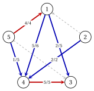
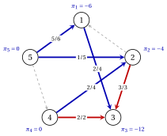
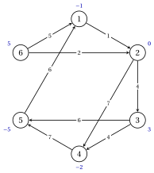
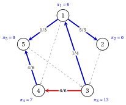
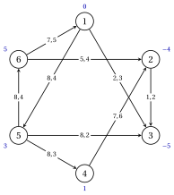
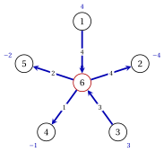

# Exercises · The network simplex

**Exercises · Chapter 8** · each solution opens with a click · [:material-book-open-variant: Chapter 8: Network simplex](../network-simplex/network-simplex/index.md) · [:material-file-pdf-box: Exercises, volume 4 (PDF)](../pdf/exercises-4-network-simplex.pdf)

!!! formula "Rules used in these exercises"

    The definitions and the results of the chapter [«The network simplex»](https://fabiofurini.github.io/network-optimization/network-simplex/network-simplex/), for a connected network $G=(N,A)$ with balances $b_i$, $\sum_{i \in N}b_i=0$, zero lower bounds, capacities $u_{ij}$ and costs $c_{ij}$; the arcs are in lexicographic order and the root of every tree is the last node $n$.

    - **(N1)** <strong>Tree solution.</strong> $x_{ij}=0$ on $L$, $x_{ij}=u_{ij}$ on $U$; with the residual balances $\hat{b}_i=b_i-\sum_{(i,j) \in U}u_{ij}+\sum_{(j,i) \in U}u_{ji}$, take the leaf $\ell \neq n$ with the smallest index, with tree arc $a$ and neighbour $j$: $x_a=\hat{b}_\ell$ if $a=(\ell,j)$, $x_a=-\hat{b}_\ell$ if $a=(j,\ell)$, then $\hat{b}_j:=\hat{b}_j+\hat{b}_\ell$; delete $\ell$ and repeat.

    - **(N2)** <strong>Potentials.</strong> $\pi_n=0$ and $\bar{c}_{ij}=c_{ij}-\pi_i+\pi_j=0$ on the tree arcs: $\pi_j=\pi_i-c_{ij}$ or $\pi_i=\pi_j+c_{ij}$. The reduced cost of a nonbasic arc is the cost of its fundamental cycle, traversed in its direction.

    - **(N3)** <strong>Optimality.</strong> $\bar{c}_{ij} \ge 0$ on $L$ and $\bar{c}_{ij} \le 0$ on $U$: the tree solution is optimal, and the unique optimum if the inequalities are strict.

    - **(N4)** <strong>Pivot.</strong> Entering arc: among the arcs of $L$ with $\bar{c}_{ij}<0$ and of $U$ with $\bar{c}_{ij}>0$, the largest $|\bar{c}_{ij}|$ (the first in lexicographic order if more than one). The cycle $C$ goes as the entering arc if it is in $L$, against it if it is in $U$; residual capacity $u_{ij}-x_{ij}$ on a forward arc, $x_{ij}$ on a backward arc; $\theta$ is the minimum. The apex is the first node shared by the tree paths of the endpoints of the entering arc to the root; the leaving arc is the last blocking arc from the apex along $C$, and it goes to $U$ if forward, to $L$ if backward. The cost decreases by $\theta|\bar{c}_{kl}|$; the potentials of the subtree $S$ cut off by the leaving arc change by $-\bar{c}_{kl}$ if $l \in S$, by $+\bar{c}_{kl}$ if $k \in S$.

    - **(N5)** <strong>Strong feasibility.</strong> Every tree arc with $x_{ij}=0$ points towards the root, and every tree arc with $x_{ij}=u_{ij}$ points away from the root.

    - **(N6)** <strong>Phase 0.</strong> Artificial node $r=n+1$, arc $(i,r)$ if $b_i \ge 0$ and $(r,i)$ if $b_i<0$, capacity $+\infty$, cost $1$ (cost $0$ on $A$), root $r$. $G$ is feasible if and only if $z_0=0$; then the network simplex continues with the costs $c_{ij}$ ($0$ on the artificial arcs), and only the arcs with $\bar{c}^0_{ij}=0$ may enter.

!!! esercizio "Exercise 8.1: Bases and tree solutions"

    !!! esercizio "Exercise"

        We consider the network $G=(N,A)$ with $N=\{1,2,\dots,5\}$, the $8$ arcs

        $$
        A=\{(1,3),(1,4),(2,1),(2,4),(4,3),(5,1),(5,3),(5,4)\},
        $$

        the balances $b_1=3$, $b_2=2$, $b_3=-7$, $b_4=-3$, $b_5=5$, zero lower bounds and the costs and capacities of the table; in the figure each arc carries $c_{ij},u_{ij}$ and each node its balance.

        
<table>
        <tr>
        <th>arc</th>
        <th>\((1,3)\)</th>
        <th>\((1,4)\)</th>
        <th>\((2,1)\)</th>
        <th>\((2,4)\)</th>
        <th>\((4,3)\)</th>
        <th>\((5,1)\)</th>
        <th>\((5,3)\)</th>
        <th>\((5,4)\)</th>
        </tr>
        <tr>
        <td>\(c_{ij}\)</td>
        <td>\(1\)</td>
        <td>\(7\)</td>
        <td>\(8\)</td>
        <td>\(1\)</td>
        <td>\(6\)</td>
        <td>\(7\)</td>
        <td>\(1\)</td>
        <td>\(1\)</td>
        </tr>
        <tr>
        <td>\(u_{ij}\)</td>
        <td>\(5\)</td>
        <td>\(6\)</td>
        <td>\(4\)</td>
        <td>\(2\)</td>
        <td>\(5\)</td>
        <td>\(4\)</td>
        <td>\(3\)</td>
        <td>\(5\)</td>
        </tr>
        </table>

        { .fig loading=lazy  }

        Consider the spanning tree $T=\{(1,3),(1,4),(2,4),(5,4)\}$, the sets $U=\{(4,3),(5,1)\}$ and $L=\{(2,1),(5,3)\}$, and the set of arcs $F=\{(1,4),(2,1),(2,4),(5,3)\}$.

    **Questions**

    1. Show that $F$ is not a basis: find a cycle of $F$ and a linear combination of its columns of $\mat{B}$ equal to zero. Why is $T$ a basis?

    2. Compute the residual balances and the tree solution of $(T,L,U)$ from the leaves, as in (N1).

    3. Is the tree structure feasible? Is it degenerate? Compute its cost.

    4. Is the tree structure strongly feasible, with root $5$?

??? soluzione "Solution"

    We use the rules (N1)–(N6) of the box at the beginning of these exercises.

    1. The arcs of $F$ contain the cycle $1,4,2,1$, which uses $(1,4)$ forward, $(2,4)$ backward, $(2,1)$ forward. With $+1$ for the forward arcs and $-1$ for the backward ones,

        $$
        \mat{B}_{(1,4)} -\mat{B}_{(2,4)} +\mat{B}_{(2,1)}=\vet{0},
        $$

        so the columns of $F$ are linearly dependent, in $\mat{B}$ and in the matrix without the row of node $5$: $F$ is not a basis. The set $T$ has $4$ arcs and connects all the nodes, so it is a spanning tree, and the spanning trees are the bases.

    2. The residual balances move the flows of $U$ to the right-hand side:

        $$
        \hat{\vet{b}}=(7,2,-2,-8,1) .
        $$

        The leaves are processed in the order $2,3,1,4$:

        
<table>
        <tr>
        <th>leaf \(\ell\)</th>
        <th>tree arc</th>
        <th>flow</th>
        <th>residual balance of the neighbour</th>
        </tr>
        <tr>
        <td>\(2\)</td>
        <td>\((2,4)\)</td>
        <td>\(x_{24}=\hat{b}_{2}=2\)</td>
        <td>\(\hat{b}_{4}=-8+2=-6\)</td>
        </tr>
        <tr>
        <td>\(3\)</td>
        <td>\((1,3)\)</td>
        <td>\(x_{13}=-\hat{b}_{3}=2\)</td>
        <td>\(\hat{b}_{1}=7-2=5\)</td>
        </tr>
        <tr>
        <td>\(1\)</td>
        <td>\((1,4)\)</td>
        <td>\(x_{14}=\hat{b}_{1}=5\)</td>
        <td>\(\hat{b}_{4}=-6+5=-1\)</td>
        </tr>
        <tr>
        <td>\(4\)</td>
        <td>\((5,4)\)</td>
        <td>\(x_{54}=-\hat{b}_{4}=1\)</td>
        <td>\(\hat{b}_{5}=1-1=0\)</td>
        </tr>
        </table>

        With $x_{ij}=0$ on $L$ and $x_{ij}=u_{ij}$ on $U$, the tree solution is

        
<table>
        <tr>
        <th>arc</th>
        <th>\((1,3)\)</th>
        <th>\((1,4)\)</th>
        <th>\((2,1)\)</th>
        <th>\((2,4)\)</th>
        <th>\((4,3)\)</th>
        <th>\((5,1)\)</th>
        <th>\((5,3)\)</th>
        <th>\((5,4)\)</th>
        </tr>
        <tr>
        <td>\(x_{ij}\)</td>
        <td>\(2\)</td>
        <td>\(5\)</td>
        <td>\(0\)</td>
        <td>\(2\)</td>
        <td>\(5\)</td>
        <td>\(4\)</td>
        <td>\(0\)</td>
        <td>\(1\)</td>
        </tr>
        <tr>
        <td>\(u_{ij}\)</td>
        <td>\(5\)</td>
        <td>\(6\)</td>
        <td>\(4\)</td>
        <td>\(2\)</td>
        <td>\(5\)</td>
        <td>\(4\)</td>
        <td>\(3\)</td>
        <td>\(5\)</td>
        </tr>
        </table>

    3. Every tree arc has $0 \le x_{ij} \le u_{ij}$, so the tree structure is feasible. The tree arc $(2,4)$ has $x_{24}=2$, at a bound: the tree structure is degenerate. Its cost is

        $$
        1 \cdot 2+7 \cdot 5+1 \cdot 2+6 \cdot 5+7 \cdot 4+1 \cdot 1=98 .
        $$

    4. No. The tree arc $(2,4)$ is at its capacity and points towards the root: on the tree path from $2$ to the root, no more flow can be sent forward along it. By (N5) the tree structure is not strongly feasible.

        { .fig loading=lazy  }

    !!! chiave ""

        $F$ contains a cycle and is not a basis; $(T,L,U)$ is feasible and degenerate, with cost $98$, and it is not strongly feasible because of the arc $(2,4)$.

!!! esercizio "Exercise 8.2: Potentials and the optimality certificate"

    !!! esercizio "Exercise"

        We consider the network $G=(N,A)$ with $N=\{1,2,\dots,5\}$, the $8$ arcs

        $$
        A=\{(1,3),(2,1),(2,3),(4,2),(4,3),(5,1),(5,2),(5,4)\},
        $$

        the balances $b_1=-3$, $b_2=0$, $b_3=-7$, $b_4=4$, $b_5=6$, zero lower bounds and the costs and capacities of the table; in the figure each arc carries $c_{ij},u_{ij}$ and each node its balance.

        
<table>
        <tr>
        <th>arc</th>
        <th>\((1,3)\)</th>
        <th>\((2,1)\)</th>
        <th>\((2,3)\)</th>
        <th>\((4,2)\)</th>
        <th>\((4,3)\)</th>
        <th>\((5,1)\)</th>
        <th>\((5,2)\)</th>
        <th>\((5,4)\)</th>
        </tr>
        <tr>
        <td>\(c_{ij}\)</td>
        <td>\(6\)</td>
        <td>\(7\)</td>
        <td>\(6\)</td>
        <td>\(4\)</td>
        <td>\(4\)</td>
        <td>\(6\)</td>
        <td>\(4\)</td>
        <td>\(7\)</td>
        </tr>
        <tr>
        <td>\(u_{ij}\)</td>
        <td>\(4\)</td>
        <td>\(4\)</td>
        <td>\(3\)</td>
        <td>\(4\)</td>
        <td>\(2\)</td>
        <td>\(6\)</td>
        <td>\(5\)</td>
        <td>\(5\)</td>
        </tr>
        </table>

        { .fig loading=lazy  }

        Consider the tree structure with $T=\{(1,3),(4,2),(5,1),(5,2)\}$, $U=\{(2,3),(4,3)\}$ and $L=\{(2,1),(5,4)\}$, whose tree solution is

        
<table>
        <tr>
        <th>arc</th>
        <th>\((1,3)\)</th>
        <th>\((2,1)\)</th>
        <th>\((2,3)\)</th>
        <th>\((4,2)\)</th>
        <th>\((4,3)\)</th>
        <th>\((5,1)\)</th>
        <th>\((5,2)\)</th>
        <th>\((5,4)\)</th>
        </tr>
        <tr>
        <td>\(x_{ij}\)</td>
        <td>\(2\)</td>
        <td>\(0\)</td>
        <td>\(3\)</td>
        <td>\(2\)</td>
        <td>\(2\)</td>
        <td>\(5\)</td>
        <td>\(1\)</td>
        <td>\(0\)</td>
        </tr>
        </table>

    **Questions**

    1. Compute the potentials of $T$ with root $5$ ($\pi_5=0$), as in (N2).

    2. Compute the reduced costs of the nonbasic arcs. Is the tree solution optimal? Is it the unique optimum?

    3. Write the fundamental cycle of $(4,3)$, traversed in its direction, and check that its cost equals $\bar{c}_{43}$.

    4. Give an optimal solution $(\vet{\pi},\vet{\alpha})$ of the dual model of [Chapter 4 «Network flow models»](https://fabiofurini.github.io/network-optimization/flows/network-flow-models/), with $\alpha_{ij}=\max\{0,-\bar{c}_{ij}\}$, and check that the dual value equals the cost of the flow.

??? soluzione "Solution"

    We use the rules (N1)–(N6) of the box at the beginning of these exercises.

    1. Going down the tree from the root $5$:

        $$
        \begin{gathered}
        \pi_{1}=\pi_{5}-c_{51}=-6, \qquad \pi_{2}=\pi_{5}-c_{52}=-4, \qquad \pi_{3}=\pi_{1}-c_{13}=-12\\
        \pi_{4}=\pi_{2}+c_{42}=0 .
        \end{gathered}
        $$

        Hence $\vet{\pi}=(-6,-4,-12,0,0)$.

    2. The reduced costs $\bar{c}_{ij}=c_{ij}-\pi_i+\pi_j$ are

        
<table>
        <tr>
        <th>arc</th>
        <th>\((1,3)\)</th>
        <th>\((2,1)\)</th>
        <th>\((2,3)\)</th>
        <th>\((4,2)\)</th>
        <th>\((4,3)\)</th>
        <th>\((5,1)\)</th>
        <th>\((5,2)\)</th>
        <th>\((5,4)\)</th>
        </tr>
        <tr>
        <td>state</td>
        <td>\(\mathrm{T}\)</td>
        <td>\(\mathrm{L}\)</td>
        <td>\(\mathrm{U}\)</td>
        <td>\(\mathrm{T}\)</td>
        <td>\(\mathrm{U}\)</td>
        <td>\(\mathrm{T}\)</td>
        <td>\(\mathrm{T}\)</td>
        <td>\(\mathrm{L}\)</td>
        </tr>
        <tr>
        <td>\(x_{ij}\)</td>
        <td>\(2\)</td>
        <td>\(0\)</td>
        <td>\(3\)</td>
        <td>\(2\)</td>
        <td>\(2\)</td>
        <td>\(5\)</td>
        <td>\(1\)</td>
        <td>\(0\)</td>
        </tr>
        <tr>
        <td>\(\bar{c}_{ij}\)</td>
        <td>\(0\)</td>
        <td>\(5\)</td>
        <td>\(-2\)</td>
        <td>\(0\)</td>
        <td>\(-8\)</td>
        <td>\(0\)</td>
        <td>\(0\)</td>
        <td>\(7\)</td>
        </tr>
        </table>

        The arcs of $L$ have $\bar{c}_{21}=5, \bar{c}_{54}=7$, all positive, and the arcs of $U$ have $\bar{c}_{23}=-2, \bar{c}_{43}=-8$, all negative. By (N3) the tree solution is optimal, with cost $80$, and it is the unique optimum because the inequalities are strict (Gurobi confirms the value).

        { .fig loading=lazy  }

    3. The cycle is $4,3,1,5,2,4$: $(4,3)$ forward, $(1,3)$ backward, $(5,1)$ backward, $(5,2)$ forward, $(4,2)$ backward. Its cost is

        $$
        c_{43}-c_{13}-c_{51}+c_{52}-c_{42}=4-6-6+4-4=-8=\bar{c}_{43} .
        $$

    4. With $\alpha_{ij}=\max\{0,-\bar{c}_{ij}\}$ the dual constraints $\pi_i-\pi_j-\alpha_{ij} \le c_{ij}$ hold, and $\alpha_{ij}>0$ only on the arcs of $U$: $\alpha_{23}=2$, $\alpha_{43}=8$. The dual value is

        $$
        \sum_{i \in N} b_i\pi_i-\sum_{(i,j) \in A} u_{ij}\alpha_{ij}=102-22=80,
        $$

        equal to the cost: both solutions are optimal.

    !!! chiave ""

        The potentials $\vet{\pi}=(-6,-4,-12,0,0)$ give $\bar{c}>0$ on $L$ and $\bar{c}<0$ on $U$: the tree solution is the unique optimum, with cost $80$ equal to the dual value.

!!! esercizio "Exercise 8.3: The network simplex without capacities"

    !!! esercizio "Exercise"

        We consider the network $G=(N,A)$ with $N=\{1,2,\dots,6\}$, the $9$ arcs

        $$
        A=\{(1,2),(2,3),(2,4),(3,4),(3,5),(4,5),(5,1),(6,1),(6,2)\},
        $$

        the balances $b_1=-1$, $b_2=0$, $b_3=3$, $b_4=-2$, $b_5=-5$, $b_6=5$, zero lower bounds and the costs of the table (no capacity: $u_{ij}=+\infty$); in the figure each arc carries $c_{ij}$ and each node its balance.

        
<table>
        <tr>
        <th>arc</th>
        <th>\((1,2)\)</th>
        <th>\((2,3)\)</th>
        <th>\((2,4)\)</th>
        <th>\((3,4)\)</th>
        <th>\((3,5)\)</th>
        <th>\((4,5)\)</th>
        <th>\((5,1)\)</th>
        <th>\((6,1)\)</th>
        <th>\((6,2)\)</th>
        </tr>
        <tr>
        <td>\(c_{ij}\)</td>
        <td>\(1\)</td>
        <td>\(4\)</td>
        <td>\(7\)</td>
        <td>\(4\)</td>
        <td>\(6\)</td>
        <td>\(7\)</td>
        <td>\(6\)</td>
        <td>\(5\)</td>
        <td>\(2\)</td>
        </tr>
        </table>

        { .fig loading=lazy  }

        The initial tree structure has $T=\{(1,2),(2,3),(3,4),(3,5),(6,1)\}$, $L=\{(2,4),(4,5),(5,1),(6,2)\}$ and $U=\emptyset$.

    **Questions**

    1. Compute the tree solution of the initial tree structure, its cost and its potentials. Is it nondegenerate?

    2. Solve the problem with the network simplex algorithm, with the rules (N1)–(N4): for every iteration give the flows, the potentials, the reduced costs, the entering arc, the cycle with its apex, the step and the leaving arc.

    3. Give the optimal flow and its cost, and explain why it is the unique optimum.

??? soluzione "Solution"

    We use the rules (N1)–(N6) of the box at the beginning of these exercises.

    1. From the leaves, as in (N1):

        
<table>
        <tr>
        <th>arc</th>
        <th>\((1,2)\)</th>
        <th>\((2,3)\)</th>
        <th>\((2,4)\)</th>
        <th>\((3,4)\)</th>
        <th>\((3,5)\)</th>
        <th>\((4,5)\)</th>
        <th>\((5,1)\)</th>
        <th>\((6,1)\)</th>
        <th>\((6,2)\)</th>
        </tr>
        <tr>
        <td>\(x_{ij}\)</td>
        <td>\(4\)</td>
        <td>\(4\)</td>
        <td>\(0\)</td>
        <td>\(2\)</td>
        <td>\(5\)</td>
        <td>\(0\)</td>
        <td>\(0\)</td>
        <td>\(5\)</td>
        <td>\(0\)</td>
        </tr>
        </table>

        Every tree arc has a positive flow, so the tree solution is nondegenerate; its cost is $83$. From the root $6$, $\vet{\pi}=(-5,-6,-10,-14,-16,0)$.

    2. <strong>Iteration 1</strong>  The potentials are $\vet{\pi}=(-5,-6,-10,-14,-16,0)$ and the cost is $83$.

        
<table>
        <tr>
        <th>arc</th>
        <th>\((1,2)\)</th>
        <th>\((2,3)\)</th>
        <th>\((2,4)\)</th>
        <th>\((3,4)\)</th>
        <th>\((3,5)\)</th>
        <th>\((4,5)\)</th>
        <th>\((5,1)\)</th>
        <th>\((6,1)\)</th>
        <th>\((6,2)\)</th>
        </tr>
        <tr>
        <td>state</td>
        <td>\(\mathrm{T}\)</td>
        <td>\(\mathrm{T}\)</td>
        <td>\(\mathrm{L}\)</td>
        <td>\(\mathrm{T}\)</td>
        <td>\(\mathrm{T}\)</td>
        <td>\(\mathrm{L}\)</td>
        <td>\(\mathrm{L}\)</td>
        <td>\(\mathrm{T}\)</td>
        <td>\(\mathrm{L}\)</td>
        </tr>
        <tr>
        <td>\(x_{ij}\)</td>
        <td>\(4\)</td>
        <td>\(4\)</td>
        <td>\(0\)</td>
        <td>\(2\)</td>
        <td>\(5\)</td>
        <td>\(0\)</td>
        <td>\(0\)</td>
        <td>\(5\)</td>
        <td>\(0\)</td>
        </tr>
        <tr>
        <td>\(\bar{c}_{ij}\)</td>
        <td>\(0\)</td>
        <td>\(0\)</td>
        <td>\(-1\)</td>
        <td>\(0\)</td>
        <td>\(0\)</td>
        <td>\(5\)</td>
        <td>\(17\)</td>
        <td>\(0\)</td>
        <td>\(-4\)</td>
        </tr>
        </table>

        - The eligible arcs are $(2,4)$ and $(6,2)$; the entering arc is $e=(6,2)$, with $\bar{c}_{62}=-4$, in $L$: $C$ follows it.

        - The tree paths to the root are $6$ and $2,1,6$: the apex is $w=6$, and $C$ is $6,2,1,6$.

            
<table>
            <tr>
            <td>arc of \(C\)</td>
            <td>\((6,2)\)</td>
            <td>\((1,2)\)</td>
            <td>\((6,1)\)</td>
            </tr>
            <tr>
            <td>direction</td>
            <td>\(+\)</td>
            <td>\(-\)</td>
            <td>\(-\)</td>
            </tr>
            <tr>
            <td>residual</td>
            <td>\(+\infty\)</td>
            <td>\(4\)</td>
            <td>\(5\)</td>
            </tr>
            </table>

        - $\theta=4$: the only blocking arc is $(1,2)$; it leaves the tree, to $L$. The cost becomes $83-4 \cdot 4=67$.

        - Removing $(1,2)$ cuts off $S=\{2,3,4,5\}$, which contains $l=2$: these potentials change by $-\bar{c}_{62}=4$.

        <strong>Iteration 2</strong>  The potentials are $\vet{\pi}=(-5,-2,-6,-10,-12,0)$ and the cost is $67$.

        
<table>
        <tr>
        <th>arc</th>
        <th>\((1,2)\)</th>
        <th>\((2,3)\)</th>
        <th>\((2,4)\)</th>
        <th>\((3,4)\)</th>
        <th>\((3,5)\)</th>
        <th>\((4,5)\)</th>
        <th>\((5,1)\)</th>
        <th>\((6,1)\)</th>
        <th>\((6,2)\)</th>
        </tr>
        <tr>
        <td>state</td>
        <td>\(\mathrm{L}\)</td>
        <td>\(\mathrm{T}\)</td>
        <td>\(\mathrm{L}\)</td>
        <td>\(\mathrm{T}\)</td>
        <td>\(\mathrm{T}\)</td>
        <td>\(\mathrm{L}\)</td>
        <td>\(\mathrm{L}\)</td>
        <td>\(\mathrm{T}\)</td>
        <td>\(\mathrm{T}\)</td>
        </tr>
        <tr>
        <td>\(x_{ij}\)</td>
        <td>\(0\)</td>
        <td>\(4\)</td>
        <td>\(0\)</td>
        <td>\(2\)</td>
        <td>\(5\)</td>
        <td>\(0\)</td>
        <td>\(0\)</td>
        <td>\(1\)</td>
        <td>\(4\)</td>
        </tr>
        <tr>
        <td>\(\bar{c}_{ij}\)</td>
        <td>\(4\)</td>
        <td>\(0\)</td>
        <td>\(-1\)</td>
        <td>\(0\)</td>
        <td>\(0\)</td>
        <td>\(5\)</td>
        <td>\(13\)</td>
        <td>\(0\)</td>
        <td>\(0\)</td>
        </tr>
        </table>

        - The only eligible arc is $e=(2,4)$, with $\bar{c}_{24}=-1$, in $L$: $C$ follows it.

        - The tree paths to the root are $2,6$ and $4,3,2,6$: the apex is $w=2$, and $C$ is $2,4,3,2$.

            
<table>
            <tr>
            <td>arc of \(C\)</td>
            <td>\((2,4)\)</td>
            <td>\((3,4)\)</td>
            <td>\((2,3)\)</td>
            </tr>
            <tr>
            <td>direction</td>
            <td>\(+\)</td>
            <td>\(-\)</td>
            <td>\(-\)</td>
            </tr>
            <tr>
            <td>residual</td>
            <td>\(+\infty\)</td>
            <td>\(2\)</td>
            <td>\(4\)</td>
            </tr>
            </table>

        - $\theta=2$: the only blocking arc is $(3,4)$; it leaves the tree, to $L$. The cost becomes $67-2 \cdot 1=65$.

        - Removing $(3,4)$ cuts off $S=\{4\}$, which contains $l=4$: these potentials change by $-\bar{c}_{24}=1$.

        <strong>Iteration 3</strong>  The potentials are $\vet{\pi}=(-5,-2,-6,-9,-12,0)$ and the cost is $65$.

        
<table>
        <tr>
        <th>arc</th>
        <th>\((1,2)\)</th>
        <th>\((2,3)\)</th>
        <th>\((2,4)\)</th>
        <th>\((3,4)\)</th>
        <th>\((3,5)\)</th>
        <th>\((4,5)\)</th>
        <th>\((5,1)\)</th>
        <th>\((6,1)\)</th>
        <th>\((6,2)\)</th>
        </tr>
        <tr>
        <td>state</td>
        <td>\(\mathrm{L}\)</td>
        <td>\(\mathrm{T}\)</td>
        <td>\(\mathrm{T}\)</td>
        <td>\(\mathrm{L}\)</td>
        <td>\(\mathrm{T}\)</td>
        <td>\(\mathrm{L}\)</td>
        <td>\(\mathrm{L}\)</td>
        <td>\(\mathrm{T}\)</td>
        <td>\(\mathrm{T}\)</td>
        </tr>
        <tr>
        <td>\(x_{ij}\)</td>
        <td>\(0\)</td>
        <td>\(2\)</td>
        <td>\(2\)</td>
        <td>\(0\)</td>
        <td>\(5\)</td>
        <td>\(0\)</td>
        <td>\(0\)</td>
        <td>\(1\)</td>
        <td>\(4\)</td>
        </tr>
        <tr>
        <td>\(\bar{c}_{ij}\)</td>
        <td>\(4\)</td>
        <td>\(0\)</td>
        <td>\(0\)</td>
        <td>\(1\)</td>
        <td>\(0\)</td>
        <td>\(4\)</td>
        <td>\(13\)</td>
        <td>\(0\)</td>
        <td>\(0\)</td>
        </tr>
        </table>

        All the arcs of $L$ have $\bar{c}_{ij} \ge 0$: <code>STOP</code>.

    3. The optimal flow is

        
<table>
        <tr>
        <th>arc</th>
        <th>\((1,2)\)</th>
        <th>\((2,3)\)</th>
        <th>\((2,4)\)</th>
        <th>\((3,4)\)</th>
        <th>\((3,5)\)</th>
        <th>\((4,5)\)</th>
        <th>\((5,1)\)</th>
        <th>\((6,1)\)</th>
        <th>\((6,2)\)</th>
        </tr>
        <tr>
        <td>\(\tilde{x}_{ij}\)</td>
        <td>\(0\)</td>
        <td>\(2\)</td>
        <td>\(2\)</td>
        <td>\(0\)</td>
        <td>\(5\)</td>
        <td>\(0\)</td>
        <td>\(0\)</td>
        <td>\(1\)</td>
        <td>\(4\)</td>
        </tr>
        </table>

        with cost $65$. All the nonbasic arcs are in $L$ with $\bar{c}_{ij}>0$, so by (N3) it is the unique optimum; Gurobi gives the same value.

        { .fig loading=lazy  }

    !!! chiave ""

        The network simplex makes $2$ nondegenerate pivots, with costs $83$, $67$, $65$; the last tree certifies the unique optimum, of cost $65$.

!!! esercizio "Exercise 8.4: The network simplex with capacities"

    !!! esercizio "Exercise"

        We consider the network $G=(N,A)$ with $N=\{1,2,\dots,5\}$, the $8$ arcs

        $$
        A=\{(1,2),(1,4),(1,5),(2,3),(3,1),(3,4),(4,5),(5,3)\},
        $$

        the balances $b_1=5$, $b_2=-5$, $b_3=7$, $b_4=-2$, $b_5=-5$, zero lower bounds and the costs and capacities of the table; in the figure each arc carries $c_{ij},u_{ij}$ and each node its balance.

        
<table>
        <tr>
        <th>arc</th>
        <th>\((1,2)\)</th>
        <th>\((1,4)\)</th>
        <th>\((1,5)\)</th>
        <th>\((2,3)\)</th>
        <th>\((3,1)\)</th>
        <th>\((3,4)\)</th>
        <th>\((4,5)\)</th>
        <th>\((5,3)\)</th>
        </tr>
        <tr>
        <td>\(c_{ij}\)</td>
        <td>\(6\)</td>
        <td>\(2\)</td>
        <td>\(6\)</td>
        <td>\(2\)</td>
        <td>\(7\)</td>
        <td>\(2\)</td>
        <td>\(7\)</td>
        <td>\(6\)</td>
        </tr>
        <tr>
        <td>\(u_{ij}\)</td>
        <td>\(5\)</td>
        <td>\(4\)</td>
        <td>\(3\)</td>
        <td>\(4\)</td>
        <td>\(4\)</td>
        <td>\(6\)</td>
        <td>\(6\)</td>
        <td>\(2\)</td>
        </tr>
        </table>

        { .fig loading=lazy  }

        The initial tree structure has $T=\{(1,2),(1,4),(3,1),(4,5)\}$, $U=\{(1,5),(3,4),(5,3)\}$ and $L=\{(2,3)\}$.

    **Questions**

    1. Compute the tree solution of the initial tree structure and its cost. Check that it is strongly feasible, with root $5$.

    2. Solve the problem with the network simplex algorithm, with the rules (N1)–(N4), giving all the details of every iteration.

    3. Which pivot is degenerate? What changes in that pivot, and what does not?

    4. Give the optimal flow, its cost and the arcs at their capacity.

??? soluzione "Solution"

    We use the rules (N1)–(N6) of the box at the beginning of these exercises.

    1. From the leaves, as in (N1):

        
<table>
        <tr>
        <th>arc</th>
        <th>\((1,2)\)</th>
        <th>\((1,4)\)</th>
        <th>\((1,5)\)</th>
        <th>\((2,3)\)</th>
        <th>\((3,1)\)</th>
        <th>\((3,4)\)</th>
        <th>\((4,5)\)</th>
        <th>\((5,3)\)</th>
        </tr>
        <tr>
        <td>\(x_{ij}\)</td>
        <td>\(5\)</td>
        <td>\(0\)</td>
        <td>\(3\)</td>
        <td>\(0\)</td>
        <td>\(3\)</td>
        <td>\(6\)</td>
        <td>\(4\)</td>
        <td>\(2\)</td>
        </tr>
        <tr>
        <td>\(u_{ij}\)</td>
        <td>\(5\)</td>
        <td>\(4\)</td>
        <td>\(3\)</td>
        <td>\(4\)</td>
        <td>\(4\)</td>
        <td>\(6\)</td>
        <td>\(6\)</td>
        <td>\(2\)</td>
        </tr>
        </table>

        Its cost is $121$. The tree arcs at a bound are: $(1,4)$, with $x_{14}=0$, points towards the root; $(1,2)$, with $x_{12}=5=u_{12}$, points away from the root. By (N5) the tree structure is strongly feasible.

    2. <strong>Iteration 1</strong>  The potentials are $\vet{\pi}=(9,3,16,7,0)$ and the cost is $121$.

        
<table>
        <tr>
        <th>arc</th>
        <th>\((1,2)\)</th>
        <th>\((1,4)\)</th>
        <th>\((1,5)\)</th>
        <th>\((2,3)\)</th>
        <th>\((3,1)\)</th>
        <th>\((3,4)\)</th>
        <th>\((4,5)\)</th>
        <th>\((5,3)\)</th>
        </tr>
        <tr>
        <td>state</td>
        <td>\(\mathrm{T}\)</td>
        <td>\(\mathrm{T}\)</td>
        <td>\(\mathrm{U}\)</td>
        <td>\(\mathrm{L}\)</td>
        <td>\(\mathrm{T}\)</td>
        <td>\(\mathrm{U}\)</td>
        <td>\(\mathrm{T}\)</td>
        <td>\(\mathrm{U}\)</td>
        </tr>
        <tr>
        <td>\(x_{ij}\)</td>
        <td>\(5\)</td>
        <td>\(0\)</td>
        <td>\(3\)</td>
        <td>\(0\)</td>
        <td>\(3\)</td>
        <td>\(6\)</td>
        <td>\(4\)</td>
        <td>\(2\)</td>
        </tr>
        <tr>
        <td>\(\bar{c}_{ij}\)</td>
        <td>\(0\)</td>
        <td>\(0\)</td>
        <td>\(-3\)</td>
        <td>\(15\)</td>
        <td>\(0\)</td>
        <td>\(-7\)</td>
        <td>\(0\)</td>
        <td>\(22\)</td>
        </tr>
        </table>

        - The only eligible arc is $e=(5,3)$, with $\bar{c}_{53}=22$, in $U$: $C$ is traversed against it.

        - The tree paths to the root are $5$ and $3,1,4,5$: the apex is $w=5$, and $C$ is $5,4,1,3,5$.

            
<table>
            <tr>
            <td>arc of \(C\)</td>
            <td>\((4,5)\)</td>
            <td>\((1,4)\)</td>
            <td>\((3,1)\)</td>
            <td>\((5,3)\)</td>
            </tr>
            <tr>
            <td>direction</td>
            <td>\(-\)</td>
            <td>\(-\)</td>
            <td>\(-\)</td>
            <td>\(-\)</td>
            </tr>
            <tr>
            <td>residual</td>
            <td>\(4\)</td>
            <td>\(0\)</td>
            <td>\(3\)</td>
            <td>\(2\)</td>
            </tr>
            </table>

        - $\theta=0$: the only blocking arc is $(1,4)$; it leaves the tree, to $L$. The pivot is degenerate, and the cost stays $121$.

        - Removing $(1,4)$ cuts off $S=\{1,2,3\}$, which contains $l=3$: these potentials change by $-\bar{c}_{53}=-22$.

        <strong>Iteration 2</strong>  The potentials are $\vet{\pi}=(-13,-19,-6,7,0)$ and the cost is $121$.

        
<table>
        <tr>
        <th>arc</th>
        <th>\((1,2)\)</th>
        <th>\((1,4)\)</th>
        <th>\((1,5)\)</th>
        <th>\((2,3)\)</th>
        <th>\((3,1)\)</th>
        <th>\((3,4)\)</th>
        <th>\((4,5)\)</th>
        <th>\((5,3)\)</th>
        </tr>
        <tr>
        <td>state</td>
        <td>\(\mathrm{T}\)</td>
        <td>\(\mathrm{L}\)</td>
        <td>\(\mathrm{U}\)</td>
        <td>\(\mathrm{L}\)</td>
        <td>\(\mathrm{T}\)</td>
        <td>\(\mathrm{U}\)</td>
        <td>\(\mathrm{T}\)</td>
        <td>\(\mathrm{T}\)</td>
        </tr>
        <tr>
        <td>\(x_{ij}\)</td>
        <td>\(5\)</td>
        <td>\(0\)</td>
        <td>\(3\)</td>
        <td>\(0\)</td>
        <td>\(3\)</td>
        <td>\(6\)</td>
        <td>\(4\)</td>
        <td>\(2\)</td>
        </tr>
        <tr>
        <td>\(\bar{c}_{ij}\)</td>
        <td>\(0\)</td>
        <td>\(22\)</td>
        <td>\(19\)</td>
        <td>\(15\)</td>
        <td>\(0\)</td>
        <td>\(15\)</td>
        <td>\(0\)</td>
        <td>\(0\)</td>
        </tr>
        </table>

        - The eligible arcs are $(1,5)$ and $(3,4)$; the entering arc is $e=(1,5)$, with $\bar{c}_{15}=19$, in $U$: $C$ is traversed against it.

        - The tree paths to the root are $1,3,5$ and $5$: the apex is $w=5$, and $C$ is $5,1,3,5$.

            
<table>
            <tr>
            <td>arc of \(C\)</td>
            <td>\((1,5)\)</td>
            <td>\((3,1)\)</td>
            <td>\((5,3)\)</td>
            </tr>
            <tr>
            <td>direction</td>
            <td>\(-\)</td>
            <td>\(-\)</td>
            <td>\(-\)</td>
            </tr>
            <tr>
            <td>residual</td>
            <td>\(3\)</td>
            <td>\(3\)</td>
            <td>\(2\)</td>
            </tr>
            </table>

        - $\theta=2$: the only blocking arc is $(5,3)$; it leaves the tree, to $L$. The cost becomes $121-2 \cdot 19=83$.

        - Removing $(5,3)$ cuts off $S=\{1,2,3\}$, which contains $k=1$: these potentials change by $\bar{c}_{15}=19$.

        <strong>Iteration 3</strong>  The potentials are $\vet{\pi}=(6,0,13,7,0)$ and the cost is $83$.

        
<table>
        <tr>
        <th>arc</th>
        <th>\((1,2)\)</th>
        <th>\((1,4)\)</th>
        <th>\((1,5)\)</th>
        <th>\((2,3)\)</th>
        <th>\((3,1)\)</th>
        <th>\((3,4)\)</th>
        <th>\((4,5)\)</th>
        <th>\((5,3)\)</th>
        </tr>
        <tr>
        <td>state</td>
        <td>\(\mathrm{T}\)</td>
        <td>\(\mathrm{L}\)</td>
        <td>\(\mathrm{T}\)</td>
        <td>\(\mathrm{L}\)</td>
        <td>\(\mathrm{T}\)</td>
        <td>\(\mathrm{U}\)</td>
        <td>\(\mathrm{T}\)</td>
        <td>\(\mathrm{L}\)</td>
        </tr>
        <tr>
        <td>\(x_{ij}\)</td>
        <td>\(5\)</td>
        <td>\(0\)</td>
        <td>\(1\)</td>
        <td>\(0\)</td>
        <td>\(1\)</td>
        <td>\(6\)</td>
        <td>\(4\)</td>
        <td>\(0\)</td>
        </tr>
        <tr>
        <td>\(\bar{c}_{ij}\)</td>
        <td>\(0\)</td>
        <td>\(3\)</td>
        <td>\(0\)</td>
        <td>\(15\)</td>
        <td>\(0\)</td>
        <td>\(-4\)</td>
        <td>\(0\)</td>
        <td>\(19\)</td>
        </tr>
        </table>

        All the arcs of $L$ have $\bar{c}_{ij} \ge 0$ and all the arcs of $U$ have $\bar{c}_{ij} \le 0$: <code>STOP</code>.

    3. Iteration $1$ is degenerate: $\theta=0$ because the arc $(1,4)$ has residual capacity $0$ along $C$. The flow and the cost ($121$) do not change, but the tree does: $(5,3)$ enters, $(1,4)$ leaves, and the potentials of $S=\{1,2,3\}$ change by $-22$.

    4. The optimal flow is

        
<table>
        <tr>
        <th>arc</th>
        <th>\((1,2)\)</th>
        <th>\((1,4)\)</th>
        <th>\((1,5)\)</th>
        <th>\((2,3)\)</th>
        <th>\((3,1)\)</th>
        <th>\((3,4)\)</th>
        <th>\((4,5)\)</th>
        <th>\((5,3)\)</th>
        </tr>
        <tr>
        <td>\(\tilde{x}_{ij}\)</td>
        <td>\(5\)</td>
        <td>\(0\)</td>
        <td>\(1\)</td>
        <td>\(0\)</td>
        <td>\(1\)</td>
        <td>\(6\)</td>
        <td>\(4\)</td>
        <td>\(0\)</td>
        </tr>
        <tr>
        <td>\(u_{ij}\)</td>
        <td>\(5\)</td>
        <td>\(4\)</td>
        <td>\(3\)</td>
        <td>\(4\)</td>
        <td>\(4\)</td>
        <td>\(6\)</td>
        <td>\(6\)</td>
        <td>\(2\)</td>
        </tr>
        </table>

        with cost $83$; the arc of $U$ at its capacity is $(3,4)$. The reduced costs are strictly positive on $L$ and strictly negative on $U$, so the optimum is unique (Gurobi gives the same value).

        { .fig loading=lazy  }

    !!! chiave ""

        From the cost $121$ the algorithm reaches the unique optimum, of cost $83$, in $2$ pivots, one of them degenerate.

!!! esercizio "Exercise 8.5: Strongly feasible trees and the leaving arc rule"

    !!! esercizio "Exercise"

        We consider the network $G=(N,A)$ with $N=\{1,2,\dots,6\}$, the $9$ arcs

        $$
        A=\{(1,3),(1,5),(2,3),(4,2),(5,3),(5,4),(5,6),(6,1),(6,2)\},
        $$

        the balances $b_1=0$, $b_2=-4$, $b_3=-5$, $b_4=1$, $b_5=3$, $b_6=5$, zero lower bounds and the costs and capacities of the table; in the figure each arc carries $c_{ij},u_{ij}$ and each node its balance.

        
<table>
        <tr>
        <th>arc</th>
        <th>\((1,3)\)</th>
        <th>\((1,5)\)</th>
        <th>\((2,3)\)</th>
        <th>\((4,2)\)</th>
        <th>\((5,3)\)</th>
        <th>\((5,4)\)</th>
        <th>\((5,6)\)</th>
        <th>\((6,1)\)</th>
        <th>\((6,2)\)</th>
        </tr>
        <tr>
        <td>\(c_{ij}\)</td>
        <td>\(2\)</td>
        <td>\(8\)</td>
        <td>\(1\)</td>
        <td>\(7\)</td>
        <td>\(8\)</td>
        <td>\(8\)</td>
        <td>\(8\)</td>
        <td>\(7\)</td>
        <td>\(5\)</td>
        </tr>
        <tr>
        <td>\(u_{ij}\)</td>
        <td>\(3\)</td>
        <td>\(4\)</td>
        <td>\(2\)</td>
        <td>\(6\)</td>
        <td>\(2\)</td>
        <td>\(3\)</td>
        <td>\(4\)</td>
        <td>\(5\)</td>
        <td>\(4\)</td>
        </tr>
        </table>

        { .fig loading=lazy  }

        Consider the tree structure with $T=\{(1,3),(1,5),(2,3),(4,2),(6,1)\}$, $U=\{(5,3),(5,4)\}$ and $L=\{(5,6),(6,2)\}$.

    **Questions**

    1. Compute the tree solution and check that the tree structure is strongly feasible, with root $6$.

    2. Compute the potentials and the reduced costs, and choose the entering arc with (N4).

    3. Find the apex, the cycle, the step and the blocking arcs. Which arc leaves the tree with the rule of (N4)? Check that the new tree structure is strongly feasible.

    4. Show that choosing the other blocking arc, $(1,3)$, gives a tree structure that is not strongly feasible.

    5. Prove that in a degenerate pivot from a strongly feasible tree, performed with the rule of (N4), the sum of the potentials strictly decreases, and check it on this pivot.

??? soluzione "Solution"

    We use the rules (N1)–(N6) of the box at the beginning of these exercises.

    1. From the leaves, as in (N1):

        
<table>
        <tr>
        <th>arc</th>
        <th>\((1,3)\)</th>
        <th>\((1,5)\)</th>
        <th>\((2,3)\)</th>
        <th>\((4,2)\)</th>
        <th>\((5,3)\)</th>
        <th>\((5,4)\)</th>
        <th>\((5,6)\)</th>
        <th>\((6,1)\)</th>
        <th>\((6,2)\)</th>
        </tr>
        <tr>
        <td>\(x_{ij}\)</td>
        <td>\(3\)</td>
        <td>\(2\)</td>
        <td>\(0\)</td>
        <td>\(4\)</td>
        <td>\(2\)</td>
        <td>\(3\)</td>
        <td>\(0\)</td>
        <td>\(5\)</td>
        <td>\(0\)</td>
        </tr>
        <tr>
        <td>\(u_{ij}\)</td>
        <td>\(3\)</td>
        <td>\(4\)</td>
        <td>\(2\)</td>
        <td>\(6\)</td>
        <td>\(2\)</td>
        <td>\(3\)</td>
        <td>\(4\)</td>
        <td>\(5\)</td>
        <td>\(4\)</td>
        </tr>
        </table>

        The tree arcs at a bound are: $(6,1)$, with $x_{61}=5=u_{61}$, points away from the root; $(2,3)$, with $x_{23}=0$, points towards the root; $(1,3)$, with $x_{13}=3=u_{13}$, points away from the root. By (N5) the tree structure is strongly feasible.

    2. The potentials are $\vet{\pi}=(-7,-8,-9,-1,-15,0)$ and the cost is $125$.

        
<table>
        <tr>
        <th>arc</th>
        <th>\((1,3)\)</th>
        <th>\((1,5)\)</th>
        <th>\((2,3)\)</th>
        <th>\((4,2)\)</th>
        <th>\((5,3)\)</th>
        <th>\((5,4)\)</th>
        <th>\((5,6)\)</th>
        <th>\((6,1)\)</th>
        <th>\((6,2)\)</th>
        </tr>
        <tr>
        <td>state</td>
        <td>\(\mathrm{T}\)</td>
        <td>\(\mathrm{T}\)</td>
        <td>\(\mathrm{T}\)</td>
        <td>\(\mathrm{T}\)</td>
        <td>\(\mathrm{U}\)</td>
        <td>\(\mathrm{U}\)</td>
        <td>\(\mathrm{L}\)</td>
        <td>\(\mathrm{T}\)</td>
        <td>\(\mathrm{L}\)</td>
        </tr>
        <tr>
        <td>\(x_{ij}\)</td>
        <td>\(3\)</td>
        <td>\(2\)</td>
        <td>\(0\)</td>
        <td>\(4\)</td>
        <td>\(2\)</td>
        <td>\(3\)</td>
        <td>\(0\)</td>
        <td>\(5\)</td>
        <td>\(0\)</td>
        </tr>
        <tr>
        <td>\(\bar{c}_{ij}\)</td>
        <td>\(0\)</td>
        <td>\(0\)</td>
        <td>\(0\)</td>
        <td>\(0\)</td>
        <td>\(14\)</td>
        <td>\(22\)</td>
        <td>\(23\)</td>
        <td>\(0\)</td>
        <td>\(-3\)</td>
        </tr>
        </table>

        The eligible arcs are $(5,3)$, $(5,4)$ and $(6,2)$; the entering arc is $e=(5,4)$, with $\bar{c}_{54}=22$.

    3. The tree paths to the root are $5,1,6$ and $4,2,3,1,6$: the apex is $w=1$, and $C$ is $1,3,2,4,5,1$.

        
<table>
        <tr>
        <td>arc of \(C\)</td>
        <td>\((1,3)\)</td>
        <td>\((2,3)\)</td>
        <td>\((4,2)\)</td>
        <td>\((5,4)\)</td>
        <td>\((1,5)\)</td>
        </tr>
        <tr>
        <td>direction</td>
        <td>\(+\)</td>
        <td>\(-\)</td>
        <td>\(-\)</td>
        <td>\(-\)</td>
        <td>\(-\)</td>
        </tr>
        <tr>
        <td>residual</td>
        <td>\(0\)</td>
        <td>\(0\)</td>
        <td>\(4\)</td>
        <td>\(3\)</td>
        <td>\(2\)</td>
        </tr>
        </table>

        Hence $\theta=0$, and the blocking arcs are $(1,3)$ and $(2,3)$, in this order from the apex: the leaving arc is $(2,3)$, and it goes to $L$. The flow does not change, and the new tree is $T'=\{(1,3),(1,5),(4,2),(5,4),(6,1)\}$. The tree arcs at a bound are: $(6,1)$, with $x_{61}=5=u_{61}$, points away from the root; $(1,3)$, with $x_{13}=3=u_{13}$, points away from the root; $(5,4)$, with $x_{54}=3=u_{54}$, points away from the root. By (N5) the tree structure is strongly feasible.

    4. With $(1,3)$ leaving, the tree would be $\{(1,5),(2,3),(4,2),(5,4),(6,1)\}$, and the arc $(2,3)$ has zero flow and points away from the root: by (N5) this tree structure is not strongly feasible.

    5. In a degenerate pivot all the blocking arcs lie on the tree path $P$ from the apex to $p$, the endpoint where $C$ enters $e$: the arcs of the path from $q$ to the apex and $e$ itself have positive residual capacity, by strong feasibility. Hence the leaving arc separates $p$ from the root, $p \in S$, and by (N4) the potentials of $S$ change by $\bar{c}_{kl}<0$ if $p=k$ (arc of $L$) or by $-\bar{c}_{kl}<0$ if $p=l$ (arc of $U$). Here $p=4$, $S=\{2,4\}$, and the potentials of $S$ change by $-22$: the sum of the potentials goes from $-40$ to $-84$.

    !!! chiave ""

        The pivot of $(5,4)$ is degenerate with two blocking arcs; the rule chooses $(2,3)$ and keeps the tree strongly feasible, while $(1,3)$ would not; the sum of the potentials drops from $-40$ to $-84$.

!!! esercizio "Exercise 8.6: Phase 0"

    !!! esercizio "Exercise"

        We consider the network $G=(N,A)$ with $N=\{1,2,\dots,5\}$, the $6$ arcs

        $$
        A=\{(1,4),(1,5),(2,1),(3,2),(4,3),(5,2)\},
        $$

        the balances $b_1=4$, $b_2=-4$, $b_3=3$, $b_4=-1$, $b_5=-2$, zero lower bounds and the costs and capacities of the table; in the figure each arc carries $c_{ij},u_{ij}$ and each node its balance.

        
<table>
        <tr>
        <th>arc</th>
        <th>\((1,4)\)</th>
        <th>\((1,5)\)</th>
        <th>\((2,1)\)</th>
        <th>\((3,2)\)</th>
        <th>\((4,3)\)</th>
        <th>\((5,2)\)</th>
        </tr>
        <tr>
        <td>\(c_{ij}\)</td>
        <td>\(8\)</td>
        <td>\(8\)</td>
        <td>\(6\)</td>
        <td>\(6\)</td>
        <td>\(5\)</td>
        <td>\(7\)</td>
        </tr>
        <tr>
        <td>\(u_{ij}\)</td>
        <td>\(6\)</td>
        <td>\(3\)</td>
        <td>\(4\)</td>
        <td>\(6\)</td>
        <td>\(6\)</td>
        <td>\(2\)</td>
        </tr>
        </table>

        { .fig loading=lazy  }

        No feasible flow is known in advance.

    **Questions**

    1. Build the auxiliary network of Phase 0 as in (N6): artificial node, artificial arcs, costs, initial tree, its flows, its cost $z_0$ and its potentials.

    2. Run Phase 0 with the rules (N1)–(N4). Is the network feasible?

    3. Which arcs are frozen at the end of Phase 0? Continue with the network simplex algorithm and find an optimal flow of $G$.

??? soluzione "Solution"

    We use the rules (N1)–(N6) of the box at the beginning of these exercises.

    1. The artificial node is $6$, with $b_{6}=0$, and the artificial arcs are $(1,6)$, $(6,2)$, $(3,6)$, $(6,4)$ and $(6,5)$, with capacity $+\infty$ and cost $1$ (the arcs of $A$ cost $0$). The initial tree is formed by the artificial arcs, with flows $x_{16}=4$, $x_{62}=4$, $x_{36}=3$, $x_{64}=1$, $x_{65}=2$, and $z_0=14$. The root is $6$, and the potentials are $\vet{\pi}=(1,-1,1,-1,-1,0)$: $1$ for the arcs $(i,6)$, $-1$ for the arcs $(6,i)$.

        { .fig loading=lazy  }

        The arcs of $A$, all empty, are not drawn.

    2. <strong>Iteration 1</strong>  The potentials are $\vet{\pi}=(1,-1,1,-1,-1,0)$ and the cost $z_0$ is $14$.

        
<table>
        <tr>
        <th>arc</th>
        <th>\((1,4)\)</th>
        <th>\((1,5)\)</th>
        <th>\((1,6)\)</th>
        <th>\((2,1)\)</th>
        <th>\((3,2)\)</th>
        <th>\((3,6)\)</th>
        <th>\((4,3)\)</th>
        <th>\((5,2)\)</th>
        <th>\((6,2)\)</th>
        <th>\((6,4)\)</th>
        <th>\((6,5)\)</th>
        </tr>
        <tr>
        <td>state</td>
        <td>\(\mathrm{L}\)</td>
        <td>\(\mathrm{L}\)</td>
        <td>\(\mathrm{T}\)</td>
        <td>\(\mathrm{L}\)</td>
        <td>\(\mathrm{L}\)</td>
        <td>\(\mathrm{T}\)</td>
        <td>\(\mathrm{L}\)</td>
        <td>\(\mathrm{L}\)</td>
        <td>\(\mathrm{T}\)</td>
        <td>\(\mathrm{T}\)</td>
        <td>\(\mathrm{T}\)</td>
        </tr>
        <tr>
        <td>\(x_{ij}\)</td>
        <td>\(0\)</td>
        <td>\(0\)</td>
        <td>\(4\)</td>
        <td>\(0\)</td>
        <td>\(0\)</td>
        <td>\(3\)</td>
        <td>\(0\)</td>
        <td>\(0\)</td>
        <td>\(4\)</td>
        <td>\(1\)</td>
        <td>\(2\)</td>
        </tr>
        <tr>
        <td>\(\bar{c}_{ij}\)</td>
        <td>\(-2\)</td>
        <td>\(-2\)</td>
        <td>\(0\)</td>
        <td>\(2\)</td>
        <td>\(-2\)</td>
        <td>\(0\)</td>
        <td>\(2\)</td>
        <td>\(0\)</td>
        <td>\(0\)</td>
        <td>\(0\)</td>
        <td>\(0\)</td>
        </tr>
        </table>

        - The eligible arcs are $(1,4)$, $(1,5)$ and $(3,2)$; the entering arc is $e=(1,4)$, with $\bar{c}_{14}=-2$, in $L$: $C$ follows it.

        - The tree paths to the root are $1,6$ and $4,6$: the apex is $w=6$, and $C$ is $6,1,4,6$.

            
<table>
            <tr>
            <td>arc of \(C\)</td>
            <td>\((1,6)\)</td>
            <td>\((1,4)\)</td>
            <td>\((6,4)\)</td>
            </tr>
            <tr>
            <td>direction</td>
            <td>\(-\)</td>
            <td>\(+\)</td>
            <td>\(-\)</td>
            </tr>
            <tr>
            <td>residual</td>
            <td>\(4\)</td>
            <td>\(6\)</td>
            <td>\(1\)</td>
            </tr>
            </table>

        - $\theta=1$: the only blocking arc is $(6,4)$; it leaves the tree, to $L$. The cost becomes $14-1 \cdot 2=12$.

        - Removing $(6,4)$ cuts off $S=\{4\}$, which contains $l=4$: these potentials change by $-\bar{c}_{14}=2$.

        <strong>Iteration 2</strong>  The potentials are $\vet{\pi}=(1,-1,1,1,-1,0)$ and the cost $z_0$ is $12$.

        
<table>
        <tr>
        <th>arc</th>
        <th>\((1,4)\)</th>
        <th>\((1,5)\)</th>
        <th>\((1,6)\)</th>
        <th>\((2,1)\)</th>
        <th>\((3,2)\)</th>
        <th>\((3,6)\)</th>
        <th>\((4,3)\)</th>
        <th>\((5,2)\)</th>
        <th>\((6,2)\)</th>
        <th>\((6,4)\)</th>
        <th>\((6,5)\)</th>
        </tr>
        <tr>
        <td>state</td>
        <td>\(\mathrm{T}\)</td>
        <td>\(\mathrm{L}\)</td>
        <td>\(\mathrm{T}\)</td>
        <td>\(\mathrm{L}\)</td>
        <td>\(\mathrm{L}\)</td>
        <td>\(\mathrm{T}\)</td>
        <td>\(\mathrm{L}\)</td>
        <td>\(\mathrm{L}\)</td>
        <td>\(\mathrm{T}\)</td>
        <td>\(\mathrm{L}\)</td>
        <td>\(\mathrm{T}\)</td>
        </tr>
        <tr>
        <td>\(x_{ij}\)</td>
        <td>\(1\)</td>
        <td>\(0\)</td>
        <td>\(3\)</td>
        <td>\(0\)</td>
        <td>\(0\)</td>
        <td>\(3\)</td>
        <td>\(0\)</td>
        <td>\(0\)</td>
        <td>\(4\)</td>
        <td>\(0\)</td>
        <td>\(2\)</td>
        </tr>
        <tr>
        <td>\(\bar{c}_{ij}\)</td>
        <td>\(0\)</td>
        <td>\(-2\)</td>
        <td>\(0\)</td>
        <td>\(2\)</td>
        <td>\(-2\)</td>
        <td>\(0\)</td>
        <td>\(0\)</td>
        <td>\(0\)</td>
        <td>\(0\)</td>
        <td>\(2\)</td>
        <td>\(0\)</td>
        </tr>
        </table>

        - The eligible arcs are $(1,5)$ and $(3,2)$; the entering arc is $e=(1,5)$, with $\bar{c}_{15}=-2$, in $L$: $C$ follows it.

        - The tree paths to the root are $1,6$ and $5,6$: the apex is $w=6$, and $C$ is $6,1,5,6$.

            
<table>
            <tr>
            <td>arc of \(C\)</td>
            <td>\((1,6)\)</td>
            <td>\((1,5)\)</td>
            <td>\((6,5)\)</td>
            </tr>
            <tr>
            <td>direction</td>
            <td>\(-\)</td>
            <td>\(+\)</td>
            <td>\(-\)</td>
            </tr>
            <tr>
            <td>residual</td>
            <td>\(3\)</td>
            <td>\(3\)</td>
            <td>\(2\)</td>
            </tr>
            </table>

        - $\theta=2$: the only blocking arc is $(6,5)$; it leaves the tree, to $L$. The cost becomes $12-2 \cdot 2=8$.

        - Removing $(6,5)$ cuts off $S=\{5\}$, which contains $l=5$: these potentials change by $-\bar{c}_{15}=2$.

        <strong>Iteration 3</strong>  The potentials are $\vet{\pi}=(1,-1,1,1,1,0)$ and the cost $z_0$ is $8$.

        
<table>
        <tr>
        <th>arc</th>
        <th>\((1,4)\)</th>
        <th>\((1,5)\)</th>
        <th>\((1,6)\)</th>
        <th>\((2,1)\)</th>
        <th>\((3,2)\)</th>
        <th>\((3,6)\)</th>
        <th>\((4,3)\)</th>
        <th>\((5,2)\)</th>
        <th>\((6,2)\)</th>
        <th>\((6,4)\)</th>
        <th>\((6,5)\)</th>
        </tr>
        <tr>
        <td>state</td>
        <td>\(\mathrm{T}\)</td>
        <td>\(\mathrm{T}\)</td>
        <td>\(\mathrm{T}\)</td>
        <td>\(\mathrm{L}\)</td>
        <td>\(\mathrm{L}\)</td>
        <td>\(\mathrm{T}\)</td>
        <td>\(\mathrm{L}\)</td>
        <td>\(\mathrm{L}\)</td>
        <td>\(\mathrm{T}\)</td>
        <td>\(\mathrm{L}\)</td>
        <td>\(\mathrm{L}\)</td>
        </tr>
        <tr>
        <td>\(x_{ij}\)</td>
        <td>\(1\)</td>
        <td>\(2\)</td>
        <td>\(1\)</td>
        <td>\(0\)</td>
        <td>\(0\)</td>
        <td>\(3\)</td>
        <td>\(0\)</td>
        <td>\(0\)</td>
        <td>\(4\)</td>
        <td>\(0\)</td>
        <td>\(0\)</td>
        </tr>
        <tr>
        <td>\(\bar{c}_{ij}\)</td>
        <td>\(0\)</td>
        <td>\(0\)</td>
        <td>\(0\)</td>
        <td>\(2\)</td>
        <td>\(-2\)</td>
        <td>\(0\)</td>
        <td>\(0\)</td>
        <td>\(-2\)</td>
        <td>\(0\)</td>
        <td>\(2\)</td>
        <td>\(2\)</td>
        </tr>
        </table>

        - The eligible arcs are $(3,2)$ and $(5,2)$; the entering arc is $e=(3,2)$, with $\bar{c}_{32}=-2$, in $L$: $C$ follows it.

        - The tree paths to the root are $3,6$ and $2,6$: the apex is $w=6$, and $C$ is $6,3,2,6$.

            
<table>
            <tr>
            <td>arc of \(C\)</td>
            <td>\((3,6)\)</td>
            <td>\((3,2)\)</td>
            <td>\((6,2)\)</td>
            </tr>
            <tr>
            <td>direction</td>
            <td>\(-\)</td>
            <td>\(+\)</td>
            <td>\(-\)</td>
            </tr>
            <tr>
            <td>residual</td>
            <td>\(3\)</td>
            <td>\(6\)</td>
            <td>\(4\)</td>
            </tr>
            </table>

        - $\theta=3$: the only blocking arc is $(3,6)$; it leaves the tree, to $L$. The cost becomes $8-3 \cdot 2=2$.

        - Removing $(3,6)$ cuts off $S=\{3\}$, which contains $k=3$: these potentials change by $\bar{c}_{32}=-2$.

        <strong>Iteration 4</strong>  The potentials are $\vet{\pi}=(1,-1,-1,1,1,0)$ and the cost $z_0$ is $2$.

        
<table>
        <tr>
        <th>arc</th>
        <th>\((1,4)\)</th>
        <th>\((1,5)\)</th>
        <th>\((1,6)\)</th>
        <th>\((2,1)\)</th>
        <th>\((3,2)\)</th>
        <th>\((3,6)\)</th>
        <th>\((4,3)\)</th>
        <th>\((5,2)\)</th>
        <th>\((6,2)\)</th>
        <th>\((6,4)\)</th>
        <th>\((6,5)\)</th>
        </tr>
        <tr>
        <td>state</td>
        <td>\(\mathrm{T}\)</td>
        <td>\(\mathrm{T}\)</td>
        <td>\(\mathrm{T}\)</td>
        <td>\(\mathrm{L}\)</td>
        <td>\(\mathrm{T}\)</td>
        <td>\(\mathrm{L}\)</td>
        <td>\(\mathrm{L}\)</td>
        <td>\(\mathrm{L}\)</td>
        <td>\(\mathrm{T}\)</td>
        <td>\(\mathrm{L}\)</td>
        <td>\(\mathrm{L}\)</td>
        </tr>
        <tr>
        <td>\(x_{ij}\)</td>
        <td>\(1\)</td>
        <td>\(2\)</td>
        <td>\(1\)</td>
        <td>\(0\)</td>
        <td>\(3\)</td>
        <td>\(0\)</td>
        <td>\(0\)</td>
        <td>\(0\)</td>
        <td>\(1\)</td>
        <td>\(0\)</td>
        <td>\(0\)</td>
        </tr>
        <tr>
        <td>\(\bar{c}_{ij}\)</td>
        <td>\(0\)</td>
        <td>\(0\)</td>
        <td>\(0\)</td>
        <td>\(2\)</td>
        <td>\(0\)</td>
        <td>\(2\)</td>
        <td>\(-2\)</td>
        <td>\(-2\)</td>
        <td>\(0\)</td>
        <td>\(2\)</td>
        <td>\(2\)</td>
        </tr>
        </table>

        - The eligible arcs are $(4,3)$ and $(5,2)$; the entering arc is $e=(4,3)$, with $\bar{c}_{43}=-2$, in $L$: $C$ follows it.

        - The tree paths to the root are $4,1,6$ and $3,2,6$: the apex is $w=6$, and $C$ is $6,1,4,3,2,6$.

            
<table>
            <tr>
            <td>arc of \(C\)</td>
            <td>\((1,6)\)</td>
            <td>\((1,4)\)</td>
            <td>\((4,3)\)</td>
            <td>\((3,2)\)</td>
            <td>\((6,2)\)</td>
            </tr>
            <tr>
            <td>direction</td>
            <td>\(-\)</td>
            <td>\(+\)</td>
            <td>\(+\)</td>
            <td>\(+\)</td>
            <td>\(-\)</td>
            </tr>
            <tr>
            <td>residual</td>
            <td>\(1\)</td>
            <td>\(5\)</td>
            <td>\(6\)</td>
            <td>\(3\)</td>
            <td>\(1\)</td>
            </tr>
            </table>

        - $\theta=1$: the blocking arcs are $(1,6)$ and $(6,2)$, and the last one from the apex is $(6,2)$; it leaves the tree, to $L$. The cost becomes $2-1 \cdot 2=0$.

        - Removing $(6,2)$ cuts off $S=\{2,3\}$, which contains $l=3$: these potentials change by $-\bar{c}_{43}=2$.

        <strong>Iteration 5</strong>  The potentials are $\vet{\pi}=(1,1,1,1,1,0)$ and the cost $z_0$ is $0$.

        
<table>
        <tr>
        <th>arc</th>
        <th>\((1,4)\)</th>
        <th>\((1,5)\)</th>
        <th>\((1,6)\)</th>
        <th>\((2,1)\)</th>
        <th>\((3,2)\)</th>
        <th>\((3,6)\)</th>
        <th>\((4,3)\)</th>
        <th>\((5,2)\)</th>
        <th>\((6,2)\)</th>
        <th>\((6,4)\)</th>
        <th>\((6,5)\)</th>
        </tr>
        <tr>
        <td>state</td>
        <td>\(\mathrm{T}\)</td>
        <td>\(\mathrm{T}\)</td>
        <td>\(\mathrm{T}\)</td>
        <td>\(\mathrm{L}\)</td>
        <td>\(\mathrm{T}\)</td>
        <td>\(\mathrm{L}\)</td>
        <td>\(\mathrm{T}\)</td>
        <td>\(\mathrm{L}\)</td>
        <td>\(\mathrm{L}\)</td>
        <td>\(\mathrm{L}\)</td>
        <td>\(\mathrm{L}\)</td>
        </tr>
        <tr>
        <td>\(x_{ij}\)</td>
        <td>\(2\)</td>
        <td>\(2\)</td>
        <td>\(0\)</td>
        <td>\(0\)</td>
        <td>\(4\)</td>
        <td>\(0\)</td>
        <td>\(1\)</td>
        <td>\(0\)</td>
        <td>\(0\)</td>
        <td>\(0\)</td>
        <td>\(0\)</td>
        </tr>
        <tr>
        <td>\(\bar{c}_{ij}\)</td>
        <td>\(0\)</td>
        <td>\(0\)</td>
        <td>\(0\)</td>
        <td>\(0\)</td>
        <td>\(0\)</td>
        <td>\(0\)</td>
        <td>\(0\)</td>
        <td>\(0\)</td>
        <td>\(2\)</td>
        <td>\(2\)</td>
        <td>\(2\)</td>
        </tr>
        </table>

        All the arcs of $L$ have $\bar{c}_{ij} \ge 0$: <code>STOP</code>.

        Phase 0 ends with $z_0=0$: by (N6) the network is feasible.

    3. The frozen arcs, with $\bar{c}^0_{ij} \neq 0$, are $(6,2)$ ($\bar{c}^0=2$), $(6,4)$ ($\bar{c}^0=2$), $(6,5)$ ($\bar{c}^0=2$). With the costs $c_{ij}$ on $A$ and $0$ on the artificial arcs:  <strong>Iteration 1</strong>  The potentials are $\vet{\pi}=(0,-19,-13,-8,-8,0)$ and the cost is $61$.

        
<table>
        <tr>
        <th>arc</th>
        <th>\((1,4)\)</th>
        <th>\((1,5)\)</th>
        <th>\((1,6)\)</th>
        <th>\((2,1)\)</th>
        <th>\((3,2)\)</th>
        <th>\((3,6)\)</th>
        <th>\((4,3)\)</th>
        <th>\((5,2)\)</th>
        <th>\((6,2)\)</th>
        <th>\((6,4)\)</th>
        <th>\((6,5)\)</th>
        </tr>
        <tr>
        <td>state</td>
        <td>\(\mathrm{T}\)</td>
        <td>\(\mathrm{T}\)</td>
        <td>\(\mathrm{T}\)</td>
        <td>\(\mathrm{L}\)</td>
        <td>\(\mathrm{T}\)</td>
        <td>\(\mathrm{L}\)</td>
        <td>\(\mathrm{T}\)</td>
        <td>\(\mathrm{L}\)</td>
        <td>\(\mathrm{L}\)</td>
        <td>\(\mathrm{L}\)</td>
        <td>\(\mathrm{L}\)</td>
        </tr>
        <tr>
        <td>\(x_{ij}\)</td>
        <td>\(2\)</td>
        <td>\(2\)</td>
        <td>\(0\)</td>
        <td>\(0\)</td>
        <td>\(4\)</td>
        <td>\(0\)</td>
        <td>\(1\)</td>
        <td>\(0\)</td>
        <td>\(0\)</td>
        <td>\(0\)</td>
        <td>\(0\)</td>
        </tr>
        <tr>
        <td>\(\bar{c}_{ij}\)</td>
        <td>\(0\)</td>
        <td>\(0\)</td>
        <td>\(0\)</td>
        <td>\(25\)</td>
        <td>\(0\)</td>
        <td>\(13\)</td>
        <td>\(0\)</td>
        <td>\(-4\)</td>
        <td>\(-19\)</td>
        <td>\(-8\)</td>
        <td>\(-8\)</td>
        </tr>
        </table>

        The arcs $(6,2)$, $(6,4)$ and $(6,5)$ violate (N3) but are frozen and cannot enter.

        - The only eligible arc is $e=(5,2)$, with $\bar{c}_{52}=-4$, in $L$: $C$ follows it.

        - The tree paths to the root are $5,1,6$ and $2,3,4,1,6$: the apex is $w=1$, and $C$ is $1,5,2,3,4,1$.

            
<table>
            <tr>
            <td>arc of \(C\)</td>
            <td>\((1,5)\)</td>
            <td>\((5,2)\)</td>
            <td>\((3,2)\)</td>
            <td>\((4,3)\)</td>
            <td>\((1,4)\)</td>
            </tr>
            <tr>
            <td>direction</td>
            <td>\(+\)</td>
            <td>\(+\)</td>
            <td>\(-\)</td>
            <td>\(-\)</td>
            <td>\(-\)</td>
            </tr>
            <tr>
            <td>residual</td>
            <td>\(1\)</td>
            <td>\(2\)</td>
            <td>\(4\)</td>
            <td>\(1\)</td>
            <td>\(2\)</td>
            </tr>
            </table>

        - $\theta=1$: the blocking arcs are $(1,5)$ and $(4,3)$, and the last one from the apex is $(4,3)$; it leaves the tree, to $L$. The cost becomes $61-1 \cdot 4=57$.

        - Removing $(4,3)$ cuts off $S=\{2,3\}$, which contains $l=2$: these potentials change by $-\bar{c}_{52}=4$.

        <strong>Iteration 2</strong>  The potentials are $\vet{\pi}=(0,-15,-9,-8,-8,0)$ and the cost is $57$.

        
<table>
        <tr>
        <th>arc</th>
        <th>\((1,4)\)</th>
        <th>\((1,5)\)</th>
        <th>\((1,6)\)</th>
        <th>\((2,1)\)</th>
        <th>\((3,2)\)</th>
        <th>\((3,6)\)</th>
        <th>\((4,3)\)</th>
        <th>\((5,2)\)</th>
        <th>\((6,2)\)</th>
        <th>\((6,4)\)</th>
        <th>\((6,5)\)</th>
        </tr>
        <tr>
        <td>state</td>
        <td>\(\mathrm{T}\)</td>
        <td>\(\mathrm{T}\)</td>
        <td>\(\mathrm{T}\)</td>
        <td>\(\mathrm{L}\)</td>
        <td>\(\mathrm{T}\)</td>
        <td>\(\mathrm{L}\)</td>
        <td>\(\mathrm{L}\)</td>
        <td>\(\mathrm{T}\)</td>
        <td>\(\mathrm{L}\)</td>
        <td>\(\mathrm{L}\)</td>
        <td>\(\mathrm{L}\)</td>
        </tr>
        <tr>
        <td>\(x_{ij}\)</td>
        <td>\(1\)</td>
        <td>\(3\)</td>
        <td>\(0\)</td>
        <td>\(0\)</td>
        <td>\(3\)</td>
        <td>\(0\)</td>
        <td>\(0\)</td>
        <td>\(1\)</td>
        <td>\(0\)</td>
        <td>\(0\)</td>
        <td>\(0\)</td>
        </tr>
        <tr>
        <td>\(\bar{c}_{ij}\)</td>
        <td>\(0\)</td>
        <td>\(0\)</td>
        <td>\(0\)</td>
        <td>\(21\)</td>
        <td>\(0\)</td>
        <td>\(9\)</td>
        <td>\(4\)</td>
        <td>\(0\)</td>
        <td>\(-15\)</td>
        <td>\(-8\)</td>
        <td>\(-8\)</td>
        </tr>
        </table>

        The arcs $(6,2)$, $(6,4)$ and $(6,5)$ violate (N3) but are frozen and cannot enter. All the other arcs of $L$ have $\bar{c}_{ij} \ge 0$: <code>STOP</code>.

        Restricted to $A$, the optimal flow is

        
<table>
        <tr>
        <th>arc</th>
        <th>\((1,4)\)</th>
        <th>\((1,5)\)</th>
        <th>\((2,1)\)</th>
        <th>\((3,2)\)</th>
        <th>\((4,3)\)</th>
        <th>\((5,2)\)</th>
        </tr>
        <tr>
        <td>\(\tilde{x}_{ij}\)</td>
        <td>\(1\)</td>
        <td>\(3\)</td>
        <td>\(0\)</td>
        <td>\(3\)</td>
        <td>\(0\)</td>
        <td>\(1\)</td>
        </tr>
        </table>

        with cost $57$ (Gurobi gives the same value).

    !!! chiave ""

        Phase 0 brings $z_0$ from $14$ to $0$ in $4$ pivots; the network simplex then reaches the optimal flow of $G$, of cost $57$, in $1$ pivot.
