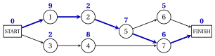
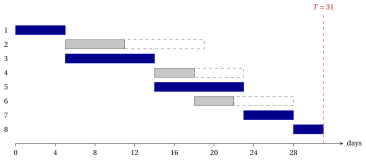
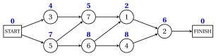
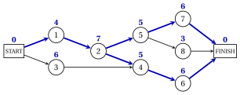
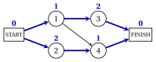

# Exercises · Project management

**Exercises · Chapter 9** · each solution opens with a click · [:material-book-open-variant: Chapter 9: Project management](../project-management/project-management/index.md) · [:material-file-pdf-box: Exercises, volume 5 (PDF)](../pdf/exercises-5-project-management.pdf)

!!! formula "Rules used in these exercises"

    The definitions and the method of the chapter [«Project management»](https://fabiofurini.github.io/network-optimization/project-management/project-management/), for a project with activities $1,2,\dots,n$, durations $d_j>0$ and immediate predecessors.

    - **(P1)** <strong>Project network.</strong> Nodes $0$ (START), $1,2,\dots,n$ and $n+1$ (FINISH), with $d_0=d_{n+1}=0$; an arc $(i,j)$ for every precedence, $(0,j)$ for every activity without immediate predecessors, $(j,n+1)$ for every activity without successors. The arc $(i,j)$ has length $d_i$.

    - **(P2)** <strong>Topological order.</strong> Repeatedly remove the node without entering arcs of smallest index; if all the remaining nodes have entering arcs, the precedences contain a cycle.

    - **(P3)** <strong>Forward pass</strong>, in topological order: $\mathit{ES}_0=0$, $\mathit{ES}_j=\max_{(i,j) \in A} \mathit{EF}_i$, $\mathit{EF}_j=\mathit{ES}_j+d_j$; the minimum project duration is $T=\mathit{ES}_{n+1}$.

    - **(P4)** <strong>Backward pass</strong>, in reverse order: $\mathit{LF}_{n+1}=T$, $\mathit{LF}_j=\min_{(j,k) \in A} \mathit{LS}_k$, $\mathit{LS}_j=\mathit{LF}_j-d_j$. Slacks $\mathit{TS}_j=\mathit{LS}_j-\mathit{ES}_j$ and $\mathit{FS}_j=\min_{(j,k) \in A} \mathit{ES}_k-\mathit{EF}_j$; the arc $(i,j)$ is tight if $\mathit{ES}_j=\mathit{EF}_i$, and the critical paths are the paths from START to FINISH made of tight arcs.

    - **(P5)** <strong>Changes and LP.</strong> If $d_j$ grows by $\delta$, $T'=T+\max\{0,\delta-\mathit{TS}_j\}$; if it decreases by $\delta$, $T-\delta \le T' \le T$, with $T'=T$ when a critical path avoids $j$. The $\mathrm{PD}$ model is $\min\{t_{n+1}-t_0 : t_j-t_i \ge d_i,\ (i,j) \in A\}$, and its dual sends one unit of flow from START to FINISH, maximizing $\sum d_i x_{ij}$.

!!! esercizio "Exercise 9.1: The forward and the backward pass"

    !!! esercizio "Exercise"

        A project has $7$ activities, numbered $1,2,\dots,7$, with the immediate predecessors and the durations (in days) of the table.

        
<table>
        <tr>
        <th>activity \(j\)</th>
        <th>immediate predecessors</th>
        <th>\(d_j\)</th>
        </tr>
        <tr>
        <td>\(1\)</td>
        <td>—</td>
        <td>\(9\) days</td>
        </tr>
        <tr>
        <td>\(2\)</td>
        <td>\(1\)</td>
        <td>\(2\) days</td>
        </tr>
        <tr>
        <td>\(3\)</td>
        <td>—</td>
        <td>\(2\) days</td>
        </tr>
        <tr>
        <td>\(4\)</td>
        <td>\(3\)</td>
        <td>\(8\) days</td>
        </tr>
        <tr>
        <td>\(5\)</td>
        <td>\(2\)</td>
        <td>\(7\) days</td>
        </tr>
        <tr>
        <td>\(6\)</td>
        <td>\(5\)</td>
        <td>\(5\) days</td>
        </tr>
        <tr>
        <td>\(7\)</td>
        <td>\(4\), \(5\)</td>
        <td>\(6\) days</td>
        </tr>
        </table>

    **Questions**

    1. Draw the project network, with the START node $0$ and the FINISH node $8$, and give its topological order (P2).

    2. Run the forward pass: give $\mathit{ES}_j$ and $\mathit{EF}_j$ for every node and the minimum project duration $T$.

    3. Run the backward pass: give $\mathit{LF}_j$ and $\mathit{LS}_j$ for every node.

    4. Find the critical path and check that its length is $T$.

??? soluzione "Solution"

    We use the rules (P1)–(P5) of the box at the beginning of these exercises.

    1. Activities $1$ and $3$ have no immediate predecessors and are linked to START; activities $6$ and $7$ have no successors and enter FINISH. The durations are written above the nodes:

        { .fig loading=lazy  }

        Every activity has immediate predecessors of smaller index, so the topological order is $0,1,2,3,4,5,6,7,8$.

    2. Each row processes one node: the earliest finish times of its immediate predecessors (the maximum in bold), then $\mathit{ES}_j$ and $\mathit{EF}_j$:

        
<table>
        <tr>
        <th>node \(j\)</th>
        <th>\(d_j\)</th>
        <th>\(\mathit{EF}_i\) of the predecessors (\(i\))</th>
        <th>\(\mathit{ES}_j\)</th>
        <th>\(\mathit{EF}_j\)</th>
        </tr>
        <tr>
        <td>\(0\)</td>
        <td>\(0\)</td>
        <td>—</td>
        <td>\(0\)</td>
        <td>\(0\)</td>
        </tr>
        <tr>
        <td>\(1\)</td>
        <td>\(9\)</td>
        <td>\(\mathbf{0}\) (\(0\))</td>
        <td>\(0\)</td>
        <td>\(9\)</td>
        </tr>
        <tr>
        <td>\(2\)</td>
        <td>\(2\)</td>
        <td>\(\mathbf{9}\) (\(1\))</td>
        <td>\(9\)</td>
        <td>\(11\)</td>
        </tr>
        <tr>
        <td>\(3\)</td>
        <td>\(2\)</td>
        <td>\(\mathbf{0}\) (\(0\))</td>
        <td>\(0\)</td>
        <td>\(2\)</td>
        </tr>
        <tr>
        <td>\(4\)</td>
        <td>\(8\)</td>
        <td>\(\mathbf{2}\) (\(3\))</td>
        <td>\(2\)</td>
        <td>\(10\)</td>
        </tr>
        <tr>
        <td>\(5\)</td>
        <td>\(7\)</td>
        <td>\(\mathbf{11}\) (\(2\))</td>
        <td>\(11\)</td>
        <td>\(18\)</td>
        </tr>
        <tr>
        <td>\(6\)</td>
        <td>\(5\)</td>
        <td>\(\mathbf{18}\) (\(5\))</td>
        <td>\(18\)</td>
        <td>\(23\)</td>
        </tr>
        <tr>
        <td>\(7\)</td>
        <td>\(6\)</td>
        <td>\(10\) (\(4\)), \(\mathbf{18}\) (\(5\))</td>
        <td>\(18\)</td>
        <td>\(24\)</td>
        </tr>
        <tr>
        <td>\(8\)</td>
        <td>\(0\)</td>
        <td>\(23\) (\(6\)), \(\mathbf{24}\) (\(7\))</td>
        <td>\(24\)</td>
        <td>\(24\)</td>
        </tr>
        </table>

        The minimum project duration is $T=\mathit{ES}_{8}=24$ days.

    3. In the reverse order each row gives the latest start times of the immediate successors (the minimum in bold), then $\mathit{LF}_j$ and $\mathit{LS}_j$:

        
<table>
        <tr>
        <th>node \(j\)</th>
        <th>\(d_j\)</th>
        <th>\(\mathit{LS}_k\) of the successors (\(k\))</th>
        <th>\(\mathit{LF}_j\)</th>
        <th>\(\mathit{LS}_j\)</th>
        </tr>
        <tr>
        <td>\(8\)</td>
        <td>\(0\)</td>
        <td>—</td>
        <td>\(24\)</td>
        <td>\(24\)</td>
        </tr>
        <tr>
        <td>\(7\)</td>
        <td>\(6\)</td>
        <td>\(\mathbf{24}\) (\(8\))</td>
        <td>\(24\)</td>
        <td>\(18\)</td>
        </tr>
        <tr>
        <td>\(6\)</td>
        <td>\(5\)</td>
        <td>\(\mathbf{24}\) (\(8\))</td>
        <td>\(24\)</td>
        <td>\(19\)</td>
        </tr>
        <tr>
        <td>\(5\)</td>
        <td>\(7\)</td>
        <td>\(19\) (\(6\)), \(\mathbf{18}\) (\(7\))</td>
        <td>\(18\)</td>
        <td>\(11\)</td>
        </tr>
        <tr>
        <td>\(4\)</td>
        <td>\(8\)</td>
        <td>\(\mathbf{18}\) (\(7\))</td>
        <td>\(18\)</td>
        <td>\(10\)</td>
        </tr>
        <tr>
        <td>\(3\)</td>
        <td>\(2\)</td>
        <td>\(\mathbf{10}\) (\(4\))</td>
        <td>\(10\)</td>
        <td>\(8\)</td>
        </tr>
        <tr>
        <td>\(2\)</td>
        <td>\(2\)</td>
        <td>\(\mathbf{11}\) (\(5\))</td>
        <td>\(11\)</td>
        <td>\(9\)</td>
        </tr>
        <tr>
        <td>\(1\)</td>
        <td>\(9\)</td>
        <td>\(\mathbf{9}\) (\(2\))</td>
        <td>\(9\)</td>
        <td>\(0\)</td>
        </tr>
        <tr>
        <td>\(0\)</td>
        <td>\(0\)</td>
        <td>\(\mathbf{0}\) (\(1\)), \(8\) (\(3\))</td>
        <td>\(0\)</td>
        <td>\(0\)</td>
        </tr>
        </table>

        The pass ends with $\mathit{LS}_0=0$.

    4. The tight arcs from START reach FINISH along a single path, in blue:

        { .fig loading=lazy  }

        The critical path is $\text{START},\allowbreak 1,\allowbreak 2,\allowbreak 5,\allowbreak 7,\allowbreak \text{FINISH}$, of length $9+2+7+6=24=T$.

    !!! chiave ""

        The forward pass gives $T=24$, the backward pass ends with $\mathit{LS}_0=0$, and the critical path is $\text{START},\allowbreak 1,\allowbreak 2,\allowbreak 5,\allowbreak 7,\allowbreak \text{FINISH}$.

!!! esercizio "Exercise 9.2: Slacks and the Gantt chart"

    !!! esercizio "Exercise"

        A project has $8$ activities, numbered $1,2,\dots,8$, with the immediate predecessors and the durations (in days) of the table.

        
<table>
        <tr>
        <th>activity \(j\)</th>
        <th>immediate predecessors</th>
        <th>\(d_j\)</th>
        </tr>
        <tr>
        <td>\(1\)</td>
        <td>—</td>
        <td>\(5\) days</td>
        </tr>
        <tr>
        <td>\(2\)</td>
        <td>\(1\)</td>
        <td>\(6\) days</td>
        </tr>
        <tr>
        <td>\(3\)</td>
        <td>\(1\)</td>
        <td>\(9\) days</td>
        </tr>
        <tr>
        <td>\(4\)</td>
        <td>\(2\), \(3\)</td>
        <td>\(4\) days</td>
        </tr>
        <tr>
        <td>\(5\)</td>
        <td>\(3\)</td>
        <td>\(9\) days</td>
        </tr>
        <tr>
        <td>\(6\)</td>
        <td>\(4\)</td>
        <td>\(4\) days</td>
        </tr>
        <tr>
        <td>\(7\)</td>
        <td>\(4\), \(5\)</td>
        <td>\(5\) days</td>
        </tr>
        <tr>
        <td>\(8\)</td>
        <td>\(6\), \(7\)</td>
        <td>\(3\) days</td>
        </tr>
        </table>

    **Questions**

    1. Compute the earliest and the latest start and finish times of all the activities, and the minimum project duration $T$.

    2. Compute the total and the free slack of every activity. Which activities are critical? Give the critical path.

    3. By how many days can activity $2$ be delayed without delaying the project? And without moving the earliest start time of any other activity? Which activities move if it is delayed by $\mathit{TS}_{2}$ days?

    4. Draw the Gantt chart of the earliest schedule, with the total slacks.

??? soluzione "Solution"

    We use the rules (P1)–(P5) of the box at the beginning of these exercises.

    1. The forward pass in the topological order $0,1,2,3,4,5,6,7,8,9$ and the backward pass in the reverse order give:

        
<table>
        <tr>
        <th>\(j\)</th>
        <th>\(d_j\)</th>
        <th>\(\mathit{ES}_j\)</th>
        <th>\(\mathit{EF}_j\)</th>
        <th>\(\mathit{LS}_j\)</th>
        <th>\(\mathit{LF}_j\)</th>
        <th>\(\mathit{TS}_j\)</th>
        <th>\(\mathit{FS}_j\)</th>
        <th>critical</th>
        </tr>
        <tr>
        <td>\(1\)</td>
        <td>\(5\)</td>
        <td>\(0\)</td>
        <td>\(5\)</td>
        <td>\(0\)</td>
        <td>\(5\)</td>
        <td>\(0\)</td>
        <td>\(0\)</td>
        <td>yes</td>
        </tr>
        <tr>
        <td>\(2\)</td>
        <td>\(6\)</td>
        <td>\(5\)</td>
        <td>\(11\)</td>
        <td>\(13\)</td>
        <td>\(19\)</td>
        <td>\(8\)</td>
        <td>\(3\)</td>
        <td></td>
        </tr>
        <tr>
        <td>\(3\)</td>
        <td>\(9\)</td>
        <td>\(5\)</td>
        <td>\(14\)</td>
        <td>\(5\)</td>
        <td>\(14\)</td>
        <td>\(0\)</td>
        <td>\(0\)</td>
        <td>yes</td>
        </tr>
        <tr>
        <td>\(4\)</td>
        <td>\(4\)</td>
        <td>\(14\)</td>
        <td>\(18\)</td>
        <td>\(19\)</td>
        <td>\(23\)</td>
        <td>\(5\)</td>
        <td>\(0\)</td>
        <td></td>
        </tr>
        <tr>
        <td>\(5\)</td>
        <td>\(9\)</td>
        <td>\(14\)</td>
        <td>\(23\)</td>
        <td>\(14\)</td>
        <td>\(23\)</td>
        <td>\(0\)</td>
        <td>\(0\)</td>
        <td>yes</td>
        </tr>
        <tr>
        <td>\(6\)</td>
        <td>\(4\)</td>
        <td>\(18\)</td>
        <td>\(22\)</td>
        <td>\(24\)</td>
        <td>\(28\)</td>
        <td>\(6\)</td>
        <td>\(6\)</td>
        <td></td>
        </tr>
        <tr>
        <td>\(7\)</td>
        <td>\(5\)</td>
        <td>\(23\)</td>
        <td>\(28\)</td>
        <td>\(23\)</td>
        <td>\(28\)</td>
        <td>\(0\)</td>
        <td>\(0\)</td>
        <td>yes</td>
        </tr>
        <tr>
        <td>\(8\)</td>
        <td>\(3\)</td>
        <td>\(28\)</td>
        <td>\(31\)</td>
        <td>\(28\)</td>
        <td>\(31\)</td>
        <td>\(0\)</td>
        <td>\(0\)</td>
        <td>yes</td>
        </tr>
        </table>

        and $T=\mathit{ES}_{9}=31$ days.

    2. The last two columns of the table are $\mathit{TS}_j=\mathit{LS}_j-\mathit{ES}_j$ and $\mathit{FS}_j=\min \mathit{ES}_k-\mathit{EF}_j$. The critical activities, with $\mathit{TS}_j=0$, are $1$, $3$, $5$, $7$ and $8$, and the tight arcs from START reach FINISH only along $\text{START},\allowbreak 1,\allowbreak 3,\allowbreak 5,\allowbreak 7,\allowbreak 8,\allowbreak \text{FINISH}$, the critical path.

    3. Activity $2$ has $\mathit{TS}_{2}=8$ and $\mathit{FS}_{2}=3$. It can start $8$ days late without delaying the project, but only $3$ days late without moving any other activity. With a delay of $8$ days the earliest start times of the activities $4$ and $6$ move, by $5$ days, and FINISH stays at $T=31$.

    4. Bars from $\mathit{ES}_j$ to $\mathit{EF}_j$ (critical activities in blue), dashed boxes from $\mathit{EF}_j$ to $\mathit{LF}_j$:

        { .fig loading=lazy  }

        The blue bars follow each other without gaps from day $0$ to day $31$.

    !!! chiave ""

        $T=31$; the critical path is $\text{START},\allowbreak 1,\allowbreak 3,\allowbreak 5,\allowbreak 7,\allowbreak 8,\allowbreak \text{FINISH}$. Activity $2$ can absorb $8$ days of delay, but only $3$ without moving other activities.

!!! esercizio "Exercise 9.3: Topological order and inconsistent precedences"

    !!! esercizio "Exercise"

        A project has $7$ activities, numbered $1,2,\dots,7$, with the immediate predecessors and the durations (in days) of the table.

        
<table>
        <tr>
        <th>activity \(j\)</th>
        <th>immediate predecessors</th>
        <th>\(d_j\)</th>
        </tr>
        <tr>
        <td>\(1\)</td>
        <td>\(6\), \(7\)</td>
        <td>\(2\) days</td>
        </tr>
        <tr>
        <td>\(2\)</td>
        <td>\(1\), \(4\)</td>
        <td>\(6\) days</td>
        </tr>
        <tr>
        <td>\(3\)</td>
        <td>—</td>
        <td>\(4\) days</td>
        </tr>
        <tr>
        <td>\(4\)</td>
        <td>\(6\)</td>
        <td>\(8\) days</td>
        </tr>
        <tr>
        <td>\(5\)</td>
        <td>—</td>
        <td>\(7\) days</td>
        </tr>
        <tr>
        <td>\(6\)</td>
        <td>\(5\)</td>
        <td>\(8\) days</td>
        </tr>
        <tr>
        <td>\(7\)</td>
        <td>\(3\), \(5\)</td>
        <td>\(5\) days</td>
        </tr>
        </table>

    **Questions**

    1. Find the topological order of the project network with (P2), giving at every step the nodes without entering arcs.

    2. Run the forward pass and give the minimum project duration $T$ and the critical path.

    3. The planner adds the precedence «activity $2$ must be finished before activity $3$ starts». Run (P2) on the new network, find a directed cycle, and prove that the new project has no schedule.

??? soluzione "Solution"

    We use the rules (P1)–(P5) of the box at the beginning of these exercises.

    1. The project network, with the durations above the nodes:

        { .fig loading=lazy  }

        At every step the node of smallest index among the nodes without entering arcs is removed:

        
<table>
        <tr>
        <th>step</th>
        <th>nodes without entering arcs</th>
        <th>removed</th>
        </tr>
        <tr>
        <td>\(1\)</td>
        <td>\(0\)</td>
        <td>\(0\)</td>
        </tr>
        <tr>
        <td>\(2\)</td>
        <td>\(3\), \(5\)</td>
        <td>\(3\)</td>
        </tr>
        <tr>
        <td>\(3\)</td>
        <td>\(5\)</td>
        <td>\(5\)</td>
        </tr>
        <tr>
        <td>\(4\)</td>
        <td>\(6\), \(7\)</td>
        <td>\(6\)</td>
        </tr>
        <tr>
        <td>\(5\)</td>
        <td>\(4\), \(7\)</td>
        <td>\(4\)</td>
        </tr>
        <tr>
        <td>\(6\)</td>
        <td>\(7\)</td>
        <td>\(7\)</td>
        </tr>
        <tr>
        <td>\(7\)</td>
        <td>\(1\)</td>
        <td>\(1\)</td>
        </tr>
        <tr>
        <td>\(8\)</td>
        <td>\(2\)</td>
        <td>\(2\)</td>
        </tr>
        <tr>
        <td>\(9\)</td>
        <td>\(8\)</td>
        <td>\(8\)</td>
        </tr>
        </table>

        The topological order is $0,3,5,6,4,7,1,2,8$: the activities are not numbered in this order.

    2. Each row processes one node, in topological order:

        
<table>
        <tr>
        <th>node \(j\)</th>
        <th>\(d_j\)</th>
        <th>\(\mathit{EF}_i\) of the predecessors (\(i\))</th>
        <th>\(\mathit{ES}_j\)</th>
        <th>\(\mathit{EF}_j\)</th>
        </tr>
        <tr>
        <td>\(0\)</td>
        <td>\(0\)</td>
        <td>—</td>
        <td>\(0\)</td>
        <td>\(0\)</td>
        </tr>
        <tr>
        <td>\(3\)</td>
        <td>\(4\)</td>
        <td>\(\mathbf{0}\) (\(0\))</td>
        <td>\(0\)</td>
        <td>\(4\)</td>
        </tr>
        <tr>
        <td>\(5\)</td>
        <td>\(7\)</td>
        <td>\(\mathbf{0}\) (\(0\))</td>
        <td>\(0\)</td>
        <td>\(7\)</td>
        </tr>
        <tr>
        <td>\(6\)</td>
        <td>\(8\)</td>
        <td>\(\mathbf{7}\) (\(5\))</td>
        <td>\(7\)</td>
        <td>\(15\)</td>
        </tr>
        <tr>
        <td>\(4\)</td>
        <td>\(8\)</td>
        <td>\(\mathbf{15}\) (\(6\))</td>
        <td>\(15\)</td>
        <td>\(23\)</td>
        </tr>
        <tr>
        <td>\(7\)</td>
        <td>\(5\)</td>
        <td>\(4\) (\(3\)), \(\mathbf{7}\) (\(5\))</td>
        <td>\(7\)</td>
        <td>\(12\)</td>
        </tr>
        <tr>
        <td>\(1\)</td>
        <td>\(2\)</td>
        <td>\(\mathbf{15}\) (\(6\)), \(12\) (\(7\))</td>
        <td>\(15\)</td>
        <td>\(17\)</td>
        </tr>
        <tr>
        <td>\(2\)</td>
        <td>\(6\)</td>
        <td>\(17\) (\(1\)), \(\mathbf{23}\) (\(4\))</td>
        <td>\(23\)</td>
        <td>\(29\)</td>
        </tr>
        <tr>
        <td>\(8\)</td>
        <td>\(0\)</td>
        <td>\(\mathbf{29}\) (\(2\))</td>
        <td>\(29\)</td>
        <td>\(29\)</td>
        </tr>
        </table>

        Hence $T=\mathit{ES}_{8}=29$ days, and the tight arcs give the critical path $\text{START},\allowbreak 5,\allowbreak 6,\allowbreak 4,\allowbreak 2,\allowbreak \text{FINISH}$.

    3. With the new arc $(2,3)$ the rule (P2) proceeds as follows:

        
<table>
        <tr>
        <th>step</th>
        <th>nodes without entering arcs</th>
        <th>removed</th>
        </tr>
        <tr>
        <td>\(1\)</td>
        <td>\(0\), \(8\)</td>
        <td>\(0\)</td>
        </tr>
        <tr>
        <td>\(2\)</td>
        <td>\(5\), \(8\)</td>
        <td>\(5\)</td>
        </tr>
        <tr>
        <td>\(3\)</td>
        <td>\(6\), \(8\)</td>
        <td>\(6\)</td>
        </tr>
        <tr>
        <td>\(4\)</td>
        <td>\(4\), \(8\)</td>
        <td>\(4\)</td>
        </tr>
        <tr>
        <td>\(5\)</td>
        <td>\(8\)</td>
        <td>\(8\)</td>
        </tr>
        <tr>
        <td>\(6\)</td>
        <td>none</td>
        <td>—</td>
        </tr>
        </table>

        It stops with the nodes $1$, $2$, $3$ and $7$ left, all with entering arcs. Going backwards from node $1$ along entering arcs we find the cycle $1,2,3,7,1$. Adding up the constraints $t_j \ge t_i+d_i$ of its arcs, the start times cancel:

        $$
        0 \ge d_{1}+d_{2}+d_{3}+d_{7}=2+6+4+5=17,
        $$

        a contradiction: the new precedences admit no schedule, and the plan must be corrected.

    !!! chiave ""

        The topological order $0,3,5,6,4,7,1,2,8$ gives $T=29$. The precedence $(2,3)$ closes the cycle $1,2,3,7,1$, and no schedule exists.

!!! esercizio "Exercise 9.4: Two critical paths and changes of durations"

    !!! esercizio "Exercise"

        A project has $8$ activities, numbered $1,2,\dots,8$, with the immediate predecessors and the durations (in days) of the table.

        
<table>
        <tr>
        <th>activity \(j\)</th>
        <th>immediate predecessors</th>
        <th>\(d_j\)</th>
        </tr>
        <tr>
        <td>\(1\)</td>
        <td>—</td>
        <td>\(4\) days</td>
        </tr>
        <tr>
        <td>\(2\)</td>
        <td>\(1\)</td>
        <td>\(7\) days</td>
        </tr>
        <tr>
        <td>\(3\)</td>
        <td>—</td>
        <td>\(6\) days</td>
        </tr>
        <tr>
        <td>\(4\)</td>
        <td>\(2\), \(3\)</td>
        <td>\(5\) days</td>
        </tr>
        <tr>
        <td>\(5\)</td>
        <td>\(2\)</td>
        <td>\(5\) days</td>
        </tr>
        <tr>
        <td>\(6\)</td>
        <td>\(4\)</td>
        <td>\(6\) days</td>
        </tr>
        <tr>
        <td>\(7\)</td>
        <td>\(5\)</td>
        <td>\(6\) days</td>
        </tr>
        <tr>
        <td>\(8\)</td>
        <td>\(5\)</td>
        <td>\(3\) days</td>
        </tr>
        </table>

    **Questions**

    1. Compute the earliest and latest times, $T$ and all the critical paths.

    2. Without running the method again, what can you say about the minimum project duration if (i) $d_{4}$ decreases by $1$; (ii) $d_{1}$ decreases by $1$; (iii) $d_{3}$ increases by $7$?

    3. Check the three answers by running the forward pass again, and give the new critical paths.

??? soluzione "Solution"

    We use the rules (P1)–(P5) of the box at the beginning of these exercises.

    1. The forward and the backward pass give:

        
<table>
        <tr>
        <th>\(j\)</th>
        <th>\(d_j\)</th>
        <th>\(\mathit{ES}_j\)</th>
        <th>\(\mathit{EF}_j\)</th>
        <th>\(\mathit{LS}_j\)</th>
        <th>\(\mathit{LF}_j\)</th>
        <th>\(\mathit{TS}_j\)</th>
        <th>\(\mathit{FS}_j\)</th>
        <th>critical</th>
        </tr>
        <tr>
        <td>\(1\)</td>
        <td>\(4\)</td>
        <td>\(0\)</td>
        <td>\(4\)</td>
        <td>\(0\)</td>
        <td>\(4\)</td>
        <td>\(0\)</td>
        <td>\(0\)</td>
        <td>yes</td>
        </tr>
        <tr>
        <td>\(2\)</td>
        <td>\(7\)</td>
        <td>\(4\)</td>
        <td>\(11\)</td>
        <td>\(4\)</td>
        <td>\(11\)</td>
        <td>\(0\)</td>
        <td>\(0\)</td>
        <td>yes</td>
        </tr>
        <tr>
        <td>\(3\)</td>
        <td>\(6\)</td>
        <td>\(0\)</td>
        <td>\(6\)</td>
        <td>\(5\)</td>
        <td>\(11\)</td>
        <td>\(5\)</td>
        <td>\(5\)</td>
        <td></td>
        </tr>
        <tr>
        <td>\(4\)</td>
        <td>\(5\)</td>
        <td>\(11\)</td>
        <td>\(16\)</td>
        <td>\(11\)</td>
        <td>\(16\)</td>
        <td>\(0\)</td>
        <td>\(0\)</td>
        <td>yes</td>
        </tr>
        <tr>
        <td>\(5\)</td>
        <td>\(5\)</td>
        <td>\(11\)</td>
        <td>\(16\)</td>
        <td>\(11\)</td>
        <td>\(16\)</td>
        <td>\(0\)</td>
        <td>\(0\)</td>
        <td>yes</td>
        </tr>
        <tr>
        <td>\(6\)</td>
        <td>\(6\)</td>
        <td>\(16\)</td>
        <td>\(22\)</td>
        <td>\(16\)</td>
        <td>\(22\)</td>
        <td>\(0\)</td>
        <td>\(0\)</td>
        <td>yes</td>
        </tr>
        <tr>
        <td>\(7\)</td>
        <td>\(6\)</td>
        <td>\(16\)</td>
        <td>\(22\)</td>
        <td>\(16\)</td>
        <td>\(22\)</td>
        <td>\(0\)</td>
        <td>\(0\)</td>
        <td>yes</td>
        </tr>
        <tr>
        <td>\(8\)</td>
        <td>\(3\)</td>
        <td>\(16\)</td>
        <td>\(19\)</td>
        <td>\(19\)</td>
        <td>\(22\)</td>
        <td>\(3\)</td>
        <td>\(3\)</td>
        <td></td>
        </tr>
        </table>

        so $T=22$. The tight arcs from START reach FINISH along two paths, in blue: $\text{START},\allowbreak 1,\allowbreak 2,\allowbreak 4,\allowbreak 6,\allowbreak \text{FINISH}$ and $\text{START},\allowbreak 1,\allowbreak 2,\allowbreak 5,\allowbreak 7,\allowbreak \text{FINISH}$.

        { .fig loading=lazy  }

    2. (i) Activity $4$ lies only on $\text{START},\allowbreak 1,\allowbreak 2,\allowbreak 4,\allowbreak 6,\allowbreak \text{FINISH}$; the other critical path avoids it, so by (P5) $T'=T=22$. (ii) Activity $1$ lies on both critical paths: by (P5), $21 \le T' \le 22$, and both critical paths become $1$ day shorter. (iii) Activity $3$ has $\mathit{TS}_{3}=5$, so $T'=T+\max\{0,7-5\}=24$.

    3. Running the critical path method on each changed project:

        
<table>
        <tr>
        <th>change</th>
        <th>\(\mathit{TS}_j\)</th>
        <th>new \(T\)</th>
        <th>critical paths after the change</th>
        </tr>
        <tr>
        <td>\(d_4=5 \to 4\)</td>
        <td>\(0\)</td>
        <td>\(22\)</td>
        <td>\(\text{START},1,2,5,7,\text{FINISH}\)</td>
        </tr>
        <tr>
        <td>\(d_1=4 \to 3\)</td>
        <td>\(0\)</td>
        <td>\(21\)</td>
        <td>\(\text{START},1,2,4,6,\text{FINISH}\); \(\text{START},1,2,5,7,\text{FINISH}\)</td>
        </tr>
        <tr>
        <td>\(d_3=6 \to 13\)</td>
        <td>\(5\)</td>
        <td>\(24\)</td>
        <td>\(\text{START},3,4,6,\text{FINISH}\)</td>
        </tr>
        </table>

        In (ii) every path avoiding activity $1$ is at most $21$ days long, so the lower bound is attained.

    !!! chiave ""

        With two critical paths, shortening an activity on only one of them does not shorten the project; shortening the common activity $1$ does, and a delay of $\mathit{TS}_{3}+2$ on activity $3$ delays the project by $2$ days.

!!! esercizio "Exercise 9.5: The LP model and its dual"

    !!! esercizio "Exercise"

        A project has $4$ activities, numbered $1,2,\dots,4$, with the immediate predecessors and the durations (in days) of the table.

        
<table>
        <tr>
        <th>activity \(j\)</th>
        <th>immediate predecessors</th>
        <th>\(d_j\)</th>
        </tr>
        <tr>
        <td>\(1\)</td>
        <td>—</td>
        <td>\(8\) days</td>
        </tr>
        <tr>
        <td>\(2\)</td>
        <td>\(1\)</td>
        <td>\(5\) days</td>
        </tr>
        <tr>
        <td>\(3\)</td>
        <td>\(1\)</td>
        <td>\(9\) days</td>
        </tr>
        <tr>
        <td>\(4\)</td>
        <td>\(1\)</td>
        <td>\(2\) days</td>
        </tr>
        </table>

    **Questions**

    1. Write the $\mathrm{PD}$ model of the project, with one variable $t_j$ per node.

    2. Write its dual model $D(\mathrm{PD})$, with one variable $x_{ij}$ per arc.

    3. Compute $\mathit{ES}$ and $\mathit{LS}$, show that both are optimal for the $\mathrm{PD}$ model, and give an optimal solution of $D(\mathrm{PD})$. Prove the optimality with weak duality.

    4. Which constraints of the $\mathrm{PD}$ model hold with equality in every optimal solution?

??? soluzione "Solution"

    We use the rules (P1)–(P5) of the box at the beginning of these exercises.

    1. The project network, with the durations above the nodes, has the arcs $(0,1)$, $(1,2)$, $(1,3)$, $(1,4)$, $(2,5)$, $(3,5)$, $(4,5)$:

        { .fig loading=lazy  }

        There is one constraint $t_j-t_i \ge d_i$ per arc, and the variables are free:

        $$
        \small
        \setlength{\arraycolsep}{3pt}
        \begin{array}{rrrrrrrcr}
        \min & -t_{0} &  &  &  &  & +t_{5} & & \\
        \text{subject to} & -t_{0} & +t_{1} &  &  &  &  & \ge & 0 \\
        &  & -t_{1} & +t_{2} &  &  &  & \ge & 8 \\
        &  & -t_{1} &  & +t_{3} &  &  & \ge & 8 \\
        &  & -t_{1} &  &  & +t_{4} &  & \ge & 8 \\
        &  &  & -t_{2} &  &  & +t_{5} & \ge & 5 \\
        &  &  &  & -t_{3} &  & +t_{5} & \ge & 9 \\
        &  &  &  &  & -t_{4} & +t_{5} & \ge & 2 \\
        & t_{0}, & t_{1}, & t_{2}, & t_{3}, & t_{4}, & t_{5} & \in & \R
        \end{array}
        $$

    2. There is one variable $x_{ij} \ge 0$ per arc and one flow conservation constraint per node, with $b_0=1$ and $b_{5}=-1$; the arcs leaving START have length $d_0=0$:

        $$
        \small
        \setlength{\arraycolsep}{2.5pt}
        \begin{array}{rrrrrrrrcr}
        \max &  & 8\,x_{12} & +8\,x_{13} & +8\,x_{14} & +5\,x_{25} & +9\,x_{35} & +2\,x_{45} & & \\
        \text{subject to} & x_{01} &  &  &  &  &  &  & = & 1 \\
        & -x_{01} & +x_{12} & +x_{13} & +x_{14} &  &  &  & = & 0 \\
        &  & -x_{12} &  &  & +x_{25} &  &  & = & 0 \\
        &  &  & -x_{13} &  &  & +x_{35} &  & = & 0 \\
        &  &  &  & -x_{14} &  &  & +x_{45} & = & 0 \\
        &  &  &  &  & -x_{25} & -x_{35} & -x_{45} & = & -1 \\
        & x_{01}, & x_{12}, & x_{13}, & x_{14}, & x_{25}, & x_{35}, & x_{45} & \ge & 0
        \end{array}
        $$

    3. The forward and the backward pass give $\mathit{ES}=(0,\,0,\,8,\,8,\,8,\,17)$ and $\mathit{LS}=(0,\,0,\,12,\,8,\,15,\,17)$, both with $t_{5}-t_0=17$. Both satisfy every constraint of the $\mathrm{PD}$ model, and they differ on the nodes $2$, $4$: the optimal solution of the $\mathrm{PD}$ model is not unique. The critical path is $\text{START},\allowbreak 1,\allowbreak 3,\allowbreak \text{FINISH}$; its incidence vector, with $x_{ij}=1$ on the arcs $(0,1)$, $(1,3)$, $(3,5)$ and $0$ elsewhere, is feasible for $D(\mathrm{PD})$ with value $8+9=17$. By weak duality a feasible solution of the $\mathrm{PD}$ model and a feasible solution of its dual with the same value are both optimal: $z(\mathrm{PD})=z(D(\mathrm{PD}))=17$ (Gurobi confirms both values).

    4. The constraints of the arcs of the critical path: adding them up, $t_{5}-t_0 \ge 17$, and an optimal solution has $t_{5}-t_0=17$, so each of them holds with equality. The constraint of every other arc is strict for $\mathit{ES}$ or for $\mathit{LS}$, two optimal solutions:

        
<table>
        <tr>
        <th>arc \((i,j)\)</th>
        <th>\(d_i\)</th>
        <th>\(\mathit{ES}_j-\mathit{ES}_i\)</th>
        <th>\(\mathit{LS}_j-\mathit{LS}_i\)</th>
        </tr>
        <tr>
        <td>\((1,2)\)</td>
        <td>\(8\)</td>
        <td>\(8\)</td>
        <td>\(12\)</td>
        </tr>
        <tr>
        <td>\((1,4)\)</td>
        <td>\(8\)</td>
        <td>\(8\)</td>
        <td>\(15\)</td>
        </tr>
        <tr>
        <td>\((2,5)\)</td>
        <td>\(5\)</td>
        <td>\(9\)</td>
        <td>\(5\)</td>
        </tr>
        <tr>
        <td>\((4,5)\)</td>
        <td>\(2\)</td>
        <td>\(9\)</td>
        <td>\(2\)</td>
        </tr>
        </table>

        In every row at least one of the two differences is larger than $d_i$.

    !!! chiave ""

        $z(\mathrm{PD})=z(D(\mathrm{PD}))=17$: $\mathit{ES}$ and $\mathit{LS}$ are optimal schedules, and the critical path is the optimal dual solution.

!!! esercizio "Exercise 9.6: Proofs and counterexamples"

    !!! esercizio "Exercise"

        A project has $7$ activities, numbered $1,2,\dots,7$, with the immediate predecessors and the durations (in days) of the table.

        
<table>
        <tr>
        <th>activity \(j\)</th>
        <th>immediate predecessors</th>
        <th>\(d_j\)</th>
        </tr>
        <tr>
        <td>\(1\)</td>
        <td>—</td>
        <td>\(9\) days</td>
        </tr>
        <tr>
        <td>\(2\)</td>
        <td>\(1\)</td>
        <td>\(7\) days</td>
        </tr>
        <tr>
        <td>\(3\)</td>
        <td>\(1\)</td>
        <td>\(5\) days</td>
        </tr>
        <tr>
        <td>\(4\)</td>
        <td>\(2\), \(3\)</td>
        <td>\(6\) days</td>
        </tr>
        <tr>
        <td>\(5\)</td>
        <td>\(3\)</td>
        <td>\(9\) days</td>
        </tr>
        <tr>
        <td>\(6\)</td>
        <td>\(4\)</td>
        <td>\(4\) days</td>
        </tr>
        <tr>
        <td>\(7\)</td>
        <td>\(4\), \(5\)</td>
        <td>\(9\) days</td>
        </tr>
        </table>

    **Questions**

    1. In a project, two activities $i$ and $j$ are not linked by any path, $i$ already has an immediate successor and $j$ an immediate predecessor. The precedence «$i$ before $j$» is added. Prove that the new minimum project duration is

        $$
        T'=T+\max\{0,\ \mathit{EF}_i-\mathit{LS}_j\},
        $$

        where $\mathit{EF}_i$, $\mathit{LS}_j$ and $T$ are computed before the change.

    2. In the project of the table, compute the times and use the formula for the precedences «$5$ before $6$» and «$2$ before $3$».

    3. A student claims: «a path from START to FINISH made of critical activities is a critical path». Disprove the claim with a project of four activities.

??? soluzione "Solution"

    We use the rules (P1)–(P5) of the box at the beginning of these exercises.

    1. Only one arc is added, $(i,j)$, since $i$ already has a successor and $j$ a predecessor, and no cycle appears, since no path goes from $j$ to $i$. Every path that does not use $(i,j)$ keeps its length, and the longest one has length $T$.

        - A new path is a path from START to $i$, the arc $(i,j)$ of length $d_i$, and a path from $j$ to FINISH. The two pieces do not use $(i,j)$, otherwise the path would visit $i$ or $j$ twice.

        - The longest pieces have lengths $\mathit{ES}_i$ and $T-\mathit{LS}_j$ (forward and backward pass of the old network), so the longest new path has length $\mathit{ES}_i+d_i+T-\mathit{LS}_j=T+\mathit{EF}_i-\mathit{LS}_j$.

        - The minimum project duration is the maximum length of a path from START to FINISH: $T'=\max\{T,\ T+\mathit{EF}_i-\mathit{LS}_j\}$.

    2. The times of the project are:

        
<table>
        <tr>
        <th>\(j\)</th>
        <th>\(d_j\)</th>
        <th>\(\mathit{ES}_j\)</th>
        <th>\(\mathit{EF}_j\)</th>
        <th>\(\mathit{LS}_j\)</th>
        <th>\(\mathit{LF}_j\)</th>
        <th>\(\mathit{TS}_j\)</th>
        <th>\(\mathit{FS}_j\)</th>
        <th>critical</th>
        </tr>
        <tr>
        <td>\(1\)</td>
        <td>\(9\)</td>
        <td>\(0\)</td>
        <td>\(9\)</td>
        <td>\(0\)</td>
        <td>\(9\)</td>
        <td>\(0\)</td>
        <td>\(0\)</td>
        <td>yes</td>
        </tr>
        <tr>
        <td>\(2\)</td>
        <td>\(7\)</td>
        <td>\(9\)</td>
        <td>\(16\)</td>
        <td>\(10\)</td>
        <td>\(17\)</td>
        <td>\(1\)</td>
        <td>\(0\)</td>
        <td></td>
        </tr>
        <tr>
        <td>\(3\)</td>
        <td>\(5\)</td>
        <td>\(9\)</td>
        <td>\(14\)</td>
        <td>\(9\)</td>
        <td>\(14\)</td>
        <td>\(0\)</td>
        <td>\(0\)</td>
        <td>yes</td>
        </tr>
        <tr>
        <td>\(4\)</td>
        <td>\(6\)</td>
        <td>\(16\)</td>
        <td>\(22\)</td>
        <td>\(17\)</td>
        <td>\(23\)</td>
        <td>\(1\)</td>
        <td>\(0\)</td>
        <td></td>
        </tr>
        <tr>
        <td>\(5\)</td>
        <td>\(9\)</td>
        <td>\(14\)</td>
        <td>\(23\)</td>
        <td>\(14\)</td>
        <td>\(23\)</td>
        <td>\(0\)</td>
        <td>\(0\)</td>
        <td>yes</td>
        </tr>
        <tr>
        <td>\(6\)</td>
        <td>\(4\)</td>
        <td>\(22\)</td>
        <td>\(26\)</td>
        <td>\(28\)</td>
        <td>\(32\)</td>
        <td>\(6\)</td>
        <td>\(6\)</td>
        <td></td>
        </tr>
        <tr>
        <td>\(7\)</td>
        <td>\(9\)</td>
        <td>\(23\)</td>
        <td>\(32\)</td>
        <td>\(23\)</td>
        <td>\(32\)</td>
        <td>\(0\)</td>
        <td>\(0\)</td>
        <td>yes</td>
        </tr>
        </table>

        with $T=32$.

        - «$5$ before $6$»: $\mathit{EF}_{5}=23 \le 28=\mathit{LS}_{6}$, so $T'=T=32$: activity $6$ may have to start later than $\mathit{ES}_{6}=22$, but within its slack.

        - «$2$ before $3$»: $\mathit{EF}_{2}=16>9=\mathit{LS}_{3}$, so $T'=32+16-9=39$.

        Running the critical path method on the two new networks gives the same values.

    3. Take the activities $1,2,3,4$ with durations $d_1=1$, $d_2=2$, $d_3=2$, $d_4=1$, where $1$ precedes $3$ and $4$, and $2$ precedes $4$:

        { .fig loading=lazy  }

        The forward pass gives $\mathit{ES}=(0,0,0,1,2,3)$ for the nodes $0,1,\dots,5$, and $T=3$. The two critical paths $\text{START},\allowbreak 1,\allowbreak 3,\allowbreak \text{FINISH}$ and $\text{START},\allowbreak 2,\allowbreak 4,\allowbreak \text{FINISH}$ (blue) contain all the activities, so every activity is critical. The path $\text{START},\allowbreak 1,\allowbreak 4,\allowbreak \text{FINISH}$ uses only critical activities, but its length is $1+1=2<3$: its arc $(1,4)$ is not tight, $\mathit{EF}_1=1<2=\mathit{ES}_4$.

    !!! chiave ""

        Adding the precedence «$i$ before $j$» delays the project by $\max\{0,\mathit{EF}_i-\mathit{LS}_j\}$; a path of critical activities is critical only if its arcs are tight.
