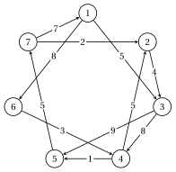
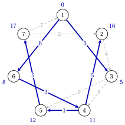
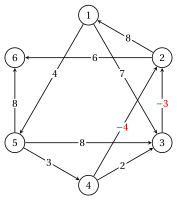
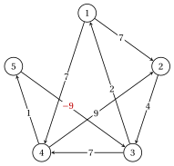
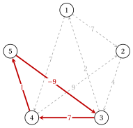
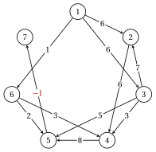
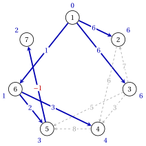
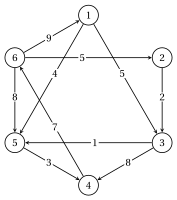
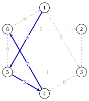

# Exercises · Shortest paths

**Exercises · Chapter 3** · each solution opens with a click · [:material-book-open-variant: Chapter 3: Shortest paths](../trees-and-paths/shortest-paths/index.md) · [:material-file-pdf-box: Exercises, volume 2 (PDF)](../pdf/exercises-2-trees-and-paths.pdf)

!!! formula "Rules used in these exercises"

    The definitions and the algorithms of the chapter [«Shortest paths»](https://fabiofurini.github.io/network-optimization/trees-and-paths/shortest-paths/), for a directed graph $G=(N,A)$ with lengths $d_{ij}$, $n=|N|$, $m=|A|$ and source $s=1$.

    - **(S1)** <strong>Dijkstra</strong> ($d_{ij} \ge 0$). The temporary node with the smallest label becomes permanent (smallest index on ties); for each arc $(i,j)$ with $j$ temporary, if $d(i)+d_{ij}<d(j)$ then $d(j):=d(i)+d_{ij}$ and $\mathit{pred}(j):=i$.

    - **(S2)** <strong>Bellman–Ford.</strong> Pass $k$ computes

        $$
        d^k(j)=\min\Big\{ d^{k-1}(j),\ \min_{(i,j) \in A} \big(d^{k-1}(i)+d_{ij}\big)\Big\};
        $$

        the predecessor changes only if the label strictly decreases (smallest $i$ on ties). Stop when $d^k=d^{k-1}$; a change in pass $n$ means a negative cycle reachable from $s$.

    - **(S3)** <strong>Negative cycle.</strong> If $d^n(j)<d^{n-1}(j)$, the predecessors read backwards from $j$, one row per pass from row $n$, give a walk with $n$ arcs that contains a negative cycle.

    - **(S4)** <strong>Acyclic graphs.</strong> Topological order by removing a node without entering arcs (smallest index); the nodes are processed in this order, each one relaxing its leaving arcs. Lengths $-d_{ij}$ give longest paths.

    - **(S5)** <strong>Potentials.</strong> $\bar{c}_{ij}=d_{ij}-\pi_i+\pi_j$; with labels, $\pi_i=-d(i)$. Feasible potentials ($\bar{c} \ge 0$) and a path from $s$ to $t$ of tight arcs ($\bar{c}=0$) prove that the path is shortest, of length $\pi_s-\pi_t$. The dual of $\mathrm{SP}(s,t)$ is $\max\{\pi_s-\pi_t : \pi_i-\pi_j \le d_{ij}\}$.

!!! esercizio "Exercise 3.1: Dijkstra's algorithm"

    !!! esercizio "Exercise"

        We consider the directed graph $G=(N,A)$ with $N=\{1,2,\dots,7\}$, the $11$ arcs and the lengths $d_{ij}$ of the table, drawn below; the source is $s=1$.

        
<table>
        <tr>
        <th>arc</th>
        <th>\((1,3)\)</th>
        <th>\((1,6)\)</th>
        <th>\((2,3)\)</th>
        <th>\((3,4)\)</th>
        <th>\((3,5)\)</th>
        <th>\((4,2)\)</th>
        <th>\((4,5)\)</th>
        <th>\((5,7)\)</th>
        <th>\((6,4)\)</th>
        <th>\((7,1)\)</th>
        <th>\((7,2)\)</th>
        </tr>
        <tr>
        <td>\(d_{ij}\)</td>
        <td>\(5\)</td>
        <td>\(8\)</td>
        <td>\(4\)</td>
        <td>\(8\)</td>
        <td>\(9\)</td>
        <td>\(5\)</td>
        <td>\(1\)</td>
        <td>\(5\)</td>
        <td>\(3\)</td>
        <td>\(7\)</td>
        <td>\(2\)</td>
        </tr>
        </table>

        { .fig loading=lazy  }

    **Questions**

    1. Run Dijkstra's algorithm from $s=1$: give the labels after every iteration and the order in which the nodes become permanent.

    2. Draw the shortest path tree and give a shortest path from $1$ to $7$ with its length.

    3. With the potentials $\pi_i=-\tilde{d}(i)$, compute the reduced costs and list the tight arcs.

??? soluzione "Solution"

    We use the rules (S1)–(S5) of the box at the beginning of these exercises.

    1. Each row is an iteration; permanent labels in bold, a label that decreased with the new predecessor in brackets:

        
<table>
        <tr>
        <th>it.</th>
        <th>\(i\)</th>
        <th>\(d(1)\)</th>
        <th>\(d(2)\)</th>
        <th>\(d(3)\)</th>
        <th>\(d(4)\)</th>
        <th>\(d(5)\)</th>
        <th>\(d(6)\)</th>
        <th>\(d(7)\)</th>
        </tr>
        <tr>
        <td>\(1\)</td>
        <td>\(1\)</td>
        <td>\(\mathbf{0}\)</td>
        <td>\(\infty\)</td>
        <td>\(5\) (\(1\))</td>
        <td>\(\infty\)</td>
        <td>\(\infty\)</td>
        <td>\(8\) (\(1\))</td>
        <td>\(\infty\)</td>
        </tr>
        <tr>
        <td>\(2\)</td>
        <td>\(3\)</td>
        <td>\(\mathbf{0}\)</td>
        <td>\(\infty\)</td>
        <td>\(\mathbf{5}\)</td>
        <td>\(13\) (\(3\))</td>
        <td>\(14\) (\(3\))</td>
        <td>\(8\)</td>
        <td>\(\infty\)</td>
        </tr>
        <tr>
        <td>\(3\)</td>
        <td>\(6\)</td>
        <td>\(\mathbf{0}\)</td>
        <td>\(\infty\)</td>
        <td>\(\mathbf{5}\)</td>
        <td>\(11\) (\(6\))</td>
        <td>\(14\)</td>
        <td>\(\mathbf{8}\)</td>
        <td>\(\infty\)</td>
        </tr>
        <tr>
        <td>\(4\)</td>
        <td>\(4\)</td>
        <td>\(\mathbf{0}\)</td>
        <td>\(16\) (\(4\))</td>
        <td>\(\mathbf{5}\)</td>
        <td>\(\mathbf{11}\)</td>
        <td>\(12\) (\(4\))</td>
        <td>\(\mathbf{8}\)</td>
        <td>\(\infty\)</td>
        </tr>
        <tr>
        <td>\(5\)</td>
        <td>\(5\)</td>
        <td>\(\mathbf{0}\)</td>
        <td>\(16\)</td>
        <td>\(\mathbf{5}\)</td>
        <td>\(\mathbf{11}\)</td>
        <td>\(\mathbf{12}\)</td>
        <td>\(\mathbf{8}\)</td>
        <td>\(17\) (\(5\))</td>
        </tr>
        <tr>
        <td>\(6\)</td>
        <td>\(2\)</td>
        <td>\(\mathbf{0}\)</td>
        <td>\(\mathbf{16}\)</td>
        <td>\(\mathbf{5}\)</td>
        <td>\(\mathbf{11}\)</td>
        <td>\(\mathbf{12}\)</td>
        <td>\(\mathbf{8}\)</td>
        <td>\(17\)</td>
        </tr>
        <tr>
        <td>\(7\)</td>
        <td>\(7\)</td>
        <td>\(\mathbf{0}\)</td>
        <td>\(\mathbf{16}\)</td>
        <td>\(\mathbf{5}\)</td>
        <td>\(\mathbf{11}\)</td>
        <td>\(\mathbf{12}\)</td>
        <td>\(\mathbf{8}\)</td>
        <td>\(\mathbf{17}\)</td>
        </tr>
        </table>

        The nodes become permanent in the order $1,3,6,4,5,2,7$, and $\tilde{\vet{d}}=(0,\,16,\,5,\,11,\,12,\,8,\,17)$.

    2. The arcs $(\mathit{pred}(j),j)$ are $(4,2)$, $(1,3)$, $(6,4)$, $(4,5)$, $(1,6)$, $(5,7)$ (blue); next to each node its distance:

        { .fig loading=lazy  }

        The shortest path from $1$ to $7$ is $1,6,4,5,7$, of length $8+3+1+5=17$.

    3. The potentials are $\vet{\pi}=(0,\,-16,\,-5,\,-11,\,-12,\,-8,\,-17)$, and $\bar{c}_{ij}=d_{ij}-\pi_i+\pi_j$:

        
<table>
        <tr>
        <th>arc</th>
        <th>\((1,3)\)</th>
        <th>\((1,6)\)</th>
        <th>\((2,3)\)</th>
        <th>\((3,4)\)</th>
        <th>\((3,5)\)</th>
        <th>\((4,2)\)</th>
        <th>\((4,5)\)</th>
        <th>\((5,7)\)</th>
        <th>\((6,4)\)</th>
        <th>\((7,1)\)</th>
        <th>\((7,2)\)</th>
        </tr>
        <tr>
        <td>\(d_{ij}\)</td>
        <td>\(5\)</td>
        <td>\(8\)</td>
        <td>\(4\)</td>
        <td>\(8\)</td>
        <td>\(9\)</td>
        <td>\(5\)</td>
        <td>\(1\)</td>
        <td>\(5\)</td>
        <td>\(3\)</td>
        <td>\(7\)</td>
        <td>\(2\)</td>
        </tr>
        <tr>
        <td>\(\bar{c}_{ij}\)</td>
        <td>\(0\)</td>
        <td>\(0\)</td>
        <td>\(15\)</td>
        <td>\(2\)</td>
        <td>\(2\)</td>
        <td>\(0\)</td>
        <td>\(0\)</td>
        <td>\(0\)</td>
        <td>\(0\)</td>
        <td>\(24\)</td>
        <td>\(3\)</td>
        </tr>
        </table>

        All reduced costs are non-negative, and the tight arcs are $(1,3)$, $(1,6)$, $(4,2)$, $(4,5)$, $(5,7)$, $(6,4)$: exactly the arcs of the shortest path tree.

    !!! chiave ""

        Dijkstra's algorithm gives $\tilde{\vet{d}}=(0,\,16,\,5,\,11,\,12,\,8,\,17)$; the potentials $\pi_i=-\tilde{d}(i)$ are feasible, and their tight arcs form the shortest path tree.

!!! esercizio "Exercise 3.2: Bellman--Ford with negative arcs"

    !!! esercizio "Exercise"

        We consider the directed graph $G=(N,A)$ with $N=\{1,2,\dots,6\}$, the $10$ arcs and the lengths $d_{ij}$ of the table, drawn below; the source is $s=1$.

        
<table>
        <tr>
        <th>arc</th>
        <th>\((1,3)\)</th>
        <th>\((1,5)\)</th>
        <th>\((2,1)\)</th>
        <th>\((2,6)\)</th>
        <th>\((3,2)\)</th>
        <th>\((4,2)\)</th>
        <th>\((4,3)\)</th>
        <th>\((5,3)\)</th>
        <th>\((5,4)\)</th>
        <th>\((5,6)\)</th>
        </tr>
        <tr>
        <td>\(d_{ij}\)</td>
        <td>\(7\)</td>
        <td>\(4\)</td>
        <td>\(8\)</td>
        <td>\(6\)</td>
        <td>\(-3\)</td>
        <td>\(-4\)</td>
        <td>\(2\)</td>
        <td>\(8\)</td>
        <td>\(3\)</td>
        <td>\(8\)</td>
        </tr>
        </table>

        { .fig loading=lazy  }

    **Questions**

    1. Run the Bellman–Ford algorithm from $s=1$: give the labels $d^k$ of every pass and the number of passes.

    2. Draw the shortest path tree and give a shortest path from $1$ to $6$.

    3. Run Dijkstra's algorithm on the same lengths: which labels are wrong, and why?

??? soluzione "Solution"

    We use the rules (S1)–(S5) of the box at the beginning of these exercises.

    1. Each row is a pass; next to a label that decreased, the new predecessor in brackets:

        $$
        \begin{array}{c|cccccc}
        \hline {k} & {d^k(1)} & {d^k(2)} & {d^k(3)} & {d^k(4)} & {d^k(5)} & {d^k(6)} \\
        \hline {0} & {0} & {\infty} & {\infty} & {\infty} & {\infty} & {\infty} \\
        {1} & {0} & {\infty} & {7} ({1}) & {\infty} & {4} ({1}) & {\infty} \\
        {2} & {0} & {4} ({3}) & {7} & {7} ({5}) & {4} & {12} ({5}) \\
        {3} & {0} & {3} ({4}) & {7} & {7} & {4} & {10} ({2}) \\
        {4} & {0} & {3} & {7} & {7} & {4} & {9} ({2}) \\
        {5} & {0} & {3} & {7} & {7} & {4} & {9} \\
        \hline
        \end{array}
        $$

        Pass $5$ repeats the labels of pass $4$: the algorithm stops after $5$ passes with $\tilde{\vet{d}}=(0,\,3,\,7,\,7,\,4,\,9)$.

    2. The last predecessors give the arcs $(4,2)$, $(1,3)$, $(5,4)$, $(1,5)$, $(2,6)$ (blue):

        { .fig loading=lazy  }

        The shortest path from $1$ to $6$ is $1,5,4,2,6$, of length $9$.

    3. Dijkstra's algorithm makes the nodes permanent in the order $1,5,3,2,4,6$ and returns $(0,\,4,\,7,\,7,\,4,\,10)$: the labels of nodes $2,6$ are wrong. The negative arc $(4,2)$ ends in a node that is already permanent when its tail is selected, so (S1) never uses it, although $\tilde{d}(4)+d_{42}=7-4=3<4$.

    !!! chiave ""

        With negative arcs and no negative cycle, the Bellman–Ford algorithm stops after $5$ passes with $\tilde{\vet{d}}=(0,\,3,\,7,\,7,\,4,\,9)$, while Dijkstra's algorithm fails.

!!! esercizio "Exercise 3.3: Detecting a negative cycle"

    !!! esercizio "Exercise"

        We consider the directed graph $G=(N,A)$ with $N=\{1,2,\dots,5\}$, the $8$ arcs and the lengths $d_{ij}$ of the table, drawn below; the source is $s=1$.

        
<table>
        <tr>
        <th>arc</th>
        <th>\((1,2)\)</th>
        <th>\((1,4)\)</th>
        <th>\((2,3)\)</th>
        <th>\((3,1)\)</th>
        <th>\((3,4)\)</th>
        <th>\((4,2)\)</th>
        <th>\((4,5)\)</th>
        <th>\((5,3)\)</th>
        </tr>
        <tr>
        <td>\(d_{ij}\)</td>
        <td>\(7\)</td>
        <td>\(7\)</td>
        <td>\(4\)</td>
        <td>\(2\)</td>
        <td>\(7\)</td>
        <td>\(9\)</td>
        <td>\(1\)</td>
        <td>\(-9\)</td>
        </tr>
        </table>

        { .fig loading=lazy  }

    **Questions**

    1. Run the Bellman–Ford algorithm from $s=1$ for $5$ passes. Does $G$ have a negative cycle reachable from $1$?

    2. Find a negative cycle by reading the predecessors backwards, and give its length.

    3. What is the optimal value of the single-source LP model $\mathrm{SP}(1)$?

??? soluzione "Solution"

    We use the rules (S1)–(S5) of the box at the beginning of these exercises.

    1. Each row is a pass; next to a label that decreased, the new predecessor in brackets:

        $$
        \begin{array}{c|ccccc}
        \hline {k} & {d^k(1)} & {d^k(2)} & {d^k(3)} & {d^k(4)} & {d^k(5)} \\
        \hline {0} & {0} & {\infty} & {\infty} & {\infty} & {\infty} \\
        {1} & {0} & {7} ({1}) & {\infty} & {\mathbf{7}} ({\mathbf{1}}) & {\infty} \\
        {2} & {0} & {7} & {11} ({2}) & {7} & {\mathbf{8}} ({\mathbf{4}}) \\
        {3} & {0} & {7} & {\mathbf{-1}} ({\mathbf{5}}) & {7} & {8} \\
        {4} & {0} & {7} & {-1} & {\mathbf{6}} ({\mathbf{3}}) & {8} \\
        {5} & {0} & {7} & {-1} & {6} & {\mathbf{7}} ({\mathbf{4}}) \\
        \hline
        \end{array}
        $$

        In pass $n=5$ the label of node $5$ decreases from $8$ to $7$: $d^5 \neq d^4$, and a negative cycle is reachable from $1$.

    2. Reading backwards from node $5$ (bold entries): row $5$ gives $4$, row $4$ gives $3$, row $3$ gives $5$, row $2$ gives $4$, row $1$ gives $1$. The walk is

        $$
        1,4,5,3,4,5, \qquad \text{of length } 7=d^5(5),
        $$

        and its first repeated node closes the cycle $4,5,3,4$, of length $1-9+7=-1$ (red):

        { .fig loading=lazy  }

    3. The model is feasible, since every node is reachable from $1$, and $G$ has a negative cycle: adding $\lambda$ units of flow around it keeps the balances and lowers the value by $\lambda$. The model $\mathrm{SP}(1)$ is unbounded (Gurobi confirms it).

    !!! chiave ""

        A change in pass $n=5$ reveals a negative cycle: the walk read backwards in the table contains the cycle $4,5,3,4$ of length $-1$, and the LP model is unbounded.

!!! esercizio "Exercise 3.4: Shortest paths in an acyclic graph"

    !!! esercizio "Exercise"

        We consider the directed graph $G=(N,A)$ with $N=\{1,2,\dots,7\}$, the $11$ arcs and the lengths $d_{ij}$ of the table, drawn below; the source is $s=1$.

        
<table>
        <tr>
        <th>arc</th>
        <th>\((1,2)\)</th>
        <th>\((1,3)\)</th>
        <th>\((1,6)\)</th>
        <th>\((2,4)\)</th>
        <th>\((3,2)\)</th>
        <th>\((3,4)\)</th>
        <th>\((3,5)\)</th>
        <th>\((4,5)\)</th>
        <th>\((5,7)\)</th>
        <th>\((6,4)\)</th>
        <th>\((6,5)\)</th>
        </tr>
        <tr>
        <td>\(d_{ij}\)</td>
        <td>\(6\)</td>
        <td>\(6\)</td>
        <td>\(1\)</td>
        <td>\(6\)</td>
        <td>\(7\)</td>
        <td>\(3\)</td>
        <td>\(5\)</td>
        <td>\(8\)</td>
        <td>\(-1\)</td>
        <td>\(3\)</td>
        <td>\(2\)</td>
        </tr>
        </table>

        { .fig loading=lazy  }

    **Questions**

    1. Show that $G$ is acyclic by finding its topological order with (S4).

    2. Compute the shortest paths from $s=1$ with the algorithm for acyclic graphs, and draw the shortest path tree.

    3. Compute a longest path from $1$ to $7$ and its length.

??? soluzione "Solution"

    We use the rules (S1)–(S5) of the box at the beginning of these exercises.

    1. Removing each time the node without entering arcs of smallest index gives the order $1,3,2,6,4,5,7$. Every arc goes forward in this order, so $G$ has no directed cycle.

    2. Each row processes one node and shows the labels after it:

        
<table>
        <tr>
        <th>step</th>
        <th>node \(i\)</th>
        <th>\(d(1)\)</th>
        <th>\(d(2)\)</th>
        <th>\(d(3)\)</th>
        <th>\(d(4)\)</th>
        <th>\(d(5)\)</th>
        <th>\(d(6)\)</th>
        <th>\(d(7)\)</th>
        </tr>
        <tr>
        <td>\(1\)</td>
        <td>\(1\)</td>
        <td>\(0\)</td>
        <td>\(6\)</td>
        <td>\(6\)</td>
        <td>\(\infty\)</td>
        <td>\(\infty\)</td>
        <td>\(1\)</td>
        <td>\(\infty\)</td>
        </tr>
        <tr>
        <td>\(2\)</td>
        <td>\(3\)</td>
        <td>\(0\)</td>
        <td>\(6\)</td>
        <td>\(6\)</td>
        <td>\(9\)</td>
        <td>\(11\)</td>
        <td>\(1\)</td>
        <td>\(\infty\)</td>
        </tr>
        <tr>
        <td>\(3\)</td>
        <td>\(2\)</td>
        <td>\(0\)</td>
        <td>\(6\)</td>
        <td>\(6\)</td>
        <td>\(9\)</td>
        <td>\(11\)</td>
        <td>\(1\)</td>
        <td>\(\infty\)</td>
        </tr>
        <tr>
        <td>\(4\)</td>
        <td>\(6\)</td>
        <td>\(0\)</td>
        <td>\(6\)</td>
        <td>\(6\)</td>
        <td>\(4\)</td>
        <td>\(3\)</td>
        <td>\(1\)</td>
        <td>\(\infty\)</td>
        </tr>
        <tr>
        <td>\(5\)</td>
        <td>\(4\)</td>
        <td>\(0\)</td>
        <td>\(6\)</td>
        <td>\(6\)</td>
        <td>\(4\)</td>
        <td>\(3\)</td>
        <td>\(1\)</td>
        <td>\(\infty\)</td>
        </tr>
        <tr>
        <td>\(6\)</td>
        <td>\(5\)</td>
        <td>\(0\)</td>
        <td>\(6\)</td>
        <td>\(6\)</td>
        <td>\(4\)</td>
        <td>\(3\)</td>
        <td>\(1\)</td>
        <td>\(2\)</td>
        </tr>
        <tr>
        <td>\(7\)</td>
        <td>\(7\)</td>
        <td>\(0\)</td>
        <td>\(6\)</td>
        <td>\(6\)</td>
        <td>\(4\)</td>
        <td>\(3\)</td>
        <td>\(1\)</td>
        <td>\(2\)</td>
        </tr>
        </table>

        Hence $\tilde{\vet{d}}=(0,\,6,\,6,\,4,\,3,\,1,\,2)$; the predecessors give the arcs $(1,2)$, $(1,3)$, $(6,4)$, $(6,5)$, $(1,6)$, $(5,7)$ (blue):

        { .fig loading=lazy  }

        The shortest path from $1$ to $7$ is $1,6,5,7$, of length $2$.

    3. With the lengths $-d_{ij}$ the same algorithm gives the longest path lengths

        $$
        (0,\,13,\,6,\,19,\,27,\,1,\,26).
        $$

        A longest path from $1$ to $7$ is $1,3,2,4,5,7$, of length $26$.

    !!! chiave ""

        In the topological order $1,3,2,6,4,5,7$ every label is final when its node is processed: shortest path to $7$ of length $2$, longest path of length $26$.

!!! esercizio "Exercise 3.5: Potentials as optimality certificate"

    !!! esercizio "Exercise"

        We consider the directed graph $G=(N,A)$ with $N=\{1,2,\dots,6\}$, the $10$ arcs and the lengths $d_{ij}$ of the table, drawn below; the source is $s=1$.

        
<table>
        <tr>
        <th>arc</th>
        <th>\((1,3)\)</th>
        <th>\((1,5)\)</th>
        <th>\((2,3)\)</th>
        <th>\((3,4)\)</th>
        <th>\((3,5)\)</th>
        <th>\((4,6)\)</th>
        <th>\((5,4)\)</th>
        <th>\((6,1)\)</th>
        <th>\((6,2)\)</th>
        <th>\((6,5)\)</th>
        </tr>
        <tr>
        <td>\(d_{ij}\)</td>
        <td>\(5\)</td>
        <td>\(4\)</td>
        <td>\(2\)</td>
        <td>\(8\)</td>
        <td>\(1\)</td>
        <td>\(7\)</td>
        <td>\(3\)</td>
        <td>\(9\)</td>
        <td>\(5\)</td>
        <td>\(8\)</td>
        </tr>
        </table>

        { .fig loading=lazy  }

        The tree $\bar{T}$ with the arcs $(6,2)$, $(1,3)$, $(3,4)$, $(1,5)$, $(4,6)$ gives the labels $\bar{\vet{d}}=(0,\,25,\,5,\,13,\,4,\,20)$, the lengths of its paths from $1$.

    **Questions**

    1. Write the dual model $D(\mathrm{SP}(1,6))$ of the LP model of the shortest path from $1$ to $6$.

    2. Compute the reduced costs of the potentials $\bar{\pi}_i=-\bar{d}(i)$. Is the path of $\bar{T}$ from $1$ to $6$ a shortest path?

    3. The potentials $\tilde{\vet{\pi}}=(0,\,-19,\,-5,\,-7,\,-4,\,-14)$ are given. Show that they are feasible, and find a path from $1$ to $6$ that they certify as shortest.

    4. What are the optimal values of $\mathrm{SP}(1,6)$ and of its dual?

??? soluzione "Solution"

    We use the rules (S1)–(S5) of the box at the beginning of these exercises.

    1. There is one free variable $\pi_i$ per node and one constraint $\pi_i-\pi_j \le d_{ij}$ per arc:

        $$
        \begin{array}{rll}
        \max & \pi_1-\pi_{6} & \\
        \text{subject to} & \pi_{1}-\pi_{3} \le 5 & \text{arc }(1,3) \\
        & \pi_{1}-\pi_{5} \le 4 & \text{arc }(1,5) \\
        & \pi_{2}-\pi_{3} \le 2 & \text{arc }(2,3) \\
        & \pi_{3}-\pi_{4} \le 8 & \text{arc }(3,4) \\
        & \pi_{3}-\pi_{5} \le 1 & \text{arc }(3,5) \\
        & \pi_{4}-\pi_{6} \le 7 & \text{arc }(4,6) \\
        & \pi_{5}-\pi_{4} \le 3 & \text{arc }(5,4) \\
        & \pi_{6}-\pi_{1} \le 9 & \text{arc }(6,1) \\
        & \pi_{6}-\pi_{2} \le 5 & \text{arc }(6,2) \\
        & \pi_{6}-\pi_{5} \le 8 & \text{arc }(6,5) \\
        & \pi_i \in \R, & i \in \{1,\dots,6\}.
        \end{array}
        $$

    2. With $\bar{\vet{\pi}}=(0,\,-25,\,-5,\,-13,\,-4,\,-20)$ the reduced costs are:

        
<table>
        <tr>
        <th>arc</th>
        <th>\((1,3)\)</th>
        <th>\((1,5)\)</th>
        <th>\((2,3)\)</th>
        <th>\((3,4)\)</th>
        <th>\((3,5)\)</th>
        <th>\((4,6)\)</th>
        <th>\((5,4)\)</th>
        <th>\((6,1)\)</th>
        <th>\((6,2)\)</th>
        <th>\((6,5)\)</th>
        </tr>
        <tr>
        <td>\(d_{ij}\)</td>
        <td>\(5\)</td>
        <td>\(4\)</td>
        <td>\(2\)</td>
        <td>\(8\)</td>
        <td>\(1\)</td>
        <td>\(7\)</td>
        <td>\(3\)</td>
        <td>\(9\)</td>
        <td>\(5\)</td>
        <td>\(8\)</td>
        </tr>
        <tr>
        <td>\(\bar{c}_{ij}\)</td>
        <td>\(0\)</td>
        <td>\(0\)</td>
        <td>\(22\)</td>
        <td>\(0\)</td>
        <td>\(2\)</td>
        <td>\(0\)</td>
        <td>\(-6\)</td>
        <td>\(29\)</td>
        <td>\(0\)</td>
        <td>\(24\)</td>
        </tr>
        </table>

        The arc $(5,4)$ has $\bar{c}_{54}=3-(-4)+(-13)=-6<0$: the potentials are not feasible, and entering node $4$ through $(5,4)$ gives a path of length $7<13=\bar{d}(4)$. The path $1,3,4,6$ of $\bar{T}$ has length $20$, larger than the distance $14$: it is not shortest.

    3. The reduced costs of $\tilde{\vet{\pi}}$ are all non-negative:

        
<table>
        <tr>
        <th>arc</th>
        <th>\((1,3)\)</th>
        <th>\((1,5)\)</th>
        <th>\((2,3)\)</th>
        <th>\((3,4)\)</th>
        <th>\((3,5)\)</th>
        <th>\((4,6)\)</th>
        <th>\((5,4)\)</th>
        <th>\((6,1)\)</th>
        <th>\((6,2)\)</th>
        <th>\((6,5)\)</th>
        </tr>
        <tr>
        <td>\(d_{ij}\)</td>
        <td>\(5\)</td>
        <td>\(4\)</td>
        <td>\(2\)</td>
        <td>\(8\)</td>
        <td>\(1\)</td>
        <td>\(7\)</td>
        <td>\(3\)</td>
        <td>\(9\)</td>
        <td>\(5\)</td>
        <td>\(8\)</td>
        </tr>
        <tr>
        <td>\(\bar{c}_{ij}\)</td>
        <td>\(0\)</td>
        <td>\(0\)</td>
        <td>\(16\)</td>
        <td>\(6\)</td>
        <td>\(2\)</td>
        <td>\(0\)</td>
        <td>\(0\)</td>
        <td>\(23\)</td>
        <td>\(0\)</td>
        <td>\(18\)</td>
        </tr>
        </table>

        The path $1,5,4,6$ uses only tight arcs, so by (S5) it is a shortest path, of length $\tilde{\pi}_1-\tilde{\pi}_{6}=14$.

        { .fig loading=lazy  }

    4. By weak duality the incidence vector of $1,5,4,6$, of value $14$, and $\tilde{\vet{\pi}}$, of value $\tilde{\pi}_1-\tilde{\pi}_{6}=14$, are both optimal: $z(\mathrm{SP}(1,6))=z(D(\mathrm{SP}(1,6)))=14$ (Gurobi confirms it).

    !!! chiave ""

        Potentials with a negative reduced cost point to a shorter path; feasible potentials with a tight path certify it: the distance from $1$ to $6$ is $14$.
