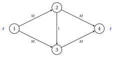

# 5.5 The Ford–Fulkerson algorithm { #sez-sec-mf-ff }

**Part 3 · Flows · Chapter 5** · [:material-book-open-variant: Chapter 5: Maximum flow](index.md) · [:material-file-pdf-box: Lecture notes, volume 3 (PDF)](../../pdf/lecture-notes-3-flows.pdf) · [:material-presentation: Slides](../../pdf/slides-maximum-flow.pdf) · [:material-pencil: Exercises: Maximum flow](../../exercises/maximum-flow.md) · [:material-gesture-tap: App: Maximum flow: Ford–Fulkerson and Edmonds–Karp](../../lab/maximum-flow-ford-fulkerson-edmonds-karp.md)

- By [Theorem 5.8](the-max-flow-min-cut-theorem.md#box-12-mf-th-mfmc), a flow can be improved as long as its residual network has an augmenting path. The <strong>Ford–Fulkerson algorithm</strong> starts from the zero flow and augments along such paths until none is left.

!!! algoritmo "Algorithm: Ford–Fulkerson algorithm"

    

<strong>Input:</strong> a directed graph \(G=(N,A)\) with integer capacities \(u_{ij} \ge 0\), a source \(s\) and a sink \(t\)

<strong>Output:</strong> a maximum flow \(\vet{x}\) and a minimum cut \((S,N \setminus S)\)

1<strong>Step 0 (initialization).</strong> Set \(x_{ij}:=0\) for every \((i,j) \in A\), and \(v:=0\).

2<strong>Step 1 (search).</strong> Build the residual network \(G(\vet{x})\) and search it from \(s\).

3  If \(t\) is not labelled, <code>STOP</code>: \(\vet{x}\) is a maximum flow, and \(S\) is the set of the labelled nodes.

4<strong>Step 2 (augmentation).</strong> Let \(P\) be the path of the predecessors from \(s\) to \(t\), and
    \(\delta:=\min_{(i,j) \in P} r_{ij}\).

5  Augment \(\vet{x}\) along \(P\) by \(\delta\), set \(v:=v+\delta\), and go to Step 1.

- Step 1 can use any search of [Chapter 1, Section «Graph search»](https://fabiofurini.github.io/network-optimization/graphs/graphs/graph-search/). In this module the Ford–Fulkerson algorithm uses the <strong>depth-first search</strong>: $\mathit{LIST}$ is a stack, the residual arcs leaving each node are scanned by increasing index of the head, and the search stops as soon as $t$ is labelled.

- When the search does not label $t$, it has labelled all the nodes reachable from $s$ (Chapter 1, Theorem «correctness of the search»): they form the set $S$ of Step 1.

!!! teorema "Theorem 5.9: correctness of Ford–Fulkerson"

    Let the capacities be integer. Then every flow computed by the Ford–Fulkerson algorithm is integer, the algorithm stops after at most $\tilde{v}$ augmentations, and at the stop $\vet{x}$ is a maximum flow and $(S,N \setminus S)$ is a minimum cut.

??? dimostrazione "Proof"

    We use [Lemma 5.7](the-residual-network.md#box-9-mf-lem-aug) and [Theorem 5.8](the-max-flow-min-cut-theorem.md#box-12-mf-th-mfmc).

    1. <em>Integrality.</em> The zero flow is integer. If $\vet{x}$ is integer, all residual capacities are integer, so $\delta$ is a positive integer and the augmented flow is integer.

    2. <em>Termination.</em> Every flow is feasible, and every augmentation raises the value by $\delta \ge 1$. No value exceeds $\tilde{v}$, so there are at most $\tilde{v}$ augmentations.

    3. <em>Optimality.</em> At the stop $t$ is not labelled, so $G(\vet{x})$ has no augmenting path and $S$ is the set of the nodes reachable from $s$. The proof of (b) implies (c) gives $v=u(S,N \setminus S)$: the flow is maximum and the cut is minimum. □

!!! teorema "Corollary 5.10: integrality"

    If all the capacities are integer, there is a maximum flow with integer entries.

??? dimostrazione "Proof"

    The flow returned by the Ford–Fulkerson algorithm, by [Theorem 5.9](#box-14-mf-th-ff). □

- The same conclusion follows from [Chapter 4, Theorem «integer vertices»](https://fabiofurini.github.io/network-optimization/flows/network-flow-models/total-unimodularity-and-integrality/): with the arc $(t,s)$, the $\mathrm{MF}$ model is a minimum cost flow model with integer data, and its optimum is attained at an integer vertex.

- Rational capacities become integer after multiplication by a common denominator, which multiplies every flow and every cut by the same factor: the algorithm stops also with rational capacities.

!!! teorema "Theorem 5.11: running time of Ford–Fulkerson"

    With integer capacities, the Ford–Fulkerson algorithm runs in $O((n+m)\,\tilde{v})$ time, and $\tilde{v} \le (n-1)\,U$, where $U$ is the largest capacity.

??? dimostrazione "Proof"

    Every iteration builds $G(\vet{x})$ in $O(m)$ time, searches it in $O(n+m)$ time, since $G(\vet{x})$ has at most $2m$ arcs (Chapter 1, Theorem «running time of the search»), and changes at most $n-1$ flows along $P$. There are at most $\tilde{v}$ iterations with an augmentation, plus the last one.

    - By [Corollary 5.4](cuts.md#box-5-mf-cor-weak) with $S=\{s\}$, $\tilde{v} \le u(\{s\},N \setminus \{s\})$, and $s$ has at most $n-1$ leaving arcs, each with capacity at most $U$.

    
□

- The bound grows with the value $U$ of the capacities, and not only with the number of their digits, about $\log_2 U$: the running time is <strong>pseudopolynomial</strong>. [Example 5.7](#box-18-mf-ex-bad) shows that the number of augmentations can really grow with the capacities.

## 5.5.1 Ford–Fulkerson on the reference network

!!! esempio "Example 5.6: Ford–Fulkerson on the reference network"

    We run the algorithm on the network of [Example 5.1](the-maximum-flow-problem.md#box-2-mf-ex-ref). Each row is an iteration: the augmenting path, the residual capacities of its arcs, the backward arcs it uses, the bottleneck and the new value.

    
<table>
    <tr>
    <th>iteration</th>
    <th>augmenting path</th>
    <th>\(r_{ij}\) on \(P\)</th>
    <th>backward arcs</th>
    <th>\(\delta\)</th>
    <th>\(v\)</th>
    </tr>
    <tr>
    <td>\(1\)</td>
    <td>\(1,2,4,3,5,6\)</td>
    <td>\(5,3,2,4,3\)</td>
    <td>–</td>
    <td>\(2\)</td>
    <td>\(2\)</td>
    </tr>
    <tr>
    <td>\(2\)</td>
    <td>\(1,2,4,6\)</td>
    <td>\(3,1,4\)</td>
    <td>–</td>
    <td>\(1\)</td>
    <td>\(3\)</td>
    </tr>
    <tr>
    <td>\(3\)</td>
    <td>\(1,3,4,6\)</td>
    <td>\(4,2,3\)</td>
    <td>\((3,4)\)</td>
    <td>\(2\)</td>
    <td>\(5\)</td>
    </tr>
    <tr>
    <td>\(4\)</td>
    <td>\(1,3,5,4,6\)</td>
    <td>\(2,2,2,1\)</td>
    <td>–</td>
    <td>\(1\)</td>
    <td>\(6\)</td>
    </tr>
    <tr>
    <td>\(5\)</td>
    <td>\(1,3,5,6\)</td>
    <td>\(1,1,1\)</td>
    <td>–</td>
    <td>\(1\)</td>
    <td>\(7\)</td>
    </tr>
    </table>

    The flows after each iteration ($k=0$ is the zero flow) are:

    $$
    \begin{array}{c|ccccccccc}
    \hline {k} & {x_{12}} & {x_{13}} & {x_{24}} & {x_{32}} & {x_{35}} & {x_{43}} & {x_{46}} & {x_{54}} & {x_{56}} \\
    \hline {0} & {0} & {0} & {0} & {0} & {0} & {0} & {0} & {0} & {0} \\
    {1} & {2} & {0} & {2} & {0} & {2} & {2} & {0} & {0} & {2} \\
    {2} & {3} & {0} & {3} & {0} & {2} & {2} & {1} & {0} & {2} \\
    {3} & {3} & {2} & {3} & {0} & {2} & {0} & {3} & {0} & {2} \\
    {4} & {3} & {3} & {3} & {0} & {3} & {0} & {4} & {1} & {2} \\
    {5} & {3} & {4} & {3} & {0} & {4} & {0} & {4} & {1} & {3} \\
    \hline
    \end{array}
    $$

    - Iteration $1$ is the depth-first search of [Chapter 1, Example «DFS from node $1$»](https://fabiofurini.github.io/network-optimization/graphs/graphs/graph-search/): all the arcs are empty, $G(\vet{0})=G$, and the path goes through the arc $(4,3)$.

    - After iteration $2$ the flow is $\bar{\vet{x}}$ of [Example 5.1](the-maximum-flow-problem.md#box-2-mf-ex-ref), and iteration $3$ is the augmentation of [Example 5.3](the-residual-network.md#box-10-mf-ex-residual): the backward arc $(3,4)$ cancels the two units sent on $(4,3)$ in iteration $1$.

    - The sixth search labels only the nodes $1$ and $2$, and the algorithm stops: the flow is $\tilde{\vet{x}}$ of [Example 5.5](the-max-flow-min-cut-theorem.md#box-13-mf-ex-maxflow), and $S=\{1,2\}$ gives the minimum cut of capacity $u_{13}+u_{24}=7$.

    - The algorithm makes $5$ augmentations, within the bound $\tilde{v}=7$ of [Theorem 5.9](#box-14-mf-th-ff).

## 5.5.2 The number of augmentations

!!! esempio "Example 5.7: many augmentations"

    In the network below, $M$ is a positive integer. The paths $1,2,4$ and $1,3,4$ carry $M$ units each, and the cut $S=\{1\}$ has capacity $2M$, so $\tilde{v}=2M$.

    { .fig loading=lazy  }

    - The Ford–Fulkerson algorithm allows any augmenting path. If the paths $1,2,3,4$ and $1,3,2,4$ alternate, the second one through the backward arc $(3,2)$, every bottleneck is $\delta=1$, given by the arc $(2,3)$ or by its backward arc: $2M$ augmentations are needed, two million for $M=10^6$.

    - With the depth-first search of this module, for $M \ge 2$, the paths are $1,2,3,4$, then $1,2,4$, $1,3,2,4$ and $1,3,4$, with $\delta=1$, $M-1$, $1$, $M-1$: four augmentations.

!!! chiave ""

    The Ford–Fulkerson algorithm augments along paths of the residual network until none is left. With integer capacities it stops after at most $\tilde{v}$ augmentations, with an integer maximum flow and a minimum cut; its running time $O((n+m)\,\tilde{v})$ is pseudopolynomial.

---

**Next:** [5.6 The Edmonds–Karp algorithm](the-edmonds-karp-algorithm.md)
