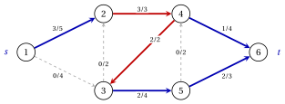

# 5.1 The maximum flow problem { #sez-sec-mf-problem }

**Part 3 · Flows · Chapter 5** · [:material-book-open-variant: Chapter 5: Maximum flow](index.md) · [:material-file-pdf-box: Lecture notes, volume 3 (PDF)](../../pdf/lecture-notes-3-flows.pdf) · [:material-pencil: Exercises: Maximum flow](../../exercises/maximum-flow.md) · [:material-gesture-tap: App: Maximum flow: Ford–Fulkerson and Edmonds–Karp](../../lab/maximum-flow-ford-fulkerson-edmonds-karp.md)

!!! definizione "Definition 5.1: maximum flow problem"

    Let $G=(N,A)$ be a directed graph with $n=|N|$ nodes and $m=|A|$ arcs, two distinct nodes $s$, the <strong>source</strong>, and $t$, the <strong>sink</strong>, and a <strong>capacity</strong> $u_{ij} \ge 0$ for every arc $(i,j) \in A$.

    - A <strong>feasible flow</strong> is a vector $\vet{x} \in \R^m$ with $0 \le x_{ij} \le u_{ij}$ for every arc $(i,j) \in A$ and flow conservation at every node other than $s$ and $t$:

        $$
        \sum_{(i,j) \in \delta^+(i)} x_{ij} \;-\; \sum_{(j,i) \in \delta^-(i)} x_{ji}=0, \quad \forall i \in N \setminus
        \{s,t\}.
        $$

    - The <strong>value</strong> of the flow is the net outflow of the source:

        $$
        v=\sum_{(s,j) \in \delta^+(s)} x_{sj} \;-\; \sum_{(j,s) \in \delta^-(s)} x_{js} .
        $$

    - The <strong>maximum flow problem</strong> asks for a feasible flow of maximum value, a <strong>maximum flow</strong>. Its value is denoted by $\tilde{v}$.

- The capacities are finite, and the flow $\vet{x}=\vet{0}$, of value $0$, is always feasible.

- The nodes other than $s$ and $t$ pass on everything they receive: the flow leaves $s$ and travels through the network towards $t$.

- As in [Chapter 4 «Network flow models»](https://fabiofurini.github.io/network-optimization/flows/network-flow-models/), $\delta^+(i)$ and $\delta^-(i)$ are the arcs leaving and entering node $i$, and the arcs are numbered $a_1,a_2,\dots,a_m$ in lexicographic order.

!!! esempio "Example 5.1: the reference network"

    We give capacities to the reference graph of [Chapter 1 «Graphs»](https://fabiofurini.github.io/network-optimization/graphs/graphs/), with source $s=1$ and sink $t=6$:

    
<table>
    <tr>
    <th>arc</th>
    <th>\((1,2)\)</th>
    <th>\((1,3)\)</th>
    <th>\((2,4)\)</th>
    <th>\((3,2)\)</th>
    <th>\((3,5)\)</th>
    <th>\((4,3)\)</th>
    <th>\((4,6)\)</th>
    <th>\((5,4)\)</th>
    <th>\((5,6)\)</th>
    </tr>
    <tr>
    <td>\(u_{ij}\)</td>
    <td>\(5\)</td>
    <td>\(4\)</td>
    <td>\(3\)</td>
    <td>\(2\)</td>
    <td>\(4\)</td>
    <td>\(2\)</td>
    <td>\(4\)</td>
    <td>\(2\)</td>
    <td>\(3\)</td>
    </tr>
    <tr>
    <td>\(\bar{x}_{ij}\)</td>
    <td>\(3\)</td>
    <td>\(0\)</td>
    <td>\(3\)</td>
    <td>\(0\)</td>
    <td>\(2\)</td>
    <td>\(2\)</td>
    <td>\(1\)</td>
    <td>\(0\)</td>
    <td>\(2\)</td>
    </tr>
    </table>

    In the figure each arc carries its capacity $u_{ij}$.

    { .fig loading=lazy  }

    The flow $\bar{\vet{x}}$ of the table is feasible. For example, at node $4$ the inflow is $\bar{x}_{24}+\bar{x}_{54}=3+0=3$ and the outflow is $\bar{x}_{43}+\bar{x}_{46}=2+1=3$. Its value is

    $$
    v=\bar{x}_{12}+\bar{x}_{13}=3+0=3 ,
    $$

    and node $6$ receives $\bar{x}_{46}+\bar{x}_{56}=1+2=3$ units. In the figure each arc carries $\bar{x}_{ij}/u_{ij}$: the arcs with $0<\bar{x}_{ij}<u_{ij}$ are blue, the saturated arcs ($\bar{x}_{ij}=u_{ij}$) red, and the empty arcs grey and dashed.

    { .fig loading=lazy  }

## 5.1.1 The LP model

- We use one continuous variable $x_{ij}$ for every arc $(i,j) \in A$, the flow on the arc, and one variable $v$, the value of the flow.

!!! chiave ""

    Using these variables, an LP model for the maximum flow problem reads as follows:

    

    \begin{align*}
    &&   \max \;\; v                                                                                \label{mf:obj}  \tag{5.1a}\\[1ex]
    && \text{subject to} \quad  \sum_{(s,j) \in \delta^+(s)} x_{sj} - \sum_{(j,s) \in \delta^-(s)} x_{js}
    &= v, &                                                                                    \label{mf:cons-s}  \tag{5.1b}\\[1ex]
    && \sum_{(i,j) \in \delta^+(i)} x_{ij} - \sum_{(j,i) \in \delta^-(i)} x_{ji}
    &= 0, & \forall i \in N \setminus \{s,t\},                                                 \label{mf:cons}  \tag{5.1c}\\[1ex]
    && \sum_{(t,j) \in \delta^+(t)} x_{tj} - \sum_{(j,t) \in \delta^-(t)} x_{jt}
    &= -v, &                                                                                   \label{mf:cons-t}  \tag{5.1d}\\[1ex]
    && x_{ij} &\le u_{ij}, & \forall (i,j) \in A,                                             \label{mf:cap}  \tag{5.1e}\\[1ex]
    && x_{ij} &\ge 0, & \forall (i,j) \in A,                                                  \label{mf:dom}  \tag{5.1f}\\[1ex]
    && v &\in \R. &                                                                           \label{mf:domv} \tag{5.1g}
    \end{align*}

    This LP model is referred to as the $\mathrm{MF}$ model.

- Description of the objective function and constraints of the $\mathrm{MF}$ model:

    - the objective function $\eqref{mf:obj}$ maximizes the value of the flow;

    - constraint $\eqref{mf:cons-s}$ states that the net outflow of $s$ is $v$, and constraint $\eqref{mf:cons-t}$ that the net inflow of $t$ is $v$;

    - constraints $\eqref{mf:cons}$ are the flow conservation constraints of the other nodes;

    - constraints $\eqref{mf:cap}$ impose the capacities, and constraints $\eqref{mf:dom}$ and $\eqref{mf:domv}$ define the variables of the LP model.

- Every arc contributes $+x_{ij}$ to the row of its tail and $-x_{ij}$ to the row of its head, so the left-hand sides of $\eqref{mf:cons-s}$–$\eqref{mf:cons-t}$ add up to zero: constraint $\eqref{mf:cons-t}$ follows from the others.

- In [Chapter 4, Section «Special cases»](https://fabiofurini.github.io/network-optimization/flows/network-flow-models/special-cases/) the maximum flow problem is a minimum cost flow model: zero balances and zero costs, plus the arc $(t,s)$ with capacity $+\infty$ and cost $-1$. Calling $v$ the flow $x_{ts}$ on this arc, $\eqref{mf:cons-s}$–$\eqref{mf:cons-t}$ are its conservation constraints, and $\min\,(-x_{ts})$ is $\max\, v$.

!!! chiave ""

    A feasible flow respects the capacities and is conserved at every node other than $s$ and $t$; its value $v$ is the net outflow of $s$. The maximum flow problem is the LP $\mathrm{MF}$: maximize $v$ under conservation and capacities.

---

**Next:** [5.2 Cuts](cuts.md)
