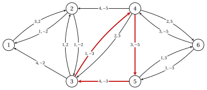

# 6.1 The residual network with costs { #sez-sec-mc-residual }

**Part 3 · Flows · Chapter 6** · [:material-book-open-variant: Chapter 6: Minimum cost flow](index.md) · [:material-file-pdf-box: Lecture notes, volume 3 (PDF)](../../pdf/lecture-notes-3-flows.pdf) · [:material-presentation: Slides](../../pdf/slides-min-cost-flow.pdf) · [:material-pencil: Exercises: Minimum cost flow](../../exercises/min-cost-flow.md) · [:material-gesture-tap: App: Minimum cost flow: cycle canceling and successive shortest paths](../../lab/minimum-cost-flow.md)

- In this chapter the network $G=(N,A)$ has balances $b_i$ with $\sum_{i \in N} b_i=0$, lower bounds $l_{ij}$, capacities $u_{ij}$ (finite or $+\infty$) and costs $c_{ij}$, as in [Chapter 4](https://fabiofurini.github.io/network-optimization/flows/network-flow-models/networks-and-flows/). The arcs are numbered $a_1,a_2,\dots,a_m$ in lexicographic order.

- The set $A$ has no pair of opposite arcs $(i,j)$, $(j,i)$. An arc $(j,i)$ opposite to $(i,j)$ can be replaced by the arcs $(j,k)$ and $(k,i)$ through a new transshipment node $k$, both with the bounds of $(j,i)$, the first with its cost and the second with cost $0$: the flows and their costs do not change.

!!! definizione "Definition 6.1: residual network"

    Let $\vet{x}$ be a vector with $l_{ij} \le x_{ij} \le u_{ij}$ for every arc. The <strong>residual network</strong> $G(\vet{x})=(N,A(\vet{x}))$ has, for every arc $(i,j) \in A$:

    - the <strong>forward arc</strong> $(i,j)$, if $x_{ij}<u_{ij}$, with <strong>residual capacity</strong> $r_{ij}=u_{ij}-x_{ij}$ and cost $c_{ij}$;

    - the <strong>backward arc</strong> $(j,i)$, if $x_{ij}>l_{ij}$, with residual capacity $r_{ji}=x_{ij}-l_{ij}$ and cost $-c_{ij}$.

    We write $c^x_{ij}$ for the cost of the arc $(i,j)$ of $G(\vet{x})$.

- A forward arc can carry $r_{ij}$ more units on $(i,j)$. A backward arc $(j,i)$ sends units back from $j$ to $i$ by decreasing $x_{ij}$, and saves $c_{ij}$ per unit.

- An arc of $A$ gives two arcs of $G(\vet{x})$ exactly when $l_{ij}<x_{ij}<u_{ij}$. With $\vet{l}=\vet{0}$ and without the costs, $G(\vet{x})$ is the residual network of [Chapter 5 «Maximum flow»](https://fabiofurini.github.io/network-optimization/flows/maximum-flow/).

!!! definizione "Definition 6.2: cycles of the residual network"

    Let $W$ be a directed cycle of $G(\vet{x})$. Its <strong>cost</strong> and its <strong>residual capacity</strong> are

    $$
    c(W)=\sum_{(i,j) \in W} c^x_{ij}, \qquad\qquad r(W)=\min_{(i,j) \in W} r_{ij},
    $$

    and $W$ is a <strong>negative cycle</strong> if $c(W)<0$. <strong>Augmenting</strong> $\vet{x}$ along $W$ by $\theta$, with $0<\theta \le r(W)$, means increasing $x_{ij}$ by $\theta$ for every forward arc $(i,j)$ of $W$, and decreasing $x_{ij}$ by $\theta$ for every arc $(i,j) \in A$ whose backward arc $(j,i)$ is in $W$.

!!! teorema "Proposition 6.3: augmenting along a cycle"

    Let $\vet{l} \le \vet{x} \le \vet{u}$, let $W$ be a cycle of $G(\vet{x})$ and $0<\theta \le r(W)$, and let $\vet{x}'$ be $\vet{x}$ augmented along $W$ by $\theta$. Then $\vet{l} \le \vet{x}' \le \vet{u}$, every node has the same outflow minus inflow in $\vet{x}'$ and in $\vet{x}$, and

    $$
    \vet{c}'\vet{x}'=\vet{c}'\vet{x}+\theta\, c(W).
    $$

??? dimostrazione "Proof"

    We check the three claims arc by arc.

    1. <em>Bounds.</em> On a forward arc, $x'_{ij}=x_{ij}+\theta \le x_{ij}+r_{ij}=u_{ij}$. If the backward arc $(j,i)$ is in $W$, then $x'_{ij}=x_{ij}-\theta \ge x_{ij}-r_{ji}=l_{ij}$.

    2. <em>Balances.</em> Augmenting by $\theta$ along an arc $(i,k)$ of $G(\vet{x})$ raises the outflow minus inflow of $i$ by $\theta$ and lowers that of $k$ by $\theta$: a forward arc sends more flow from $i$ to $k$, a backward arc sends less flow from $k$ to $i$. Every node of $W$ is the tail of one arc of $W$ and the head of another one, so the changes cancel.

    3. <em>Cost.</em> A forward arc changes the cost by $c_{ij}\theta=c^x_{ij}\theta$; a backward arc $(j,i)$ changes it by $-c_{ij}\theta=c^x_{ji}\theta$. Adding up along $W$ gives $\theta\, c(W)$. □

- If $\vet{x}$ is a feasible flow, so is $\vet{x}'$. Along a negative cycle the cost decreases by $\theta\, |c(W)|$.

!!! esempio "Example 6.1: the residual network of the most expensive flow"

    We use the reference network of [Chapter 4](https://fabiofurini.github.io/network-optimization/flows/network-flow-models/networks-and-flows/), with zero lower bounds, the balances $\vet{b}=(5,2,0,-3,0,-4)$, and the costs and capacities

    
<table>
    <tr>
    <th>arc</th>
    <th>\((1,2)\)</th>
    <th>\((1,3)\)</th>
    <th>\((2,4)\)</th>
    <th>\((3,2)\)</th>
    <th>\((3,5)\)</th>
    <th>\((4,3)\)</th>
    <th>\((4,6)\)</th>
    <th>\((5,4)\)</th>
    <th>\((5,6)\)</th>
    </tr>
    <tr>
    <td>\(c_{ij}\)</td>
    <td>\(2\)</td>
    <td>\(2\)</td>
    <td>\(5\)</td>
    <td>\(2\)</td>
    <td>\(3\)</td>
    <td>\(3\)</td>
    <td>\(5\)</td>
    <td>\(5\)</td>
    <td>\(3\)</td>
    </tr>
    <tr>
    <td>\(u_{ij}\)</td>
    <td>\(4\)</td>
    <td>\(4\)</td>
    <td>\(4\)</td>
    <td>\(2\)</td>
    <td>\(4\)</td>
    <td>\(3\)</td>
    <td>\(5\)</td>
    <td>\(3\)</td>
    <td>\(2\)</td>
    </tr>
    </table>

    Its most expensive feasible flow, computed with Gurobi by maximizing the cost, is

    $$
    \vet{x}^0=(1,\,4,\,4,\,1,\,4,\,1,\,3,\,3,\,1), \qquad \vet{c}'\vet{x}^0=80,
    $$

    with the entries in the order of the arcs; it is the only flow of cost $80$, as the enumeration of the $12$ integer feasible flows confirms. Each arc gives the following arcs of $G(\vet{x}^0)$, with residual capacity and cost:

    
<table>
    <tr>
    <th>arc \((i,j)\)</th>
    <th>\((1,2)\)</th>
    <th>\((1,3)\)</th>
    <th>\((2,4)\)</th>
    <th>\((3,2)\)</th>
    <th>\((3,5)\)</th>
    <th>\((4,3)\)</th>
    <th>\((4,6)\)</th>
    <th>\((5,4)\)</th>
    <th>\((5,6)\)</th>
    </tr>
    <tr>
    <td>\(x^0_{ij}\)</td>
    <td>\(1\)</td>
    <td>\(4\)</td>
    <td>\(4\)</td>
    <td>\(1\)</td>
    <td>\(4\)</td>
    <td>\(1\)</td>
    <td>\(3\)</td>
    <td>\(3\)</td>
    <td>\(1\)</td>
    </tr>
    <tr>
    <td>forward \((i,j)\): \(r,c\)</td>
    <td>\(3,2\)</td>
    <td>–</td>
    <td>–</td>
    <td>\(1,2\)</td>
    <td>–</td>
    <td>\(2,3\)</td>
    <td>\(2,5\)</td>
    <td>–</td>
    <td>\(1,3\)</td>
    </tr>
    <tr>
    <td>backward \((j,i)\): \(r,c\)</td>
    <td>\(1,-2\)</td>
    <td>\(4,-2\)</td>
    <td>\(4,-5\)</td>
    <td>\(1,-2\)</td>
    <td>\(4,-3\)</td>
    <td>\(1,-3\)</td>
    <td>\(3,-5\)</td>
    <td>\(3,-5\)</td>
    <td>\(1,-3\)</td>
    </tr>
    </table>

    In the figure each arc of $G(\vet{x}^0)$ carries the pair $r_{ij},c^x_{ij}$; the cycle $W=4,5,3,4$ is red.

    { .fig loading=lazy  }

    - The cycle $W=4,5,3,4$ uses the backward arcs of $(5,4)$, $(3,5)$ and $(4,3)$:

        $$
        c(W)=-5-3-3=-11, \qquad r(W)=\min\{3,4,1\}=1.
        $$

    - Augmenting by $\theta=1$ decreases $x_{54}$, $x_{35}$ and $x_{43}$ by one unit. The new flow $\vet{x}^1=(1,4,4,1,3,0,3,2,1)$ is feasible and costs $80-11=69$: the unit that went around the directed cycle $3,5,4,3$ of $G$ cost $11$ and delivered nothing.

!!! chiave ""

    The residual network $G(\vet{x})$ has a forward arc of cost $c_{ij}$ where $x_{ij}$ can grow and a backward arc of cost $-c_{ij}$ where $x_{ij}$ can decrease. Augmenting along a cycle of $G(\vet{x})$ keeps the bounds and the balances, and changes the cost by $\theta\, c(W)$.

---

**Next:** [6.2 Circulations and their decomposition](circulations-and-their-decomposition.md)
