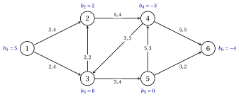
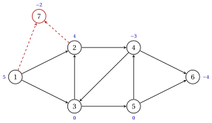
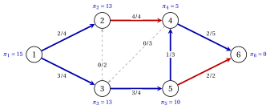

# Network flow models

**Part 3 · Flows · Chapter 4** · [:material-file-pdf-box: Lecture notes, volume 3 (PDF)](../pdf/lecture-notes-3-flows.pdf) · [:material-pencil: Exercises: Flow models](../exercises/network-flow-models.md)

!!! nota "Prerequisites"

    - From this module, [Chapter 1 «Graphs»](https://fabiofurini.github.io/network-optimization/graphs/graphs/): directed graphs, the node–arc incidence matrix, spanning trees and the rank of the incidence matrix.

    - From the module Linear Programming, [Chapter 9 «Duality theory»](https://fabiofurini.github.io/linear-programming/duality/09-duality/) and [Chapter 15 «The geometry of Linear Programming»](https://fabiofurini.github.io/linear-programming/advanced-methods/15-geometry/): the dual of an LP, weak and strong duality, vertices of a polyhedron.

    - Determinants: the Laplace expansion along a column and Cramer's rule.

!!! chiave "Objectives"

    At the end of this chapter you will be able to:

    - describe a network with balances, lower bounds, capacities and costs, and write the minimum cost flow model, also in matrix form with the incidence matrix;

    - check the necessary conditions for the existence of a feasible flow, and build counterexamples;

    - remove the lower bounds by a substitution, and balance an instance with a dummy node;

    - prove that the incidence matrix is totally unimodular, and deduce that the model has integer optimal solutions when the data are integer;

    - write the dual with the potentials $\pi_i$, compute the reduced costs and certify the optimality of a flow;

    - recognize the shortest path, the maximum flow, the transportation and the assignment problems as minimum cost flow models.

## 4.1 Networks and flows { #sez-sec-nf-networks }

!!! definizione "Definition 4.1: network"

    A <strong>network</strong> is a directed graph $G=(N,A)$, with $n=|N|$ nodes and $m=|A|$ arcs, together with the following data.

    - Every node $i \in N$ has a <strong>balance</strong> $b_i \in \R$. The node is a <strong>supply node</strong> if $b_i>0$, a <strong>demand node</strong> if $b_i<0$, and a <strong>transshipment node</strong> if $b_i=0$.

    - Every arc $(i,j) \in A$ has a <strong>lower bound</strong> $l_{ij}$ and a <strong>capacity</strong> $u_{ij}$, with $0 \le l_{ij} \le u_{ij} \le +\infty$, and a <strong>cost</strong> $c_{ij} \in \R$ per unit of flow.

    When the lower bounds are not given, $l_{ij}=0$ for every arc.

!!! definizione "Definition 4.2: flow"

    Let $G=(N,A)$ be a network. A <strong>flow</strong> is a vector $\vet{x} \in \R^m$ with one entry $x_{ij}$, the amount sent along the arc, for every $(i,j) \in A$.

    - The flow satisfies the <strong>flow conservation</strong> constraint of node $i$ if what leaves $i$ minus what enters $i$ equals the balance:

        $$
        \sum_{(i,j) \in \delta^+(i)} x_{ij} \;-\; \sum_{(j,i) \in \delta^-(i)} x_{ji} = b_i .
        $$

    - The flow is <strong>feasible</strong> if it satisfies flow conservation at every node and $l_{ij} \le x_{ij} \le u_{ij}$ for every arc. Its <strong>cost</strong> is $\sum_{(i,j) \in A} c_{ij}\, x_{ij}$.

- A supply node sends out $b_i$ units more than it receives, a demand node receives $-b_i$ units more than it sends, and a transshipment node passes on everything it receives.

- With the node–arc incidence matrix $\mat{B}$ of [Chapter 1 «Graphs»](https://fabiofurini.github.io/network-optimization/graphs/graphs/), flow conservation at all the nodes reads $\mat{B}\vet{x}=\vet{b}$: row $i$ of $\mat{B}\vet{x}$ is the outflow minus the inflow of $i$.

!!! esempio "Example 4.1: the reference network"

    We add data to the reference graph of [Chapter 1 «Graphs»](https://fabiofurini.github.io/network-optimization/graphs/graphs/), with the arcs numbered $a_1,a_2,\dots,a_9$ in lexicographic order. The balances are

    $$
    b_1=5,\qquad b_2=2,\qquad b_3=0,\qquad b_4=-3,\qquad b_5=0,\qquad b_6=-4,
    $$

    so nodes $1$ and $2$ supply $7$ units, nodes $4$ and $6$ demand them, and nodes $3$ and $5$ are transshipment nodes. The lower bounds are zero, and the costs and capacities are:

    
<table>
    <tr>
    <th>arc</th>
    <th>\((1,2)\)</th>
    <th>\((1,3)\)</th>
    <th>\((2,4)\)</th>
    <th>\((3,2)\)</th>
    <th>\((3,5)\)</th>
    <th>\((4,3)\)</th>
    <th>\((4,6)\)</th>
    <th>\((5,4)\)</th>
    <th>\((5,6)\)</th>
    </tr>
    <tr>
    <td>\(c_{ij}\)</td>
    <td>\(2\)</td>
    <td>\(2\)</td>
    <td>\(5\)</td>
    <td>\(2\)</td>
    <td>\(3\)</td>
    <td>\(3\)</td>
    <td>\(5\)</td>
    <td>\(5\)</td>
    <td>\(3\)</td>
    </tr>
    <tr>
    <td>\(u_{ij}\)</td>
    <td>\(4\)</td>
    <td>\(4\)</td>
    <td>\(4\)</td>
    <td>\(2\)</td>
    <td>\(4\)</td>
    <td>\(3\)</td>
    <td>\(5\)</td>
    <td>\(3\)</td>
    <td>\(2\)</td>
    </tr>
    </table>

    In the figure each arc carries the pair $c_{ij},u_{ij}$, and each node its balance $b_i$ (in blue).

    { .fig loading=lazy  }

    The flow $\bar{\vet{x}}$ with

    $$
    \bar{x}_{12}=1,~ \bar{x}_{13}=4,~ \bar{x}_{24}=3,~ \bar{x}_{32}=0,~ \bar{x}_{35}=4,~ \bar{x}_{43}=0,~
    \bar{x}_{46}=2,~ \bar{x}_{54}=2,~ \bar{x}_{56}=2
    $$

    is feasible. For example, at node $4$ the outflow is $\bar{x}_{43}+\bar{x}_{46}=2$, the inflow is $\bar{x}_{24}+\bar{x}_{54}=5$, and $2-5=-3=b_4$. The arcs $(1,3)$, $(3,5)$ and $(5,6)$ are at capacity, and the cost of $\bar{\vet{x}}$ is $63$.

### 4.1.1 Flow across a cut

- For a set of nodes $S \subseteq N$, we denote by $\delta^+(S)$ the arcs with the tail in $S$ and the head outside $S$, by $\delta^-(S)$ the arcs with the head in $S$ and the tail outside $S$, and $x(F)=\sum_{(i,j) \in F} x_{ij}$ for a set of arcs $F$.

!!! teorema "Lemma 4.3: flow across a cut"

    Let $\vet{x}$ satisfy flow conservation at every node of a network $G=(N,A)$. Then, for every $S \subseteq N$,

    $$
    x(\delta^+(S))-x(\delta^-(S))=\sum_{i \in S} b_i .
    $$

??? dimostrazione "Proof"

    Add up the conservation constraints of the nodes of $S$; the right-hand side is $\sum_{i \in S} b_i$.

    - An arc with both endpoints in $S$ appears twice, with $+x_{ij}$ in the row of its tail and $-x_{ij}$ in the row of its head: it cancels.

    - An arc of $\delta^+(S)$ appears only in the row of its tail, with $+x_{ij}$; an arc of $\delta^-(S)$ only in the row of its head, with $-x_{ij}$; the other arcs do not appear.

    
□

- In [Example 4.1](#box-3-nf-ex-ref), the set $S=\{1,2,3\}$ has $\delta^+(S)=\{(2,4),(3,5)\}$ and $\delta^-(S)=\{(4,3)\}$. The flow $\bar{\vet{x}}$ gives $3+4-0=7=b_1+b_2+b_3$.

!!! chiave ""

    A network has balances on the nodes and lower bounds, capacities and costs on the arcs. A feasible flow satisfies $\mat{B}\vet{x}=\vet{b}$ and the bounds; across every cut, the net outflow equals the total balance of the nodes inside.

## 4.2 The minimum cost flow model { #sez-sec-nf-model }

!!! definizione "Definition 4.4: minimum cost flow problem"

    Given a network $G=(N,A)$ with balances $b_i$, lower bounds $l_{ij}$, capacities $u_{ij}$ and costs $c_{ij}$, the <strong>minimum cost flow problem</strong> asks for a feasible flow of minimum cost.

- We use one continuous variable $x_{ij}$ for every arc $(i,j) \in A$, the flow on the arc.

!!! chiave ""

    Using these variables, a Linear Programming (LP) model for the minimum cost flow problem reads as follows:

    

    \begin{align*}
    &&   \min \;\;{\sum_{(i,j) \in A} c_{ij} \, x_{ij}}                                      \label{nf:obj}  \tag{4.1a}\\[1ex]
    && \text{subject to} \quad  \sum_{(i,j) \in \delta^+(i)} x_{ij} - \sum_{(j,i) \in \delta^-(i)} x_{ji}
    &= b_i, & \forall i \in N,                                                       \label{nf:cons}  \tag{4.1b}\\[1ex]
    && l_{ij} \le x_{ij} &\le u_{ij}, & \forall (i,j) \in A.                          \label{nf:bounds} \tag{4.1c}
    \end{align*}

    This LP model is referred to as the $\mathrm{MCF}$ model.

- Description of the objective function and constraints of the $\mathrm{MCF}$ model:

    - the linear objective function $\eqref{nf:obj}$ minimizes the total cost of the flow;

    - constraints $\eqref{nf:cons}$ are the flow conservation constraints, one for every node;

    - finally, constraints $\eqref{nf:bounds}$ impose the lower bound and the capacity of every arc.

- With the node–arc incidence matrix $\mat{B}$, the vector $\vet{c}$ of the costs and the vectors $\vet{l}$, $\vet{u}$ of the bounds, the $\mathrm{MCF}$ model is

    $$
    \min \;\big\{\, \vet{c}' \vet{x} \;:\; \mat{B}\vet{x}=\vet{b},~ \vet{l} \le \vet{x} \le \vet{u} \,\big\}.
    $$

- The model has $m$ variables and $n$ equations. The column of $x_{ij}$ in $\mat{B}$ has only two nonzero entries, $+1$ in row $i$ and $-1$ in row $j$: this structure gives all the properties of this chapter.

!!! esempio "Example 4.2: the $\mathrm{MCF}$ model of the reference network"

    For the network of [Example 4.1](#box-3-nf-ex-ref) the $\mathrm{MCF}$ model has $9$ variables and $6$ equations:

    $\begin{array}{rrrrrrrrrrcr} \min & 2x_{12} & +2x_{13} & +5x_{24} & +2x_{32} & +3x_{35} & +3x_{43} & +5x_{46} & +5x_{54} & +3x_{56} & & \\[1ex] \text{subject to} & x_{12} & +x_{13} & & & & & & & & = & 5\\ & -x_{12} & & +x_{24} & -x_{32} & & & & & & = & 2\\ & & -x_{13} & & +x_{32} & +x_{35} & -x_{43} & & & & = & 0\\ & & & -x_{24} & & & +x_{43} & +x_{46} & -x_{54} & & = & -3\\ & & & & & -x_{35} & & & +x_{54} & +x_{56} & = & 0\\ & & & & & & & -x_{46} & & -x_{56} & = & -4 \end{array}$

    together with $0 \le x_{12} \le 4$, $0 \le x_{13} \le 4$, $0 \le x_{24} \le 4$, $0 \le x_{32} \le 2$, $0 \le x_{35} \le 4$, $0 \le x_{43} \le 3$, $0 \le x_{46} \le 5$, $0 \le x_{54} \le 3$, $0 \le x_{56} \le 2$. The coefficient matrix of the equations is the incidence matrix $\mat{B}$ of the reference graph.

!!! chiave ""

    The minimum cost flow problem is the LP $\min\{\vet{c}'\vet{x} : \mat{B}\vet{x}=\vet{b},~\vet{l} \le \vet{x} \le \vet{u}\}$: one variable per arc, one conservation equation per node.

## 4.3 Feasibility conditions { #sez-sec-nf-feasibility }

!!! definizione "Definition 4.5: balanced network"

    A network is <strong>balanced</strong> if $\sum_{i \in N} b_i=0$, that is, if the total supply equals the total demand.

!!! teorema "Proposition 4.6: a feasible network is balanced"

    If a network $G=(N,A)$ has a feasible flow, then $\sum_{i \in N} b_i=0$.

??? dimostrazione "Proof"

    Apply [Lemma 4.3](#box-4-nf-lem-cut) with $S=N$: no arc leaves or enters $N$, so $\delta^+(N)=\delta^-(N)= \emptyset$ and $\sum_{i \in N} b_i=0$. In matrix form, the rows of $\mat{B}$ add up to the zero vector, hence so do the entries of $\vet{b}=\mat{B}\vet{x}$. □

!!! teorema "Proposition 4.7: cut condition"

    If a network $G=(N,A)$ has a feasible flow, then for every $S \subseteq N$

    $$
    \sum_{i \in S} b_i \;\le\; u(\delta^+(S)) - l(\delta^-(S)),
    $$

    where $u(F)$ and $l(F)$ are the sums of the capacities and of the lower bounds of the arcs of $F$.

??? dimostrazione "Proof"

    Let $\vet{x}$ be a feasible flow. By [Lemma 4.3](#box-4-nf-lem-cut) and the bounds $x_{ij} \le u_{ij}$ on $\delta^+(S)$ and $x_{ij} \ge l_{ij}$ on $\delta^-(S)$,

    $$
    \sum_{i \in S} b_i = x(\delta^+(S))-x(\delta^-(S)) \le u(\delta^+(S))-l(\delta^-(S)).
    \qedhere
    $$

    
□

- The supply of the nodes of $S$, net of their demand, must be able to leave $S$ through the arcs of $\delta^+(S)$, while the arcs of $\delta^-(S)$ bring at least their lower bounds into $S$.

- A balanced network can still have no feasible flow: the balance is only a necessary condition.

!!! esempio "Example 4.3: balanced networks without a feasible flow"

    We keep the arcs, costs and capacities of the reference network and change the balances.

    1. With $b_5=-1$, $b_6=1$ and $b_i=0$ for the other nodes, the network is balanced. But node $6$ has no leaving arc: for $S=\{6\}$ we get $\delta^+(S)=\emptyset$, and the cut condition fails, since $b_6=1>0$.

    2. With $b_1=9$, $b_6=-8$ and the other balances as in [Example 4.1](#box-3-nf-ex-ref), the network is balanced, since $9+2-3-8=0$. For $S=\{1\}$ we get $u(\delta^+(S))=u_{12}+u_{13}=8<9=b_1$: node $1$ cannot send out its supply.

    For the reference network itself, all the $62$ sets $S$ with $\emptyset \neq S \neq N$ satisfy the cut condition, and the flow $\bar{\vet{x}}$ of [Example 4.1](#box-3-nf-ex-ref) is feasible.

!!! chiave ""

    A network with a feasible flow is balanced, and every cut can carry the net supply of the nodes inside it. These conditions are necessary: a balanced network may have no feasible flow.

## 4.4 Removing the lower bounds { #sez-sec-nf-lower }

!!! definizione "Definition 4.8: substitution of the lower bounds"

    Given a network with lower bounds $\vet{l}$, the <strong>substituted network</strong> has the same nodes, arcs and costs, zero lower bounds and

    $$
    b'_i=b_i-\sum_{(i,j) \in \delta^+(i)} l_{ij}+\sum_{(j,i) \in \delta^-(i)} l_{ji}, \quad \forall i \in N,
    \qquad\quad u'_{ij}=u_{ij}-l_{ij}, \quad \forall (i,j) \in A,
    $$

    that is, $\vet{b}'=\vet{b}-\mat{B}\vet{l}$ and $\vet{u}'=\vet{u}-\vet{l}$.

- The $l_{ij}$ units that must travel on $(i,j)$ are sent in advance: the tail $i$ has $l_{ij}$ units less to send, the head $j$ has $l_{ij}$ units less to receive, and the arc has $l_{ij}$ units less of free capacity.

!!! teorema "Proposition 4.9: removing the lower bounds"

    The map $\vet{x}'=\vet{x}-\vet{l}$ is a one-to-one correspondence between the feasible flows of a network and those of its substituted network, and

    $$
    \vet{c}'\vet{x}=\vet{c}'\vet{x}'+\vet{c}'\vet{l}.
    $$

    Hence the two $\mathrm{MCF}$ models have the same optimal solutions, up to the shift by $\vet{l}$, and their optimal values differ by the constant $\vet{c}'\vet{l}$.

??? dimostrazione "Proof"

    The map is linear and invertible, with inverse $\vet{x}=\vet{x}'+\vet{l}$. For every $\vet{x} \in \R^m$:

    1. $\mat{B}\vet{x}=\vet{b}$ if and only if $\mat{B}\vet{x}'=\mat{B}\vet{x}-\mat{B}\vet{l}=\vet{b}-\mat{B}\vet{l} =\vet{b}'$;

    2. $\vet{l} \le \vet{x} \le \vet{u}$ if and only if $\vet{0} \le \vet{x}' \le \vet{u}-\vet{l}=\vet{u}'$;

    3. $\vet{c}'\vet{x}=\vet{c}'(\vet{x}'+\vet{l})=\vet{c}'\vet{x}'+\vet{c}'\vet{l}$.

    The cost of every feasible flow changes by the same constant, so the optimal solutions correspond. □

!!! esempio "Example 4.4: a lower bound on the reference network"

    In the network of [Example 4.1](#box-3-nf-ex-ref) we impose $l_{32}=1$: at least one unit must travel from $3$ to $2$. The column of $(3,2)$ in $\mat{B}$ has $+1$ in row $3$ and $-1$ in row $2$, so $\mat{B}\vet{l}=(0,-1,1,0,0,0)'$ and

    $$
    \vet{b}'=\vet{b}-\mat{B}\vet{l}=(5,\,3,\,-1,\,-3,\,0,\,-4)', \qquad u'_{32}=2-1=1, \qquad \vet{c}'\vet{l}=c_{32}\,
    l_{32}=2.
    $$

    Node $3$ becomes a demand node, because it has already sent one unit, and node $2$ has one more unit to send. The substituted network has optimal value $60$; adding the constant $2$, the optimal value with $l_{32}=1$ is $62$.

!!! chiave ""

    The substitution $\vet{x}=\vet{l}+\vet{x}'$ removes the lower bounds: $\vet{b}'=\vet{b}-\mat{B}\vet{l}$, $\vet{u}'=\vet{u}-\vet{l}$, and the objective changes by the constant $\vet{c}'\vet{l}$.

## 4.5 Unbalanced instances { #sez-sec-nf-dummy }

!!! definizione "Definition 4.10: unbalanced instance"

    An instance with $\sum_{i \in N} b_i>0$ is <strong>unbalanced</strong>: the total supply exceeds the total demand. Every demand must be met, and every supply node $i$ sends out <em>at most</em> $b_i$ units:

    $$
    \sum_{(i,j) \in \delta^+(i)} x_{ij} - \sum_{(j,i) \in \delta^-(i)} x_{ji} \;\le\; b_i \quad \forall i \in N:\, b_i>0,
    \qquad\quad = b_i \quad \forall i \in N:\, b_i \le 0,
    $$

    with the bounds $l_{ij} \le x_{ij} \le u_{ij}$ and the objective $\min \sum_{(i,j) \in A} c_{ij}\,x_{ij}$.

!!! definizione "Definition 4.11: dummy node"

    Let $P=\{i \in N : b_i>0\}$ be the supply nodes and $e=\sum_{i \in N} b_i>0$ the excess. The <strong>balanced network</strong> adds a <strong>dummy node</strong> $d$ with balance $b_d=-e$, and an arc $(i,d)$ for every $i \in P$ with $l_{id}=0$, $u_{id}=+\infty$ and $c_{id}=0$.

!!! teorema "Proposition 4.12: the dummy node"

    The feasible solutions of the unbalanced instance and the feasible flows of the balanced network correspond, with the same cost: a flow of the balanced network restricted to $A$ is feasible for the unbalanced instance, and a solution of the unbalanced instance becomes a feasible flow with $x_{id}=b_i-(\text{outflow}-\text{inflow of } i)$.

??? dimostrazione "Proof"

    For a vector $\vet{x}$ on $A$, let $s_i(\vet{x})$ be the outflow minus the inflow of node $i$ along the arcs of $A$.

    1. Let $(\vet{x},(x_{id})_{i \in P})$ be feasible for the balanced network. At $i \in P$ conservation reads $s_i(\vet{x})+x_{id}=b_i$ with $x_{id} \ge 0$, so $s_i(\vet{x}) \le b_i$; at the other nodes of $N$ it reads $s_i(\vet{x})=b_i$.

    2. Conversely, let $\vet{x}$ be feasible for the unbalanced instance, and set $x_{id}=b_i-s_i(\vet{x}) \ge 0$ for $i \in P$. Conservation holds at every node of $N$, and at $d$ the inflow is

        $$
        \sum_{i \in P} x_{id}=\sum_{i \in P} b_i-\sum_{i \in N} s_i(\vet{x})+\sum_{i \notin P} s_i(\vet{x})
        =\sum_{i \in P} b_i - 0+\sum_{i \notin P} b_i=e,
        $$

        since the values $s_i(\vet{x})$ add up to zero: every arc of $A$ contributes $+x_{ij}$ to its tail and $-x_{ij}$ to its head. Hence $d$ receives exactly $-b_d=e$ units.

    The dummy arcs cost zero, so the two costs coincide. □

- The flow on $(i,d)$ is the part of the supply of $i$ that is not used.

- If the total demand exceeds the total supply and the demands are upper limits, a dummy node $d$ with balance $b_d=-\sum_{i \in N} b_i$ and arcs $(d,j)$ to the demand nodes balances the network in the same way.

!!! esempio "Example 4.5: a dummy node on the reference network"

    In the network of [Example 4.1](#box-3-nf-ex-ref) we raise the supply of node $2$ to $b_2=4$. The total supply is $9$, the total demand is $7$, and the excess is $e=2$.

    - The balanced network adds node $7$ with $b_7=-2$, and the arcs $(1,7)$ and $(2,7)$ with cost $0$ and capacity $+\infty$ (dashed in the figure).

    - Its optimal flow, computed with Gurobi, ships all the $4$ units of node $2$ and only $3$ units of node $1$: $x_{17}=2$, $x_{27}=0$, with optimal value $56$.

    { .fig loading=lazy  }

!!! chiave ""

    An unbalanced instance becomes a balanced network with a dummy node that absorbs the excess through zero-cost arcs; the flow on a dummy arc is the unused supply of its tail.

## 4.6 Total unimodularity and integrality { #sez-sec-nf-tu }

!!! definizione "Definition 4.13: totally unimodular matrix"

    An integer matrix $\mat{M}$ is <strong>totally unimodular</strong> (TU) if the determinant of every square submatrix of $\mat{M}$ is $0$, $+1$ or $-1$. A square submatrix is obtained by choosing $k$ rows and $k$ columns, for any $k \ge 1$.

- With $k=1$ the definition requires every entry of a TU matrix to be $0$, $+1$ or $-1$.

!!! teorema "Theorem 4.14: the incidence matrix is totally unimodular"

    The node–arc incidence matrix $\mat{B}$ of every directed graph $G=(N,A)$ is totally unimodular.

??? dimostrazione "Proof"

    Let $\mat{M}$ be a $k \times k$ submatrix of $\mat{B}$; we prove $\det(\mat{M}) \in \{0,+1,-1\}$ by induction on $k$. For $k=1$ the entry is $0$, $+1$ or $-1$. Let $k \ge 2$. Every column of $\mat{B}$ has exactly one $+1$ and one $-1$, so every column of $\mat{M}$ has at most two nonzero entries; there are three cases.

    1. <em>A column of $\mat{M}$ is zero.</em> Then $\det(\mat{M})=0$.

    2. <em>A column of $\mat{M}$ has exactly one nonzero entry, $\pm 1$.</em> The Laplace expansion along this column gives $\det(\mat{M})=\pm\det(\mat{M}')$, where $\mat{M}'$ is a $(k-1) \times (k-1)$ submatrix of $\mat{B}$: by induction $\det(\mat{M}') \in \{0,+1,-1\}$.

    3. <em>Every column of $\mat{M}$ has two nonzero entries, $+1$ and $-1$.</em> Then the rows of $\mat{M}$ add up to the zero vector, they are linearly dependent, and $\det(\mat{M})=0$. □

!!! esempio "Example 4.6: submatrices of the reference incidence matrix"

    We take rows $2,3,4$ of the incidence matrix $\mat{B}$ of the reference graph and two choices of three columns.

    $$
    \begin{array}{c|rrr}
    & a_1 & a_3 & a_5\\ \hline
    2 & -1 & 1 & 0\\
    3 & 0 & 0 & 1\\
    4 & 0 & -1 & 0
    \end{array}
    \qquad\qquad
    \begin{array}{c|rrr}
    & a_3 & a_4 & a_6\\ \hline
    2 & 1 & -1 & 0\\
    3 & 0 & 1 & -1\\
    4 & -1 & 0 & 1
    \end{array}
    $$

    - The column of $a_1=(1,2)$ in the first matrix has one nonzero entry (case 2): expanding along it, and then along the column of $a_5$, the determinant is $-1$.

    - The arcs $a_3=(2,4)$, $a_4=(3,2)$, $a_6=(4,3)$ of the second matrix form the cycle $2,4,3,2$, and all their endpoints are among the chosen rows: every column has $+1$ and $-1$ (case 3), and the determinant is $0$.

    - The matrix $\mat{B}$ has $5004$ square submatrices; computing all their determinants confirms that they take only the values $-1$, $0$ and $+1$.

### 4.6.1 Integer vertices

- A point $\bar{\vet{x}}$ of a polyhedron $P$ is a <strong>vertex</strong> if it is not the midpoint of two distinct points of $P$, as in [Chapter 15 «The geometry of Linear Programming»](https://fabiofurini.github.io/linear-programming/advanced-methods/15-geometry/) of the module Linear Programming.

- For a set of arcs $F$, we denote by $\mat{B}_F$ the submatrix of the columns of $F$, and by $\vet{x}_F$ the corresponding entries of $\vet{x}$.

!!! teorema "Theorem 4.15: integer vertices"

    Let $G=(N,A)$ be a network with integer balances $\vet{b}$, integer lower bounds $\vet{l}$ and capacities $\vet{u}$ that are integer or $+\infty$. Then every vertex of

    $$
    P=\big\{\, \vet{x} \in \R^m : \mat{B}\vet{x}=\vet{b},~ \vet{l} \le \vet{x} \le \vet{u} \,\big\}
    $$

    is an integer vector.

??? dimostrazione "Proof"

    Let $\bar{\vet{x}}$ be a vertex of $P$, and let $F=\{\, a \in A : l_a<\bar{x}_a<u_a \,\}$ be the arcs strictly between their bounds. If $F=\emptyset$, every entry of $\bar{\vet{x}}$ is a bound, hence an integer.

    1. <em>The columns of $\mat{B}_F$ are linearly independent.</em> Otherwise $\mat{B}_F\vet{d}_F=\vet{0}$ for some $\vet{d} \neq \vet{0}$ with $d_a=0$ for $a \notin F$. For a small $\varepsilon>0$ both $\bar{\vet{x}}+\varepsilon \vet{d}$ and $\bar{\vet{x}}-\varepsilon\vet{d}$ satisfy the strict bounds on $F$ and $\mat{B}\vet{x}=\vet{b}$, so they lie in $P$, and $\bar{\vet{x}}$ is their midpoint: a contradiction.

    2. <em>The system for $\bar{\vet{x}}_F$ has integer data.</em> Every $a \notin F$ has $\bar{x}_a \in \{l_a,u_a\}$, an integer, so $\mat{B}_F\bar{\vet{x}}_F=\vet{b}-\sum_{a \notin F} \mat{B}_a\bar{x}_a=:\hat{\vet{b}}$ is integer.

    3. <em>Cramer's rule.</em> $\mat{B}_F$ has rank $|F|$, so some $|F|$ of its rows form a nonsingular square matrix $\mat{M}$, and $\mat{M}\bar{\vet{x}}_F=\hat{\vet{b}}_R$ on these rows $R$. By Cramer's rule each entry of $\bar{\vet{x}}_F$ is $\det(\mat{M}_a)/\det(\mat{M})$, with $\mat{M}_a$ an integer matrix.

    4. By [Theorem 4.14](#box-19-nf-th-tu), $\det(\mat{M})=\pm 1$, so every entry of $\bar{\vet{x}}_F$ is an integer. □

!!! teorema "Corollary 4.16: integrality of the minimum cost flow model"

    Let the balances, the lower bounds and the capacities be integer, with every capacity finite. If the $\mathrm{MCF}$ model has a feasible solution, then it has an integer optimal solution, for any costs $\vet{c}$.

??? dimostrazione "Proof"

    The polyhedron $P$ is nonempty and bounded, since $\vet{l} \le \vet{x} \le \vet{u}$ with finite bounds. A linear function attains its minimum over a nonempty bounded polyhedron at a vertex ([Chapter 15 «The geometry of Linear Programming»](https://fabiofurini.github.io/linear-programming/advanced-methods/15-geometry/)), and every vertex of $P$ is integer by [Theorem 4.15](#box-21-nf-th-vertices). □

- The simplex algorithm ends at a vertex, so with integer data it returns an integer optimal flow: the integer requirement $x_{ij} \in \Z_{\ge 0}$ comes for free.

- Total unimodularity is a property of the matrix: for a matrix that is not TU, an integer right-hand side can give fractional vertices.

!!! esempio "Example 4.7: a matrix that is not totally unimodular"

    The undirected triangle with vertices $1,2,3$ and edges $e_1=\{1,2\}$, $e_2=\{1,3\}$, $e_3=\{2,3\}$ has the vertex–edge incidence matrix

    $$
    \mat{M}=\begin{pmatrix} 1 & 1 & 0\\ 1 & 0 & 1\\ 0 & 1 & 1 \end{pmatrix}, \qquad \det(\mat{M})=-2,
    $$

    so $\mat{M}$ is not TU. The polyhedron $\{\vet{y} \in \R^3 : \mat{M}\vet{y}=\vet{1},~ \vet{y} \ge \vet{0}\}$ contains the single point $\vet{y}=(\frac{1}{2},\frac{1}{2},\frac{1}{2})$, since $\mat{M}$ is nonsingular: this vertex is fractional, although the data are integer.

!!! chiave ""

    The incidence matrix of a directed graph is totally unimodular. Hence, with integer balances and bounds, every vertex of the feasible region is integer, and the $\mathrm{MCF}$ model has an integer optimal solution.

## 4.7 The dual model and the reduced costs { #sez-sec-nf-dual }

- By [Proposition 4.9](#box-12-nf-prop-subst) the lower bounds can be removed, so in this section $\vet{l}=\vet{0}$ and every capacity is finite. The constraint $x_{ij} \le u_{ij}$ is written as $-x_{ij} \ge -u_{ij}$.

- Following the rules of [Chapter 9 «Duality theory»](https://fabiofurini.github.io/linear-programming/duality/09-duality/) of the module Linear Programming, we use a free dual variable $\pi_i$, the <strong>potential</strong> of node $i$, for its conservation equation, and a non-negative dual variable $\alpha_{ij}$ for the capacity of $(i,j)$.

!!! chiave ""

    Using free dual variables $\pi_i$ for the constraints $\eqref{nf:cons}$ and non-negative dual variables $\alpha_{ij}$ for the capacities, the dual model of the $\mathrm{MCF}$ model with $\vet{l}=\vet{0}$ is:

    

    \begin{align*}
    &&   \max \;\;{\sum_{i \in N} b_i \, \pi_i - \sum_{(i,j) \in A} u_{ij} \, \alpha_{ij}}        \label{nf:dobj}  \tag{4.2a}\\[1ex]
    && \text{subject to} \quad  \pi_i - \pi_j - \alpha_{ij} &\le c_{ij}, & \forall (i,j) \in A, \label{nf:dcons}  \tag{4.2b}\\[1ex]
    && \pi_i &\in \R, & \forall i \in N,                                                    \label{nf:dfree}  \tag{4.2c}\\[1ex]
    && \alpha_{ij} &\ge 0, & \forall (i,j) \in A.                                         \label{nf:dalpha} \tag{4.2d}
    \end{align*}

    This LP model is referred to as the $D(\mathrm{MCF})$ model.

- Description of the dual model:

    - the column of $x_{ij}$ has $+1$ in the equation of $i$, $-1$ in the equation of $j$ and $-1$ in its capacity constraint, which gives the dual constraint $\eqref{nf:dcons}$, one for every arc;

    - the primal variables are non-negative, so the dual constraints are of type $\le$.

- Adding the same constant to all the potentials changes neither $\eqref{nf:dcons}$ nor the objective, since $\sum_{i \in N} b_i=0$: the potentials can be normalized, for example with $\pi_n=0$.

!!! definizione "Definition 4.17: reduced cost"

    Given potentials $\vet{\pi} \in \R^n$, the <strong>reduced cost</strong> of the arc $(i,j) \in A$ is

    $$
    \bar{c}_{ij}=c_{ij}-\pi_i+\pi_j .
    $$

- The dual constraint $\eqref{nf:dcons}$ reads $\bar{c}_{ij}+\alpha_{ij} \ge 0$. For fixed potentials, the best choice of $\alpha_{ij} \ge 0$ is the smallest one, $\alpha_{ij}=\max\{0,-\bar{c}_{ij}\}$.

!!! teorema "Lemma 4.18: cost and reduced cost"

    For every $\vet{x}$ with $\mat{B}\vet{x}=\vet{b}$ and every $\vet{\pi} \in \R^n$,

    $$
    \sum_{(i,j) \in A} c_{ij}\, x_{ij}=\sum_{(i,j) \in A} \bar{c}_{ij}\, x_{ij}+\sum_{i \in N} b_i\, \pi_i .
    $$

??? dimostrazione "Proof"

    Since $c_{ij}=\bar{c}_{ij}+\pi_i-\pi_j$, it suffices to show $\sum_{(i,j) \in A}(\pi_i-\pi_j)\,x_{ij}=\sum_{i \in N} b_i\pi_i$. The term $\pi_i x_{ij}$ goes to the tail and $-\pi_j x_{ij}$ to the head, so

    $$
    \sum_{(i,j) \in A}(\pi_i-\pi_j)\,x_{ij}=\sum_{i \in N} \pi_i \Big(\sum_{(i,j) \in \delta^+(i)} x_{ij}-\sum_{(j,i)
    \in \delta^-(i)} x_{ji}\Big)=\sum_{i \in N} \pi_i\, b_i .
    \qedhere
    $$

    
□

!!! teorema "Theorem 4.19: duality gap"

    Let $\vet{x}$ be a feasible flow ($\vet{l}=\vet{0}$) and $(\vet{\pi},\vet{\alpha})$ a feasible solution of the $D(\mathrm{MCF})$ model. Then

    $$
    \sum_{(i,j) \in A} c_{ij}x_{ij}-\Big(\sum_{i \in N} b_i\pi_i-\sum_{(i,j) \in A} u_{ij}\alpha_{ij}\Big)
    =\sum_{(i,j) \in A} (\bar{c}_{ij}+\alpha_{ij})\,x_{ij}+\sum_{(i,j) \in A} \alpha_{ij}\,(u_{ij}-x_{ij}) \;\ge\; 0,
    $$

    and both solutions are optimal if and only if, for every arc, $(\bar{c}_{ij}+\alpha_{ij})\,x_{ij}=0$ and $\alpha_{ij}(u_{ij}-x_{ij})=0$.

??? dimostrazione "Proof"

    By [Lemma 4.18](#box-25-nf-lem-identity), the left-hand side is $\sum \bar{c}_{ij}x_{ij}+\sum u_{ij}\alpha_{ij}$, and $u_{ij}\alpha_{ij}=\alpha_{ij}x_{ij}+\alpha_{ij}(u_{ij}-x_{ij})$ gives the identity.

    - Every term is non-negative: $\bar{c}_{ij}+\alpha_{ij} \ge 0$ by $\eqref{nf:dcons}$, $\alpha_{ij} \ge 0$, and $0 \le x_{ij} \le u_{ij}$.

    - If the gap is zero, the primal cost equals a dual value, which is a lower bound on every primal cost by the inequality just proved: $\vet{x}$ is optimal, and in the same way $(\vet{\pi},\vet{\alpha})$ is optimal.

    - If both are optimal, the gap is zero by the strong duality theorem of [Chapter 9 «Duality theory»](https://fabiofurini.github.io/linear-programming/duality/09-duality/). A sum of non-negative terms is zero if and only if every term is zero.

    
□

!!! teorema "Corollary 4.20: reduced cost certificate"

    Let $\vet{x}$ be a feasible flow ($\vet{l}=\vet{0}$) and $\vet{\pi} \in \R^n$ potentials such that, for every arc,

    $$
    \bar{c}_{ij}>0 \;\Rightarrow\; x_{ij}=0, \qquad\qquad \bar{c}_{ij}<0 \;\Rightarrow\; x_{ij}=u_{ij}.
    $$

    Then $\vet{x}$ is an optimal flow, and $\vet{\pi}$ with $\alpha_{ij}=\max\{0,-\bar{c}_{ij}\}$ is an optimal solution of the $D(\mathrm{MCF})$ model.

??? dimostrazione "Proof"

    The pair $(\vet{\pi},\vet{\alpha})$ is dual feasible, since $\alpha_{ij} \ge 0$ and $\bar{c}_{ij}+\alpha_{ij} \ge 0$. We check the two conditions of [Theorem 4.19](#box-26-nf-th-gap) on every arc.

    - If $\bar{c}_{ij} \ge 0$, then $\alpha_{ij}=0$, and $\bar{c}_{ij}x_{ij}=0$ because $\bar{c}_{ij}>0$ forces $x_{ij}=0$.

    - If $\bar{c}_{ij}<0$, then $\bar{c}_{ij}+\alpha_{ij}=0$, and $\alpha_{ij}(u_{ij}-x_{ij})=0$ because $x_{ij}=u_{ij}$.

    The gap is zero, so both solutions are optimal. □

- An arc with positive reduced cost is empty, an arc with negative reduced cost is saturated, and an arc strictly between its bounds has reduced cost zero.

!!! esempio "Example 4.8: the dual of the reference network"

    For the network of [Example 4.1](#box-3-nf-ex-ref), the $D(\mathrm{MCF})$ model is

    $$
    \max\; 5\pi_1+2\pi_2-3\pi_4-4\pi_6-\big(4\alpha_{12}+4\alpha_{13}+4\alpha_{24}+2\alpha_{32}+4\alpha_{35}+3\alpha_{43}
    +5\alpha_{46}+3\alpha_{54}+2\alpha_{56}\big)
    $$

    with $\vet{\alpha} \ge \vet{0}$, free potentials, and one constraint per arc:

    $$
    \begin{array}{lll}
    \pi_1-\pi_2-\alpha_{12} \le 2, & \pi_1-\pi_3-\alpha_{13} \le 2, & \pi_2-\pi_4-\alpha_{24} \le 5,\\
    \pi_3-\pi_2-\alpha_{32} \le 2, & \pi_3-\pi_5-\alpha_{35} \le 3, & \pi_4-\pi_3-\alpha_{43} \le 3,\\
    \pi_4-\pi_6-\alpha_{46} \le 5, & \pi_5-\pi_4-\alpha_{54} \le 5, & \pi_5-\pi_6-\alpha_{56} \le 3.
    \end{array}
    $$

    The balances $b_3=b_5=0$ make $\pi_3$ and $\pi_5$ disappear from the objective.

- The potentials and the reduced costs are the basis of the optimality tests of Chapter 6 «Minimum cost flow».

!!! chiave ""

    The dual of the $\mathrm{MCF}$ model has a potential $\pi_i$ per node; the reduced cost is $\bar{c}_{ij}=c_{ij}-\pi_i+\pi_j$. A feasible flow whose positive-reduced-cost arcs are empty and negative-reduced-cost arcs are saturated is optimal.

## 4.8 Special cases { #sez-sec-nf-special }

- Several classical problems are $\mathrm{MCF}$ models with special data; all the lower bounds are zero.

<table>
<tr>
<th>problem</th>
<th>the \(\mathrm{MCF}\) model</th>
</tr>
<tr>
<td><strong>Shortest path</strong></td>
<td>\(b_s=1\), \(b_t=-1\), \(b_i=0\) otherwise; \(u_{ij}=+\infty\), \(c_{ij}\) the length of the arc: the unit of flow travels from \(s\) to \(t\).</td>
</tr>
<tr>
<td><strong>Maximum flow</strong></td>
<td>\(b_i=0\) and \(c_{ij}=0\) for every arc, plus the arc \((t,s)\) with \(c_{ts}=-1\) and \(u_{ts}=+\infty\): the flow on \((t,s)\) is the value sent from \(s\) to \(t\).</td>
</tr>
<tr>
<td><strong>Transportation</strong></td>
<td>\(N=P \cup D\) with arcs from the origins \(P\) to the destinations \(D\); \(b_i\) the supply of \(i \in P\), \(-b_j\) the demand of \(j \in D\), \(u_{ij}=+\infty\).</td>
</tr>
<tr>
<td><strong>Assignment</strong></td>
<td>a transportation model with \(|P|=|D|\), \(b_i=1\) for \(i \in P\) and \(b_j=-1\) for \(j \in D\).</td>
</tr>
</table>

- In the four models the balances and the bounds are integer, so the integer vertices of [Theorem 4.15](#box-21-nf-th-vertices) are paths, integer flows and assignments.

!!! chiave ""

    Shortest path, maximum flow, transportation and assignment are minimum cost flow models with special balances, capacities and costs.

## 4.9 A transshipment instance { #sez-sec-nf-example }

- We solve the $\mathrm{MCF}$ model of [Example 4.2](#box-6-nf-ex-model): the reference network, with two supply nodes, two demand nodes and two transshipment nodes. The optimal solution is computed with Gurobi (gurobipy), and then certified by hand with [Corollary 4.20](#box-27-nf-cor-certificate).

!!! esempio "Example 4.9: the optimal flow"

    The optimal flow $\tilde{\vet{x}}$ and its optimal value are

    
<table>
    <tr>
    <th>arc</th>
    <th>\((1,2)\)</th>
    <th>\((1,3)\)</th>
    <th>\((2,4)\)</th>
    <th>\((3,2)\)</th>
    <th>\((3,5)\)</th>
    <th>\((4,3)\)</th>
    <th>\((4,6)\)</th>
    <th>\((5,4)\)</th>
    <th>\((5,6)\)</th>
    </tr>
    <tr>
    <td>\(\tilde{x}_{ij}\)</td>
    <td>\(2\)</td>
    <td>\(3\)</td>
    <td>\(4\)</td>
    <td>\(0\)</td>
    <td>\(3\)</td>
    <td>\(0\)</td>
    <td>\(2\)</td>
    <td>\(1\)</td>
    <td>\(2\)</td>
    </tr>
    <tr>
    <td>\(u_{ij}\)</td>
    <td>\(4\)</td>
    <td>\(4\)</td>
    <td>\(4\)</td>
    <td>\(2\)</td>
    <td>\(4\)</td>
    <td>\(3\)</td>
    <td>\(5\)</td>
    <td>\(3\)</td>
    <td>\(2\)</td>
    </tr>
    </table>

    $z(\mathrm{MCF})=60$.

    In the figure each arc carries $\tilde{x}_{ij}/u_{ij}$: the arcs strictly between their bounds are blue, the arcs at capacity red, the empty arcs grey and dashed. Next to each node, its potential.

    { .fig loading=lazy  }

    The flow is integer, as [Corollary 4.16](#box-22-nf-cor-integral) guarantees.

### 4.9.1 The certificate of optimality

1. The five blue arcs $(1,2)$, $(1,3)$, $(3,5)$, $(4,6)$, $(5,4)$ form a spanning tree. We ask for reduced cost zero on them, $\pi_i-\pi_j=c_{ij}$, and normalize with $\pi_6=0$.

2. Going backwards from node $6$: $\pi_4=\pi_6+c_{46}=5$, $\pi_5=\pi_4+c_{54}=10$, $\pi_3=\pi_5+c_{35}=13$, $\pi_1=\pi_3+c_{13}=15$ and $\pi_2=\pi_1-c_{12}=13$.

3. The potential $\pi_i$ is the cost of the tree path from $i$ to $6$: for example, $\pi_1=c_{13}+c_{35}+c_{54}+ c_{46}=2+3+5+5=15$.

!!! esempio "Example 4.10: reduced costs and optimality"

    The reduced costs $\bar{c}_{ij}=c_{ij}-\pi_i+\pi_j$ are:

    
<table>
    <tr>
    <th>arc</th>
    <th>\((1,2)\)</th>
    <th>\((1,3)\)</th>
    <th>\((2,4)\)</th>
    <th>\((3,2)\)</th>
    <th>\((3,5)\)</th>
    <th>\((4,3)\)</th>
    <th>\((4,6)\)</th>
    <th>\((5,4)\)</th>
    <th>\((5,6)\)</th>
    </tr>
    <tr>
    <td>\(\bar{c}_{ij}\)</td>
    <td>\(0\)</td>
    <td>\(0\)</td>
    <td>\(-3\)</td>
    <td>\(2\)</td>
    <td>\(0\)</td>
    <td>\(11\)</td>
    <td>\(0\)</td>
    <td>\(0\)</td>
    <td>\(-7\)</td>
    </tr>
    <tr>
    <td>\(\alpha_{ij}\)</td>
    <td>\(0\)</td>
    <td>\(0\)</td>
    <td>\(3\)</td>
    <td>\(0\)</td>
    <td>\(0\)</td>
    <td>\(0\)</td>
    <td>\(0\)</td>
    <td>\(0\)</td>
    <td>\(7\)</td>
    </tr>
    </table>

    - The arcs with $\bar{c}_{ij}>0$, $(3,2)$ and $(4,3)$, are empty; the arcs with $\bar{c}_{ij}<0$, $(2,4)$ and $(5,6)$, are at capacity. By [Corollary 4.20](#box-27-nf-cor-certificate), $\tilde{\vet{x}}$ is optimal.

    - The dual value is $\sum_{i \in N} b_i\pi_i-\sum_{(i,j) \in A} u_{ij}\alpha_{ij}=86-26=60$, equal to the cost of $\tilde{\vet{x}}$. The potentials coincide with the dual values returned by Gurobi, shifted so that $\pi_6=0$.

- <strong>Uniqueness.</strong> Every optimal flow has gap zero with $(\vet{\pi},\vet{\alpha})$, so by [Theorem 4.19](#box-26-nf-th-gap) it has $x_{32}=x_{43}=0$, $x_{24}=4$ and $x_{56}=2$. The flow on the five tree arcs is then fixed by conservation, since their columns are linearly independent: $\tilde{\vet{x}}$ is the unique optimal flow.

- <strong>The flow $\bar{\vet{x}}$.</strong> The feasible flow $\bar{\vet{x}}$ of [Example 4.1](#box-3-nf-ex-ref) costs $63$, and its gap with the same dual solution is $63-60=3=\alpha_{24}(u_{24}-\bar{x}_{24})=3 \cdot (4-3)$: the arc $(2,4)$ is not used enough.

!!! chiave ""

    On the reference network the optimal flow costs $60$. The potentials of its spanning tree give reduced costs that are positive only on empty arcs and negative only on saturated arcs: they certify the optimality without a solver.

## 4.10 Typical mistakes

!!! attenzione "Warning"

    - <strong>Swapping outflow and inflow.</strong> The conservation constraint is outflow minus inflow equal to $b_i$, with $b_i>0$ at a supply node: the signs follow the incidence matrix, $+1$ in the tail.

    - <strong>Taking $\sum_i b_i=0$ as sufficient.</strong> A balanced network can have no feasible flow: a cut may be too small to carry the supply inside it.

    - <strong>Getting the substitution signs wrong.</strong> With $\vet{x}=\vet{l}+\vet{x}'$ the tail of $(i,j)$ loses $l_{ij}$ units of balance and the head gains them; the constant $\vet{c}'\vet{l}$ must be added back to the value.

    - <strong>Forgetting the dummy node.</strong> An instance with more supply than demand has no feasible flow with equalities; the dummy arcs must cost zero, or the unused supply is charged.

    - <strong>Claiming integrality for any matrix.</strong> Integer vertices need a TU matrix and integer $\vet{b}$, $\vet{l}$, $\vet{u}$; the costs may be fractional.

    - <strong>Writing the reduced cost with the wrong signs.</strong> In this module $\bar{c}_{ij}=c_{ij}-\pi_i+\pi_j$, with $-\pi$ of the tail and $+\pi$ of the head.

    - <strong>Expecting unique potentials.</strong> The potentials are defined up to an additive constant; they are fixed by a normalization such as $\pi_n=0$.

## 4.11 In summary

!!! chiave "In summary"

    - A network has balances $b_i$, lower bounds $l_{ij}$, capacities $u_{ij}$ and costs $c_{ij}$; the minimum cost flow problem is the LP $\min\{\vet{c}'\vet{x} : \mat{B}\vet{x}=\vet{b},~\vet{l} \le \vet{x} \le \vet{u}\}$.

    - Across every cut the net outflow equals the balance inside; a feasible network is balanced and satisfies the cut condition.

    - Lower bounds are removed with $\vet{x}=\vet{l}+\vet{x}'$; an excess of supply goes to a dummy node through zero-cost arcs.

    - The incidence matrix is totally unimodular, so with integer $\vet{b}$, $\vet{l}$, $\vet{u}$ every vertex is integer and the $\mathrm{MCF}$ model has an integer optimal solution.

    - The dual has potentials $\pi_i$; with $\bar{c}_{ij}=c_{ij}-\pi_i+\pi_j$, a flow with empty positive-cost arcs and saturated negative-cost arcs is optimal.

    - Shortest path, maximum flow, transportation and assignment are $\mathrm{MCF}$ models.

    <strong>The reference network at a glance.</strong>

    
<table>
    <tr>
    <td>balances</td>
    <td>\(\vet{b}=(5,2,0,-3,0,-4)\)</td>
    </tr>
    <tr>
    <td>optimal flow</td>
    <td>\(\tilde{\vet{x}}=(2,3,4,0,3,0,2,1,2)\), \(z(\mathrm{MCF})=60\)</td>
    </tr>
    <tr>
    <td>potentials (\(\pi_6=0\))</td>
    <td>\(\vet{\pi}=(15,13,13,5,10,0)\)</td>
    </tr>
    <tr>
    <td>empty / saturated arcs</td>
    <td>\((3,2)\), \((4,3)\) / \((2,4)\), \((5,6)\)</td>
    </tr>
    <tr>
    <td>with \(l_{32}=1\)</td>
    <td>\(\vet{b}'=(5,3,-1,-3,0,-4)\), optimal value \(62\)</td>
    </tr>
    <tr>
    <td>with \(b_2=4\) (dummy node \(7\))</td>
    <td>\(x_{17}=2\), optimal value \(56\)</td>
    </tr>
    </table>

---

**Exercises on this chapter:** [:material-pencil: Flow models](../exercises/network-flow-models.md)
