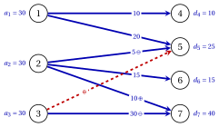

# 7.4 The potential method { #sez-ta-sec-potentials }

**Part 3 · Flows · Chapter 7** · [:material-book-open-variant: Chapter 7: Transportation and assignment](index.md) · [:material-file-pdf-box: Lecture notes, volume 3 (PDF)](../../pdf/lecture-notes-3-flows.pdf) · [:material-pencil: Exercises: Transportation and assignment](../../exercises/transportation-and-assignment.md)

- We write the constraints [(7.1c)](the-transportation-problem.md#mjx-eqn:ta:demand) as $-\sum_{i \in P} x_{ij}=-d_j$, the conservation constraints of the destinations, and use a free dual variable $\pi_v$, the potential of node $v$, for the constraint of every node $v \in P \cup D$, as in [Chapter 4](https://fabiofurini.github.io/network-optimization/flows/network-flow-models/the-dual-model-and-the-reduced-costs/).

!!! chiave ""

    Using a free dual variable $\pi_v$ for the constraint of each node $v \in P \cup D$, the dual model of the $\mathrm{TP}$ model is:

    

    \begin{align*}
    &&   \max \;\;{\sum_{i \in P} a_i \, \pi_i - \sum_{j \in D} d_j \, \pi_j}                    \label{ta:dobj}  \tag{7.2a}\\[1ex]
    && \text{subject to} \quad  \pi_i - \pi_j &\le c_{ij}, & \forall i \in P,~\forall j \in D, \label{ta:dcons}  \tag{7.2b}\\[1ex]
    && \pi_v &\in \R, & \forall v \in P \cup D.                                           \label{ta:dfree} \tag{7.2c}
    \end{align*}

    This LP model is referred to as the $D(\mathrm{TP})$ model.

- With the reduced cost $\bar{c}_{ij}=c_{ij}-\pi_i+\pi_j$ of [Chapter 4](https://fabiofurini.github.io/network-optimization/flows/network-flow-models/the-dual-model-and-the-reduced-costs/), the dual constraint $\eqref{ta:dcons}$ reads $\bar{c}_{ij} \ge 0$.

- Adding the same constant to all the potentials changes neither the reduced costs nor, in a balanced instance, the objective $\eqref{ta:dobj}$. We normalize with $\pi_{m+n}=0$, the potential of the last destination.

- For every $\vet{x}$ that satisfies the constraints [(7.1b)](the-transportation-problem.md#mjx-eqn:ta:supply) and [(7.1c)](the-transportation-problem.md#mjx-eqn:ta:demand), the potentials add up row by row and column by column:

    $$
    \sum_{i \in P}\sum_{j \in D} (\pi_i-\pi_j)\,x_{ij}=\sum_{i \in P} a_i\,\pi_i-\sum_{j \in D} d_j\,\pi_j ,
    $$

    and since $c_{ij}=\bar{c}_{ij}+\pi_i-\pi_j$,

    $$
    \sum_{i \in P}\sum_{j \in D} c_{ij}\,x_{ij}=\sum_{i \in P}\sum_{j \in D}\bar{c}_{ij}\,x_{ij}+\sum_{i \in P}
    a_i\,\pi_i-\sum_{j \in D} d_j\,\pi_j .
    $$

    This is the Lemma «cost and reduced cost» of Chapter 4 for the bipartite network.

!!! definizione "Definition 7.9: potentials of a basis"

    The <strong>potentials of a basis</strong> $T$ are the values $\pi_v$, $v \in P \cup D$, such that

    $$
    \bar{c}_{ij}=c_{ij}-\pi_i+\pi_j=0, \quad \forall (i,j) \in T, \qquad\qquad \pi_{m+n}=0 .
    $$

- The potentials of a basis exist and are unique. Starting from $\pi_{m+n}=0$, a basic cell $(i,j)$ with one known endpoint gives the other one: $\pi_i=\pi_j+c_{ij}$ or $\pi_j=\pi_i-c_{ij}$. Each node is reached along its unique path in the tree from $m+n$, which forces its value.

!!! teorema "Theorem 7.10: optimality criterion"

    Let $\bar{\vet{x}}$ be the basic feasible solution of a basis $T$, with potentials $\vet{\pi}$. If $\bar{c}_{ij} \ge 0$ for every cell, then $\bar{\vet{x}}$ is optimal for the $\mathrm{TP}$ model, $\vet{\pi}$ is optimal for the $D(\mathrm{TP})$ model, and

    $$
    \sum_{i \in P}\sum_{j \in D} c_{ij}\,\bar{x}_{ij}=\sum_{i \in P} a_i\,\pi_i-\sum_{j \in D} d_j\,\pi_j .
    $$

    If moreover $\bar{c}_{ij}>0$ for every cell outside $T$, then $\bar{\vet{x}}$ is the unique optimal solution.

??? dimostrazione "Proof"

    We use the identity above. Let $z_\pi=\sum_{i \in P} a_i\pi_i-\sum_{j \in D} d_j\pi_j$.

    1. For $\bar{\vet{x}}$: $\bar{c}_{ij}=0$ on $T$ and $\bar{x}_{ij}=0$ outside $T$, so $\sum \bar{c}_{ij}\bar{x}_{ij}=0$ and the cost of $\bar{\vet{x}}$ is $z_\pi$.

    2. For every feasible $\vet{x}$: $\bar{c} \ge 0$ and $\vet{x} \ge \vet{0}$, so its cost is at least $z_\pi$; hence $\bar{\vet{x}}$ is optimal. The potentials satisfy $\eqref{ta:dcons}$, and their value $z_\pi$ equals a primal cost: by weak duality they are optimal.

    3. If $\bar{c}_{ij}>0$ outside $T$, an optimal $\vet{x}$ has $\sum \bar{c}_{ij}x_{ij}=0$, hence $x_{ij}=0$ outside $T$: it is the basic solution of $T$, which is $\bar{\vet{x}}$ by [Theorem 7.6](basic-solutions.md#box-9-ta-th-basis). □

## 7.4.1 The cycle of a cell and the pivot

!!! teorema "Lemma 7.11: the cycle of a non-basic cell"

    Let $T$ be a basis and $e=(k,l) \notin T$. The cells $T \cup \{e\}$ contain exactly one cycle $C$, made of $e$ and of the path from $l$ to $k$ in the tree. Write $C$ starting from $e$ and moving first along row $k$, and give the sign $+$ to the cells in the odd positions ($e$ included) and $-$ to the others. Then every row and every column that meets $C$ contains exactly one cell of $C$ with sign $+$ and one with sign $-$.

??? dimostrazione "Proof"

    The cycle is the fundamental cycle of the arc $(k,l)$ (Proposition «fundamental cycle» of [Chapter 1](https://fabiofurini.github.io/network-optimization/graphs/graphs/trees-and-forests/)). It visits the nodes $k,j_1,i_1,j_2,\dots,l$ alternately in $P$ and in $D$, so it has an even number of cells, and two consecutive cells share a node: the first two share the row $k$, the next two a column, and so on. Every node of $C$ lies in exactly two cells of $C$, which are consecutive along $C$, the last and the first one included: their positions have different parity, hence different signs. □

!!! teorema "Theorem 7.12: the pivot"

    Let $\bar{\vet{x}}$ be the basic feasible solution of a basis $T$ with potentials $\vet{\pi}$, let $e \notin T$ with $\bar{c}_e<0$, let $C^+$ and $C^-$ be the cells of its cycle with sign $+$ and $-$, and let

    $$
    \theta=\min\{\bar{x}_f : f \in C^-\},
    $$

    attained at a cell $f^\ast \in C^-$. For $0 \le t \le \theta$, let $\vet{x}(t)$ be $\bar{\vet{x}}$ with $t$ added on the cells of $C^+$ and subtracted on the cells of $C^-$.

    - **(a)** $\vet{x}(t)$ is feasible, and its cost is the cost of $\bar{\vet{x}}$ plus $t\,\bar{c}_e$.

    - **(b)** $T'=T \cup \{e\} \setminus \{f^\ast\}$ is a basis, and $\vet{x}(\theta)$ is its basic feasible solution.

??? dimostrazione "Proof"

    1. <em>Feasibility.</em> By [Lemma 7.11](#box-17-ta-lem-cycle) every row and column of $C$ gains $t$ on one cell and loses $t$ on another, so all the sums are unchanged. The cells of $C^-$ keep $\bar{x}_f-t \ge 0$ since $t \le \theta$.

    2. <em>Cost.</em> The change of cost is $t\big(\sum_{C^+} c_{ij}-\sum_{C^-} c_{ij}\big)$. Every node of $C$ lies in one cell of $C^+$ and one of $C^-$, so $\sum_{C^+}(\pi_i-\pi_j)=\sum_{C^-}(\pi_i-\pi_j)$, and the change is $t\big(\sum_{C^+}\bar{c}_{ij}-\sum_{C^-}\bar{c}_{ij}\big)=t\,\bar{c}_e$: the other cells of $C$ are basic, with $\bar{c}_{ij}=0$.

    3. <em>New basis.</em> $T'$ has $m+n-1$ cells, and it has no cycle: the only cycle of $T \cup \{e\}$ is $C$, which contains $f^\ast$. An acyclic set of $m+n-1$ arcs on $m+n$ nodes is a spanning tree (Theorem «characterizations of a tree» of Chapter 1). $\vet{x}(\theta)$ is zero outside $T'$, since $x_{f^\ast}(\theta)=0$, so it is the basic solution of $T'$. □

!!! algoritmo "Algorithm: The potential method"

    

<strong>Input:</strong> a balanced instance with supplies \(a_i\), demands \(d_j\) and costs \(c_{ij}\)

<strong>Output:</strong> an optimal basic feasible solution \(\tilde{\vet{x}}\) and optimal potentials \(\tilde{\vet{\pi}}\)

1<strong>Step 0 (initial basis).</strong> Build a basis \(T\) and its basic feasible solution \(\bar{\vet{x}}\) with the
    north-west corner rule or the minimum cost rule.

2<strong>Step 1 (potentials).</strong> Compute the potentials of \(T\) and the reduced costs \(\bar{c}_{ij}=c_{ij}-\pi_i+\pi_j\) of
    the cells outside \(T\).

3<strong>Step 2 (optimality test).</strong> If \(\bar{c}_{ij} \ge 0\) for every cell, <code>STOP</code>: \(\bar{\vet{x}}\) is optimal.

4<strong>Step 3 (entering cell).</strong> Choose a cell \(e\) with \(\bar{c}_e<0\).

5<strong>Step 4 (cycle).</strong> Find the cycle of \(e\) with its signs, \(\theta:=\min\{\bar{x}_f : f \in C^-\}\), and a leaving
    cell \(f^\ast \in C^-\) with \(\bar{x}_{f^\ast}=\theta\).

6<strong>Step 5 (pivot).</strong> Add \(\theta\) on \(C^+\), subtract \(\theta\) on \(C^-\), set \(T:=T \cup \{e\} \setminus \{f^\ast\}\), and go to Step 1.

- <strong>Rules of the examples.</strong> In Step 3 the entering cell has the most negative reduced cost (the smallest $i$, then $j$, on ties). In Step 4 the cycle is written from the entering cell moving first along its row, and the leaving cell is the first cell of $C^-$ with $\bar{x}_f=\theta$ in row–column order.

- The method is also known as the <strong>u-v method</strong> or MODI (modified distribution) method, and the cycle as the <strong>stepping stone</strong> path: the amounts move along it like on stones across a river.

!!! teorema "Theorem 7.13: termination"

    If $\theta>0$ at every iteration, the potential method stops after a finite number of iterations with an optimal basic feasible solution and optimal potentials.

??? dimostrazione "Proof"

    By [Theorem 7.12](#box-18-ta-th-pivot) every iteration with $\theta>0$ moves to a new basis and decreases the cost by $\theta\,|\bar{c}_e|>0$. A basis determines its basic solution ([Theorem 7.6](basic-solutions.md#box-9-ta-th-basis)), so a basis visited twice would have two different costs: no basis repeats. There are finitely many sets of $m+n-1$ cells, so the method stops, at Step 2, and [Theorem 7.10](#box-16-ta-th-opt) applies. □

- When $\theta=0$ the pivot is <strong>degenerate</strong>: the basis changes, the solution and its cost do not. The potential method is the simplex algorithm on the $\mathrm{TP}$ model: the basic cells are the basic variables, $\bar{c}_{ij}$ are their reduced costs, and the cycle describes how the basic variables change when $x_e$ grows.

- Hence the anti-cycling rule of Bland of [Chapter 7 «Optimality conditions and pivot rules»](https://fabiofurini.github.io/linear-programming/simplex/07-optimality-pivot/) of the module Linear Programming applies: with the first cell with $\bar{c}_{ij}<0$ in row–column order as the entering cell, and the leaving rule above, no basis repeats even with degenerate pivots.

!!! attenzione "The u-v convention"

    Many textbooks write the u-v method with $u_i+v_j=c_{ij}$ on the basic cells and $\bar{c}_{ij}=c_{ij}-u_i-v_j$. These are the potentials of this chapter with $u_i=\pi_i$ for the origins and $v_j=-\pi_j$ for the destinations: the reduced costs are the same, and the potentials of the destinations change sign.

## 7.4.2 The potential method on the transportation instance

- We start from the north-west corner solution of [Example 7.5](initial-basic-feasible-solutions.md#box-13-ta-ex-nw), of cost $440$.

- In each tableau the basic cells (blue) contain the amount $\bar{x}_{ij}$ in bold, and the other cells the reduced cost $\bar{c}_{ij}$; the last column and the last row contain the potentials. The entering cell is red, and the cells of the cycle are marked $\oplus$ and $\ominus$.

!!! esempio "Example 7.7: the potential method from the north-west corner"

    In the first iteration the potentials of the north-west basis come from $\pi_7=0$, along the tree:

    $$
    \pi_2=\pi_7+c_{27}=2,\qquad \pi_3=\pi_7+c_{37}=6,\qquad \pi_5=\pi_2-c_{25}=-2,
    $$

    $$
    \pi_6=\pi_2-c_{26}=0,\qquad \pi_1=\pi_5+c_{15}=7,\qquad \pi_4=\pi_1-c_{14}=6 .
    $$

    For example, $\bar{c}_{35}=c_{35}-\pi_3+\pi_5=1-6-2=-7$.

    
<table>
    <tr>
    <th colspan="6"><strong>Iteration 1</strong></th>
    </tr>
    <tr>
    <td></td>
    <td>\(4\)</td>
    <td>\(5\)</td>
    <td>\(6\)</td>
    <td>\(7\)</td>
    <td>\(\pi_i\)</td>
    </tr>
    <tr>
    <td>\(1\)</td>
    <td class="cella-blu">\(\mathbf{10}\)</td>
    <td class="cella-blu">\(\mathbf{20}\)</td>
    <td>\(-5\)</td>
    <td>\(-4\)</td>
    <td>\(7\)</td>
    </tr>
    <tr>
    <td>\(2\)</td>
    <td>\(7\)</td>
    <td class="cella-blu">\(\mathbf{5}\,\ominus\)</td>
    <td class="cella-blu">\(\mathbf{15}\)</td>
    <td class="cella-blu">\(\mathbf{10}\,\oplus\)</td>
    <td>\(2\)</td>
    </tr>
    <tr>
    <td>\(3\)</td>
    <td>\(9\)</td>
    <td class="cella-rossa">\(-7\,\oplus\)</td>
    <td>\(-2\)</td>
    <td class="cella-blu">\(\mathbf{30}\,\ominus\)</td>
    <td>\(6\)</td>
    </tr>
    <tr>
    <td>\(\pi_j\)</td>
    <td>\(6\)</td>
    <td>\(-2\)</td>
    <td>\(0\)</td>
    <td>\(0\)</td>
    <td></td>
    </tr>
    </table>

    - The negative reduced costs are $\bar{c}_{35}=-7$, $\bar{c}_{16}=-5$, $\bar{c}_{17}=-4$, $\bar{c}_{36}=-2$; the cell $(3,5)$ enters the basis.

    - The cycle is $\,(3,5)^{+},\ (3,7)^{-},\ (2,7)^{+},\ (2,5)^{-}$.

    - The cells with sign $-$ have $\bar{x}_{37}=30$ and $\bar{x}_{25}=5$: $\theta=5$, and the cell $(2,5)$ leaves the basis.

    - The cost goes from $440$ to $440+5\cdot(-7)=405$.

    In the network, the entering arc $(3,5)$ (red, dashed) closes the cycle $3,5,2,7,3$ with the tree.

    { .fig loading=lazy  }

    In the second iteration the cycle has six cells and visits all three rows.

    
<table>
    <tr>
    <th colspan="6"><strong>Iteration 2</strong></th>
    </tr>
    <tr>
    <td></td>
    <td>\(4\)</td>
    <td>\(5\)</td>
    <td>\(6\)</td>
    <td>\(7\)</td>
    <td>\(\pi_i\)</td>
    </tr>
    <tr>
    <td>\(1\)</td>
    <td class="cella-blu">\(\mathbf{10}\)</td>
    <td class="cella-blu">\(\mathbf{20}\,\ominus\)</td>
    <td class="cella-rossa">\(-12\,\oplus\)</td>
    <td>\(-11\)</td>
    <td>\(14\)</td>
    </tr>
    <tr>
    <td>\(2\)</td>
    <td>\(14\)</td>
    <td>\(7\)</td>
    <td class="cella-blu">\(\mathbf{15}\,\ominus\)</td>
    <td class="cella-blu">\(\mathbf{15}\,\oplus\)</td>
    <td>\(2\)</td>
    </tr>
    <tr>
    <td>\(3\)</td>
    <td>\(16\)</td>
    <td class="cella-blu">\(\mathbf{5}\,\oplus\)</td>
    <td>\(-2\)</td>
    <td class="cella-blu">\(\mathbf{25}\,\ominus\)</td>
    <td>\(6\)</td>
    </tr>
    <tr>
    <td>\(\pi_j\)</td>
    <td>\(13\)</td>
    <td>\(5\)</td>
    <td>\(0\)</td>
    <td>\(0\)</td>
    <td></td>
    </tr>
    </table>

    - The negative reduced costs are $\bar{c}_{16}=-12$, $\bar{c}_{17}=-11$, $\bar{c}_{36}=-2$; the cell $(1,6)$ enters the basis.

    - The cycle is $\,(1,6)^{+},\ (1,5)^{-},\ (3,5)^{+},\ (3,7)^{-},\ (2,7)^{+},\ (2,6)^{-}$.

    - The cells with sign $-$ have $\bar{x}_{15}=20$, $\bar{x}_{37}=25$ and $\bar{x}_{26}=15$: $\theta=15$, and the cell $(2,6)$ leaves the basis.

    - The cost goes from $405$ to $405+15\cdot(-12)=225$.

    
<table>
    <tr>
    <th colspan="6"><strong>Iteration 3</strong></th>
    </tr>
    <tr>
    <td></td>
    <td>\(4\)</td>
    <td>\(5\)</td>
    <td>\(6\)</td>
    <td>\(7\)</td>
    <td>\(\pi_i\)</td>
    </tr>
    <tr>
    <td>\(1\)</td>
    <td class="cella-blu">\(\mathbf{10}\)</td>
    <td class="cella-blu">\(\mathbf{5}\,\ominus\)</td>
    <td class="cella-blu">\(\mathbf{15}\)</td>
    <td class="cella-rossa">\(-11\,\oplus\)</td>
    <td>\(14\)</td>
    </tr>
    <tr>
    <td>\(2\)</td>
    <td>\(14\)</td>
    <td>\(7\)</td>
    <td>\(12\)</td>
    <td class="cella-blu">\(\mathbf{30}\)</td>
    <td>\(2\)</td>
    </tr>
    <tr>
    <td>\(3\)</td>
    <td>\(16\)</td>
    <td class="cella-blu">\(\mathbf{20}\,\oplus\)</td>
    <td>\(10\)</td>
    <td class="cella-blu">\(\mathbf{10}\,\ominus\)</td>
    <td>\(6\)</td>
    </tr>
    <tr>
    <td>\(\pi_j\)</td>
    <td>\(13\)</td>
    <td>\(5\)</td>
    <td>\(12\)</td>
    <td>\(0\)</td>
    <td></td>
    </tr>
    </table>

    - The only negative reduced cost is $\bar{c}_{17}=-11$: the cell $(1,7)$ enters the basis.

    - The cycle is $\,(1,7)^{+},\ (1,5)^{-},\ (3,5)^{+},\ (3,7)^{-}$.

    - The cells with sign $-$ have $\bar{x}_{15}=5$ and $\bar{x}_{37}=10$: $\theta=5$, and the cell $(1,5)$ leaves the basis.

    - The cost goes from $225$ to $225+5\cdot(-11)=170$.

    
<table>
    <tr>
    <th colspan="6"><strong>Iteration 4</strong></th>
    </tr>
    <tr>
    <td></td>
    <td>\(4\)</td>
    <td>\(5\)</td>
    <td>\(6\)</td>
    <td>\(7\)</td>
    <td>\(\pi_i\)</td>
    </tr>
    <tr>
    <td>\(1\)</td>
    <td class="cella-blu">\(\mathbf{10}\)</td>
    <td>\(11\)</td>
    <td class="cella-blu">\(\mathbf{15}\,\ominus\)</td>
    <td class="cella-blu">\(\mathbf{5}\,\oplus\)</td>
    <td>\(3\)</td>
    </tr>
    <tr>
    <td>\(2\)</td>
    <td>\(3\)</td>
    <td>\(7\)</td>
    <td>\(1\)</td>
    <td class="cella-blu">\(\mathbf{30}\)</td>
    <td>\(2\)</td>
    </tr>
    <tr>
    <td>\(3\)</td>
    <td>\(5\)</td>
    <td class="cella-blu">\(\mathbf{25}\)</td>
    <td class="cella-rossa">\(-1\,\oplus\)</td>
    <td class="cella-blu">\(\mathbf{5}\,\ominus\)</td>
    <td>\(6\)</td>
    </tr>
    <tr>
    <td>\(\pi_j\)</td>
    <td>\(2\)</td>
    <td>\(5\)</td>
    <td>\(1\)</td>
    <td>\(0\)</td>
    <td></td>
    </tr>
    </table>

    - The only negative reduced cost is $\bar{c}_{36}=-1$: the cell $(3,6)$ enters the basis.

    - The cycle is $\,(3,6)^{+},\ (3,7)^{-},\ (1,7)^{+},\ (1,6)^{-}$.

    - The cells with sign $-$ have $\bar{x}_{37}=5$ and $\bar{x}_{16}=15$: $\theta=5$, and the cell $(3,7)$ leaves the basis.

    - The cost goes from $170$ to $170+5\cdot(-1)=165$.

    
<table>
    <tr>
    <th colspan="6"><strong>Iteration 5</strong></th>
    </tr>
    <tr>
    <td></td>
    <td>\(4\)</td>
    <td>\(5\)</td>
    <td>\(6\)</td>
    <td>\(7\)</td>
    <td>\(\pi_i\)</td>
    </tr>
    <tr>
    <td>\(1\)</td>
    <td class="cella-blu">\(\mathbf{10}\)</td>
    <td>\(10\)</td>
    <td class="cella-blu">\(\mathbf{10}\)</td>
    <td class="cella-blu">\(\mathbf{10}\)</td>
    <td>\(3\)</td>
    </tr>
    <tr>
    <td>\(2\)</td>
    <td>\(3\)</td>
    <td>\(6\)</td>
    <td>\(1\)</td>
    <td class="cella-blu">\(\mathbf{30}\)</td>
    <td>\(2\)</td>
    </tr>
    <tr>
    <td>\(3\)</td>
    <td>\(6\)</td>
    <td class="cella-blu">\(\mathbf{25}\)</td>
    <td class="cella-blu">\(\mathbf{5}\)</td>
    <td>\(1\)</td>
    <td>\(5\)</td>
    </tr>
    <tr>
    <td>\(\pi_j\)</td>
    <td>\(2\)</td>
    <td>\(4\)</td>
    <td>\(1\)</td>
    <td>\(0\)</td>
    <td></td>
    </tr>
    </table>

    - All the reduced costs are non-negative: the basic feasible solution is optimal, with cost $z=165$.

- The optimal solution is

    $$
    \tilde{x}_{14}=10,\quad \tilde{x}_{16}=10,\quad \tilde{x}_{17}=10,\quad \tilde{x}_{27}=30,\quad \tilde{x}_{35}=25,\quad
    \tilde{x}_{36}=5, \qquad z(\mathrm{TP})=165 .
    $$

    Every cell outside the basis has $\bar{c}_{ij}>0$, so by [Theorem 7.10](#box-16-ta-th-opt) the optimum is unique.

- The potentials $\tilde{\vet{\pi}}=(3,2,5,2,4,1,0)$ are optimal for the $D(\mathrm{TP})$ model, with value

    $$
    30\,(3+2+5)-(10 \cdot 2+25 \cdot 4+15 \cdot 1+40 \cdot 0)=300-135=165 .
    $$

    Gurobi returns the same optimal solution, and its dual values coincide with $\tilde{\vet{\pi}}$.

- From the minimum cost solution of [Example 7.6](initial-basic-feasible-solutions.md#box-14-ta-ex-mc) the method needs a single pivot: that solution has the basis of iteration $4$, and the entering cell $(3,6)$, with $\theta=5$, gives the optimum.

## 7.4.3 Degeneracy

!!! esempio "Example 7.8: a degenerate pivot"

    We consider the instance

    $$
    \begin{array}{c|ccc|c}
    \hline {c_{ij}} & {4} & {5} & {6} & {a_i} \\
    \hline {1} & {1} & {4} & {7} & {30} \\
    {2} & {6} & {2} & {5} & {25} \\
    {3} & {3} & {9} & {5} & {30} \\
    \hline {d_j} & {30} & {30} & {25} & {85} \\
    \hline
    \end{array}
    $$

    - In the north-west corner rule the first cell exhausts row $1$ and column $4$ at once. Only the row is crossed out, and the cell $(2,4)$ enters $T$ with the amount $0$: the solution, of cost $250$, is degenerate.

    
<table>
    <tr>
    <th>step</th>
    <th>cell</th>
    <th>amount</th>
    <th>crossed out</th>
    </tr>
    <tr>
    <td>\(1\)</td>
    <td>\((1,4)\)</td>
    <td>\(30\)</td>
    <td>row \(1\)</td>
    </tr>
    <tr>
    <td>\(2\)</td>
    <td>\((2,4)\)</td>
    <td>\(0\)</td>
    <td>column \(4\)</td>
    </tr>
    <tr>
    <td>\(3\)</td>
    <td>\((2,5)\)</td>
    <td>\(25\)</td>
    <td>row \(2\)</td>
    </tr>
    <tr>
    <td>\(4\)</td>
    <td>\((3,5)\)</td>
    <td>\(5\)</td>
    <td>column \(5\)</td>
    </tr>
    <tr>
    <td>\(5\)</td>
    <td>\((3,6)\)</td>
    <td>\(25\)</td>
    <td>row \(3\), column \(6\)</td>
    </tr>
    </table>

    
<table>
    <tr>
    <th colspan="5"><strong>Iteration 1</strong></th>
    </tr>
    <tr>
    <td></td>
    <td>\(4\)</td>
    <td>\(5\)</td>
    <td>\(6\)</td>
    <td>\(\pi_i\)</td>
    </tr>
    <tr>
    <td>\(1\)</td>
    <td class="cella-blu">\(\mathbf{30}\)</td>
    <td>\(7\)</td>
    <td>\(14\)</td>
    <td>\(-7\)</td>
    </tr>
    <tr>
    <td>\(2\)</td>
    <td class="cella-blu">\(\mathbf{0}\,\ominus\)</td>
    <td class="cella-blu">\(\mathbf{25}\,\oplus\)</td>
    <td>\(7\)</td>
    <td>\(-2\)</td>
    </tr>
    <tr>
    <td>\(3\)</td>
    <td class="cella-rossa">\(-10\,\oplus\)</td>
    <td class="cella-blu">\(\mathbf{5}\,\ominus\)</td>
    <td class="cella-blu">\(\mathbf{25}\)</td>
    <td>\(5\)</td>
    </tr>
    <tr>
    <td>\(\pi_j\)</td>
    <td>\(-8\)</td>
    <td>\(-4\)</td>
    <td>\(0\)</td>
    <td></td>
    </tr>
    </table>

    - The only negative reduced cost is $\bar{c}_{34}=-10$: the cell $(3,4)$ enters the basis.

    - The cycle is $\,(3,4)^{+},\ (3,5)^{-},\ (2,5)^{+},\ (2,4)^{-}$.

    - The cells with sign $-$ have $\bar{x}_{35}=5$ and $\bar{x}_{24}=0$: $\theta=0$, and the cell $(2,4)$ leaves the basis.

    - The pivot is degenerate: the solution and its cost $z=250$ do not change, only the basis does.

    In the second iteration the basis has changed, so the potentials have changed too: now $\bar{c}_{15}<0$.

    
<table>
    <tr>
    <th colspan="5"><strong>Iteration 2</strong></th>
    </tr>
    <tr>
    <td></td>
    <td>\(4\)</td>
    <td>\(5\)</td>
    <td>\(6\)</td>
    <td>\(\pi_i\)</td>
    </tr>
    <tr>
    <td>\(1\)</td>
    <td class="cella-blu">\(\mathbf{30}\,\ominus\)</td>
    <td class="cella-rossa">\(-3\,\oplus\)</td>
    <td>\(4\)</td>
    <td>\(3\)</td>
    </tr>
    <tr>
    <td>\(2\)</td>
    <td>\(10\)</td>
    <td class="cella-blu">\(\mathbf{25}\)</td>
    <td>\(7\)</td>
    <td>\(-2\)</td>
    </tr>
    <tr>
    <td>\(3\)</td>
    <td class="cella-blu">\(\mathbf{0}\,\oplus\)</td>
    <td class="cella-blu">\(\mathbf{5}\,\ominus\)</td>
    <td class="cella-blu">\(\mathbf{25}\)</td>
    <td>\(5\)</td>
    </tr>
    <tr>
    <td>\(\pi_j\)</td>
    <td>\(2\)</td>
    <td>\(-4\)</td>
    <td>\(0\)</td>
    <td></td>
    </tr>
    </table>

    - The only negative reduced cost is $\bar{c}_{15}=-3$: the cell $(1,5)$ enters the basis.

    - The cycle is $\,(1,5)^{+},\ (1,4)^{-},\ (3,4)^{+},\ (3,5)^{-}$.

    - The cells with sign $-$ have $\bar{x}_{14}=30$ and $\bar{x}_{35}=5$: $\theta=5$, and the cell $(3,5)$ leaves the basis.

    - The cost goes from $250$ to $250+5\cdot(-3)=235$.

    
<table>
    <tr>
    <th colspan="5"><strong>Iteration 3</strong></th>
    </tr>
    <tr>
    <td></td>
    <td>\(4\)</td>
    <td>\(5\)</td>
    <td>\(6\)</td>
    <td>\(\pi_i\)</td>
    </tr>
    <tr>
    <td>\(1\)</td>
    <td class="cella-blu">\(\mathbf{25}\)</td>
    <td class="cella-blu">\(\mathbf{5}\)</td>
    <td>\(4\)</td>
    <td>\(3\)</td>
    </tr>
    <tr>
    <td>\(2\)</td>
    <td>\(7\)</td>
    <td class="cella-blu">\(\mathbf{25}\)</td>
    <td>\(4\)</td>
    <td>\(1\)</td>
    </tr>
    <tr>
    <td>\(3\)</td>
    <td class="cella-blu">\(\mathbf{5}\)</td>
    <td>\(3\)</td>
    <td class="cella-blu">\(\mathbf{25}\)</td>
    <td>\(5\)</td>
    </tr>
    <tr>
    <td>\(\pi_j\)</td>
    <td>\(2\)</td>
    <td>\(-1\)</td>
    <td>\(0\)</td>
    <td></td>
    </tr>
    </table>

    - All the reduced costs are non-negative: the basic feasible solution is optimal, with cost $z=235$.

    The optimal solution is unique, with cost $235$, and Gurobi confirms it.

- The basic cell with value $0$ must be kept in $T$: without it, the other four cells would not span the six nodes, and the potentials could not be computed.

- The degenerate pivot of iteration $1$ does not lower the cost, but it moves to a basis whose potentials reveal an improving cell.

!!! chiave ""

    The potential method computes the potentials of the basis ($\bar{c}_{ij}=0$ on the basic cells, $\pi_{m+n}=0$), stops when every reduced cost is non-negative, and otherwise moves $\theta$ units around the cycle of an entering cell. The cost decreases by $\theta\,|\bar{c}_e|$; with $\theta=0$ only the basis changes.

---

**Next:** [7.5 The assignment problem](the-assignment-problem.md)
