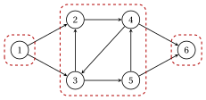

# 1.3 Connectivity { #sez-sec-gr-connectivity }

**Part 1 · Graphs · Chapter 1** · [:material-book-open-variant: Chapter 1: Graphs](index.md) · [:material-file-pdf-box: Lecture notes, volume 1 (PDF)](../../pdf/lecture-notes-1-graphs.pdf) · [:material-pencil: Exercises: Graphs](../../exercises/graphs.md)

!!! definizione "Definition 1.10: connected graph and connected components"

    Let $G=(V,E)$ be an undirected graph.

    - Two vertices $u$ and $v$ are <strong>connected</strong> if $G$ has a path from $u$ to $v$; the graph $G$ is <strong>connected</strong> if every two vertices are connected.

    - A <strong>connected component</strong> of $G$ is a maximal subset $U \subseteq V$ of pairwise connected vertices.

    A directed graph is <strong>weakly connected</strong> if its underlying undirected graph is connected, and its connected components are those of the underlying undirected graph.

!!! definizione "Definition 1.11: reachability and strongly connected components"

    Let $G=(N,A)$ be a directed graph.

    - A node $j$ is <strong>reachable</strong> from $i$ if $G$ has a directed path from $i$ to $j$; the set of the nodes reachable from $i$, $i$ included, is denoted by $R(i)$.

    - The nodes $i$ and $j$ are <strong>strongly connected</strong> if $j \in R(i)$ and $i \in R(j)$; the graph is <strong>strongly connected</strong> if every two nodes are strongly connected.

    - A <strong>strongly connected component</strong> of $G$ is a maximal subset $S \subseteq N$ of pairwise strongly connected nodes.

!!! teorema "Proposition 1.12: components are equivalence classes"

    Being connected is an equivalence relation on $V$, and being strongly connected is an equivalence relation on $N$. Hence the connected components partition $V$ and the strongly connected components partition $N$.

??? dimostrazione "Proof"

    We prove the three properties for the strong connection; the undirected case is the same with paths in place of directed paths.

    1. <em>Reflexive</em>: the path $i$ of length $0$ shows that $i \in R(i)$.

    2. <em>Symmetric</em>: the definition is symmetric in $i$ and $j$.

    3. <em>Transitive</em>: a directed path from $i$ to $j$ followed by one from $j$ to $h$ is a directed walk from $i$ to $h$, which contains a directed path by [Lemma 1.6](undirected-and-directed-graphs.md#box-9-gr-lem-walk). The same holds from $h$ to $i$.

    The equivalence classes are the maximal subsets of pairwise related elements, that is, the components. □

- The <strong>reversed graph</strong> $G'=(N,A')$ has the arc $(j,i)$ for every arc $(i,j) \in A$. The node $i$ is reachable from $j$ in $G$ if and only if $j$ is reachable from $i$ in $G'$; we denote by $R'(i)$ the set of the nodes reachable from $i$ in $G'$.

- By [Definition 1.11](#box-16-gr-def-strong), the strongly connected component that contains $i$ is

    $$
    S(i)=R(i) \cap R'(i).
    $$

!!! esempio "Example 1.6: components of the reference graph"

    In the reference graph:

    $$
    R(1)=\{1,2,3,4,5,6\}, \qquad R(2)=\{2,3,4,5,6\}, \qquad R(6)=\{6\}.
    $$

    In the reversed graph $R'(3)=\{1,2,3,4,5\}$, and $R(3)=\{2,3,4,5,6\}$, so $S(3)=\{2,3,4,5\}$. The strongly connected components are

    $$
    \{1\}, \qquad \{2,3,4,5\}, \qquad \{6\}.
    $$

    { .fig loading=lazy  }

    The graph is weakly connected, with one connected component, but it is not strongly connected: no node is reachable from node $6$.

!!! chiave ""

    The connected components and the strongly connected components are the classes of two equivalence relations. The strongly connected component of $i$ is $R(i) \cap R'(i)$: the nodes reachable from $i$ that can also reach $i$.

---

**Next:** [1.4 Trees and forests](trees-and-forests.md)
