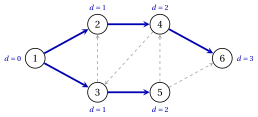
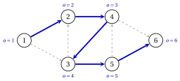

# 1.6 Graph search

**Part 1 · Graphs · Chapter 1** · [:material-book-open-variant: Chapter 1: Graphs](index.md) · [:material-file-pdf-box: Lecture notes, volume 1 (PDF)](../../pdf/lecture-notes-1-graphs.pdf) · [:material-presentation: Slides](../../pdf/slides-graphs.pdf) · [:material-pencil: Exercises: Graphs](../../exercises/graphs.md) · [:material-gesture-tap: App: Graph search: BFS and DFS](../../lab/graph-search-bfs-dfs.md)

!!! definizione "Definition 1.24: graph search"

    Given a directed graph $G=(N,A)$ and a node $s \in N$, the <strong>source</strong>, a <strong>graph search</strong> finds the set $R(s)$ of the nodes reachable from $s$. During the search:

    - a node is <strong>labelled</strong> when the search reaches it, and it stays labelled;

    - every labelled node $j \neq s$ records its <strong>predecessor</strong> $\mathit{pred}(j)$, the node from which it was reached;

    - the labelled nodes still to be processed are kept in a list, $\mathit{LIST}$;

    - an arc $(i,j)$ is <strong>admissible</strong> if $i$ is labelled and $j$ is not.

!!! algoritmo "Algorithm: Generic graph search"

    

<strong>Input:</strong> a directed graph \(G=(N,A)\) given by its adjacency lists, a source \(s \in N\)

<strong>Output:</strong> the labelled nodes, equal to \(R(s)\), and the predecessors \(\mathit{pred}(j)\)

1<strong>Step 0 (initialization).</strong> Label \(s\) and set \(\mathit{LIST}:=\{s\}\); all the other nodes are unlabelled.

2<strong>Step 1 (selection).</strong> If \(\mathit{LIST}=\emptyset\), <code>STOP</code>. Otherwise select a node \(i \in \mathit{LIST}\):

3  the <em>first</em> node of \(\mathit{LIST}\) in the breadth-first search (BFS),

4  the <em>last</em> node of \(\mathit{LIST}\) in the depth-first search (DFS).

5<strong>Step 2 (labelling).</strong> If \(i\) has an admissible arc \((i,j)\), take the first one in \(L(i)\):

6  label \(j\), set \(\mathit{pred}(j):=i\) and append \(j\) at the end of \(\mathit{LIST}\).

7  Otherwise remove \(i\) from \(\mathit{LIST}\). Go to Step 1.

- In the BFS the list $\mathit{LIST}$ is a <strong>queue</strong> (first in, first out): the nodes are processed in the order in which they are labelled.

- In the DFS the list $\mathit{LIST}$ is a <strong>stack</strong> (last in, first out): the search always moves on from the most recently labelled node still in $\mathit{LIST}$, and goes back only when that node has no admissible arc.

- The order of the adjacency lists decides which admissible arc is taken first; with lists sorted by increasing index, as in this module, the result is unique.

### 1.6.1 The predecessor tree

!!! teorema "Proposition 1.25: predecessor tree"

    At every iteration, the arcs $(\mathit{pred}(j),j)$, for the labelled nodes $j \neq s$, form a tree on the labelled nodes, the <strong>predecessor tree</strong>. For every labelled node $j$ it contains a directed path from $s$ to $j$.

??? dimostrazione "Proof"

    Let $r$ be the number of labelled nodes.

    1. Every labelled node $j \neq s$ has one predecessor, labelled before $j$. Starting from $j$ and moving to the predecessor, the nodes are labelled earlier and earlier, so the sequence ends in $s$.

    2. Read backwards, it is a directed path from $s$ to $j$ along the arcs $(\mathit{pred}(h),h)$.

    3. Hence the $r-1$ arcs connect the $r$ labelled nodes, and they form a tree by [Theorem 1.17](trees-and-forests.md#box-23-gr-th-tree)(b). □

!!! teorema "Theorem 1.26: correctness of the search"

    At the end of the generic search, BFS and DFS included, the labelled nodes are exactly the nodes of $R(s)$.

??? dimostrazione "Proof"

    Every labelled node is reachable from $s$, by [Proposition 1.25](#box-33-gr-prop-predtree). Conversely, let $j \in R(s)$ and let $s=i_0,i_1,\dots,i_k=j$ be a directed path; assume by contradiction that $j$ is unlabelled.

    1. Let $i_t$ be the first unlabelled node of the path; $t \ge 1$, since $s$ is labelled.

    2. The node $i_{t-1}$ is labelled, so it entered $\mathit{LIST}$, and at the end it has left it.

    3. A node leaves $\mathit{LIST}$ only when it has no admissible arc. But $(i_{t-1},i_t)$ is admissible until the end, because labels are never removed: a contradiction. □

!!! teorema "Theorem 1.27: running time of the search"

    With adjacency lists, the generic search runs in $O(|N|+|A|)$ time.

??? dimostrazione "Proof"

    Every node keeps a pointer to the current position in its list $L(i)$; the pointer moves forward past the labelled successors and never moves back, since labels are never removed.

    - Each iteration labels a node or removes a node from $\mathit{LIST}$. Each node is labelled at most once and removed at most once, so there are at most $2n$ iterations, each with $O(1)$ work besides the pointer.

    - The pointer of node $i$ moves at most $\deg^+(i)$ times in total, and $\sum_{i \in N} \deg^+(i)=m$.

    The total time is $O(n+m)=O(|N|+|A|)$. □

- With the adjacency matrix the successors of a node are found by scanning a row of length $n$, and the search takes $O(n^2)$ time.

### 1.6.2 The breadth-first search on the reference graph

!!! esempio "Example 1.9: BFS from node $1$"

    We run the BFS on the reference graph from $s=1$, with the adjacency lists of [Example 1.5](representations-of-a-graph.md#box-14-gr-ex-lists). Each row is one iteration, and $\mathit{LIST}$ is shown after it:

    
<table>
    <tr>
    <th>iteration</th>
    <th>selected \(i\)</th>
    <th>action</th>
    <th>\(\mathit{LIST}\)</th>
    </tr>
    <tr>
    <td>\(1\)</td>
    <td>\(1\)</td>
    <td>label \(2\), \(\mathit{pred}(2)=1\)</td>
    <td>\(1,2\)</td>
    </tr>
    <tr>
    <td>\(2\)</td>
    <td>\(1\)</td>
    <td>label \(3\), \(\mathit{pred}(3)=1\)</td>
    <td>\(1,2,3\)</td>
    </tr>
    <tr>
    <td>\(3\)</td>
    <td>\(1\)</td>
    <td>remove \(1\)</td>
    <td>\(2,3\)</td>
    </tr>
    <tr>
    <td>\(4\)</td>
    <td>\(2\)</td>
    <td>label \(4\), \(\mathit{pred}(4)=2\)</td>
    <td>\(2,3,4\)</td>
    </tr>
    <tr>
    <td>\(5\)</td>
    <td>\(2\)</td>
    <td>remove \(2\)</td>
    <td>\(3,4\)</td>
    </tr>
    <tr>
    <td>\(6\)</td>
    <td>\(3\)</td>
    <td>label \(5\), \(\mathit{pred}(5)=3\) (\(2\) is labelled)</td>
    <td>\(3,4,5\)</td>
    </tr>
    <tr>
    <td>\(7\)</td>
    <td>\(3\)</td>
    <td>remove \(3\)</td>
    <td>\(4,5\)</td>
    </tr>
    <tr>
    <td>\(8\)</td>
    <td>\(4\)</td>
    <td>label \(6\), \(\mathit{pred}(6)=4\) (\(3\) is labelled)</td>
    <td>\(4,5,6\)</td>
    </tr>
    <tr>
    <td>\(9\)</td>
    <td>\(4\)</td>
    <td>remove \(4\)</td>
    <td>\(5,6\)</td>
    </tr>
    <tr>
    <td>\(10\)</td>
    <td>\(5\)</td>
    <td>remove \(5\) (\(4\) and \(6\) are labelled)</td>
    <td>\(6\)</td>
    </tr>
    <tr>
    <td>\(11\)</td>
    <td>\(6\)</td>
    <td>remove \(6\)</td>
    <td>(empty)</td>
    </tr>
    </table>

    The labelling order is $1,2,3,4,5,6$: every node is reachable from $1$. The predecessor tree has the arcs $(1,2)$, $(1,3)$, $(2,4)$, $(3,5)$, $(4,6)$; it is the spanning tree of [Example 1.7](trees-and-forests.md#box-26-gr-ex-tree). Next to each node, the figure shows the number $d(j)$ of arcs of the tree path from $1$ to $j$.

    { .fig loading=lazy  }

!!! teorema "Proposition 1.28: BFS finds shortest paths in number of arcs"

    In the predecessor tree of the BFS, let $d(s)=0$ and $d(j)=d(\mathit{pred}(j))+1$ for every labelled $j \neq s$. Then, for every $j \in R(s)$, $d(j)$ is the minimum number of arcs of a directed path from $s$ to $j$.

??? dimostrazione "Proof"

    We prove three facts.

    1. <em>If $\mathit{LIST}=u_1,u_2,\dots,u_r$, then $d(u_1) \le d(u_2) \le \dots \le d(u_r) \le d(u_1)+1$.</em> It holds at Step 0. A new node $j$ is labelled from $u_1$ and appended with $d(j)=d(u_1)+1$; removing $u_1$ keeps the property, because $d(u_r) \le d(u_1)+1 \le d(u_2)+1$.

    2. <em>The nodes are labelled in non-decreasing order of $d$.</em> Each new node has $d(j)=d(u_1)+1 \ge d(u_r)$, and $u_r$ is the last node labelled before $j$.

    3. <em>For every arc $(i,j)$ with $i$ labelled, $d(j) \le d(i)+1$.</em> If $j$ is labelled after $i$, then $j$ is labelled before $i$ leaves $\mathit{LIST}$, by a node $u$ at the front of $\mathit{LIST}$, labelled no later than $i$: $d(j)=d(u)+1 \le d(i)+1$. If $j$ is labelled before $i$, then $d(j) \le d(i)$ by fact 2.

    Let $s=i_0,i_1,\dots,i_k=j$ be a directed path with the minimum number $k$ of arcs. Its nodes are labelled ([Theorem 1.26](#box-34-gr-th-search)), and by fact 3, $d(j) \le d(i_{k-1})+1 \le \dots \le d(s)+k=k$. The tree path from $s$ to $j$ is a directed path with $d(j)$ arcs, so $d(j) \ge k$. □

- In [Example 1.9](#box-36-gr-ex-bfs), the values $d=(0,1,1,2,2,3)$ are the minimum numbers of arcs from node $1$: for example, the shortest directed paths to node $6$ have $3$ arcs, such as $1,2,4,6$.

### 1.6.3 The depth-first search on the reference graph

!!! esempio "Example 1.10: DFS from node $1$"

    We run the DFS on the reference graph from $s=1$: the selected node is always the last one of $\mathit{LIST}$.

    
<table>
    <tr>
    <th>iteration</th>
    <th>selected \(i\)</th>
    <th>action</th>
    <th>\(\mathit{LIST}\)</th>
    </tr>
    <tr>
    <td>\(1\)</td>
    <td>\(1\)</td>
    <td>label \(2\), \(\mathit{pred}(2)=1\)</td>
    <td>\(1,2\)</td>
    </tr>
    <tr>
    <td>\(2\)</td>
    <td>\(2\)</td>
    <td>label \(4\), \(\mathit{pred}(4)=2\)</td>
    <td>\(1,2,4\)</td>
    </tr>
    <tr>
    <td>\(3\)</td>
    <td>\(4\)</td>
    <td>label \(3\), \(\mathit{pred}(3)=4\)</td>
    <td>\(1,2,4,3\)</td>
    </tr>
    <tr>
    <td>\(4\)</td>
    <td>\(3\)</td>
    <td>label \(5\), \(\mathit{pred}(5)=3\) (\(2\) is labelled)</td>
    <td>\(1,2,4,3,5\)</td>
    </tr>
    <tr>
    <td>\(5\)</td>
    <td>\(5\)</td>
    <td>label \(6\), \(\mathit{pred}(6)=5\) (\(4\) is labelled)</td>
    <td>\(1,2,4,3,5,6\)</td>
    </tr>
    <tr>
    <td>\(6\)</td>
    <td>\(6\)</td>
    <td>remove \(6\)</td>
    <td>\(1,2,4,3,5\)</td>
    </tr>
    <tr>
    <td>\(7\)</td>
    <td>\(5\)</td>
    <td>remove \(5\)</td>
    <td>\(1,2,4,3\)</td>
    </tr>
    <tr>
    <td>\(8\)</td>
    <td>\(3\)</td>
    <td>remove \(3\)</td>
    <td>\(1,2,4\)</td>
    </tr>
    <tr>
    <td>\(9\)</td>
    <td>\(4\)</td>
    <td>remove \(4\) (\(3\) and \(6\) are labelled)</td>
    <td>\(1,2\)</td>
    </tr>
    <tr>
    <td>\(10\)</td>
    <td>\(2\)</td>
    <td>remove \(2\)</td>
    <td>\(1\)</td>
    </tr>
    <tr>
    <td>\(11\)</td>
    <td>\(1\)</td>
    <td>remove \(1\) (\(2\) and \(3\) are labelled)</td>
    <td>(empty)</td>
    </tr>
    </table>

    The labelling order is $1,2,4,3,5,6$, and the predecessor tree has the arcs $(1,2)$, $(2,4)$, $(4,3)$, $(3,5)$, $(5,6)$: a single directed path. Next to each node, the figure shows its position $o(j)$ in the labelling order.

    { .fig loading=lazy  }

- Both searches label all the nodes, as [Theorem 1.26](#box-34-gr-th-search) guarantees, but their trees differ. The DFS tree reaches node $6$ with $5$ arcs, while the BFS tree uses $3$.

### 1.6.4 Using the search

- <strong>Connected components.</strong> In an undirected graph, a search from an unlabelled vertex labels its whole component; repeating it from every vertex still unlabelled finds all the components in $O(n+m)$ time.

- <strong>Strongly connected components.</strong> A search in $G$ and one in the reversed graph $G'$ give $R(i)$ and $R'(i)$, hence $S(i)=R(i) \cap R'(i)$; repeating it for a node of every component still unknown takes $O(n(n+m))$ time.

- <strong>Spanning trees.</strong> On a connected undirected graph, the predecessor tree of a search from any vertex is a spanning tree.

!!! chiave ""

    A graph search labels exactly the nodes reachable from the source, in $O(|N|+|A|)$ time, and its predecessors form a tree. The BFS (a queue) gives paths with the minimum number of arcs; the DFS (a stack) goes deep first.

## 1.7 Typical mistakes

!!! attenzione "Warning"

    - <strong>Swapping the signs of the incidence matrix.</strong> The entry is $+1$ in the tail and $-1$ in the head: the column of $(4,3)$ has $+1$ in row $4$.

    - <strong>Calling a walk a path.</strong> A path has distinct vertices; a walk may repeat them, and it always contains a path with the same endpoints.

    - <strong>Confusing weak and strong connectivity.</strong> The reference graph is weakly connected, but it has three strongly connected components.

    - <strong>Counting the edges only.</strong> A graph with $n-1$ edges need not be a tree: it must also be connected, or acyclic.

    - <strong>Believing that the incidence matrix has full row rank.</strong> Its rank is $|N|-k$: in a connected graph one row is always redundant.

    - <strong>Expecting shortest paths from the DFS.</strong> Only the BFS tree gives the minimum number of arcs, and only when every arc counts one.

    - <strong>Forgetting the order of the lists.</strong> The labelling order and the predecessor tree depend on the order in which the successors are scanned.

## 1.8 In summary

!!! chiave "In summary"

    - An undirected graph $G=(V,E)$ has edges $\{u,v\}$, a directed graph $G=(N,A)$ has arcs $(i,j)$; the degrees add up to $2m$, the out-degrees and the in-degrees to $m$.

    - The adjacency lists need $n+m$ space; the node–arc incidence matrix has $+1$ in the tail and $-1$ in the head, and row $i$ of $\mat{B}\vet{x}$ is the outflow minus the inflow of node $i$.

    - The connected and the strongly connected components are equivalence classes; $S(i)=R(i) \cap R'(i)$.

    - A tree is connected and acyclic, with $n-1$ edges and a unique path between every two vertices; an edge outside a spanning tree closes one fundamental cycle.

    - $\rank(\mat{B})=|N|-k$, and in a connected graph the bases of $\mat{B}$ are the spanning trees.

    - The generic search finds $R(s)$ in $O(|N|+|A|)$ time; the BFS gives the minimum number of arcs.

    <strong>The reference graph at a glance.</strong>

    
<table>
    <tr>
    <td>nodes and arcs</td>
    <td>\(n=6\), \(m=9\)</td>
    </tr>
    <tr>
    <td>connected components</td>
    <td>\(1\)</td>
    </tr>
    <tr>
    <td>strongly connected components</td>
    <td>\(\{1\}\), \(\{2,3,4,5\}\), \(\{6\}\)</td>
    </tr>
    <tr>
    <td>\(\rank(\mat{B})\)</td>
    <td>\(5\)</td>
    </tr>
    <tr>
    <td>BFS from \(1\)</td>
    <td>order \(1,2,3,4,5,6\); \(d=(0,1,1,2,2,3)\)</td>
    </tr>
    <tr>
    <td>DFS from \(1\)</td>
    <td>order \(1,2,4,3,5,6\)</td>
    </tr>
    </table>

---

**Exercises on this chapter:** [:material-pencil: Graphs](../../exercises/graphs.md)

