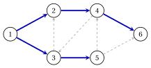

# 1.4 Trees and forests { #sez-sec-gr-trees }

**Part 1 · Graphs · Chapter 1** · [:material-book-open-variant: Chapter 1: Graphs](index.md) · [:material-file-pdf-box: Lecture notes, volume 1 (PDF)](../../pdf/lecture-notes-1-graphs.pdf) · [:material-pencil: Exercises: Graphs](../../exercises/graphs.md)

!!! definizione "Definition 1.13: tree, forest and spanning tree"

    Let $G=(V,E)$ be an undirected graph.

    - $G$ is a <strong>forest</strong> if it is acyclic, and a <strong>tree</strong> if it is connected and acyclic. A vertex of degree $1$ is a <strong>leaf</strong>.

    - A <strong>spanning tree</strong> of a connected graph $G$ is a tree $T=(V,F)$ with $F \subseteq E$; a <strong>spanning forest</strong> of $G$ is a forest $(V,F)$, $F \subseteq E$, with the same connected components as $G$.

    For a directed graph $G=(N,A)$ the notions apply to the underlying undirected graph: a subset of arcs $F \subseteq A$ is a tree (a forest) if the corresponding edges form a tree (a forest).

!!! teorema "Lemma 1.14: leaves"

    Every tree with $n \ge 2$ vertices has at least two leaves.

??? dimostrazione "Proof"

    The tree is connected with $n \ge 2$ vertices, so it has an edge. Let $v_0,v_1,\dots,v_k$ be a path of maximum length, with $k \ge 1$. A neighbour $u \neq v_1$ of $v_0$ would either lie on the path, closing a cycle, or extend the path, against its maximality. Hence $\deg(v_0)=1$, and in the same way $\deg(v_k)=1$. □

!!! teorema "Lemma 1.15: adding an edge"

    Let $G=(V,E)$ have $k$ connected components, and let $e=\{u,v\} \notin E$ with $u,v \in V$.

    1. If $u$ and $v$ are in different components of $G$, the graph $(V,E \cup \{e\})$ has $k-1$ components and no cycle through $e$.

    2. If $u$ and $v$ are in the same component of $G$, the graph $(V,E \cup \{e\})$ has $k$ components and a cycle through $e$.

??? dimostrazione "Proof"

    1. The edge $e$ joins the components of $u$ and $v$ into one, and leaves the other components unchanged. A cycle through $e$ would give, without $e$, a path from $u$ to $v$ in $G$: impossible.

    2. The components do not change. A path $u=v_0,v_1,\dots,v_k=v$ of $G$ has $k \ge 2$, since $\{u,v\} \notin E$; with $e$ it closes the cycle $v_0,v_1,\dots,v_k,v_0$. □

!!! teorema "Corollary 1.16: edges and components"

    A graph with $n$ vertices, $m$ edges and $k$ connected components satisfies $k \ge n-m$, with equality if and only if the graph is acyclic.

??? dimostrazione "Proof"

    Start from $(V,\emptyset)$, which has $n$ components, and insert the $m$ edges one at a time. By [Lemma 1.15](#box-21-gr-lem-add), each insertion either decreases the number of components by one, or leaves it unchanged and closes a cycle. Hence $k \ge n-m$.

    - If the graph has a cycle $C$, the last edge of $C$ to be inserted joins two vertices already connected by the rest of $C$: it leaves the number unchanged, and $k > n-m$.

    - If the graph is acyclic, no insertion closes a cycle, because a cycle of an intermediate graph is a cycle of the final graph: $k=n-m$.

    
□

!!! teorema "Theorem 1.17: characterizations of a tree"

    Let $G=(V,E)$ be an undirected graph with $n$ vertices and $m$ edges. The following statements are equivalent:

    - **(a)** $G$ is a tree (connected and acyclic);

    - **(b)** $G$ is connected and $m=n-1$;

    - **(c)** $G$ is acyclic and $m=n-1$;

    - **(d)** for every two vertices $u$ and $v$ there is exactly one path from $u$ to $v$;

    - **(e)** $G$ is connected, and removing any edge disconnects it.

??? dimostrazione "Proof"

    Let $k$ be the number of connected components; $G$ is connected if and only if $k=1$.

    - <strong>(a)$\Rightarrow$(b),(c).</strong> $G$ is acyclic with $k=1$, so $m=n-k=n-1$ by [Corollary 1.16](#box-22-gr-cor-count).

    - <strong>(b)$\Rightarrow$(a).</strong> Here $k=1=n-m$: the equality holds, and $G$ is acyclic by the same corollary.

    - <strong>(c)$\Rightarrow$(a).</strong> $G$ is acyclic, so $k=n-m=1$ by the same corollary: $G$ is connected.

    For (a)$\Leftrightarrow$(d), connected means at least one path between every two vertices; we show that acyclic means at most one.

    - If $G$ has a cycle $v_0,v_1,\dots,v_{k-1},v_0$, the vertices $v_0$ and $v_1$ are joined by two paths: the edge $\{v_0,v_1\}$, and $v_0,v_{k-1},\dots,v_2,v_1$.

    - Let $P \neq Q$ be two paths from $u$ to $v$. Let $w$ be the last vertex of their common initial part, and $x$ the first vertex after $w$ on $P$ that also lies on $Q$ ($v$ is a candidate). The pieces of $P$ and of $Q$ from $w$ to $x$ share only $w$ and $x$, and they do not both consist of the single edge $\{w,x\}$, since $P$ and $Q$ leave $w$ along different edges. Together they form a cycle.

    For (a)$\Leftrightarrow$(e), let $G$ be connected and $e=\{u,v\} \in E$. Applying [Lemma 1.15](#box-21-gr-lem-add) to $(V,E \setminus \{e\})$ and $e$: the edge $e$ lies on a cycle of $G$ if and only if $u$ and $v$ are connected in $(V,E \setminus \{e\})$, that is, if and only if removing $e$ leaves the graph connected. Hence every removal disconnects $G$ if and only if no edge lies on a cycle. □

!!! teorema "Corollary 1.18: spanning forests"

    Every graph with $n$ vertices and $k$ connected components has a spanning forest, with $n-k$ edges. In particular, every connected graph has a spanning tree, with $n-1$ edges.

??? dimostrazione "Proof"

    While the graph has a cycle, remove an edge $e=\{u,v\}$ of a cycle. The rest of the cycle still connects $u$ and $v$, so adding $e$ back does not change the components ([Lemma 1.15](#box-21-gr-lem-add), part 2): removing it does not change them either. The final graph is acyclic with the same $k$ components, so it is a spanning forest, and it has $n-k$ edges by [Corollary 1.16](#box-22-gr-cor-count). □

## 1.4.1 Fundamental cycles

!!! teorema "Proposition 1.19: fundamental cycle"

    Let $T=(V,F)$ be a spanning tree of a connected graph $G=(V,E)$, and let $e=\{u,v\} \in E \setminus F$. The graph $(V,F \cup \{e\})$ contains exactly one cycle, the <strong>fundamental cycle</strong> $C(T,e)$, formed by $e$ and by the unique path from $u$ to $v$ in $T$.

??? dimostrazione "Proof"

    The vertices $u$ and $v$ are connected in $T$, so the edge $e$ and the path from $u$ to $v$ in $T$ form a cycle ([Lemma 1.15](#box-21-gr-lem-add), part 2). Every cycle of $(V,F \cup \{e\})$ contains $e$, since $T$ is acyclic; removing $e$ from it leaves a path from $u$ to $v$ in $T$, which is unique by [Theorem 1.17](#box-23-gr-th-tree)(d). □

- A connected graph with a spanning tree $T$ has $m-n+1$ fundamental cycles, one for every edge outside $T$.

- In a directed graph the fundamental cycle of an arc $(i,j) \notin F$ is traversed in the direction of $(i,j)$: the arcs of $T$ traversed from tail to head are forward, the others backward.

!!! esempio "Example 1.7: a spanning tree of the reference graph"

    The arcs $F=\{(1,2),(1,3),(2,4),(3,5),(4,6)\}$ form a spanning tree $T$ of the reference graph (blue in the figure): they are $5=n-1$ arcs, and their edges form a connected graph.

    { .fig loading=lazy  }

    The $m-n+1=4$ arcs outside $T$ (dashed) give the fundamental cycles, written from the tail of the arc:

    
<table>
    <tr>
    <th>arc</th>
    <th>fundamental cycle</th>
    <th>backward arcs</th>
    </tr>
    <tr>
    <td>\((3,2)\)</td>
    <td>\(3,2,1,3\)</td>
    <td>\((1,2)\)</td>
    </tr>
    <tr>
    <td>\((4,3)\)</td>
    <td>\(4,3,1,2,4\)</td>
    <td>\((1,3)\)</td>
    </tr>
    <tr>
    <td>\((5,4)\)</td>
    <td>\(5,4,2,1,3,5\)</td>
    <td>\((2,4),~(1,2)\)</td>
    </tr>
    <tr>
    <td>\((5,6)\)</td>
    <td>\(5,6,4,2,1,3,5\)</td>
    <td>\((4,6),~(2,4),~(1,2)\)</td>
    </tr>
    </table>

    For example, the cycle of $(3,2)$ uses $(3,2)$ forward, $(1,2)$ backward (from $2$ to $1$) and $(1,3)$ forward.

!!! chiave ""

    A tree is connected and acyclic; any two of the properties “connected”, “acyclic”, “$n-1$ edges” imply the third. Adding to a spanning tree an edge outside it creates exactly one cycle, the fundamental cycle.

---

**Next:** [1.5 The rank of the incidence matrix](the-rank-of-the-incidence-matrix.md)
