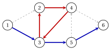

# 1.1 Undirected and directed graphs { #sez-sec-gr-graphs }

**Part 1 · Graphs · Chapter 1** · [:material-book-open-variant: Chapter 1: Graphs](index.md) · [:material-file-pdf-box: Lecture notes, volume 1 (PDF)](../../pdf/lecture-notes-1-graphs.pdf) · [:material-pencil: Exercises: Graphs](../../exercises/graphs.md) · [:material-gesture-tap: App: Graph search: BFS and DFS](../../lab/graph-search-bfs-dfs.md)

!!! definizione "Definition 1.1: undirected graph"

    An <strong>undirected graph</strong> $G=(V,E)$ is given by a finite set $V$ of <strong>vertices</strong> and a set $E$ of <strong>edges</strong>, each edge being a $2$-element subset of $V$:

    $$
    E \subseteq \big\{\, \{u,v\} : u,v \in V,~ u \neq v \,\big\}.
    $$

    We write $n=|V|$ and $m=|E|$, and the vertices are labelled $1,2,\dots,n$.

    - The vertices $u$ and $v$ are the <strong>endpoints</strong> of the edge $\{u,v\}$; the edge is <strong>incident</strong> to $u$ and to $v$, and $u$ and $v$ are <strong>adjacent</strong>.

    - The <strong>neighbourhood</strong> of $v$ is $N(v)=\{\, u \in V : \{u,v\} \in E \,\}$, the set of the incident edges is $\delta(v)=\{\, \{u,v\} \in E : u \in V \,\}$, and the <strong>degree</strong> of $v$ is $\deg(v)=|\delta(v)|$.

!!! esempio "Example 1.1: an undirected graph"

    We consider the graph $G=(V,E)$ with $n=6$ vertices and $m=9$ edges:

    $$
    V=\{1,2,3,4,5,6\}, \qquad
    E=\big\{\{1,2\},\{1,3\},\{2,3\},\{2,4\},\{3,4\},\{3,5\},\{4,5\},\{4,6\},\{5,6\}\big\}.
    $$

    { .fig loading=lazy  }

    The neighbourhood of vertex $3$ is $N(3)=\{1,2,4,5\}$, so $\deg(3)=4$. The degrees of the six vertices are

    $$
    \deg(1)=2,\quad \deg(2)=3,\quad \deg(3)=4,\quad \deg(4)=4,\quad \deg(5)=3,\quad \deg(6)=2.
    $$

!!! teorema "Proposition 1.2: handshake lemma"

    For every undirected graph $G=(V,E)$ we have

    $$
    \sum_{v \in V} \deg(v) = 2\,m .
    $$

??? dimostrazione "Proof"

    The sum counts the pairs $(v,e)$ with $v \in V$, $e \in \delta(v)$. Every edge $e=\{u,v\}$ appears in exactly two pairs, $(u,e)$ and $(v,e)$, so the number of pairs is $2m$. □

- In [Example 1.1](#box-2-gr-ex-undirected) the degrees add up to $2+3+4+4+3+2=18=2\cdot 9$.

!!! definizione "Definition 1.3: directed graph"

    A <strong>directed graph</strong> $G=(N,A)$ is given by a finite set $N$ of <strong>nodes</strong> and a set $A$ of <strong>arcs</strong>, each arc being an ordered pair of distinct nodes:

    $$
    A \subseteq \big\{\, (i,j) : i,j \in N,~ i \neq j \,\big\}.
    $$

    We write $n=|N|$ and $m=|A|$, and the nodes are labelled $1,2,\dots,n$.

    - The arc $(i,j)$ goes from its <strong>tail</strong> $i$ to its <strong>head</strong> $j$; the node $j$ is a <strong>successor</strong> of $i$, and $i$ is a <strong>predecessor</strong> of $j$.

    - The <strong>forward star</strong> $\delta^+(i)=\{\,(i,j) \in A\,\}$ contains the arcs leaving $i$, and the <strong>backward star</strong> $\delta^-(i)=\{\,(j,i) \in A\,\}$ the arcs entering $i$.

    - The <strong>out-degree</strong> of $i$ is $\deg^+(i)=|\delta^+(i)|$, and the <strong>in-degree</strong> is $\deg^-(i)=|\delta^-(i)|$.

- The arcs $(i,j)$ and $(j,i)$ are different: they are called <strong>antiparallel</strong> and can both belong to $A$.

- The <strong>underlying undirected graph</strong> of $G=(N,A)$ has the edge $\{i,j\}$ for every arc $(i,j)$ or $(j,i)$ of $A$: it is obtained by ignoring the orientation of the arcs.

!!! esempio "Example 1.2: the reference graph"

    We consider the directed graph $G=(N,A)$ with $n=6$ nodes and $m=9$ arcs:

    $$
    N=\{1,2,3,4,5,6\}, \qquad
    A=\big\{(1,2),(1,3),(2,4),(3,2),(3,5),(4,3),(4,6),(5,4),(5,6)\big\}.
    $$

    The arcs are numbered $a_1,a_2,\dots,a_9$ in this (lexicographic) order, as in the figure.

    { .fig loading=lazy  }

    The out-degrees and the in-degrees are:

    
<table>
    <tr>
    <th>node \(i\)</th>
    <th>\(1\)</th>
    <th>\(2\)</th>
    <th>\(3\)</th>
    <th>\(4\)</th>
    <th>\(5\)</th>
    <th>\(6\)</th>
    </tr>
    <tr>
    <td>\(\deg^+(i)\)</td>
    <td>\(2\)</td>
    <td>\(1\)</td>
    <td>\(2\)</td>
    <td>\(2\)</td>
    <td>\(2\)</td>
    <td>\(0\)</td>
    </tr>
    <tr>
    <td>\(\deg^-(i)\)</td>
    <td>\(0\)</td>
    <td>\(2\)</td>
    <td>\(2\)</td>
    <td>\(2\)</td>
    <td>\(1\)</td>
    <td>\(2\)</td>
    </tr>
    </table>

    The underlying undirected graph is the graph of [Example 1.1](#box-2-gr-ex-undirected). We call this graph the <strong>reference graph</strong>: all the examples of the chapter use it.

- Every arc has one tail and one head, so $\sum_{i \in N} \deg^+(i) = \sum_{i \in N} \deg^-(i) = m$. In the reference graph both sums are $9$.

## 1.1.1 Walks, paths and cycles

!!! definizione "Definition 1.4: walk, path and cycle"

    Let $G=(V,E)$ be an undirected graph.

    - A <strong>walk</strong> from $v_0$ to $v_k$ is a sequence $v_0, e_1, v_1, e_2, \dots, e_k, v_k$ of vertices and edges with $e_t=\{v_{t-1},v_t\} \in E$ for all $t \in \{1,2,\dots,k\}$; its <strong>length</strong> is $k$.

    - The walk is <strong>closed</strong> if $v_0=v_k$. It is a <strong>path</strong> if the vertices $v_0,v_1,\dots,v_k$ are distinct.

    - A <strong>cycle</strong> is a closed walk with $k \ge 3$ whose vertices $v_0,v_1,\dots,v_{k-1}$ are distinct.

    A graph without cycles is <strong>acyclic</strong>. In a simple graph a walk is identified by its vertices $v_0,v_1,\dots,v_k$.

!!! definizione "Definition 1.5: directed walk, path and cycle"

    Let $G=(N,A)$ be a directed graph.

    - A <strong>directed walk</strong> from $i_0$ to $i_k$ is a sequence of nodes $i_0,i_1,\dots,i_k$ with $(i_{t-1},i_t) \in A$ for all $t \in \{1,2,\dots,k\}$: every arc is traversed from its tail to its head.

    - It is a <strong>directed path</strong> if its nodes are distinct, and a <strong>directed cycle</strong> if $k \ge 2$, $i_0=i_k$ and the nodes $i_0,i_1,\dots,i_{k-1}$ are distinct.

    - A walk, path or cycle of the underlying undirected graph is a walk, path or cycle of $G$: its arcs can be traversed in both directions, and an arc is <strong>forward</strong> if it is traversed from tail to head, <strong>backward</strong> otherwise.

!!! esempio "Example 1.3: walks, paths and cycles in the reference graph"

    In the reference graph:

    - $1,3,2,4,3,5$ is a directed walk of length $5$; it is not a path, because node $3$ appears twice;

    - $1,3,5,6$ is a directed path of length $3$ (blue in the figure);

    - $2,4,3,2$ is a directed cycle of length $3$ (red in the figure);

    - $1,2,3$ is a path of $G$ but not a directed path: the arc $(1,2)$ is forward and the arc $(3,2)$ is backward.

    { .fig loading=lazy  }

!!! teorema "Lemma 1.6: a walk contains a path"

    If a graph has a walk (directed walk) from $u$ to $v$, then it has a path (directed path) from $u$ to $v$, whose vertices belong to the walk.

??? dimostrazione "Proof"

    Among the walks from $u$ to $v$ that use only vertices of the given walk, let $v_0,v_1,\dots,v_k$ be one of minimum length. If two indices $s<t$ had $v_s=v_t$, deleting $v_{s+1},\dots,v_t$ would give the walk $v_0,\dots,v_s,v_{t+1},\dots,v_k$ from $u$ to $v$, shorter by $t-s \ge 1$. Hence the vertices are distinct, and the walk is a path. The same argument holds for directed walks, since the deletion keeps every arc traversed from tail to head. □

- In [Example 1.3](#box-8-gr-ex-walks), deleting the closed piece $3,2,4,3$ from the walk $1,3,2,4,3,5$ leaves the directed path $1,3,5$.

## 1.1.2 Simple graphs and multigraphs

- A graph is <strong>simple</strong> if it has no <strong>loops</strong> (edges $\{v,v\}$ or arcs $(i,i)$) and no <strong>parallel</strong> edges or arcs (two copies of the same pair). The graphs of Definitions [1.1](#box-1-gr-def-graph) and [Definition 1.3](#box-4-gr-def-digraph) are simple, because $E$ and $A$ are sets of pairs of distinct elements.

- A <strong>multigraph</strong> allows loops and parallel edges or arcs. In this module all graphs are simple, and an arc is identified by the pair $(i,j)$ of its tail and its head.

!!! chiave ""

    An undirected graph $G=(V,E)$ has edges $\{u,v\}$; a directed graph $G=(N,A)$ has arcs $(i,j)$ from the tail $i$ to the head $j$. A path has distinct vertices, and every walk contains a path with the same endpoints.

---

**Next:** [1.2 Representations of a graph](representations-of-a-graph.md)
