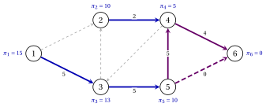
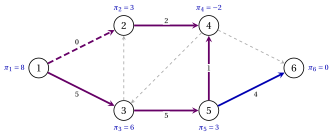

# 8.6 An uncapacitated example { #sez-sec-ns-example-a }

**Part 4 · The network simplex · Chapter 8** · [:material-book-open-variant: Chapter 8: Network simplex](index.md) · [:material-file-pdf-box: Lecture notes, volume 4 (PDF)](../../pdf/lecture-notes-4-network-simplex.pdf) · [:material-presentation: Slides](../../pdf/slides-network-simplex.pdf) · [:material-pencil: Exercises: Network simplex](../../exercises/network-simplex.md) · [:material-gesture-tap: App: The network simplex, pivot by pivot](../../lab/network-simplex.md)

- We use the reference network with the balances $\vet{b}=(5,2,0,-3,0,-4)$ and the costs of [Example 8.2](bases-and-spanning-trees.md#box-8-ns-ex-tree), but without capacities: $u_{ij}=+\infty$ for every arc, so $U=\emptyset$.

- The initial tree structure sends the $5$ units of node $1$ along the path $1,3,5,4$ and the $2$ units of node $2$ along $(2,4)$; node $4$ keeps $3$ units and forwards $4$ units to node $6$:

    $$
    T=\{(1,3),(2,4),(3,5),(4,6),(5,4)\}, \qquad L=\{(1,2),(3,2),(4,3),(5,6)\}, \qquad U=\emptyset .
    $$

- Every tree solution of the example is nondegenerate. Each table gives the state of the arcs (T, L, U), the flows and the reduced costs; each cycle table lists the arcs of $C$ from the apex.

!!! esempio "Example 8.5: the network simplex without capacities"

    <strong>Iteration 1</strong>  The potentials are $\vet{\pi}=(15,10,13,5,10,0)$ and the cost is $80$.

    
<table>
    <tr>
    <th>arc</th>
    <th>\((1,2)\)</th>
    <th>\((1,3)\)</th>
    <th>\((2,4)\)</th>
    <th>\((3,2)\)</th>
    <th>\((3,5)\)</th>
    <th>\((4,3)\)</th>
    <th>\((4,6)\)</th>
    <th>\((5,4)\)</th>
    <th>\((5,6)\)</th>
    </tr>
    <tr>
    <td>state</td>
    <td>\(\mathrm{L}\)</td>
    <td>\(\mathrm{T}\)</td>
    <td>\(\mathrm{T}\)</td>
    <td>\(\mathrm{L}\)</td>
    <td>\(\mathrm{T}\)</td>
    <td>\(\mathrm{L}\)</td>
    <td>\(\mathrm{T}\)</td>
    <td>\(\mathrm{T}\)</td>
    <td>\(\mathrm{L}\)</td>
    </tr>
    <tr>
    <td>\(x_{ij}\)</td>
    <td>\(0\)</td>
    <td>\(5\)</td>
    <td>\(2\)</td>
    <td>\(0\)</td>
    <td>\(5\)</td>
    <td>\(0\)</td>
    <td>\(4\)</td>
    <td>\(5\)</td>
    <td>\(0\)</td>
    </tr>
    <tr>
    <td>\(\bar{c}_{ij}\)</td>
    <td>\(-3\)</td>
    <td>\(0\)</td>
    <td>\(0\)</td>
    <td>\(-1\)</td>
    <td>\(0\)</td>
    <td>\(11\)</td>
    <td>\(0\)</td>
    <td>\(0\)</td>
    <td>\(-7\)</td>
    </tr>
    </table>

    - The eligible arcs are $(1,2)$, $(3,2)$ and $(5,6)$; the entering arc is $e=(5,6)$, with $\bar{c}_{56}=-7$. It is in $L$, so $C$ follows $(5,6)$.

    - The tree paths to the root are $5,4,6$ and $6$: the apex is $w=6$, and $C$ is $6,4,5,6$.

        
<table>
        <tr>
        <td>arc of \(C\)</td>
        <td>\((4,6)\)</td>
        <td>\((5,4)\)</td>
        <td>\((5,6)\)</td>
        </tr>
        <tr>
        <td>direction</td>
        <td>\(-\)</td>
        <td>\(-\)</td>
        <td>\(+\)</td>
        </tr>
        <tr>
        <td>residual</td>
        <td>\(4\)</td>
        <td>\(5\)</td>
        <td>\(+\infty\)</td>
        </tr>
        </table>

    - $\theta=4$, and $(4,6)$ leaves the tree, to $L$. The $4$ units for node $6$ now travel on $(5,6)$ instead of $5,4,6$, and the cost becomes $80-4 \cdot 7=52$.

    - Removing $(4,6)$ cuts off $S=\{1,2,3,4,5\}$, which contains $k=5$: these potentials change by $\bar{c}_{56}=-7$.

    { .fig loading=lazy  }

    <strong>Iteration 2</strong>  The potentials are $\vet{\pi}=(8,3,6,-2,3,0)$ and the cost is $52$.

    
<table>
    <tr>
    <th>arc</th>
    <th>\((1,2)\)</th>
    <th>\((1,3)\)</th>
    <th>\((2,4)\)</th>
    <th>\((3,2)\)</th>
    <th>\((3,5)\)</th>
    <th>\((4,3)\)</th>
    <th>\((4,6)\)</th>
    <th>\((5,4)\)</th>
    <th>\((5,6)\)</th>
    </tr>
    <tr>
    <td>state</td>
    <td>\(\mathrm{L}\)</td>
    <td>\(\mathrm{T}\)</td>
    <td>\(\mathrm{T}\)</td>
    <td>\(\mathrm{L}\)</td>
    <td>\(\mathrm{T}\)</td>
    <td>\(\mathrm{L}\)</td>
    <td>\(\mathrm{L}\)</td>
    <td>\(\mathrm{T}\)</td>
    <td>\(\mathrm{T}\)</td>
    </tr>
    <tr>
    <td>\(x_{ij}\)</td>
    <td>\(0\)</td>
    <td>\(5\)</td>
    <td>\(2\)</td>
    <td>\(0\)</td>
    <td>\(5\)</td>
    <td>\(0\)</td>
    <td>\(0\)</td>
    <td>\(1\)</td>
    <td>\(4\)</td>
    </tr>
    <tr>
    <td>\(\bar{c}_{ij}\)</td>
    <td>\(-3\)</td>
    <td>\(0\)</td>
    <td>\(0\)</td>
    <td>\(-1\)</td>
    <td>\(0\)</td>
    <td>\(11\)</td>
    <td>\(7\)</td>
    <td>\(0\)</td>
    <td>\(0\)</td>
    </tr>
    </table>

    - The eligible arcs are $(1,2)$ and $(3,2)$; the entering arc is $e=(1,2)$, with $\bar{c}_{12}=-3$, in $L$.

    - The tree paths to the root are $1,3,5,6$ and $2,4,5,6$: the apex is $w=5$, and $C$ is $5,3,1,2,4,5$.

        
<table>
        <tr>
        <td>arc of \(C\)</td>
        <td>\((3,5)\)</td>
        <td>\((1,3)\)</td>
        <td>\((1,2)\)</td>
        <td>\((2,4)\)</td>
        <td>\((5,4)\)</td>
        </tr>
        <tr>
        <td>direction</td>
        <td>\(-\)</td>
        <td>\(-\)</td>
        <td>\(+\)</td>
        <td>\(+\)</td>
        <td>\(-\)</td>
        </tr>
        <tr>
        <td>residual</td>
        <td>\(5\)</td>
        <td>\(5\)</td>
        <td>\(+\infty\)</td>
        <td>\(+\infty\)</td>
        <td>\(1\)</td>
        </tr>
        </table>

    - $\theta=1$, and $(5,4)$ leaves the tree, to $L$. The unit for node $4$ that travelled along $1,3,5,4$, at cost $10$, now travels along $1,2,4$, at cost $7$: the cost becomes $52-1 \cdot 3=49$.

    - Removing $(5,4)$ cuts off $S=\{2,4\}$, which contains $l=2$: these potentials change by $-\bar{c}_{12}=3$.

    { .fig loading=lazy  }

    <strong>Iteration 3</strong>  The potentials are $\vet{\pi}=(8,6,6,1,3,0)$ and the cost is $49$.

    
<table>
    <tr>
    <th>arc</th>
    <th>\((1,2)\)</th>
    <th>\((1,3)\)</th>
    <th>\((2,4)\)</th>
    <th>\((3,2)\)</th>
    <th>\((3,5)\)</th>
    <th>\((4,3)\)</th>
    <th>\((4,6)\)</th>
    <th>\((5,4)\)</th>
    <th>\((5,6)\)</th>
    </tr>
    <tr>
    <td>state</td>
    <td>\(\mathrm{T}\)</td>
    <td>\(\mathrm{T}\)</td>
    <td>\(\mathrm{T}\)</td>
    <td>\(\mathrm{L}\)</td>
    <td>\(\mathrm{T}\)</td>
    <td>\(\mathrm{L}\)</td>
    <td>\(\mathrm{L}\)</td>
    <td>\(\mathrm{L}\)</td>
    <td>\(\mathrm{T}\)</td>
    </tr>
    <tr>
    <td>\(x_{ij}\)</td>
    <td>\(1\)</td>
    <td>\(4\)</td>
    <td>\(3\)</td>
    <td>\(0\)</td>
    <td>\(4\)</td>
    <td>\(0\)</td>
    <td>\(0\)</td>
    <td>\(0\)</td>
    <td>\(4\)</td>
    </tr>
    <tr>
    <td>\(\bar{c}_{ij}\)</td>
    <td>\(0\)</td>
    <td>\(0\)</td>
    <td>\(0\)</td>
    <td>\(2\)</td>
    <td>\(0\)</td>
    <td>\(8\)</td>
    <td>\(4\)</td>
    <td>\(3\)</td>
    <td>\(0\)</td>
    </tr>
    </table>

    All the arcs of $L$ have $\bar{c}_{ij}>0$: <code>STOP</code>. By [Theorem 8.10](potentials-and-optimality.md#box-12-ns-th-optimality) the flow $x_{12}=1$, $x_{13}=4$, $x_{24}=3$, $x_{35}=4$, $x_{56}=4$ is the unique optimal flow, with value

    $$
    2 \cdot 1+2 \cdot 4+5 \cdot 3+3 \cdot 4+3 \cdot 4=49 .
    $$

    { .fig loading=lazy  }

- Gurobi (gurobipy) confirms the optimal value $49$ and the optimal flow; enumerating all the feasible tree structures gives the same unique optimum.

- The optimal flow sends $4$ units on $(5,6)$, whose capacity in Chapter 4 is $u_{56}=2$: with the capacities this flow is not feasible, and the optimal value rises from $49$ to $60$.

!!! chiave ""

    Without capacities $U$ is empty and only backward arcs can block. On the reference network two pivots lower the cost from $80$ to $52$ and to $49$; the reduced costs of the last tree are positive on all the nonbasic arcs.

---

**Next:** [8.7 Degeneracy and strongly feasible trees](degeneracy-and-strongly-feasible-trees.md)
