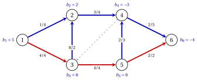

# 8.2 Bases and spanning trees { #sez-sec-ns-trees }

**Part 4 · The network simplex · Chapter 8** · [:material-book-open-variant: Chapter 8: Network simplex](index.md) · [:material-file-pdf-box: Lecture notes, volume 4 (PDF)](../../pdf/lecture-notes-4-network-simplex.pdf) · [:material-pencil: Exercises: Network simplex](../../exercises/network-simplex.md)

!!! teorema "Theorem 8.3: the bases are the spanning trees"

    Let the underlying undirected graph of $G=(N,A)$ be connected. A set $T$ of $n-1$ arcs is a basis if and only if it is a spanning tree. Moreover, for a spanning tree $T$ the rows and the columns of $\mat{M}_T$ can be ordered so that the matrix is lower triangular with diagonal entries $\pm 1$, and $\det(\mat{M}_T)=\pm 1$.

??? dimostrazione "Proof"

    We use the results of [Chapter 1 «Graphs»](https://fabiofurini.github.io/network-optimization/graphs/graphs/).

    1. <em>The columns of $T$ in $\mat{M}$ and in $\mat{B}$ are independent together.</em> The entry of node $n$ of $\sum_{a \in T}\lambda_a\mat{B}_a$ is minus the sum of the other entries, since the rows of $\mat{B}$ add up to zero. Hence $\sum_{a \in T}\lambda_a\mat{M}_a=\vet{0}$ if and only if $\sum_{a \in T}\lambda_a\mat{B}_a=\vet{0}$.

    2. <em>A spanning tree is a basis.</em> Its columns in $\mat{B}$ are linearly independent by Lemma «columns of a forest».

    3. <em>A basis is a spanning tree.</em> If the $n-1$ arcs of $T$ were acyclic, they would form a spanning tree by Theorem «characterizations of a tree»(c). Otherwise $T$ contains a cycle, whose columns are linearly dependent by Lemma «columns of a cycle», and $T$ is not a basis.

    4. <em>Triangular form.</em> By induction on $n$; for $n=2$ the matrix is $1 \times 1$ with entry $\pm 1$. For $n \ge 3$ the tree has at least two leaves (Lemma «leaves»), so it has a leaf $\ell \neq n$, with its only tree arc $a_\ell$. Row $\ell$ of $\mat{M}_T$ has the single nonzero entry $\pm 1$, in the column of $a_\ell$.

    5. Put row $\ell$ and the column of $a_\ell$ first. Deleting them leaves the matrix built in the same way for the spanning tree $T \setminus \{a_\ell\}$ of the nodes $N \setminus \{\ell\}$, which still contain $n$: by induction it can be ordered in lower triangular form. Expanding along the first row, $\det(\mat{M}_T)=\pm 1$. □

!!! teorema "Corollary 8.4: integer tree solutions"

    If the balances and the finite capacities are integer, every basic solution of the $\mathrm{MCF}$ model is integer.

??? dimostrazione "Proof"

    The right-hand side $\vet{h}-\sum_{a \in U}\mat{M}_au_a$ is integer, and $\det(\mat{M}_T)=\pm 1$ by [Theorem 8.3](#box-4-ns-th-bases): by Cramer's rule every basic variable is an integer. This is the integrality of [Chapter 4 «Network flow models»](https://fabiofurini.github.io/network-optimization/flows/network-flow-models/), seen on the bases. □

!!! definizione "Definition 8.5: tree structure and tree solution"

    Let $T$ be a spanning tree of $G$. A <strong>tree structure</strong> is a triple $(T,L,U)$, where $L$ and $U$ partition $A \setminus T$ and every arc of $U$ has a finite capacity. Its <strong>tree solution</strong> is its basic solution: $x_{ij}=0$ on $L$, $x_{ij}=u_{ij}$ on $U$, and $\mat{B}\vet{x}=\vet{b}$.

    - The tree structure is <strong>feasible</strong> if $0 \le x_{ij} \le u_{ij}$ on every arc of $T$.

    - A feasible tree structure is <strong>degenerate</strong> if some arc of $T$ has $x_{ij}=0$ or $x_{ij}=u_{ij}$.

!!! attenzione "Basis and bound status"

    - The tree $T$ is the basis. The sets $L$ and $U$ only say at which bound each nonbasic arc sits.

    - An arc of $U$ is nonbasic, although its flow $u_{ij}$ is positive. An arc of $T$ can have flow $0$ or $u_{ij}$: the tree solution is then degenerate, but the arc is still basic.

!!! teorema "Proposition 8.6: the tree solution from the leaves"

    Let $(T,L,U)$ be a tree structure, and let the <strong>residual balances</strong> be

    $$
    \hat{b}_i=b_i-\sum_{(i,j) \in U}u_{ij}+\sum_{(j,i) \in U}u_{ji}, \qquad \forall i \in N.
    $$

    Repeat until no tree arc is left: take a leaf $\ell \neq n$ of the remaining tree, with its tree arc $a$ and its neighbour $j$; set $x_a=\hat{b}_\ell$ if $a=(\ell,j)$ and $x_a=-\hat{b}_\ell$ if $a=(j,\ell)$; add $\hat{b}_\ell$ to $\hat{b}_j$; delete $\ell$ and $a$. The values obtained, with $x=0$ on $L$ and $x=u$ on $U$, are the tree solution.

??? dimostrazione "Proof"

    The residual balance $\hat{b}_i$ is the balance of node $i$ once the flows on the arcs of $U$ are moved to the right-hand side. We show that each step keeps this invariant: the remaining tree arcs must satisfy conservation with the current residual balances.

    1. At the leaf $\ell$ the only remaining unknown is $x_a$, so the conservation constraint of $\ell$ reads $x_a= \hat{b}_\ell$ if $\ell$ is the tail of $a$, and $-x_a=\hat{b}_\ell$ if $\ell$ is its head.

    2. In the constraint of $j$ the arc $a$ appears with $-x_a$ if $a=(\ell,j)$ and with $+x_a$ if $a=(j,\ell)$. Moving the known term to the right-hand side adds $x_a=\hat{b}_\ell$ or $-x_a=\hat{b}_\ell$ to $\hat{b}_j$.

    3. A tree with at least two nodes has a leaf other than $n$ ([Chapter 1, Lemma «leaves»](https://fabiofurini.github.io/network-optimization/graphs/graphs/trees-and-forests/)), so the procedure ends with node $n$ alone. Its constraint holds by [Lemma 8.2](the-simplex-algorithm-on-the-minimum-cost-flow-model.md#box-2-ns-lem-redundant), and the solution is unique by [Theorem 8.3](#box-4-ns-th-bases). □

- In the examples the leaf is always the one with the <strong>smallest index</strong> different from $n$.

- Each leaf passes its residual balance to its neighbour. Hence the flow on a tree arc equals the total residual balance of the nodes that the arc separates from $n$, as in [Chapter 4, Lemma «flow across a cut»](https://fabiofurini.github.io/network-optimization/flows/network-flow-models/networks-and-flows/).

!!! esempio "Example 8.2: the flow $\bar{\vet{x}}$ of Chapter 4 as a tree solution"

    We use the reference network of [Chapter 4](https://fabiofurini.github.io/network-optimization/flows/network-flow-models/networks-and-flows/), with $\vet{b}=(5,2,0,-3,0,-4)$ and

    
<table>
    <tr>
    <th>arc</th>
    <th>\((1,2)\)</th>
    <th>\((1,3)\)</th>
    <th>\((2,4)\)</th>
    <th>\((3,2)\)</th>
    <th>\((3,5)\)</th>
    <th>\((4,3)\)</th>
    <th>\((4,6)\)</th>
    <th>\((5,4)\)</th>
    <th>\((5,6)\)</th>
    </tr>
    <tr>
    <td>\(c_{ij}\)</td>
    <td>\(2\)</td>
    <td>\(2\)</td>
    <td>\(5\)</td>
    <td>\(2\)</td>
    <td>\(3\)</td>
    <td>\(3\)</td>
    <td>\(5\)</td>
    <td>\(5\)</td>
    <td>\(3\)</td>
    </tr>
    <tr>
    <td>\(u_{ij}\)</td>
    <td>\(4\)</td>
    <td>\(4\)</td>
    <td>\(4\)</td>
    <td>\(2\)</td>
    <td>\(4\)</td>
    <td>\(3\)</td>
    <td>\(5\)</td>
    <td>\(3\)</td>
    <td>\(2\)</td>
    </tr>
    </table>

    Take $T=\{(1,2),(2,4),(3,2),(4,6),(5,4)\}$, $U=\{(1,3),(3,5),(5,6)\}$ and $L=\{(4,3)\}$. The residual balances are

    $$
    \hat{\vet{b}}=(5-4,\;2,\;0+4-4,\;-3,\;0+4-2,\;-4+2)=(1,2,0,-3,2,-2).
    $$

    The leaves are processed in the order $1,3,2,5,4$:

    
<table>
    <tr>
    <th>leaf \(\ell\)</th>
    <th>tree arc</th>
    <th>flow</th>
    <th>residual balance of the neighbour</th>
    </tr>
    <tr>
    <td>\(1\)</td>
    <td>\((1,2)\)</td>
    <td>\(x_{12}=\hat{b}_1=1\)</td>
    <td>\(\hat{b}_2=2+1=3\)</td>
    </tr>
    <tr>
    <td>\(3\)</td>
    <td>\((3,2)\)</td>
    <td>\(x_{32}=\hat{b}_3=0\)</td>
    <td>\(\hat{b}_2=3+0=3\)</td>
    </tr>
    <tr>
    <td>\(2\)</td>
    <td>\((2,4)\)</td>
    <td>\(x_{24}=\hat{b}_2=3\)</td>
    <td>\(\hat{b}_4=-3+3=0\)</td>
    </tr>
    <tr>
    <td>\(5\)</td>
    <td>\((5,4)\)</td>
    <td>\(x_{54}=\hat{b}_5=2\)</td>
    <td>\(\hat{b}_4=0+2=2\)</td>
    </tr>
    <tr>
    <td>\(4\)</td>
    <td>\((4,6)\)</td>
    <td>\(x_{46}=\hat{b}_4=2\)</td>
    <td>\(\hat{b}_6=-2+2=0\)</td>
    </tr>
    </table>

    The tree solution is the flow $\bar{\vet{x}}=(1,4,3,0,4,0,2,2,2)$ of Chapter 4, with cost $63$. In the figure the tree arcs are blue, the arcs of $U$ red and the arc of $L$ grey and dashed; each arc carries $x_{ij}/u_{ij}$.

    { .fig loading=lazy  }

    The tree arc $(3,2)$ has flow $0$: the tree structure is feasible and degenerate.

!!! chiave ""

    The bases of the $\mathrm{MCF}$ model are the spanning trees, and their matrices are triangular with determinant $\pm 1$. A tree solution fixes the arcs of $L$ at $0$ and those of $U$ at their capacity, and the flows on the tree arcs follow from the leaves.

---

**Next:** [8.3 Potentials and optimality](potentials-and-optimality.md)
