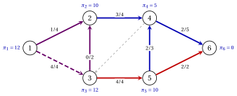

# 8.4 The pivot { #sez-sec-ns-pivot }

**Part 4 · The network simplex · Chapter 8** · [:material-book-open-variant: Chapter 8: Network simplex](index.md) · [:material-file-pdf-box: Lecture notes, volume 4 (PDF)](../../pdf/lecture-notes-4-network-simplex.pdf) · [:material-pencil: Exercises: Network simplex](../../exercises/network-simplex.md)

!!! definizione "Definition 8.11: the pivot of the network simplex"

    Let $(T,L,U)$ be a feasible tree structure, with tree solution $\vet{x}$ and potentials $\vet{\pi}$.

    - An arc is <strong>eligible</strong> if it is in $L$ with $\bar{c}_{ij}<0$, or in $U$ with $\bar{c}_{ij}>0$. The <strong>entering arc</strong> $e=(k,l)$ is the eligible arc with the largest $|\bar{c}_{ij}|$; if more than one, the first in lexicographic order.

    - The <strong>cycle of the pivot</strong> $C$ is the fundamental cycle of $e$, traversed in the direction of $e$ if $e \in L$, and in the opposite direction if $e \in U$.

    - The <strong>residual capacity</strong> of an arc of $C$ is $u_{ij}-x_{ij}$ if the arc is forward ($+\infty$ if $u_{ij}=+\infty$), and $x_{ij}$ if it is backward. The <strong>step</strong> $\theta$ is the minimum residual capacity along $C$, and the arcs that attain it are <strong>blocking</strong>.

    - The <strong>apex</strong> $w$ of $C$ is the first node shared by the tree paths from $k$ and from $l$ to the root $n$. The <strong>leaving arc</strong> $f$ is the last blocking arc met when $C$ is traversed in its direction starting from $w$.

    A pivot with $\theta=0$ is <strong>degenerate</strong>.

- Sending $\theta$ units along $C$ increases the flow on the forward arcs and decreases it on the backward arcs. The entering arc is forward if it is in $L$, whose flow must increase, and backward if it is in $U$, whose flow must decrease.

- Let $p$ and $q$ be the endpoints of $e$ in the direction of $C$: $p=k$, $q=l$ if $e \in L$, and $p=l$, $q=k$ if $e \in U$. Starting from the apex, $C$ follows the tree path from $w$ down to $p$, the arc $e$ from $p$ to $q$, and the tree path from $q$ up to $w$.

- The entering arc is a candidate to leave: its residual capacity is $u_{kl}$, so $\theta \le u_{kl}$.

!!! teorema "Proposition 8.12: the pivot"

    In the setting of [Definition 8.11](#box-14-ns-def-pivot), let $\theta<+\infty$, and let $\vet{x}'$ be obtained from $\vet{x}$ by adding $\theta$ on the forward arcs of $C$ and subtracting $\theta$ on the backward arcs.

    - **(a)** $\vet{x}'$ is a feasible flow, and $\vet{c}'\vet{x}'=\vet{c}'\vet{x}-\theta\,|\bar{c}_{kl}|$.

    - **(b)** $T'=T \cup \{e\} \setminus \{f\}$ is a spanning tree, and $\vet{x}'$ is the tree solution of the structure $(T',L',U')$, where $f$ goes to $U$ if it is forward in $C$ and to $L$ if it is backward. If $f=e$, then $T'=T$ and $e$ moves from $L$ to $U$ or from $U$ to $L$.

??? dimostrazione "Proof"

    Let $\varepsilon_a=+1$ on the forward arcs and $-1$ on the backward arcs of $C$, and let $\vet{x}^C$ be the signed incidence vector of $C$, with $x^C_a=\varepsilon_a$ on $C$ and $0$ elsewhere: then $\vet{x}'=\vet{x}+\theta \vet{x}^C$.

    1. <em>Conservation.</em> $\mat{B}\vet{x}^C=\sum_{a \in C}\varepsilon_a\mat{B}_a=\vet{0}$ by [Chapter 1, Lemma «columns of a cycle»](https://fabiofurini.github.io/network-optimization/graphs/graphs/the-rank-of-the-incidence-matrix/), so $\mat{B}\vet{x}'=\vet{b}$.

    2. <em>Bounds.</em> A forward arc increases by $\theta \le u_{ij}-x_{ij}$, a backward arc decreases by $\theta \le x_{ij}$, the other arcs do not change.

    3. <em>Cost.</em> $\vet{c}'\vet{x}'-\vet{c}'\vet{x}=\theta\,c(C)=\theta\,\varepsilon_e\bar{c}_{kl}$ by [Lemma 8.9](potentials-and-optimality.md#box-11-ns-lem-cycle), since the tree arcs have $\bar{c}_{ij}=0$. If $e \in L$, then $\varepsilon_e=+1$ and $\bar{c}_{kl}<0$; if $e \in U$, then $\varepsilon_e=-1$ and $\bar{c}_{kl}>0$. In both cases $\varepsilon_e\bar{c}_{kl} =-|\bar{c}_{kl}|$.

    4. <em>The new tree.</em> $C$ is the only cycle of $T \cup \{e\}$ ([Chapter 1, Proposition «fundamental cycle»](https://fabiofurini.github.io/network-optimization/graphs/graphs/trees-and-forests/)). Removing $f \in C$ leaves a connected graph, since the rest of $C$ still joins the endpoints of $f$; it has $n-1$ arcs, so it is a spanning tree (Theorem «characterizations of a tree»(b)).

    5. <em>The new tree solution.</em> The nonbasic arcs other than $e$ and $f$ keep their flow and their bound. The arc $f$ is blocking, so after the step $x'_f=u_f$ if it is forward and $x'_f=0$ if it is backward. Hence $\vet{x}'$ satisfies $\mat{B}\vet{x}'=\vet{b}$ and the bounds fixed by $(T',L',U')$, and it is the tree solution by [Theorem 8.3](bases-and-spanning-trees.md#box-4-ns-th-bases). □

!!! teorema "Proposition 8.13: the update of the potentials"

    In the pivot of [Proposition 8.12](#box-15-ns-prop-pivot), let $f \neq e$, and let $R$ and $S$ be the node sets of the two components of $T \setminus \{f\}$, with $n \in R$. Then $e$ has one endpoint in $R$ and one in $S$, and the potentials of $T'$ are

    $$
    \pi'_i=\pi_i, \quad \forall i \in R, \qquad\qquad
    \pi'_i=\begin{cases} \pi_i-\bar{c}_{kl} & \text{if } l \in S,\\ \pi_i+\bar{c}_{kl} & \text{if } k \in S, \end{cases}
    \quad \forall i \in S .
    $$

??? dimostrazione "Proof"

    The tree $T'$ is connected, and $T' \setminus \{e\}=T \setminus \{f\}$ has no arc between $R$ and $S$: hence $e$ joins $R$ and $S$. We check that the values $\pi'$ of the statement are the potentials of $T'$, which are unique by [Lemma 8.8](potentials-and-optimality.md#box-10-ns-lem-multipliers).

    1. The arcs of $T' \setminus \{e\}$ have both endpoints in $R$ or both in $S$, where all the potentials change by the same amount: their reduced cost stays $0$.

    2. If $l \in S$, then $c_{kl}-\pi'_k+\pi'_l=c_{kl}-\pi_k+\pi_l-\bar{c}_{kl}=0$. If $k \in S$, then $c_{kl}-\pi'_k+ \pi'_l=c_{kl}-\pi_k-\bar{c}_{kl}+\pi_l=0$.

    3. The root $n$ is in $R$, so $\pi'_n=\pi_n=0$. □

- Only the potentials of the subtree $S$ cut off by $f$ change, all by the same amount. If $f=e$, the tree and the potentials do not change.

- The reduced costs change only on the arcs with one endpoint in $R$ and the other in $S$.

!!! teorema "Proposition 8.14: unbounded problem"

    If $\theta=+\infty$, then $e \in L$, the cycle $C$ is a directed cycle whose arcs have infinite capacity, its cost is $-|\bar{c}_{kl}|<0$, and the $\mathrm{MCF}$ model is unbounded.

??? dimostrazione "Proof"

    A backward arc has the finite residual capacity $x_{ij}$, and a forward arc with finite capacity has the finite residual capacity $u_{ij}-x_{ij}$. Hence every arc of $C$ is forward with $u_{ij}=+\infty$; in particular $e$ is forward, so $e \in L$. As in [Proposition 8.12](#box-15-ns-prop-pivot), $\vet{x}+t\vet{x}^C$ is feasible for every $t \ge 0$, with cost $\vet{c}'\vet{x}-t\,|\bar{c}_{kl}|$, which tends to $-\infty$. □

!!! esempio "Example 8.4: a pivot from the tree of $\bar{\vet{x}}$"

    We continue [Example 8.3](potentials-and-optimality.md#box-13-ns-ex-potentials). The eligible arcs are $(1,3)$ and $(3,5)$, both in $U$, with $\bar{c}_{13}=2$ and $\bar{c}_{35}=1$.

    - <em>Entering arc.</em> The largest $|\bar{c}_{ij}|$ is $2$: $e=(1,3)$. It is in $U$, so $C$ is traversed against $(1,3)$: $p=3$ and $q=1$.

    - <em>Apex.</em> The tree paths to the root are $1,2,4,6$ and $3,2,4,6$: the apex is $w=2$. From $w$, the cycle goes $2 \to 3$ along $(3,2)$, $3 \to 1$ along $(1,3)$, $1 \to 2$ along $(1,2)$:

        
<table>
        <tr>
        <td>arc of \(C\)</td>
        <td>\((3,2)\)</td>
        <td>\((1,3)\)</td>
        <td>\((1,2)\)</td>
        </tr>
        <tr>
        <td>direction</td>
        <td>\(-\)</td>
        <td>\(-\)</td>
        <td>\(+\)</td>
        </tr>
        <tr>
        <td>residual</td>
        <td>\(0\)</td>
        <td>\(4\)</td>
        <td>\(3\)</td>
        </tr>
        </table>

    - <em>Step and leaving arc.</em> $\theta=\min\{0,4,3\}=0$, and the only blocking arc is $(3,2)$: it leaves the tree, backward, so it goes to $L$. The pivot is degenerate.

    - <em>Update.</em> The flow does not change and the cost stays $63$. The new tree is $T'=\{(1,2),(1,3),(2,4),(4,6),(5,4)\}$, where $(1,3)$ is a basic arc at its capacity. Removing $(3,2)$ from $T$ cuts off $S=\{3\}$, which contains $l=3$: $\pi'_3=\pi_3-\bar{c}_{13}=12-2=10$.

    In the figure the arcs of $C$ are violet, the entering arc dashed; next to each node its potential.

    { .fig loading=lazy  }

!!! chiave ""

    A pivot sends $\theta$ units around the fundamental cycle of the entering arc, oriented so that its flow moves away from its bound; the cost decreases by $\theta|\bar{c}_{kl}|$. The leaving arc is the last blocking arc from the apex, and only the potentials of the subtree it cuts off change.

---

**Next:** [8.5 The network simplex algorithm](the-network-simplex-algorithm.md)
