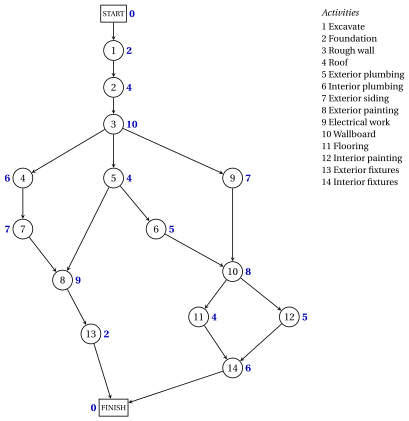

# 9.1 Projects and project networks { #sez-pm-sec-networks }

**Part 5 · Project management · Chapter 9** · [:material-book-open-variant: Chapter 9: Project management](index.md) · [:material-file-pdf-box: Lecture notes, volume 5 (PDF)](../../pdf/lecture-notes-5-project-management.pdf) · [:material-presentation: Slides](../../pdf/slides-project-management.pdf) · [:material-pencil: Exercises: Project management](../../exercises/project-management.md) · [:material-gesture-tap: App: The critical path method (CPM)](../../lab/critical-path-method.md)

!!! definizione "Definition 9.1: project"

    A <strong>project</strong> is a set of $n$ <strong>activities</strong>, numbered $1,2,\dots,n$, with the following data.

    - Every activity $j$ has a <strong>duration</strong> $d_j \in \Q_{>0}$.

    - Some pairs $(i,j)$ of activities are <strong>precedences</strong>: activity $i$ is an <strong>immediate predecessor</strong> of activity $j$, and $j$ can start only when $i$ is finished. An activity with several immediate predecessors can start only when all of them are finished.

- To describe a project we need three types of information: the <strong>activities</strong>, at the desired level of detail; the <strong>precedences</strong>, that is, the immediate predecessors of each activity; the <strong>durations</strong>, that is, an estimate of the time each activity takes.

- In the whole chapter we make two assumptions:

    - **(H1)** the durations are <strong>deterministic</strong>: every activity takes exactly its estimated duration $d_j$, without interruptions;

    - **(H2)** the resources are <strong>unlimited</strong>: activities that are not linked by precedences can be carried out at the same time.

- The method of this chapter is the <strong>critical path method</strong> (CPM). It was developed in the late 1950s, independently of the program evaluation and review technique (PERT), and the two names are often combined into PERT/CPM.

!!! definizione "Definition 9.2: project network"

    The <strong>project network</strong> of a project with $n$ activities is the directed graph $G=(N,A)$ with $N=\{0,1,\dots,n+1\}$ and the following nodes and arcs.

    - Node $j \in \{1,2,\dots,n\}$ is activity $j$. Node $0$ is the <strong>START</strong> node and node $n+1$ is the <strong>FINISH</strong> node, with durations $d_0=d_{n+1}=0$.

    - $A$ contains the arc $(i,j)$ for every precedence, the arc $(0,j)$ for every activity $j$ without immediate predecessors, and the arc $(j,n+1)$ for every activity $j$ that is not an immediate predecessor of any activity.

- This is the <strong>activity-on-node</strong> (AON) network: the activities are the nodes, and the arcs only show the precedences. In the <strong>activity-on-arc</strong> (AOA) network each activity is an arc, and a node separates an activity from its immediate predecessors.

- The AON network is easier to build, easier to read for users without experience, and easier to revise when the project changes: we always use it, and call it simply the project network.

- In practice, the project network is built by project management software from the list of activities.

!!! esempio "Example 9.1: the case study"

    A construction company has to schedule the crews that carry out the $14$ activities of a building project. The table gives, for every activity, its immediate predecessors and its estimated duration.

    
<table>
    <tr>
    <th>activity \(j\)</th>
    <th>description</th>
    <th>immediate predecessors</th>
    <th>\(d_j\)</th>
    </tr>
    <tr>
    <td>\(1\)</td>
    <td>Excavate</td>
    <td>—</td>
    <td>\(2\) weeks</td>
    </tr>
    <tr>
    <td>\(2\)</td>
    <td>Lay the foundation</td>
    <td>\(1\)</td>
    <td>\(4\) weeks</td>
    </tr>
    <tr>
    <td>\(3\)</td>
    <td>Put up the rough wall</td>
    <td>\(2\)</td>
    <td>\(10\) weeks</td>
    </tr>
    <tr>
    <td>\(4\)</td>
    <td>Put up the roof</td>
    <td>\(3\)</td>
    <td>\(6\) weeks</td>
    </tr>
    <tr>
    <td>\(5\)</td>
    <td>Install the exterior plumbing</td>
    <td>\(3\)</td>
    <td>\(4\) weeks</td>
    </tr>
    <tr>
    <td>\(6\)</td>
    <td>Install the interior plumbing</td>
    <td>\(5\)</td>
    <td>\(5\) weeks</td>
    </tr>
    <tr>
    <td>\(7\)</td>
    <td>Put up the exterior siding</td>
    <td>\(4\)</td>
    <td>\(7\) weeks</td>
    </tr>
    <tr>
    <td>\(8\)</td>
    <td>Do the exterior painting</td>
    <td>\(5\), \(7\)</td>
    <td>\(9\) weeks</td>
    </tr>
    <tr>
    <td>\(9\)</td>
    <td>Do the electrical work</td>
    <td>\(3\)</td>
    <td>\(7\) weeks</td>
    </tr>
    <tr>
    <td>\(10\)</td>
    <td>Put up the wallboard</td>
    <td>\(6\), \(9\)</td>
    <td>\(8\) weeks</td>
    </tr>
    <tr>
    <td>\(11\)</td>
    <td>Install the flooring</td>
    <td>\(10\)</td>
    <td>\(4\) weeks</td>
    </tr>
    <tr>
    <td>\(12\)</td>
    <td>Do the interior painting</td>
    <td>\(10\)</td>
    <td>\(5\) weeks</td>
    </tr>
    <tr>
    <td>\(13\)</td>
    <td>Install the exterior fixtures</td>
    <td>\(8\)</td>
    <td>\(2\) weeks</td>
    </tr>
    <tr>
    <td>\(14\)</td>
    <td>Install the interior fixtures</td>
    <td>\(11\), \(12\)</td>
    <td>\(6\) weeks</td>
    </tr>
    </table>

    Adding up the durations gives a total of $79$ weeks. Several activities can be carried out at the same time, which can reduce the project duration substantially. The project network has the $16$ nodes $0,1,\dots,15$ and $19$ arcs; next to each node, in blue, its duration.

    { .fig loading=lazy  }

    Activity $1$ is the only activity without immediate predecessors, so START has the single arc $(0,1)$; activities $13$ and $14$ are not immediate predecessors of any activity, so they enter FINISH.

## 9.1.1 Schedules and acyclic networks

!!! definizione "Definition 9.3: schedule"

    A <strong>schedule</strong> of a project is a vector $\vet{t}=(t_0,t_1,\dots,t_{n+1})$ of <strong>start times</strong> with $t_0=0$ and

    $$
    t_j \ge t_i+d_i, \quad \forall (i,j) \in A .
    $$

    Node $j$ starts at $t_j$ and finishes at $t_j+d_j$. The <strong>duration</strong> of the schedule is $t_{n+1}$, and the <strong>minimum project duration</strong> $T$ is the smallest duration of a schedule.

- The constraint of the arc $(i,j)$ says that $j$ starts after $i$ is finished. By (H1) and (H2), the precedences are the only constraints of a schedule.

- The arcs $(j,n+1)$ make FINISH start after every activity is finished: $t_{n+1}$ is the completion time of the project.

!!! teorema "Proposition 9.4: a schedule needs an acyclic network"

    A project has a schedule if and only if its project network is acyclic.

??? dimostrazione "Proof"

    No arc enters node $0$ and no arc leaves node $n+1$, so every directed cycle of $G$ is made of activities.

    1. Let $i_0,i_1,\dots,i_k=i_0$ be a directed cycle and $\vet{t}$ a schedule. Adding up the constraints of its arcs, the start times telescope:

        $$
        0=t_{i_k}-t_{i_0} \ge \sum_{s=0}^{k-1} d_{i_s} >0,
        $$

        a contradiction, since the durations of the activities are positive.

    2. Let $G$ be acyclic, and let $v_0,v_1,\dots,v_{n+1}$ be a topological order ([Chapter 3, Proposition «topological orders»](https://fabiofurini.github.io/network-optimization/trees-and-paths/shortest-paths/shortest-paths-in-acyclic-graphs/)) with $v_0=0$: node $0$ has no entering arc and can be removed first. Let $D$ be the largest duration and $t_{v_a}=a\,D$ for every $a$.

    3. Then $t_0=0$, and every arc $(v_a,v_b)$ goes forward, $a<b$, so $t_{v_b}-t_{v_a}=(b-a)\,D \ge D \ge d_{v_a}$: $\vet{t}$ is a schedule. □

- From now on the project network is acyclic. Then every activity lies on a path from START to FINISH: going backwards along the arcs we reach a node without immediate predecessors, which is linked to START, and going forwards we reach a node without successors, which is linked to FINISH.

- A cycle in the precedences is an error of the plan: an activity would have to finish before it starts.

!!! chiave ""

    A project is a set of activities with durations and precedences. Its project network has a node for every activity, plus START and FINISH, and an arc for every precedence; a schedule exists if and only if the network is acyclic.

---

**Next:** [9.2 Paths and critical paths](paths-and-critical-paths.md)
