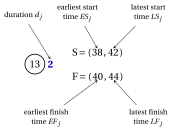
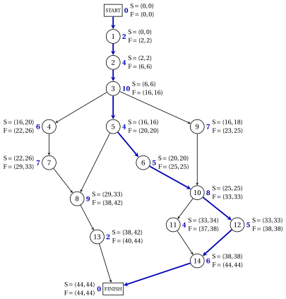

# 9.5 Slacks and critical activities { #sez-pm-sec-slacks }

**Part 5 · Project management · Chapter 9** · [:material-book-open-variant: Chapter 9: Project management](index.md) · [:material-file-pdf-box: Lecture notes, volume 5 (PDF)](../../pdf/lecture-notes-5-project-management.pdf) · [:material-pencil: Exercises: Project management](../../exercises/project-management.md)

!!! definizione "Definition 9.12: slacks and tight arcs"

    For every activity $j \in \{1,2,\dots,n\}$:

    - the <strong>total slack</strong> is $\mathit{TS}_j=\mathit{LS}_j-\mathit{ES}_j=\mathit{LF}_j-\mathit{EF}_j$;

    - the <strong>free slack</strong> is $\mathit{FS}_j=\min_{(j,k) \in \delta^+(j)} \mathit{ES}_k-\mathit{EF}_j$.

    An arc $(i,j) \in A$ is <strong>tight</strong> if $\mathit{ES}_j=\mathit{EF}_i$.

- The two differences in $\mathit{TS}_j$ coincide, since both pairs of times differ by $d_j$.

- The total slack is the delay of activity $j$ that does not delay the project; the free slack is the delay that does not move the earliest start time of any other activity. The next two results make this precise.

!!! teorema "Theorem 9.13: total slack and critical activities"

    For every activity $j$, let $L_j$ be the maximum length of a path from START to FINISH through $j$. Then:

    - **(a)** $\mathit{TS}_j=T-L_j \ge 0$, so $\mathit{TS}_j=0$ if and only if $j$ is critical;

    - **(b)** for every $\delta$ with $0 \le \delta \le \mathit{TS}_j$ there is a schedule of duration $T$ with $t_j=\mathit{ES}_j+\delta$, and no schedule of duration $T$ has $t_j>\mathit{ES}_j+\mathit{TS}_j$.

??? dimostrazione "Proof"

    1. A path from START to FINISH through $j$ is a path from START to $j$ followed by a path from $j$ to FINISH, and its length is the sum of the two lengths. Taking the longest ones, by [Theorem 9.8](the-forward-pass-earliest-times.md#box-10-pm-th-earliest) and [Theorem 9.11](the-backward-pass-latest-times.md#box-14-pm-th-latest),

        $$
        L_j=\mathit{ES}_j+\big(T-\mathit{LS}_j\big)=T-\mathit{TS}_j .
        $$

    2. Every path from START to FINISH has length at most $T$, so $\mathit{TS}_j \ge 0$, with equality if and only if a path through $j$ has length $T$, that is, $j$ is critical.

    3. If $\mathit{TS}_j>0$, let $\lambda=\delta/\mathit{TS}_j \in [0,1]$. $\mathit{ES}$ and $\mathit{LS}$ are schedules of duration $T$, and the constraints of a schedule are linear, so $(1-\lambda)\mathit{ES}+\lambda\mathit{LS}$ is a schedule of duration $T$, with $t_j=\mathit{ES}_j+\lambda\,\mathit{TS}_j=\mathit{ES}_j+\delta$. If $\mathit{TS}_j=0$, then $\delta=0$ and $\mathit{ES}$ works.

    4. By [Theorem 9.11](the-backward-pass-latest-times.md#box-14-pm-th-latest), every schedule of duration $T$ has $t_j \le \mathit{LS}_j=\mathit{ES}_j+\mathit{TS}_j$. □

!!! teorema "Proposition 9.14: free slack"

    For every activity $j$, $0 \le \mathit{FS}_j \le \mathit{TS}_j$. Moreover, for every $\delta$ with $0 \le \delta \le \mathit{FS}_j$, the start times $\mathit{ES}$ with $\mathit{ES}_j+\delta$ in place of $\mathit{ES}_j$ form a schedule of duration $T$: activity $j$ is delayed by $\delta$, and every other node keeps its earliest start time.

??? dimostrazione "Proof"

    1. By the forward pass, $\mathit{ES}_k \ge \mathit{EF}_j$ for every arc $(j,k)$, so $\mathit{FS}_j \ge 0$. Moreover $\mathit{ES}_k \le \mathit{LS}_k$ for every node $k$, by [Theorem 9.13](#box-17-pm-th-total) for the activities and since $\mathit{ES}_{n+1}=\mathit{LS}_{n+1}=T$. Hence

        $$
        \mathit{FS}_j=\min_{(j,k) \in \delta^+(j)} \mathit{ES}_k-\mathit{EF}_j \le \min_{(j,k) \in \delta^+(j)} \mathit{LS}_k-\mathit{EF}_j=\mathit{LF}_j-\mathit{EF}_j=\mathit{TS}_j .
        $$

    2. Only the constraints of the arcs of $j$ change. For $(i,j) \in \delta^-(j)$: $\mathit{ES}_j+\delta \ge \mathit{ES}_j \ge \mathit{EF}_i$. For $(j,k) \in \delta^+(j)$: $\mathit{ES}_k \ge \mathit{EF}_j+\mathit{FS}_j \ge (\mathit{ES}_j+\delta)+d_j$.

    3. The duration is still $\mathit{ES}_{n+1}=T$, since $j \neq n+1$. □

!!! teorema "Theorem 9.15: critical paths are paths of tight arcs"

    A path $P$ from START to FINISH is critical if and only if all its arcs are tight.

??? dimostrazione "Proof"

    Let $P=i_0,i_1,\dots,i_k$ with $i_0=0$ and $i_k=n+1$. Every arc has $\mathit{ES}_{i_{s+1}}-\mathit{EF}_{i_s} \ge 0$. Adding up over the arcs of $P$, the earliest start times telescope:

    $$
    \sum_{s=0}^{k-1} \big(\mathit{ES}_{i_{s+1}}-\mathit{EF}_{i_s}\big)=\mathit{ES}_{n+1}-\mathit{ES}_0-\sum_{s=0}^{k-1} d_{i_s}=T-L(P).
    $$

    A sum of non-negative terms is zero if and only if every term is zero: $L(P)=T$ if and only if every arc of $P$ is tight. □

- The critical paths are the paths from START to FINISH that use only tight arcs: to list all of them, follow the tight arcs from START.

- Every activity of a critical path has total slack zero. A path made of critical activities, instead, is critical only if its arcs are tight.

!!! esempio "Example 9.5: slacks and critical path of the case study"

    To show all the times at once, we write next to each node the pair $\mathrm{S}=(\mathit{ES}_j,\mathit{LS}_j)$ of its start times and the pair $\mathrm{F}=(\mathit{EF}_j,\mathit{LF}_j)$ of its finish times, as in the figure for activity $13$:

    { .fig loading=lazy  }

    The table collects the times and the slacks of the activities of [Example 9.3](the-forward-pass-earliest-times.md#box-12-pm-ex-forward) and [Example 9.4](the-backward-pass-latest-times.md#box-15-pm-ex-backward).

    
<table>
    <tr>
    <th>\(j\)</th>
    <th>\(d_j\)</th>
    <th>\(\mathit{ES}_j\)</th>
    <th>\(\mathit{EF}_j\)</th>
    <th>\(\mathit{LS}_j\)</th>
    <th>\(\mathit{LF}_j\)</th>
    <th>\(\mathit{TS}_j\)</th>
    <th>\(\mathit{FS}_j\)</th>
    <th>critical</th>
    </tr>
    <tr>
    <td>\(1\)</td>
    <td>\(2\)</td>
    <td>\(0\)</td>
    <td>\(2\)</td>
    <td>\(0\)</td>
    <td>\(2\)</td>
    <td>\(0\)</td>
    <td>\(0\)</td>
    <td>yes</td>
    </tr>
    <tr>
    <td>\(2\)</td>
    <td>\(4\)</td>
    <td>\(2\)</td>
    <td>\(6\)</td>
    <td>\(2\)</td>
    <td>\(6\)</td>
    <td>\(0\)</td>
    <td>\(0\)</td>
    <td>yes</td>
    </tr>
    <tr>
    <td>\(3\)</td>
    <td>\(10\)</td>
    <td>\(6\)</td>
    <td>\(16\)</td>
    <td>\(6\)</td>
    <td>\(16\)</td>
    <td>\(0\)</td>
    <td>\(0\)</td>
    <td>yes</td>
    </tr>
    <tr>
    <td>\(4\)</td>
    <td>\(6\)</td>
    <td>\(16\)</td>
    <td>\(22\)</td>
    <td>\(20\)</td>
    <td>\(26\)</td>
    <td>\(4\)</td>
    <td>\(0\)</td>
    <td></td>
    </tr>
    <tr>
    <td>\(5\)</td>
    <td>\(4\)</td>
    <td>\(16\)</td>
    <td>\(20\)</td>
    <td>\(16\)</td>
    <td>\(20\)</td>
    <td>\(0\)</td>
    <td>\(0\)</td>
    <td>yes</td>
    </tr>
    <tr>
    <td>\(6\)</td>
    <td>\(5\)</td>
    <td>\(20\)</td>
    <td>\(25\)</td>
    <td>\(20\)</td>
    <td>\(25\)</td>
    <td>\(0\)</td>
    <td>\(0\)</td>
    <td>yes</td>
    </tr>
    <tr>
    <td>\(7\)</td>
    <td>\(7\)</td>
    <td>\(22\)</td>
    <td>\(29\)</td>
    <td>\(26\)</td>
    <td>\(33\)</td>
    <td>\(4\)</td>
    <td>\(0\)</td>
    <td></td>
    </tr>
    <tr>
    <td>\(8\)</td>
    <td>\(9\)</td>
    <td>\(29\)</td>
    <td>\(38\)</td>
    <td>\(33\)</td>
    <td>\(42\)</td>
    <td>\(4\)</td>
    <td>\(0\)</td>
    <td></td>
    </tr>
    <tr>
    <td>\(9\)</td>
    <td>\(7\)</td>
    <td>\(16\)</td>
    <td>\(23\)</td>
    <td>\(18\)</td>
    <td>\(25\)</td>
    <td>\(2\)</td>
    <td>\(2\)</td>
    <td></td>
    </tr>
    <tr>
    <td>\(10\)</td>
    <td>\(8\)</td>
    <td>\(25\)</td>
    <td>\(33\)</td>
    <td>\(25\)</td>
    <td>\(33\)</td>
    <td>\(0\)</td>
    <td>\(0\)</td>
    <td>yes</td>
    </tr>
    <tr>
    <td>\(11\)</td>
    <td>\(4\)</td>
    <td>\(33\)</td>
    <td>\(37\)</td>
    <td>\(34\)</td>
    <td>\(38\)</td>
    <td>\(1\)</td>
    <td>\(1\)</td>
    <td></td>
    </tr>
    <tr>
    <td>\(12\)</td>
    <td>\(5\)</td>
    <td>\(33\)</td>
    <td>\(38\)</td>
    <td>\(33\)</td>
    <td>\(38\)</td>
    <td>\(0\)</td>
    <td>\(0\)</td>
    <td>yes</td>
    </tr>
    <tr>
    <td>\(13\)</td>
    <td>\(2\)</td>
    <td>\(38\)</td>
    <td>\(40\)</td>
    <td>\(42\)</td>
    <td>\(44\)</td>
    <td>\(4\)</td>
    <td>\(4\)</td>
    <td></td>
    </tr>
    <tr>
    <td>\(14\)</td>
    <td>\(6\)</td>
    <td>\(38\)</td>
    <td>\(44\)</td>
    <td>\(38\)</td>
    <td>\(44\)</td>
    <td>\(0\)</td>
    <td>\(0\)</td>
    <td>yes</td>
    </tr>
    </table>

    - The critical activities are $1,2,3,5,6,10,12,14$. The tight arcs from START reach FINISH only along START$,1,2,3,5,6,10,12,14,$FINISH: the critical path is unique, and its length is $T=44$ (blue in the figure).

    - The activities $4,7,8,13$ form a chain with $\mathit{TS}_{4}=\mathit{TS}_{7}=\mathit{TS}_{8}=\mathit{TS}_{13}=4$, but only the last one has free slack, $\mathit{FS}_{13}=4$. If activity $4$ starts $4$ weeks late, activities $7$, $8$, $13$ must start $4$ weeks late too, and the project still ends at week $44$.

    - Activities $9$ and $11$ have the same total and free slack, $2$ and $1$ weeks.

    { .fig loading=lazy  }

!!! attenzione "Total slacks are shared"

    The total slack of an activity is shared with the other activities of its paths: the four total slacks of the chain $4,7,8,13$ are the same $4$ weeks. If activity $4$ takes $3$ weeks more and activity $8$ takes $2$ weeks more, the path through them grows by $5>4$ weeks, and the project ends at week $45$.

!!! chiave ""

    The total slack $\mathit{TS}_j=\mathit{LS}_j-\mathit{ES}_j$ is the delay of $j$ that does not delay the project; the free slack $\mathit{FS}_j \le \mathit{TS}_j$ is the delay that does not move any other activity. The critical activities have $\mathit{TS}_j=0$, and the critical paths are the paths from START to FINISH made of tight arcs.

---

**Next:** [9.6 The critical path method](the-critical-path-method.md)
