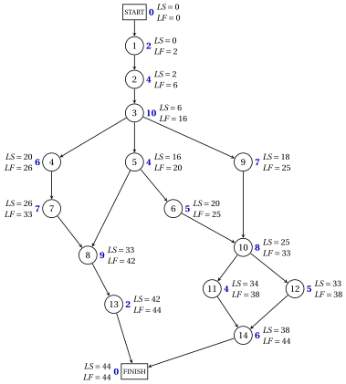

# 9.4 The backward pass: latest times { #sez-pm-sec-backward }

**Part 5 · Project management · Chapter 9** · [:material-book-open-variant: Chapter 9: Project management](index.md) · [:material-file-pdf-box: Lecture notes, volume 5 (PDF)](../../pdf/lecture-notes-5-project-management.pdf) · [:material-pencil: Exercises: Project management](../../exercises/project-management.md)

- How much later than $\mathit{ES}_j$ can an activity start without delaying the project? The latest times answer, assuming that no other delay occurs.

!!! definizione "Definition 9.10: latest start and finish times"

    Let $T=\mathit{ES}_{n+1}$. The <strong>latest finish time</strong> $\mathit{LF}_j$ and the <strong>latest start time</strong> $\mathit{LS}_j$ of the nodes are computed in the reverse topological order by the <strong>backward pass</strong>:

    $$
    \mathit{LF}_{n+1}=T, \qquad \mathit{LF}_j=\min_{(j,k) \in \delta^+(j)} \mathit{LS}_k, \quad \forall j \in N \setminus \{n+1\}, \qquad
    \mathit{LS}_j=\mathit{LF}_j-d_j, \quad \forall j \in N .
    $$

- This is the <strong>latest finish time rule</strong>: the latest finish time of an activity is the smallest latest start time of its immediate successors. The immediate successors cannot start before the activity is finished, so the activity must finish in time to let all of them start by their latest start times.

!!! teorema "Theorem 9.11: latest times"

    For every node $j \in N$, $T-\mathit{LS}_j$ is the length of a longest path from $j$ to FINISH. Moreover, $\mathit{LS}$ is a schedule of duration $T$, and every schedule $\vet{t}$ with $t_{n+1} \le T$ satisfies $t_j \le \mathit{LS}_j$ for every $j \in N$.

??? dimostrazione "Proof"

    We prove the first and the last claim by induction along the reverse topological order.

    1. <em>Node $n+1$.</em> The only path from $n+1$ to FINISH has length $0=T-\mathit{LS}_{n+1}$, and $t_{n+1} \le T=\mathit{LS}_{n+1}$.

    2. <em>Longest paths.</em> Let $j \neq n+1$. Every path from $j$ to FINISH is an arc $(j,k) \in \delta^+(j)$, of length $d_j$, followed by a path from $k$ to FINISH. By induction its maximum length is

        $$
        d_j+\max_{(j,k) \in \delta^+(j)} \big(T-\mathit{LS}_k\big)=d_j+T-\mathit{LF}_j=T-\mathit{LS}_j .
        $$

    3. <em>Upper bound.</em> For every arc $(j,k) \in \delta^+(j)$, by induction $t_j \le t_k-d_j \le \mathit{LS}_k-d_j$; hence $t_j \le \mathit{LF}_j-d_j=\mathit{LS}_j$.

    4. <em>$\mathit{LS}$ is a schedule.</em> $\mathit{LS}_k \ge \mathit{LF}_j=\mathit{LS}_j+d_j$ for every arc $(j,k) \in A$, by the minimum in the definition. Moreover $\mathit{LS}_{n+1}=T$, and $\mathit{LS}_0=T-T=0$, since a longest path from START to FINISH has length $T$. □

- In every schedule of duration $T$, node $j$ starts between $\mathit{ES}_j$ and $\mathit{LS}_j$, and both extremes are attained, by the schedules $\mathit{ES}$ and $\mathit{LS}$.

!!! esempio "Example 9.4: the backward pass on the case study"

    The backward pass processes the nodes in the order $15,14,\dots,0$. Each row gives the latest start times of the immediate successors (the minimum in bold), then $\mathit{LF}_j$ and $\mathit{LS}_j$.

    
<table>
    <tr>
    <th>node \(j\)</th>
    <th>\(d_j\)</th>
    <th>\(\mathit{LS}_k\) of the successors (\(k\))</th>
    <th>\(\mathit{LF}_j\)</th>
    <th>\(\mathit{LS}_j\)</th>
    </tr>
    <tr>
    <td>\(15\)</td>
    <td>\(0\)</td>
    <td>—</td>
    <td>\(44\)</td>
    <td>\(44\)</td>
    </tr>
    <tr>
    <td>\(14\)</td>
    <td>\(6\)</td>
    <td>\(\mathbf{44}\) (\(15\))</td>
    <td>\(44\)</td>
    <td>\(38\)</td>
    </tr>
    <tr>
    <td>\(13\)</td>
    <td>\(2\)</td>
    <td>\(\mathbf{44}\) (\(15\))</td>
    <td>\(44\)</td>
    <td>\(42\)</td>
    </tr>
    <tr>
    <td>\(12\)</td>
    <td>\(5\)</td>
    <td>\(\mathbf{38}\) (\(14\))</td>
    <td>\(38\)</td>
    <td>\(33\)</td>
    </tr>
    <tr>
    <td>\(11\)</td>
    <td>\(4\)</td>
    <td>\(\mathbf{38}\) (\(14\))</td>
    <td>\(38\)</td>
    <td>\(34\)</td>
    </tr>
    <tr>
    <td>\(10\)</td>
    <td>\(8\)</td>
    <td>\(34\) (\(11\)), \(\mathbf{33}\) (\(12\))</td>
    <td>\(33\)</td>
    <td>\(25\)</td>
    </tr>
    <tr>
    <td>\(9\)</td>
    <td>\(7\)</td>
    <td>\(\mathbf{25}\) (\(10\))</td>
    <td>\(25\)</td>
    <td>\(18\)</td>
    </tr>
    <tr>
    <td>\(8\)</td>
    <td>\(9\)</td>
    <td>\(\mathbf{42}\) (\(13\))</td>
    <td>\(42\)</td>
    <td>\(33\)</td>
    </tr>
    <tr>
    <td>\(7\)</td>
    <td>\(7\)</td>
    <td>\(\mathbf{33}\) (\(8\))</td>
    <td>\(33\)</td>
    <td>\(26\)</td>
    </tr>
    <tr>
    <td>\(6\)</td>
    <td>\(5\)</td>
    <td>\(\mathbf{25}\) (\(10\))</td>
    <td>\(25\)</td>
    <td>\(20\)</td>
    </tr>
    <tr>
    <td>\(5\)</td>
    <td>\(4\)</td>
    <td>\(\mathbf{20}\) (\(6\)), \(33\) (\(8\))</td>
    <td>\(20\)</td>
    <td>\(16\)</td>
    </tr>
    <tr>
    <td>\(4\)</td>
    <td>\(6\)</td>
    <td>\(\mathbf{26}\) (\(7\))</td>
    <td>\(26\)</td>
    <td>\(20\)</td>
    </tr>
    <tr>
    <td>\(3\)</td>
    <td>\(10\)</td>
    <td>\(20\) (\(4\)), \(\mathbf{16}\) (\(5\)), \(18\) (\(9\))</td>
    <td>\(16\)</td>
    <td>\(6\)</td>
    </tr>
    <tr>
    <td>\(2\)</td>
    <td>\(4\)</td>
    <td>\(\mathbf{6}\) (\(3\))</td>
    <td>\(6\)</td>
    <td>\(2\)</td>
    </tr>
    <tr>
    <td>\(1\)</td>
    <td>\(2\)</td>
    <td>\(\mathbf{2}\) (\(2\))</td>
    <td>\(2\)</td>
    <td>\(0\)</td>
    </tr>
    <tr>
    <td>\(0\)</td>
    <td>\(0\)</td>
    <td>\(\mathbf{0}\) (\(1\))</td>
    <td>\(0\)</td>
    <td>\(0\)</td>
    </tr>
    </table>

    The pass ends with $\mathit{LS}_0=0$, as [Theorem 9.11](#box-14-pm-th-latest) predicts. For example, activity $9$ must finish by $\mathit{LF}_9=\mathit{LS}_{10}=25$, so it must start by $\mathit{LS}_9=18$, two weeks after its earliest start time $\mathit{ES}_9=16$. In the figure, next to each node, its duration (blue) and its latest times.

    { .fig loading=lazy  }

!!! chiave ""

    The backward pass computes, in reverse topological order, $\mathit{LF}_j=\min \mathit{LS}_k$ over the immediate successors and $\mathit{LS}_j=\mathit{LF}_j-d_j$, starting from $\mathit{LF}_{n+1}=T$. $T-\mathit{LS}_j$ is the length of a longest path from $j$ to FINISH, and in every schedule of duration $T$ node $j$ starts between $\mathit{ES}_j$ and $\mathit{LS}_j$.

---

**Next:** [9.5 Slacks and critical activities](slacks-and-critical-activities.md)
