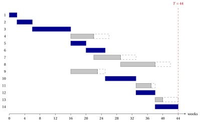

# 9.6 The critical path method { #sez-pm-sec-cpm }

**Part 5 · Project management · Chapter 9** · [:material-book-open-variant: Chapter 9: Project management](index.md) · [:material-file-pdf-box: Lecture notes, volume 5 (PDF)](../../pdf/lecture-notes-5-project-management.pdf) · [:material-pencil: Exercises: Project management](../../exercises/project-management.md)

!!! algoritmo "Algorithm: Critical path method (CPM)"

    

<strong>Input:</strong> a project with activities \(1,2,\dots,n\), durations \(d_j>0\) and precedences

<strong>Output:</strong> the times \(\mathit{ES}_j\), \(\mathit{EF}_j\), \(\mathit{LS}_j\), \(\mathit{LF}_j\), the slacks, the minimum project duration \(T\) and the tight arcs

1<strong>Step 0 (network).</strong> Build the project network \(G=(N,A)\) and a topological order: repeatedly remove a node
    without entering arcs (the smallest index, if more than one).

2  If nodes are left and all of them have entering arcs, <code>STOP</code>: the precedences contain a cycle.

3<strong>Step 1 (forward pass).</strong> Set \(\mathit{ES}_0:=0\). For each node \(j \neq 0\) in topological order, set
    \(\mathit{ES}_j:=\max_{(i,j) \in \delta^-(j)} \mathit{EF}_i\); set \(\mathit{EF}_j:=\mathit{ES}_j+d_j\) for every \(j\), and \(T:=\mathit{ES}_{n+1}\).

4<strong>Step 2 (backward pass).</strong> Set \(\mathit{LF}_{n+1}:=T\). For each node \(j \neq n+1\) in reverse topological order, set
    \(\mathit{LF}_j:=\min_{(j,k) \in \delta^+(j)} \mathit{LS}_k\); set \(\mathit{LS}_j:=\mathit{LF}_j-d_j\) for every \(j\).

5<strong>Step 3 (slacks).</strong> For every activity \(j\), set \(\mathit{TS}_j:=\mathit{LS}_j-\mathit{ES}_j\) and \(\mathit{FS}_j:=\min_{(j,k) \in \delta^+(j)} \mathit{ES}_k-\mathit{EF}_j\); mark the tight arcs, \(\mathit{ES}_j=\mathit{EF}_i\). The critical paths are the paths of tight arcs from START to
    FINISH.

6<code>STOP</code>.

!!! teorema "Theorem 9.16: running time of the critical path method"

    The critical path method runs in $O(n+m)$ time, where $m=|A|$.

??? dimostrazione "Proof"

    1. Step 0 builds the arcs from the lists of immediate predecessors, plus at most $2n$ arcs of START and FINISH. The topological order takes $O(n+m)$ time, with a counter of the entering arcs of every node, as in [Chapter 3](https://fabiofurini.github.io/network-optimization/trees-and-paths/shortest-paths/shortest-paths-in-acyclic-graphs/).

    2. Step 1 scans every arc once, as an entering arc of its head; Step 2 scans every arc once, as a leaving arc of its tail.

    3. Step 3 scans the leaving arcs of every activity once more, and marks the tight arcs with one comparison per arc. □

- The output gives the subgraph of the tight arcs, and its paths from START to FINISH are the critical paths ([Theorem 9.15](slacks-and-critical-activities.md#box-19-pm-th-tight)). Listing them one by one can take longer, when they are many.

## 9.6.1 The Gantt chart

!!! definizione "Definition 9.17: Gantt chart"

    The <strong>Gantt chart</strong> of a schedule $\vet{t}$ has a time axis and one row for every activity: the row of activity $j$ has a bar from $t_j$ to $t_j+d_j$.

- The chart shows at a glance which activities are in progress at every time. We draw the earliest schedule $\mathit{ES}$, with the bars of the critical activities in blue, and a dashed box from $\mathit{EF}_j$ to $\mathit{LF}_j$ that shows the total slack of each non-critical activity.

!!! esempio "Example 9.6: the Gantt chart of the case study"

    The Gantt chart of the earliest schedule of the case study, in weeks:

    { .fig loading=lazy  }

    - The blue bars of the critical activities follow each other without gaps from week $0$ to week $44$: a delay on any of them delays the project.

    - At week $16$ the activities $4$, $5$ and $9$ start together: by (H2), three crews work in parallel.

    - The dashed boxes of the chain $4,7,8,13$ are all $4$ weeks long, but the bars of the chain follow each other: the $4$ weeks of slack are shared.

!!! chiave ""

    The critical path method builds the network and a topological order, runs the forward and the backward pass and computes the slacks, in $O(n+m)$ time. The Gantt chart of the earliest schedule shows the activities in progress at every time, the critical path and the slacks.

---

**Next:** [9.7 The linear programming model](the-linear-programming-model.md)
