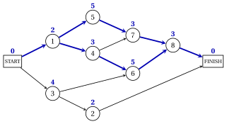

# 9.8 Two critical paths and changes of durations

**Part 5 · Project management · Chapter 9** · [:material-book-open-variant: Chapter 9: Project management](index.md) · [:material-file-pdf-box: Lecture notes, volume 5 (PDF)](../../pdf/lecture-notes-5-project-management.pdf) · [:material-presentation: Slides](../../pdf/slides-project-management.pdf) · [:material-pencil: Exercises: Project management](../../exercises/project-management.md) · [:material-gesture-tap: App: The critical path method (CPM)](../../lab/critical-path-method.md)

- A planner often asks what happens to the project if one activity takes longer, or if more crews make it shorter. The slacks and the critical paths answer without running the method again.

!!! teorema "Proposition 9.19: changing one duration"

    Let $j$ be an activity, $\delta>0$, and $T'$ the minimum project duration after the change.

    - **(a)** If $d_j$ increases by $\delta$, then $T'=T+\max\{0,\,\delta-\mathit{TS}_j\}$.

    - **(b)** If $d_j$ decreases by $\delta<d_j$, then $T-\delta \le T' \le T$, and $T'=T$ if some critical path does not contain $j$.

??? dimostrazione "Proof"

    By [Theorem 9.9](the-forward-pass-earliest-times.md#box-11-pm-th-duration), the minimum project duration is the maximum length of a path from START to FINISH. The change modifies by $\pm\delta$ the length of the paths through $j$, and only of them.

    - **(a)** By [Theorem 9.13](slacks-and-critical-activities.md#box-17-pm-th-total), the longest paths through $j$ grow to $L_j+\delta=T-\mathit{TS}_j+\delta$. If $\mathit{TS}_j>0$, the critical paths avoid $j$ and keep the length $T$; if $\mathit{TS}_j=0$, the paths avoiding $j$ have length at most $T<T+\delta$. In both cases $T'=\max\{T,\,T-\mathit{TS}_j+\delta\}$.

    - **(b)** No path grows and every path loses at most $\delta$, so $T-\delta \le T' \le T$. A critical path that avoids $j$ keeps the length $T$.

    
□

!!! esempio "Example 9.8: a project with two critical paths"

    A project has $8$ activities with the immediate predecessors and the durations of the table.

    
<table>
    <tr>
    <th>activity \(j\)</th>
    <th>immediate predecessors</th>
    <th>\(d_j\)</th>
    </tr>
    <tr>
    <td>\(1\)</td>
    <td>—</td>
    <td>\(2\) days</td>
    </tr>
    <tr>
    <td>\(2\)</td>
    <td>\(3\)</td>
    <td>\(2\) days</td>
    </tr>
    <tr>
    <td>\(3\)</td>
    <td>—</td>
    <td>\(4\) days</td>
    </tr>
    <tr>
    <td>\(4\)</td>
    <td>\(1\)</td>
    <td>\(3\) days</td>
    </tr>
    <tr>
    <td>\(5\)</td>
    <td>\(1\)</td>
    <td>\(5\) days</td>
    </tr>
    <tr>
    <td>\(6\)</td>
    <td>\(3\), \(4\)</td>
    <td>\(5\) days</td>
    </tr>
    <tr>
    <td>\(7\)</td>
    <td>\(4\), \(5\)</td>
    <td>\(3\) days</td>
    </tr>
    <tr>
    <td>\(8\)</td>
    <td>\(6\), \(7\)</td>
    <td>\(3\) days</td>
    </tr>
    </table>

    Activity $2$ follows activity $3$, so the topological order is not the natural one. START frees $1$ and $3$; node $1$ is removed first and frees $4$ and $5$; then $3$ is the free node of smallest index and frees $2$, which comes before $4$. The order is $0,1,3,2,4,5,6,7,8,9$, and the forward and the backward pass give:

    
<table>
    <tr>
    <th>\(j\)</th>
    <th>\(d_j\)</th>
    <th>\(\mathit{ES}_j\)</th>
    <th>\(\mathit{EF}_j\)</th>
    <th>\(\mathit{LS}_j\)</th>
    <th>\(\mathit{LF}_j\)</th>
    <th>\(\mathit{TS}_j\)</th>
    <th>\(\mathit{FS}_j\)</th>
    <th>critical</th>
    </tr>
    <tr>
    <td>\(1\)</td>
    <td>\(2\)</td>
    <td>\(0\)</td>
    <td>\(2\)</td>
    <td>\(0\)</td>
    <td>\(2\)</td>
    <td>\(0\)</td>
    <td>\(0\)</td>
    <td>yes</td>
    </tr>
    <tr>
    <td>\(2\)</td>
    <td>\(2\)</td>
    <td>\(4\)</td>
    <td>\(6\)</td>
    <td>\(11\)</td>
    <td>\(13\)</td>
    <td>\(7\)</td>
    <td>\(7\)</td>
    <td></td>
    </tr>
    <tr>
    <td>\(3\)</td>
    <td>\(4\)</td>
    <td>\(0\)</td>
    <td>\(4\)</td>
    <td>\(1\)</td>
    <td>\(5\)</td>
    <td>\(1\)</td>
    <td>\(0\)</td>
    <td></td>
    </tr>
    <tr>
    <td>\(4\)</td>
    <td>\(3\)</td>
    <td>\(2\)</td>
    <td>\(5\)</td>
    <td>\(2\)</td>
    <td>\(5\)</td>
    <td>\(0\)</td>
    <td>\(0\)</td>
    <td>yes</td>
    </tr>
    <tr>
    <td>\(5\)</td>
    <td>\(5\)</td>
    <td>\(2\)</td>
    <td>\(7\)</td>
    <td>\(2\)</td>
    <td>\(7\)</td>
    <td>\(0\)</td>
    <td>\(0\)</td>
    <td>yes</td>
    </tr>
    <tr>
    <td>\(6\)</td>
    <td>\(5\)</td>
    <td>\(5\)</td>
    <td>\(10\)</td>
    <td>\(5\)</td>
    <td>\(10\)</td>
    <td>\(0\)</td>
    <td>\(0\)</td>
    <td>yes</td>
    </tr>
    <tr>
    <td>\(7\)</td>
    <td>\(3\)</td>
    <td>\(7\)</td>
    <td>\(10\)</td>
    <td>\(7\)</td>
    <td>\(10\)</td>
    <td>\(0\)</td>
    <td>\(0\)</td>
    <td>yes</td>
    </tr>
    <tr>
    <td>\(8\)</td>
    <td>\(3\)</td>
    <td>\(10\)</td>
    <td>\(13\)</td>
    <td>\(10\)</td>
    <td>\(13\)</td>
    <td>\(0\)</td>
    <td>\(0\)</td>
    <td>yes</td>
    </tr>
    </table>

    - $T=13$, and two paths of tight arcs go from START to FINISH: START$,1,4,6,8,$FINISH and START$,1,5,7,8,$FINISH, both of length $13$ (blue in the figure, with the durations above the nodes).

    - Activity $3$ has $\mathit{TS}_3=1$ and $\mathit{FS}_3=0$: one day of delay moves the earliest start time of activity $2$, not the end of the project. Activity $2$ has $\mathit{TS}_2=\mathit{FS}_2=7$.

    - The path START$,1,4,7,8,$FINISH uses only critical activities, but its arc $(4,7)$ is not tight, $\mathit{EF}_4=5<7=\mathit{ES}_7$: its length is $2+3+3+3=11$, and it is not critical.

    { .fig loading=lazy  }

!!! esempio "Example 9.9: changes of one duration"

    We change one duration at a time in the project of [Example 9.8](#box-27-pm-ex-two); the new duration and the critical paths are computed by the critical path method, and agree with [Proposition 9.19](#box-26-pm-prop-change).

    
<table>
    <tr>
    <th>change</th>
    <th>\(\mathit{TS}_j\)</th>
    <th>new \(T\)</th>
    <th>critical paths after the change</th>
    </tr>
    <tr>
    <td>\(d_5=5 \to 4\)</td>
    <td>\(0\)</td>
    <td>\(13\)</td>
    <td>\(\text{START},1,4,6,8,\text{FINISH}\)</td>
    </tr>
    <tr>
    <td>\(d_8=3 \to 2\)</td>
    <td>\(0\)</td>
    <td>\(12\)</td>
    <td>\(\text{START},1,4,6,8,\text{FINISH}\); \(\text{START},1,5,7,8,\text{FINISH}\)</td>
    </tr>
    <tr>
    <td>\(d_3=4 \to 6\)</td>
    <td>\(1\)</td>
    <td>\(14\)</td>
    <td>\(\text{START},3,6,8,\text{FINISH}\)</td>
    </tr>
    </table>

    - Shortening activity $5$ by one day does not shorten the project: the critical path START$,1,4,6,8,$FINISH avoids activity $5$, and $T'=T=13$ by (b). Only one critical path is left.

    - Activity $8$ lies on both critical paths: shortening it by one day gives $T'=T-1=12$, and both paths stay critical.

    - Activity $3$ takes $2$ days more, more than its total slack $\mathit{TS}_3=1$: by (a), $T'=13+(2-1)=14$, and START$,3,6,8,$FINISH becomes the critical path.

!!! attenzione "Shortening a project"

    To shorten a project, every critical path must become shorter. When there are several critical paths, an activity that lies on only one of them does not help: shorten an activity common to all of them, or one activity on each.

!!! chiave ""

    If $d_j$ grows by $\delta$, the project lasts $\max\{0,\delta-\mathit{TS}_j\}$ more. If $d_j$ decreases, the project gains at most the same amount, and nothing if a critical path avoids $j$: with several critical paths, all of them must be shortened.

## 9.9 Typical mistakes

!!! attenzione "Warning"

    - <strong>Adding up all the durations.</strong> The case study lasts $T=44$ weeks, not $79$: activities that are not linked by precedences run in parallel.

    - <strong>Taking the minimum in the forward pass.</strong> An activity starts when <em>all</em> its immediate predecessors are finished: $\mathit{ES}_j$ is the maximum of their earliest finish times. Symmetrically, $\mathit{LF}_j$ is the minimum of the latest start times of the successors.

    - <strong>Forgetting START, FINISH and their arcs.</strong> Every activity without immediate predecessors needs the arc from START, and every activity without successors the arc to FINISH.

    - <strong>Adding up total slacks along a path.</strong> The chain $4,7,8,13$ of the case study has $4$ weeks of slack in all, not $16$.

    - <strong>Confusing total and free slack.</strong> A delay larger than $\mathit{FS}_j$ moves other activities, even when it does not delay the project.

    - <strong>Reading a critical path from the critical activities only.</strong> In [Example 9.8](#box-27-pm-ex-two) the path START$,1,4,7,8,$FINISH has only critical activities, and it is not critical: check that the arcs are tight.

    - <strong>Shortening an activity on one of several critical paths.</strong> The project duration does not change.

    - <strong>Accepting precedences with a cycle.</strong> No schedule exists, and the topological order stops before ordering all the nodes.

## 9.10 In summary

!!! chiave "In summary"

    - A project has activities with deterministic durations and precedences; its project network has a node for every activity, plus START and FINISH, and must be acyclic.

    - The length of a path from START to FINISH is the total duration of its activities; every schedule lasts at least as long as every path, and the critical paths are the longest ones.

    - The forward pass gives $\mathit{ES}_j=\max \mathit{EF}_i$ and $T=\mathit{ES}_{n+1}$, the length of a critical path; the backward pass gives $\mathit{LF}_j=\min \mathit{LS}_k$ starting from $\mathit{LF}_{n+1}=T$.

    - $\mathit{TS}_j=\mathit{LS}_j-\mathit{ES}_j$ is the delay that does not delay the project, $\mathit{FS}_j \le \mathit{TS}_j$ the delay that does not move other activities; the critical paths are the paths of tight arcs.

    - The $\mathrm{PD}$ model $\min\{t_{n+1}-t_0 : t_j-t_i \ge d_i\}$ has the longest path model as its dual, and both have optimal value $T$.

    - Increasing $d_j$ by $\delta$ delays the project by $\max\{0,\delta-\mathit{TS}_j\}$; shortening helps only if every critical path becomes shorter.

    <strong>The two projects at a glance.</strong>

    
<table>
    <tr>
    <th>case study</th>
    <th>\(14\) activities, \(79\) weeks in all; \(T=44\) weeks</th>
    </tr>
    <tr>
    <td>critical path</td>
    <td>\(\text{START},1,2,3,5,6,10,12,14,\text{FINISH}\)</td>
    </tr>
    <tr>
    <td>non-critical \(j\) (\(\mathit{TS}_j,\mathit{FS}_j\))</td>
    <td>\(4\) (\(4,0\)), \(7\) (\(4,0\)), \(8\) (\(4,0\)), \(9\) (\(2,2\)), \(11\) (\(1,1\)), \(13\) (\(4,4\))</td>
    </tr>
    <tr>
    <td>LP models</td>
    <td>\(z(\mathrm{PD})=z(D(\mathrm{PD}))=44\); \(\mathit{ES}\) and \(\mathit{LS}\) optimal</td>
    </tr>
    <tr>
    <td>second example</td>
    <td>\(T=13\), 2 critical paths:</td>
    </tr>
    <tr>
    <td></td>
    <td>\(\text{START},1,4,6,8,\text{FINISH}\) and \(\text{START},1,5,7,8,\text{FINISH}\)</td>
    </tr>
    <tr>
    <td>changes</td>
    <td>\(d_5=5\to 4\): \(T=13\); \(d_8=3\to 2\): \(T=12\); \(d_3=4\to 6\): \(T=14\)</td>
    </tr>
    </table>

---

**Exercises on this chapter:** [:material-pencil: Project management](../../exercises/project-management.md)

