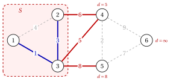

# Minimum spanning trees

**Part 2 · Trees and paths · Chapter 2** · [:material-file-pdf-box: Lecture notes, volume 2 (PDF)](../pdf/lecture-notes-2-trees-and-paths.pdf) · [:material-pencil: Exercises: Spanning trees](../exercises/minimum-spanning-trees.md) · [:material-gesture-tap: App: Minimum spanning trees: Kruskal and Prim](../lab/minimum-spanning-tree-kruskal-prim.md)

!!! nota "Prerequisites"

    - The chapter [<u>«Graphs»</u>](https://fabiofurini.github.io/network-optimization/graphs/graphs/): paths and cycles, connected components, the characterizations of a tree and the fundamental cycles.

    - The $O(\cdot)$ notation for the running time of an algorithm, and sorting $m$ numbers in $O(m\log m)$ time.

!!! chiave "Objectives"

    At the end of this chapter you will be able to:

    - state the minimum spanning tree problem and recognize it in applications;

    - prove the cut property and the cycle property, and use them to certify that a spanning tree is optimal;

    - run the algorithms of Kruskal and of Prim, prove that they are correct and analyse their running time;

    - decide whether the minimum spanning tree is unique, and find the edges that belong to every optimal tree.

## 2.1 The minimum spanning tree problem { #sez-sec-mst-problem }

!!! definizione "Definition 2.1: minimum spanning tree problem"

    Let $G=(V,E)$ be a connected undirected graph with $n=|V|$ vertices and $m=|E|$ edges, and let every edge $e \in E$ have a <strong>weight</strong> $w_e \in \R$. The <strong>weight</strong> of a set of edges $F \subseteq E$ is

    $$
    w(F)=\sum_{e \in F} w_e .
    $$

    The <strong>minimum spanning tree problem</strong> (MST) asks for a spanning tree $\tilde{T}=(V,\tilde{F})$ of $G$ of minimum weight:

    $$
    w(\tilde{F}) \le w(F) \qquad \text{for every spanning tree } (V,F) \text{ of } G .
    $$

    A spanning tree of minimum weight is a <strong>minimum spanning tree</strong>. We write $w_{uv}$ for the weight of the edge $\{u,v\}$, and we identify a spanning tree with its set of edges.

- A connected graph has a spanning tree, and it has finitely many of them: a minimum spanning tree always exists. Every spanning tree has $n-1$ edges.

- The weights can be negative. Adding the same constant to every weight adds $(n-1)$ times that constant to the weight of every spanning tree, so the minimum spanning trees do not change.

- A <strong>maximum spanning tree</strong> is a minimum spanning tree for the weights $-w_e$.

!!! esempio "Example 2.1: the weighted reference graph"

    We take the underlying undirected graph of the reference graph of the chapter [«Graphs»](https://fabiofurini.github.io/network-optimization/graphs/graphs/), with $n=6$ vertices, $m=9$ edges and the weights

    
<table>
    <tr>
    <th>edge</th>
    <th>\(\{1,2\}\)</th>
    <th>\(\{1,3\}\)</th>
    <th>\(\{2,3\}\)</th>
    <th>\(\{2,4\}\)</th>
    <th>\(\{3,4\}\)</th>
    <th>\(\{3,5\}\)</th>
    <th>\(\{4,5\}\)</th>
    <th>\(\{4,6\}\)</th>
    <th>\(\{5,6\}\)</th>
    </tr>
    <tr>
    <td>\(w_e\)</td>
    <td>\(4\)</td>
    <td>\(1\)</td>
    <td>\(3\)</td>
    <td>\(6\)</td>
    <td>\(5\)</td>
    <td>\(8\)</td>
    <td>\(2\)</td>
    <td>\(9\)</td>
    <td>\(7\)</td>
    </tr>
    </table>

    { .fig loading=lazy  }

    We call this graph the <strong>weighted reference graph</strong>: all the examples of the chapter use it. The weights are the distinct integers $1,2,\dots,9$.

!!! esempio "Example 2.2: the minimum spanning tree of the reference graph"

    The weighted reference graph has $55$ spanning trees. Enumerating all of them, the minimum weight is $18$, attained only by the tree (blue in the figure)

    $$
    \tilde{F}=\big\{\{1,3\},\{2,3\},\{3,4\},\{4,5\},\{5,6\}\big\}, \qquad w(\tilde{F})=1+3+5+2+7=18 .
    $$

    { .fig loading=lazy  }

    The spanning tree $\{1,2\},\{1,3\},\{2,4\},\{3,5\},\{4,6\}$ found by the breadth-first search in the chapter [«Graphs»](../graphs/graphs/index.md) weighs $4+1+6+8+9=28$, and a maximum spanning tree weighs $34$.

- Enumerating the spanning trees is practical only on tiny graphs: the reference graph, with $6$ vertices and $9$ edges, already has $55$. The algorithms of this chapter find a minimum spanning tree in polynomial time.

### 2.1.1 Applications

- <strong>Network design.</strong> Vertices are sites (offices, houses, plants) and $w_{uv}$ is the cost of a direct link (a cable, a pipe, a road); the cheapest network connecting all the sites is a minimum spanning tree.

- <strong>Clustering.</strong> Removing the $k-1$ heaviest edges of a minimum spanning tree splits the vertices into $k$ groups of close points (single-linkage clustering).

- <strong>Subproblem.</strong> Minimum spanning trees give lower bounds for the travelling salesman problem and a starting point for heuristic algorithms for network design.

!!! chiave ""

    A minimum spanning tree connects all the vertices of a connected weighted graph with $n-1$ edges of minimum total weight; on the weighted reference graph it is unique and weighs $18$.

## 2.2 Cuts and cycles { #sez-sec-mst-cuts }

!!! definizione "Definition 2.2: cut"

    Let $G=(V,E)$ be an undirected graph and $S \subseteq V$ with $\emptyset \neq S \neq V$. The <strong>cut</strong> defined by $S$ is the set of the edges with exactly one endpoint in $S$:

    $$
    \delta(S)=\big\{\, \{u,v\} \in E : u \in S,~ v \notin S \,\big\}.
    $$

    An edge of $\delta(S)$ <strong>crosses</strong> the cut. For a single vertex, $\delta(\{v\})=\delta(v)$ is the set of the edges incident to $v$.

- A graph is connected if and only if every cut $\delta(S)$ is nonempty: an empty cut separates $S$ from $V \setminus S$, and a path from $u \in S$ to $v \notin S$ must use an edge of $\delta(S)$.

- In the weighted reference graph, $\delta(\{1,2,3\})=\{\{2,4\},\{3,4\},\{3,5\}\}$ and $\delta(\{6\})=\{\{4,6\},\{5,6\}\}$.

!!! teorema "Lemma 2.3: a cycle crosses a cut an even number of times"

    Let $C$ be a cycle of $G$ and $\delta(S)$ a cut. Then $|C \cap \delta(S)|$ is even. In particular, if a cycle contains an edge of $\delta(S)$, it contains at least one other edge of $\delta(S)$.

??? dimostrazione "Proof"

    Let the cycle visit $v_0,v_1,\dots,v_k=v_0$. The edge $\{v_{t-1},v_t\}$ crosses the cut if and only if $v_{t-1}$ and $v_t$ lie on different sides. Walking along the cycle, the side changes at every crossing edge and only there; the walk ends at $v_0$, on the side where it started, so the number of changes is even. □

!!! definizione "Definition 2.4: fundamental cut"

    Let $T$ be a spanning tree of a connected graph $G=(V,E)$ and $e=\{u,v\} \in T$. The graph $T \setminus \{e\}$ has two connected components; let $S_e$ be the one that contains $u$. The <strong>fundamental cut</strong> of $e$ is $\delta(S_e)$.

- $T \setminus \{e\}$ has $n-2$ edges and no cycle, so it has $n-(n-2)=2$ components ([Corollary «edges and components»](https://fabiofurini.github.io/network-optimization/graphs/graphs/trees-and-forests/)); $v$ is not in $S_e$, otherwise the path from $u$ to $v$ in $T$ would not be unique.

- The only edge of $T$ in the fundamental cut of $e$ is $e$ itself: every other edge of $T$ lies inside one of the two components.

!!! teorema "Lemma 2.5: exchange"

    Let $T$ be a spanning tree of a connected graph $G=(V,E)$.

    1. If $e \notin T$ and $f$ is an edge of the fundamental cycle $C(T,e)$, then $T \cup \{e\} \setminus \{f\}$ is a spanning tree.

    2. If $f \in T$ and $e \notin T$ crosses the fundamental cut of $f$, then $f \in C(T,e)$, and $T \cup \{e\} \setminus \{f\}$ is a spanning tree.

??? dimostrazione "Proof"

    1. The rest of $C(T,e)$ joins the endpoints of $f$, so removing $f$ from the connected graph $T \cup \{e\}$ leaves it connected. The result is connected with $n-1$ edges: it is a spanning tree by the [characterizations of a tree](https://fabiofurini.github.io/network-optimization/graphs/graphs/trees-and-forests/), (b).

    2. The endpoints of $e$ lie on different sides of the fundamental cut $\delta(S_f)$. The path between them in $T$ is part of $C(T,e)$, and it must cross $\delta(S_f)$ with an edge of $T$; the only one is $f$. Part 1 concludes. □

!!! esempio "Example 2.3: cuts and cycles of the reference graph"

    The figure shows the cut $\delta(\{1,2,3\})$ (red edges) and the cycle $3,4,5$ (shaded in blue): the cycle uses the edges $\{3,4\}$ and $\{3,5\}$ of the cut, an even number.

    { .fig loading=lazy  }

    For the minimum spanning tree $\tilde{F}$ of [Example 2.2](#box-3-mst-ex-opt), the fundamental cut of $\{3,4\}$ is $\delta(\{1,2,3\})$, and the fundamental cycle of $\{3,5\}$ is $C(\tilde{F},\{3,5\})=3,4,5,3$.

!!! chiave ""

    A cycle crosses every cut an even number of times. Adding an edge to a spanning tree and removing any edge of the cycle it closes gives another spanning tree.

## 2.3 The cut property and the cycle property { #sez-sec-mst-properties }

!!! teorema "Theorem 2.6: cut property"

    Let $G=(V,E)$ be a connected graph with weights $w_e$, and let $F \subseteq E$ be contained in some minimum spanning tree. Let $\delta(S)$ be a cut with $F \cap \delta(S)=\emptyset$, and let $e$ be an edge of minimum weight in $\delta(S)$.

    - **(a)** $F \cup \{e\}$ is contained in some minimum spanning tree.

    - **(b)** If $w_e<w_f$ for every $f \in \delta(S) \setminus \{e\}$, then $e$ belongs to every minimum spanning tree.

??? dimostrazione "Proof"

    Let $T^\star$ be a minimum spanning tree with $F \subseteq T^\star$; for (b), let $T^\star$ be any minimum spanning tree and $F=\emptyset$. If $e \in T^\star$ there is nothing to prove; let $e \notin T^\star$.

    1. The fundamental cycle $C(T^\star,e)$ contains the edge $e$ of $\delta(S)$, so it contains another edge $f \in \delta(S)$, $f \neq e$ ([Lemma 2.3](#box-5-mst-lem-even)). All its edges other than $e$ are in $T^\star$, so $f \in T^\star$; and $f \notin F$, since $F \cap \delta(S)=\emptyset$.

    2. By [Lemma 2.5](#box-7-mst-lem-exchange), $T'=T^\star \cup \{e\} \setminus \{f\}$ is a spanning tree, with $w(T')=w(T^\star)+w_e-w_f$.

    3. (a) $e$ has minimum weight in $\delta(S)$, so $w_e \le w_f$ and $w(T') \le w(T^\star)$: $T'$ is a minimum spanning tree containing $F \cup \{e\}$.

    4. (b) Here $w_e<w_f$ and $w(T')<w(T^\star)$, against the optimality of $T^\star$: hence $e \in T^\star$. □

!!! teorema "Theorem 2.7: cycle property"

    Let $G=(V,E)$ be a connected graph with weights $w_e$, let $C$ be a cycle of $G$ and $e$ an edge of maximum weight in $C$.

    - **(a)** Some minimum spanning tree does not contain $e$.

    - **(b)** If $w_e>w_f$ for every $f \in C \setminus \{e\}$, then no minimum spanning tree contains $e$.

??? dimostrazione "Proof"

    Let $T^\star$ be a minimum spanning tree with $e \in T^\star$ (if there is none, both claims hold), and let $\delta(S_e)$ be the fundamental cut of $e$ in $T^\star$.

    1. The cycle $C$ contains the edge $e$ of $\delta(S_e)$, so it contains another edge $f \in \delta(S_e)$ ([Lemma 2.3](#box-5-mst-lem-even)); $f \notin T^\star$, because $e$ is the only edge of $T^\star$ in its fundamental cut.

    2. By [Lemma 2.5](#box-7-mst-lem-exchange)(2), $T'=T^\star \cup \{f\} \setminus \{e\}$ is a spanning tree, with $w(T')=w(T^\star)+w_f-w_e$.

    3. (a) $w_f \le w_e$, so $T'$ is a minimum spanning tree without $e$. (b) $w_f<w_e$ would give $w(T')<w(T^\star)$, a contradiction: no minimum spanning tree contains $e$. □

!!! esempio "Example 2.4: the two properties on the reference graph"

    - <em>Cut property.</em> The edge $\{3,4\}$, of weight $5$, is the unique lightest edge of $\delta(\{1,2,3\})=\{\{2,4\},\{3,4\},\{3,5\}\}$, with weights $6,5,8$: it belongs to every minimum spanning tree. In the same way, $\{5,6\}$ is the unique lightest edge of $\delta(\{6\})$.

    - <em>Cycle property.</em> The edge $\{1,2\}$ is the unique heaviest edge of the cycle $1,2,3$ (weights $4,3,1$), and $\{3,5\}$ is the unique heaviest edge of the cycle $3,4,5$ (weights $5,2,8$): no minimum spanning tree contains them. The cycles $2,3,4$ and $4,5,6$ exclude $\{2,4\}$ and $\{4,6\}$.

    - The four excluded edges leave exactly the $5$ edges of $\tilde{F}$: the two properties alone prove that $\tilde{F}$ is the unique minimum spanning tree.

### 2.3.1 Optimality conditions

!!! teorema "Theorem 2.8: optimality conditions"

    Let $T$ be a spanning tree of a connected graph $G=(V,E)$ with weights $w_e$. The following statements are equivalent:

    - **(i)** $T$ is a minimum spanning tree;

    - **(ii)** <strong>cycle condition</strong>: for every $e \notin T$, $w_e \ge w_f$ for every edge $f$ of $C(T,e)$;

    - **(iii)** <strong>cut condition</strong>: for every $e \in T$, $w_e \le w_f$ for every edge $f$ of the fundamental cut of $e$.

??? dimostrazione "Proof"

    We prove (i)$\Rightarrow$(iii)$\Rightarrow$(ii)$\Rightarrow$(i).

    - <strong>(i)$\Rightarrow$(iii).</strong> If $f$ crosses the fundamental cut of $e \in T$ with $w_f<w_e$, then $T \cup \{f\} \setminus \{e\}$ is a spanning tree ([Lemma 2.5](#box-7-mst-lem-exchange)(2)) lighter than $T$.

    - <strong>(iii)$\Rightarrow$(ii).</strong> Let $e \notin T$ and $f \in C(T,e)$, $f \neq e$. The path of $T$ between the endpoints of $e$ uses $f$, and it is unique, so removing $f$ separates them: $e$ crosses the fundamental cut of $f$, and $w_f \le w_e$ by (iii).

    <strong>(ii)$\Rightarrow$(i).</strong> Among the minimum spanning trees, let $T^\star$ have the largest number of edges in common with $T$, and assume $T^\star \neq T$.

    1. Take $e \in T^\star \setminus T$, and let $\delta(S_e)$ be its fundamental cut in $T^\star$. The cycle $C(T,e)$ contains $e$, so it contains another edge $f \in \delta(S_e)$ ([Lemma 2.3](#box-5-mst-lem-even)), with $f \in T$ and $f \notin T^\star$.

    2. By [Lemma 2.5](#box-7-mst-lem-exchange)(2), $T'=T^\star \cup \{f\} \setminus \{e\}$ is a spanning tree, and $w_f \le w_e$ by (ii) applied to $e \notin T$. Hence $w(T') \le w(T^\star)$.

    3. $T'$ is a minimum spanning tree with one more edge in common with $T$: a contradiction. So $T=T^\star$. □

!!! esempio "Example 2.5: certifying the optimal tree"

    For the tree $\tilde{F}$ of [Example 2.2](#box-3-mst-ex-opt), the four edges outside the tree and their fundamental cycles are:

    
<table>
    <tr>
    <th>edge \(e \notin \tilde{F}\)</th>
    <th>\(C(\tilde{F},e)\)</th>
    <th>weights of the tree edges of the cycle</th>
    </tr>
    <tr>
    <td>\(\{1,2\}\), \(w=4\)</td>
    <td>\(1,3,2,1\)</td>
    <td>\(1,~3\)</td>
    </tr>
    <tr>
    <td>\(\{2,4\}\), \(w=6\)</td>
    <td>\(2,3,4,2\)</td>
    <td>\(3,~5\)</td>
    </tr>
    <tr>
    <td>\(\{3,5\}\), \(w=8\)</td>
    <td>\(3,4,5,3\)</td>
    <td>\(5,~2\)</td>
    </tr>
    <tr>
    <td>\(\{4,6\}\), \(w=9\)</td>
    <td>\(4,5,6,4\)</td>
    <td>\(2,~7\)</td>
    </tr>
    </table>

    Every edge outside the tree is at least as heavy as the tree edges of its cycle: by [Theorem 2.8](#box-12-mst-th-optimality) the tree is optimal, without enumerating the $55$ spanning trees.

!!! esempio "Example 2.6: improving a tree that is not optimal"

    The BFS tree $T=\{\{1,2\},\{1,3\},\{2,4\},\{3,5\},\{4,6\}\}$, of weight $28$, violates the cycle condition. For $e=\{4,5\}$, of weight $2$, the fundamental cycle $4,2,1,3,5,4$ contains $\{2,4\}$, $\{1,2\}$ and $\{3,5\}$, of weights $6,4,8$.

    - Removing the heaviest of them, $\{3,5\}$, and adding $\{4,5\}$ gives a spanning tree of weight $28+2-8=22$.

    - The proof of [Theorem 2.8](#box-12-mst-th-optimality) turns into an algorithm: repeat the exchange while an edge violates the condition. The algorithms of the next sections are faster.

!!! chiave ""

    The lightest edge of a cut belongs to some minimum spanning tree, and the heaviest edge of a cycle can be left out. A spanning tree is optimal if and only if every edge outside it is the heaviest of its fundamental cycle.

## 2.4 The generic greedy algorithm { #sez-sec-mst-greedy }

- The cut property suggests building a minimum spanning tree one edge at a time: the current set $F$ is always contained in some minimum spanning tree, and the next edge is the lightest edge of a cut not crossed by $F$.

!!! algoritmo "Algorithm: Generic greedy algorithm for the MST"

    

<strong>Input:</strong> a connected undirected graph \(G=(V,E)\) with weights \(w_e\)

<strong>Output:</strong> a minimum spanning tree \(F\)

1<strong>Step 0 (initialization).</strong> Set \(F:=\emptyset\).

2<strong>Step 1 (stopping test).</strong> If \(|F|=n-1\), <code>STOP</code>.

3<strong>Step 2 (augmentation).</strong> Choose a cut \(\delta(S)\) with \(F \cap \delta(S)=\emptyset\), and add to \(F\) an edge of
    minimum weight in \(\delta(S)\). Go to Step 1.

!!! teorema "Theorem 2.9: correctness of the generic greedy algorithm"

    At every iteration of the generic greedy algorithm a cut as in Step 2 exists and is nonempty, and $F$ is contained in some minimum spanning tree. At the end, $F$ is a minimum spanning tree.

??? dimostrazione "Proof"

    By induction on the iterations; $F=\emptyset$ is contained in every minimum spanning tree.

    1. If $|F|<n-1$, the graph $(V,F)$ is a forest (a subset of a tree) with $n-|F| \ge 2$ components. Let $S$ be one of them: no edge of $F$ crosses $\delta(S)$, and $\delta(S) \neq \emptyset$ because $G$ is connected.

    2. By the cut property ([Theorem 2.6](#box-9-mst-th-cut)(a)), the new set $F \cup \{e\}$ is still contained in some minimum spanning tree.

    3. When $|F|=n-1$, $F$ is contained in a minimum spanning tree $T^\star$ with $n-1$ edges, so $F=T^\star$. □

- The added edge $e=\{u,v\}$ has $u \in S$ and $v \notin S$, and no edge of $F$ crosses $\delta(S)$: $u$ and $v$ are in different components of $(V,F)$, so $e$ does not close a cycle.

- The algorithms of Kruskal and of Prim are two ways of choosing the cut in Step 2.

!!! chiave ""

    Adding, $n-1$ times, the lightest edge of a cut not crossed by the current edges builds a minimum spanning tree.

## 2.5 Kruskal's algorithm { #sez-sec-mst-kruskal }

!!! algoritmo "Algorithm: Kruskal's algorithm"

    

<strong>Input:</strong> a connected undirected graph \(G=(V,E)\) with weights \(w_e\)

<strong>Output:</strong> a minimum spanning tree \(F\)

1<strong>Step 0 (initialization).</strong> Sort the edges by non-decreasing weight, \(w_{e_1} \le w_{e_2} \le \dots \le w_{e_m}\), and set \(F:=\emptyset\).

2<strong>Step 1 (scan).</strong> For \(k=1,2,\dots,m\): if the endpoints of \(e_k\) are in different components of \((V,F)\), set
    \(F:=F \cup \{e_k\}\); otherwise reject \(e_k\).

3  If \(|F|=n-1\), <code>STOP</code>.

- An edge is <strong>accepted</strong> if it joins two different components of $(V,F)$, and <strong>rejected</strong> if it would close a cycle. The components of $(V,F)$ start as the $n$ single vertices and merge at every acceptance.

- In this module, edges of equal weight are scanned in lexicographic order of $\{u,v\}$, with $u<v$.

!!! teorema "Theorem 2.10: correctness of Kruskal's algorithm"

    Kruskal's algorithm stops with $|F|=n-1$, and $F$ is a minimum spanning tree.

??? dimostrazione "Proof"

    We show that every accepted edge $e_k=\{u,v\}$ is a choice of Step 2 of the generic greedy algorithm. Let $S$ be the component of $(V,F)$ that contains $u$, just before $e_k$ is accepted: $v \notin S$, and no edge of $F$ crosses $\delta(S)$.

    1. Let $e_h \in \delta(S)$ with $h<k$. When $e_h$ was scanned it was not accepted, since $F \cap \delta(S)=\emptyset$; so its endpoints were in the same component then, and they still are, because components only merge. This contradicts $e_h \in \delta(S)$.

    2. Hence every edge of $\delta(S)$ is some $e_h$ with $h \ge k$, and $w_{e_h} \ge w_{e_k}$: $e_k$ has minimum weight in $\delta(S)$.

    3. If the scan ended with $|F|<n-1$, the forest $(V,F)$ would have two components joined by an edge of $G$, and that edge would have been accepted when scanned, by the argument of point 1.

    By [Theorem 2.9](#box-15-mst-th-greedy), $F$ is a minimum spanning tree. □

### 2.5.1 Implementation and running time

- The components of $(V,F)$ are kept in a <strong>union–find</strong> structure: every vertex $v$ stores the label $\mathit{comp}(v)$ of its component, and every component stores the list of its vertices and its size.

- Testing whether $u$ and $v$ are in different components is the comparison $\mathit{comp}(u) \neq \mathit{comp}(v)$, in $O(1)$ time. Merging two components relabels the vertices of the <em>smaller</em> one (<strong>union by size</strong>).

!!! teorema "Theorem 2.11: running time of Kruskal's algorithm"

    With the union–find structure by labels and union by size, Kruskal's algorithm runs in $O(m\log n)$ time.

??? dimostrazione "Proof"

    1. Sorting the edges takes $O(m\log m)$ time; since $m \le n^2$, $\log m \le 2\log n$ and this is $O(m\log n)$.

    2. The scan performs $m$ tests, each in $O(1)$ time.

    3. When a vertex is relabelled, its component merges with one at least as large, so the size of its component at least doubles. The size never exceeds $n$, so each vertex is relabelled at most $\log_2 n$ times: all the merges take $O(n\log n)$ time.

    $G$ is connected, so $n-1 \le m$, and the total is $O(m\log n+n\log n)=O(m\log n)$. □

- The running time is dominated by the sorting. With the union–find structure by trees, with union by rank and path compression, the scan takes almost linear time; the bound stays $O(m\log n)$ because of the sorting.

- The algorithm uses only comparisons between weights: any increasing transformation of the weights gives the same tree.

### 2.5.2 Kruskal's algorithm on the reference graph

!!! esempio "Example 2.7: Kruskal's algorithm"

    We run Kruskal's algorithm on the weighted reference graph. The edges in order of weight are $\{1,3\},\{4,5\},\{2,3\},\{1,2\},\{3,4\},\{2,4\},\{5,6\},\{3,5\},\{4,6\}$. Each row is one scanned edge, with the components of $(V,F)$ after the step:

    
<table>
    <tr>
    <th>\(k\)</th>
    <th>edge \(e_k\)</th>
    <th>\(w_{e_k}\)</th>
    <th>decision and components of \((V,F)\)</th>
    </tr>
    <tr>
    <td>\(1\)</td>
    <td>\(\{1,3\}\)</td>
    <td>\(1\)</td>
    <td>accept: \(\{1,3\},\{2\},\{4\},\{5\},\{6\}\)</td>
    </tr>
    <tr>
    <td>\(2\)</td>
    <td>\(\{4,5\}\)</td>
    <td>\(2\)</td>
    <td>accept: \(\{1,3\},\{2\},\{4,5\},\{6\}\)</td>
    </tr>
    <tr>
    <td>\(3\)</td>
    <td>\(\{2,3\}\)</td>
    <td>\(3\)</td>
    <td>accept: \(\{1,2,3\},\{4,5\},\{6\}\)</td>
    </tr>
    <tr>
    <td>\(4\)</td>
    <td>\(\{1,2\}\)</td>
    <td>\(4\)</td>
    <td>reject (\(1\) and \(2\) are both in \(\{1,2,3\}\))</td>
    </tr>
    <tr>
    <td>\(5\)</td>
    <td>\(\{3,4\}\)</td>
    <td>\(5\)</td>
    <td>accept: \(\{1,2,3,4,5\},\{6\}\)</td>
    </tr>
    <tr>
    <td>\(6\)</td>
    <td>\(\{2,4\}\)</td>
    <td>\(6\)</td>
    <td>reject (\(2\) and \(4\) are both in \(\{1,2,3,4,5\}\))</td>
    </tr>
    <tr>
    <td>\(7\)</td>
    <td>\(\{5,6\}\)</td>
    <td>\(7\)</td>
    <td>accept: \(\{1,2,3,4,5,6\}\); \(|F|=5\), <code>STOP</code></td>
    </tr>
    </table>

    The algorithm stops after $7$ of the $9$ edges, with $F=\{\{1,3\},\{4,5\},\{2,3\},\{3,4\},\{5,6\}\}$ of weight $18$: the tree $\tilde{F}$ of [Example 2.2](#box-3-mst-ex-opt). The figure shows, on each tree edge, its weight and in brackets the step $k$ of its acceptance.

    { .fig loading=lazy  }

- The rejected edges $\{1,2\}$ and $\{2,4\}$ are the heaviest edges of the cycles $1,2,3$ and $2,3,4$, as the cycle property predicts; the edges $\{3,5\}$ and $\{4,6\}$ are never scanned.

!!! chiave ""

    Kruskal's algorithm scans the edges by non-decreasing weight and accepts those that join two components; with union–find it runs in $O(m\log n)$ time, dominated by the sorting.

## 2.6 Prim's algorithm { #sez-sec-mst-prim }

- Prim's algorithm grows a single tree from a start vertex $s$: the set $S$ of the vertices of the tree defines the cut $\delta(S)$ of Step 2, and the lightest edge of the cut is found through a <strong>label</strong> $d(v)$ for every vertex $v \notin S$.

!!! algoritmo "Algorithm: Prim's algorithm"

    

<strong>Input:</strong> a connected undirected graph \(G=(V,E)\) with weights \(w_e\), given by its adjacency lists; a start vertex
    \(s \in V\)

<strong>Output:</strong> a minimum spanning tree \(F\)

1<strong>Step 0 (initialization).</strong> Set \(S:=\{s\}\) and \(F:=\emptyset\). For every \(v \neq s\): if \(\{s,v\} \in E\), set
    \(d(v):=w_{sv}\) and \(\mathit{pred}(v):=s\); otherwise set \(d(v):=+\infty\).

2<strong>Step 1 (selection).</strong> If \(S=V\), <code>STOP</code>. Otherwise select \(v \notin S\) with minimum \(d(v)\), and set
    \(S:=S \cup \{v\}\), \(F:=F \cup \{\{\mathit{pred}(v),v\}\}\).

3<strong>Step 2 (update).</strong> For every \(u \notin S\) adjacent to \(v\) with \(w_{vu}<d(u)\), set \(d(u):=w_{vu}\) and
    \(\mathit{pred}(u):=v\). Go to Step 1.

- In this module the start vertex is $s=1$, and ties in Step 1 are broken by the smallest index.

!!! teorema "Lemma 2.12: meaning of the labels"

    At every execution of Step 1 of Prim's algorithm, for every $v \notin S$,

    $$
    d(v)=\min\big\{\, w_{uv} : u \in S,~ \{u,v\} \in E \,\big\}
    $$

    ($+\infty$ if $v$ has no neighbour in $S$), and when $d(v)<+\infty$ the minimum is attained by $u=\mathit{pred}(v)$.

??? dimostrazione "Proof"

    By induction. At the first execution $S=\{s\}$, and Step 0 sets exactly $d(v)=w_{sv}$, or $+\infty$. Assume the claim before the insertion of a vertex $v$ into $S$. For $u \notin S \cup \{v\}$, the new set $S \cup \{v\}$ adds the candidate $w_{vu}$ when $\{v,u\} \in E$, and Step 2 replaces $d(u)$ and $\mathit{pred}(u)$ exactly when this candidate is smaller. The other labels and predecessors are unchanged. □

!!! teorema "Theorem 2.13: correctness of Prim's algorithm"

    Prim's algorithm stops with $|F|=n-1$, and $F$ is a minimum spanning tree.

??? dimostrazione "Proof"

    All the edges of $F$ have both endpoints in $S$, so $F \cap \delta(S)=\emptyset$.

    1. By [Lemma 2.12](#box-19-mst-lem-labels), $\min_{v \notin S} d(v)$ is the minimum weight of an edge of $\delta(S)$, attained by $\{\mathit{pred}(v),v\}$ for the selected $v$; it is finite because $G$ is connected.

    2. Hence every iteration is a choice of Step 2 of the generic greedy algorithm, with the cut $\delta(S)$.

    3. Each iteration adds one vertex to $S$ and one edge to $F$, so the algorithm stops after $n-1$ iterations with $|F|=n-1$; [Theorem 2.9](#box-15-mst-th-greedy) concludes. □

!!! teorema "Theorem 2.14: running time of Prim's algorithm"

    With the labels stored in an array, Prim's algorithm runs in $O(n^2)$ time.

??? dimostrazione "Proof"

    There are $n-1$ selections, and each scans the labels of at most $n$ vertices: $O(n^2)$ in total. The update after the insertion of $v$ scans the adjacency list of $v$ in $O(\deg(v))$ time, and $\sum_{v \in V} \deg(v)=2m$. The total is $O(n^2+m)=O(n^2)$, since $m \le n^2$. □

- On dense graphs, with $m$ of the order of $n^2$, the bound $O(n^2)$ is linear in the size of the graph.

- With the labels in a binary heap, each selection and each update take $O(\log n)$ time, for $O(m\log n)$ in total: better on sparse graphs.

### 2.6.1 Prim's algorithm on the reference graph

!!! esempio "Example 2.8: Prim's algorithm from vertex $1$"

    We run Prim's algorithm on the weighted reference graph from $s=1$. Each row shows the selected vertex, the edge added to $F$ and the labels $d(v)$ of the vertices outside $S$ after the update, with $\mathit{pred}(v)$ in brackets; a dash marks the vertices already in $S$.

    
<table>
    <tr>
    <th>iteration</th>
    <th>selected</th>
    <th>added edge</th>
    <th>\(d(2)\)</th>
    <th>\(d(3)\)</th>
    <th>\(d(4)\)</th>
    <th>\(d(5)\)</th>
    <th>\(d(6)\)</th>
    </tr>
    <tr>
    <td>\(0\)</td>
    <td>\(1\)</td>
    <td>–</td>
    <td>\(4~(1)\)</td>
    <td>\(1~(1)\)</td>
    <td>\(\infty\)</td>
    <td>\(\infty\)</td>
    <td>\(\infty\)</td>
    </tr>
    <tr>
    <td>\(1\)</td>
    <td>\(3\)</td>
    <td>\(\{1,3\}\)</td>
    <td>\(3~(3)\)</td>
    <td>–</td>
    <td>\(5~(3)\)</td>
    <td>\(8~(3)\)</td>
    <td>\(\infty\)</td>
    </tr>
    <tr>
    <td>\(2\)</td>
    <td>\(2\)</td>
    <td>\(\{2,3\}\)</td>
    <td>–</td>
    <td>–</td>
    <td>\(5~(3)\)</td>
    <td>\(8~(3)\)</td>
    <td>\(\infty\)</td>
    </tr>
    <tr>
    <td>\(3\)</td>
    <td>\(4\)</td>
    <td>\(\{3,4\}\)</td>
    <td>–</td>
    <td>–</td>
    <td>–</td>
    <td>\(2~(4)\)</td>
    <td>\(9~(4)\)</td>
    </tr>
    <tr>
    <td>\(4\)</td>
    <td>\(5\)</td>
    <td>\(\{4,5\}\)</td>
    <td>–</td>
    <td>–</td>
    <td>–</td>
    <td>–</td>
    <td>\(7~(5)\)</td>
    </tr>
    <tr>
    <td>\(5\)</td>
    <td>\(6\)</td>
    <td>\(\{5,6\}\)</td>
    <td>–</td>
    <td>–</td>
    <td>–</td>
    <td>–</td>
    <td>–</td>
    </tr>
    </table>

    At iteration $1$ the label of $2$ drops from $4$ to $3$, because $w_{32}=3<4$; at iteration $3$ the label of $5$ drops from $8$ to $2$. The figure shows the state after iteration $2$: the cut $\delta(\{1,2,3\})$ is crossed by $\{2,4\}$, $\{3,4\}$, $\{3,5\}$, and the next edge is $\{3,4\}$, with $d(4)=5$.

    { .fig loading=lazy  }

    The final tree is $\{1,3\},\{2,3\},\{3,4\},\{4,5\},\{5,6\}$, of weight $18$: the same tree as Kruskal's algorithm, with the edges added in a different order.

- Kruskal's algorithm adds $\{4,5\}$ second, while Prim's algorithm adds it fourth: Kruskal grows a forest, Prim a single tree containing $s$.

!!! chiave ""

    Prim's algorithm grows one tree from $s$ and adds the lightest edge leaving it; the labels $d(v)$ give that edge in $O(n)$ time, for $O(n^2)$ in total.

## 2.7 Uniqueness of the minimum spanning tree { #sez-sec-mst-uniqueness }

!!! teorema "Theorem 2.15: distinct weights"

    If the weights $w_e$, $e \in E$, are pairwise distinct, the connected graph $G=(V,E)$ has exactly one minimum spanning tree.

??? dimostrazione "Proof"

    Assume that $T_1 \neq T_2$ are minimum spanning trees. They have the same number of edges, so the symmetric difference $(T_1 \setminus T_2) \cup (T_2 \setminus T_1)$ is nonempty; let $e$ be its lightest edge, and say $e \in T_1 \setminus T_2$.

    1. The cycle $C(T_2,e)$ is not contained in the acyclic $T_1$, so it has an edge $f \notin T_1$; $f \neq e$, and $f \in T_2$, so $f \in T_2 \setminus T_1$.

    2. $f$ is in the symmetric difference and $f \neq e$, so $w_f>w_e$, the weights being distinct.

    3. $T_2 \cup \{e\} \setminus \{f\}$ is a spanning tree ([Lemma 2.5](#box-7-mst-lem-exchange)) of weight $w(T_2)+w_e-w_f<w(T_2)$: a contradiction. □

- With distinct weights, Kruskal's algorithm, Prim's algorithm from any start vertex and every execution of the generic greedy algorithm return the same tree.

- On the reference graph, Prim's algorithm from $s=6$ adds $\{5,6\},\{4,5\},\{3,4\},\{1,3\},\{2,3\}$: once more the tree $\tilde{F}$.

### 2.7.1 Weights with ties

!!! teorema "Proposition 2.16: edges in every or in no minimum spanning tree"

    Let $T$ be a minimum spanning tree of $G=(V,E)$.

    - **(a)** An edge $e \in T$ belongs to every minimum spanning tree if and only if $w_e<w_f$ for every $f \neq e$ in the fundamental cut of $e$.

    - **(b)** An edge $e \notin T$ belongs to no minimum spanning tree if and only if $w_e>w_f$ for every $f \neq e$ in $C(T,e)$.

    In particular, $T$ is the unique minimum spanning tree if and only if every edge outside $T$ is strictly heavier than the other edges of its fundamental cycle.

??? dimostrazione "Proof"

    - **(a)** If the inequalities hold, $e$ is in every minimum spanning tree by the cut property ([Theorem 2.6](#box-9-mst-th-cut)(b)). Otherwise some $f \neq e$ in the fundamental cut has $w_f \le w_e$, and $w_f \ge w_e$ by the cut condition ([Theorem 2.8](#box-12-mst-th-optimality)): so $w_f=w_e$, and $T \cup \{f\} \setminus \{e\}$ is a spanning tree ([Lemma 2.5](#box-7-mst-lem-exchange)(2)) of the same weight, without $e$.

    - **(b)** If the inequalities hold, $e$ is in no minimum spanning tree by the cycle property ([Theorem 2.7](#box-10-mst-th-cycle)(b)). Otherwise some $f \neq e$ in $C(T,e)$ has $w_f=w_e$, by the cycle condition, and $T \cup \{e\} \setminus \{f\}$ is a minimum spanning tree containing $e$.

    For the last claim: $T$ is unique if and only if no edge outside $T$ belongs to a minimum spanning tree, that is, (b) holds for every $e \notin T$. □

!!! esempio "Example 2.9: ties on the reference graph"

    - Let $w_{12}=3$ instead of $4$, so that $w_{12}=w_{23}=3$. The fundamental cycle of $\{1,2\}$ in $\tilde{F}$ is $1,3,2,1$, with $w_{23}=w_{12}$: by [Proposition 2.16](#box-24-mst-prop-ties)(b), the tree $\{1,2\},\{1,3\},\{3,4\},\{4,5\},\{5,6\}$ is also optimal, with weight $18$.

    - Enumeration confirms that these are the only two minimum spanning trees. Kruskal's algorithm, scanning $\{1,2\}$ before $\{2,3\}$, returns the one with $\{1,2\}$.

    - Ties do not always create several optimal trees: with $w_{35}=w_{46}=9$ the tree $\tilde{F}$ is still the unique minimum spanning tree, because each of the four edges outside it remains strictly the heaviest of its cycle.

!!! chiave ""

    With distinct weights the minimum spanning tree is unique. With ties, a tree is the unique optimum if and only if every edge outside it is strictly the heaviest of its fundamental cycle.

## 2.8 Typical mistakes

!!! attenzione "Warning"

    - <strong>Using the cut property with a cut crossed by $F$.</strong> The lightest edge of $\delta(S)$ is safe only if no edge already chosen crosses $\delta(S)$.

    - <strong>Accepting an edge in Kruskal's algorithm because it touches a new vertex.</strong> The test is whether the two endpoints are in different components: $\{3,4\}$ is accepted although both $3$ and $4$ are already covered.

    - <strong>Updating the labels in Prim's algorithm with path lengths.</strong> The new label is the weight $w_{vu}$ of a single edge, not $d(v)+w_{vu}$: that is Dijkstra's algorithm for shortest paths.

    - <strong>Forgetting that the labels can only decrease.</strong> In Prim's algorithm $d(u)$ changes only when $w_{vu}<d(u)$.

    - <strong>Claiming uniqueness from the algorithm.</strong> Kruskal and Prim return one tree; with ties other optimal trees may exist, and they are found through the equalities in the fundamental cycles.

    - <strong>Applying the algorithms to directed graphs.</strong> A minimum spanning tree is defined on undirected graphs; in a directed graph the orientation of the arcs is ignored.

## 2.9 In summary

!!! chiave "In summary"

    - A minimum spanning tree is a spanning tree of minimum total weight of a connected weighted graph; it has $n-1$ edges.

    - Cut property: the lightest edge of a cut not crossed by $F$ extends $F$ within some minimum spanning tree. Cycle property: the heaviest edge of a cycle can be left out, and if it is strictly the heaviest it is in no optimum.

    - A spanning tree is optimal if and only if every edge outside it is the heaviest of its fundamental cycle, or equivalently every tree edge is the lightest of its fundamental cut.

    - Kruskal's algorithm sorts the edges and accepts those joining two components, in $O(m\log n)$ time; Prim's algorithm grows one tree with the labels $d(v)$, in $O(n^2)$ time.

    - With distinct weights the minimum spanning tree is unique.

    <strong>The weighted reference graph at a glance.</strong>

    
<table>
    <tr>
    <td>vertices, edges, spanning trees</td>
    <td>\(n=6\), \(m=9\), \(55\)</td>
    </tr>
    <tr>
    <td>minimum spanning tree</td>
    <td>\(\{1,3\},\{2,3\},\{3,4\},\{4,5\},\{5,6\}\), weight \(18\) (unique)</td>
    </tr>
    <tr>
    <td>Kruskal</td>
    <td>accepts \(\{1,3\},\{4,5\},\{2,3\},\{3,4\},\{5,6\}\); rejects \(\{1,2\},\{2,4\}\)</td>
    </tr>
    <tr>
    <td>Prim from \(1\)</td>
    <td>selects \(3,2,4,5,6\)</td>
    </tr>
    </table>

---

**Exercises on this chapter:** [:material-pencil: Spanning trees](../exercises/minimum-spanning-trees.md)

<!-- laboratorio-interattivo: sezione generata da interattivi.py -->

:material-flask-outline: **In the interactive lab:** [Minimum spanning trees: Kruskal and Prim](../lab/minimum-spanning-tree-kruskal-prim.md).