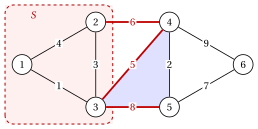

# 2.2 Cuts and cycles { #sez-sec-mst-cuts }

**Part 2 · Trees and paths · Chapter 2** · [:material-book-open-variant: Chapter 2: Spanning trees](index.md) · [:material-file-pdf-box: Lecture notes, volume 2 (PDF)](../../pdf/lecture-notes-2-trees-and-paths.pdf) · [:material-presentation: Slides](../../pdf/slides-minimum-spanning-trees.pdf) · [:material-pencil: Exercises: Spanning trees](../../exercises/minimum-spanning-trees.md) · [:material-gesture-tap: App: Minimum spanning trees: Kruskal and Prim](../../lab/minimum-spanning-tree-kruskal-prim.md)

!!! definizione "Definition 2.2: cut"

    Let $G=(V,E)$ be an undirected graph and $S \subseteq V$ with $\emptyset \neq S \neq V$. The <strong>cut</strong> defined by $S$ is the set of the edges with exactly one endpoint in $S$:

    $$
    \delta(S)=\big\{\, \{u,v\} \in E : u \in S,~ v \notin S \,\big\}.
    $$

    An edge of $\delta(S)$ <strong>crosses</strong> the cut. For a single vertex, $\delta(\{v\})=\delta(v)$ is the set of the edges incident to $v$.

- A graph is connected if and only if every cut $\delta(S)$ is nonempty: an empty cut separates $S$ from $V \setminus S$, and a path from $u \in S$ to $v \notin S$ must use an edge of $\delta(S)$.

- In the weighted reference graph, $\delta(\{1,2,3\})=\{\{2,4\},\{3,4\},\{3,5\}\}$ and $\delta(\{6\})=\{\{4,6\},\{5,6\}\}$.

!!! teorema "Lemma 2.3: a cycle crosses a cut an even number of times"

    Let $C$ be a cycle of $G$ and $\delta(S)$ a cut. Then $|C \cap \delta(S)|$ is even. In particular, if a cycle contains an edge of $\delta(S)$, it contains at least one other edge of $\delta(S)$.

??? dimostrazione "Proof"

    Let the cycle visit $v_0,v_1,\dots,v_k=v_0$. The edge $\{v_{t-1},v_t\}$ crosses the cut if and only if $v_{t-1}$ and $v_t$ lie on different sides. Walking along the cycle, the side changes at every crossing edge and only there; the walk ends at $v_0$, on the side where it started, so the number of changes is even. □

!!! definizione "Definition 2.4: fundamental cut"

    Let $T$ be a spanning tree of a connected graph $G=(V,E)$ and $e=\{u,v\} \in T$. The graph $T \setminus \{e\}$ has two connected components; let $S_e$ be the one that contains $u$. The <strong>fundamental cut</strong> of $e$ is $\delta(S_e)$.

- $T \setminus \{e\}$ has $n-2$ edges and no cycle, so it has $n-(n-2)=2$ components ([Corollary «edges and components»](https://fabiofurini.github.io/network-optimization/graphs/graphs/trees-and-forests/)); $v$ is not in $S_e$, otherwise the path from $u$ to $v$ in $T$ would not be unique.

- The only edge of $T$ in the fundamental cut of $e$ is $e$ itself: every other edge of $T$ lies inside one of the two components.

!!! teorema "Lemma 2.5: exchange"

    Let $T$ be a spanning tree of a connected graph $G=(V,E)$.

    1. If $e \notin T$ and $f$ is an edge of the fundamental cycle $C(T,e)$, then $T \cup \{e\} \setminus \{f\}$ is a spanning tree.

    2. If $f \in T$ and $e \notin T$ crosses the fundamental cut of $f$, then $f \in C(T,e)$, and $T \cup \{e\} \setminus \{f\}$ is a spanning tree.

??? dimostrazione "Proof"

    1. The rest of $C(T,e)$ joins the endpoints of $f$, so removing $f$ from the connected graph $T \cup \{e\}$ leaves it connected. The result is connected with $n-1$ edges: it is a spanning tree by the [characterizations of a tree](https://fabiofurini.github.io/network-optimization/graphs/graphs/trees-and-forests/), (b).

    2. The endpoints of $e$ lie on different sides of the fundamental cut $\delta(S_f)$. The path between them in $T$ is part of $C(T,e)$, and it must cross $\delta(S_f)$ with an edge of $T$; the only one is $f$. Part 1 concludes. □

!!! esempio "Example 2.3: cuts and cycles of the reference graph"

    The figure shows the cut $\delta(\{1,2,3\})$ (red edges) and the cycle $3,4,5$ (shaded in blue): the cycle uses the edges $\{3,4\}$ and $\{3,5\}$ of the cut, an even number.

    { .fig loading=lazy  }

    For the minimum spanning tree $\tilde{F}$ of [Example 2.2](the-minimum-spanning-tree-problem.md#box-3-mst-ex-opt), the fundamental cut of $\{3,4\}$ is $\delta(\{1,2,3\})$, and the fundamental cycle of $\{3,5\}$ is $C(\tilde{F},\{3,5\})=3,4,5,3$.

!!! chiave ""

    A cycle crosses every cut an even number of times. Adding an edge to a spanning tree and removing any edge of the cycle it closes gives another spanning tree.

---

**Next:** [2.3 The cut property and the cycle property](the-cut-property-and-the-cycle-property.md)
