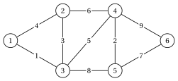
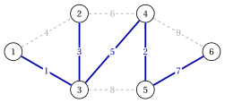

# 2.1 The minimum spanning tree problem { #sez-sec-mst-problem }

**Part 2 · Trees and paths · Chapter 2** · [:material-book-open-variant: Chapter 2: Spanning trees](index.md) · [:material-file-pdf-box: Lecture notes, volume 2 (PDF)](../../pdf/lecture-notes-2-trees-and-paths.pdf) · [:material-presentation: Slides](../../pdf/slides-minimum-spanning-trees.pdf) · [:material-pencil: Exercises: Spanning trees](../../exercises/minimum-spanning-trees.md) · [:material-gesture-tap: App: Minimum spanning trees: Kruskal and Prim](../../lab/minimum-spanning-tree-kruskal-prim.md)

!!! definizione "Definition 2.1: minimum spanning tree problem"

    Let $G=(V,E)$ be a connected undirected graph with $n=|V|$ vertices and $m=|E|$ edges, and let every edge $e \in E$ have a <strong>weight</strong> $w_e \in \R$. The <strong>weight</strong> of a set of edges $F \subseteq E$ is

    $$
    w(F)=\sum_{e \in F} w_e .
    $$

    The <strong>minimum spanning tree problem</strong> (MST) asks for a spanning tree $\tilde{T}=(V,\tilde{F})$ of $G$ of minimum weight:

    $$
    w(\tilde{F}) \le w(F) \qquad \text{for every spanning tree } (V,F) \text{ of } G .
    $$

    A spanning tree of minimum weight is a <strong>minimum spanning tree</strong>. We write $w_{uv}$ for the weight of the edge $\{u,v\}$, and we identify a spanning tree with its set of edges.

- A connected graph has a spanning tree, and it has finitely many of them: a minimum spanning tree always exists. Every spanning tree has $n-1$ edges.

- The weights can be negative. Adding the same constant to every weight adds $(n-1)$ times that constant to the weight of every spanning tree, so the minimum spanning trees do not change.

- A <strong>maximum spanning tree</strong> is a minimum spanning tree for the weights $-w_e$.

!!! esempio "Example 2.1: the weighted reference graph"

    We take the underlying undirected graph of the reference graph of the chapter [«Graphs»](https://fabiofurini.github.io/network-optimization/graphs/graphs/), with $n=6$ vertices, $m=9$ edges and the weights

    
<table>
    <tr>
    <th>edge</th>
    <th>\(\{1,2\}\)</th>
    <th>\(\{1,3\}\)</th>
    <th>\(\{2,3\}\)</th>
    <th>\(\{2,4\}\)</th>
    <th>\(\{3,4\}\)</th>
    <th>\(\{3,5\}\)</th>
    <th>\(\{4,5\}\)</th>
    <th>\(\{4,6\}\)</th>
    <th>\(\{5,6\}\)</th>
    </tr>
    <tr>
    <td>\(w_e\)</td>
    <td>\(4\)</td>
    <td>\(1\)</td>
    <td>\(3\)</td>
    <td>\(6\)</td>
    <td>\(5\)</td>
    <td>\(8\)</td>
    <td>\(2\)</td>
    <td>\(9\)</td>
    <td>\(7\)</td>
    </tr>
    </table>

    { .fig loading=lazy  }

    We call this graph the <strong>weighted reference graph</strong>: all the examples of the chapter use it. The weights are the distinct integers $1,2,\dots,9$.

!!! esempio "Example 2.2: the minimum spanning tree of the reference graph"

    The weighted reference graph has $55$ spanning trees. Enumerating all of them, the minimum weight is $18$, attained only by the tree (blue in the figure)

    $$
    \tilde{F}=\big\{\{1,3\},\{2,3\},\{3,4\},\{4,5\},\{5,6\}\big\}, \qquad w(\tilde{F})=1+3+5+2+7=18 .
    $$

    { .fig loading=lazy  }

    The spanning tree $\{1,2\},\{1,3\},\{2,4\},\{3,5\},\{4,6\}$ found by the breadth-first search in the chapter [«Graphs»](../../graphs/graphs/index.md) weighs $4+1+6+8+9=28$, and a maximum spanning tree weighs $34$.

- Enumerating the spanning trees is practical only on tiny graphs: the reference graph, with $6$ vertices and $9$ edges, already has $55$. The algorithms of this chapter find a minimum spanning tree in polynomial time.

## 2.1.1 Applications

- <strong>Network design.</strong> Vertices are sites (offices, houses, plants) and $w_{uv}$ is the cost of a direct link (a cable, a pipe, a road); the cheapest network connecting all the sites is a minimum spanning tree.

- <strong>Clustering.</strong> Removing the $k-1$ heaviest edges of a minimum spanning tree splits the vertices into $k$ groups of close points (single-linkage clustering).

- <strong>Subproblem.</strong> Minimum spanning trees give lower bounds for the travelling salesman problem and a starting point for heuristic algorithms for network design.

!!! chiave ""

    A minimum spanning tree connects all the vertices of a connected weighted graph with $n-1$ edges of minimum total weight; on the weighted reference graph it is unique and weighs $18$.

---

**Next:** [2.2 Cuts and cycles](cuts-and-cycles.md)
