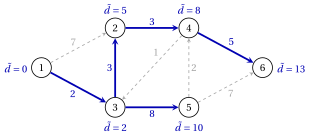
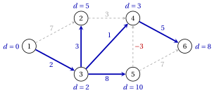
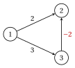

# Shortest paths

**Part 2 · Trees and paths · Chapter 3** · [:material-file-pdf-box: Lecture notes, volume 2 (PDF)](../pdf/lecture-notes-2-trees-and-paths.pdf) · [:material-pencil: Exercises: Shortest paths](../exercises/shortest-paths.md) · [:material-gesture-tap: App: Shortest paths: Dijkstra, Bellman–Ford, acyclic graphs](../lab/shortest-paths-dijkstra-bellman-ford.md)

!!! nota "Prerequisites"

    - From [Chapter 1 «Graphs»](https://fabiofurini.github.io/network-optimization/graphs/graphs/): directed walks, paths and cycles, the node–arc incidence matrix, trees and the reference graph.

    - From the module Linear Programming, [Chapter 9 «Duality theory»](https://fabiofurini.github.io/linear-programming/duality/09-duality/): the dual of an LP model and the weak duality theorem.

!!! chiave "Objectives"

    At the end of this chapter you will be able to:

    - state the $s$–$t$ and the single-source shortest path problems, and recognize when a negative cycle makes them ill-posed;

    - use the optimality of subpaths, Bellman's equations and the shortest path tree;

    - write the LP model of a shortest path as a unit flow, write its dual with the potentials $\pi_i$, and use feasible potentials as a certificate of optimality;

    - run the algorithm for acyclic graphs, the Bellman–Ford algorithm (with the detection of a negative cycle) and Dijkstra's algorithm, prove their correctness and give their running time.

## 3.1 Shortest path problems { #sez-sec-sp-problems }

!!! definizione "Definition 3.1: shortest path problems"

    Let $G=(N,A)$ be a directed graph with a <strong>length</strong> $d_{ij} \in \R$ for every arc $(i,j) \in A$, of any sign.

    - The length of a directed walk $W=i_0,i_1,\dots,i_k$ is the sum of the lengths of its arcs, $d(W)=\sum_{t=1}^{k} d_{i_{t-1}i_t}$.

    - Given two nodes $s$ and $t$, the <strong>$s$–$t$ shortest path problem</strong> asks for a directed path from $s$ to $t$ of minimum length.

    - Given a node $s$, the <strong>source</strong>, the <strong>single-source shortest path problem</strong> asks for a shortest directed path from $s$ to every node $j \in N$.

    The minimum length of a directed path from $s$ to $j$ is the <strong>distance</strong> $\tilde{d}(j)$ of $j$; we set $\tilde{d}(j)=+\infty$ if $j$ is not reachable from $s$.

- In this chapter we write $n=|N|$, $m=|A|$, and “path” and “cycle” always mean directed path and directed cycle.

- An algorithm for the single-source problem also solves the $s$–$t$ problem, for every $t$ at once.

!!! esempio "Example 3.1: the reference graph with lengths"

    We give the reference graph of [Chapter 1 «Graphs»](https://fabiofurini.github.io/network-optimization/graphs/graphs/) the lengths $d_{ij}$ written on the arcs, all non-negative; the source is $s=1$.

    { .fig loading=lazy  }

    Three of the paths from $1$ to $6$ and their lengths are:

    $$
    d(1,2,4,6)=7+3+5=15, \qquad d(1,3,2,4,6)=2+3+3+5=13, \qquad d(1,3,5,6)=2+8+7=17.
    $$

    The distances from node $1$, computed in Section [3.6](#sez-sec-sp-dijkstra), are

    $$
    \tilde{d}=(0,\,5,\,2,\,8,\,10,\,13),
    $$

    so $1,3,2,4,6$ is a shortest path from $1$ to $6$.

### 3.1.1 Negative cycles

!!! definizione "Definition 3.2: negative cycle"

    A <strong>negative cycle</strong> is a directed cycle $C$ with $d(C)<0$. In the rest of the chapter we refer to two assumptions:

    - **(A1)** every node of $G$ is reachable from $s$;

    - **(A2)** no negative cycle of $G$ is reachable from $s$.

!!! teorema "Lemma 3.3: walks and paths"

    Under (A2), for every directed walk $W$ from $s$ to $j$ there is a directed path $P$ from $s$ to $j$, with arcs of $W$, such that $d(P) \le d(W)$.

??? dimostrazione "Proof"

    By induction on the number of arcs of $W$. If $W$ has distinct nodes, $P=W$.

    1. Otherwise $W$ repeats a node: $W=s,\dots,i_a,\dots,i_b,\dots,j$ with $i_a=i_b$, $a<b$, and $b-a$ minimum. The piece $C=i_a,\dots,i_b$ is a cycle, reachable from $s$ along $W$.

    2. By (A2), $d(C) \ge 0$. Deleting $C$ from $W$ gives a walk $W'$ from $s$ to $j$ with fewer arcs and $d(W')=d(W)-d(C) \le d(W)$.

    3. By induction $W'$ contains a path $P$ with $d(P) \le d(W') \le d(W)$. □

- Under (A2) the minimum length of a walk from $s$ to $j$ equals the distance $\tilde{d}(j)$: the algorithms of this chapter compute lengths of walks, and the lemma turns them into paths.

- With a negative cycle $C$ reachable from $s$ and from which $j$ is reachable, going around $C$ again and again gives walks from $s$ to $j$ of arbitrarily negative length. The algorithms of this chapter then detect $C$ instead of computing the distances.

!!! esempio "Example 3.2: a negative cycle"

    The reference graph has two cycles, $2,4,3,2$ and $3,5,4,3$. With the lengths of [Example 3.1](#box-2-sp-ex-ref) their lengths are $7$ and $11$. If the length of the arc $(5,4)$ drops from $2$ to $d''_{54}=-10$, the cycle $3,5,4,3$ has length

    $$
    8-10+1=-1 ,
    $$

    and the walks $1,3,5,6$, $1,3,5,4,3,5,6$, $1,3,5,4,3,5,4,3,5,6$, … from $1$ to $6$ have lengths $17,16,15,\dots$: no walk is shortest. We use these lengths $d''$ again in Section [3.5](#sez-sec-sp-bf).

### 3.1.2 Optimality of subpaths

!!! teorema "Lemma 3.4: optimality of subpaths"

    Under (A2), let $P$ be a shortest path from $s$ to $j$, and let $i$ be a node of $P$. Then the subpath $P_{si}$ of $P$ from $s$ to $i$ is a shortest path from $s$ to $i$.

??? dimostrazione "Proof"

    Write $P$ as $P_{si}$ followed by the subpath $P_{ij}$ from $i$ to $j$, so $d(P)=d(P_{si})+d(P_{ij})$. Assume by contradiction that a path $Q$ from $s$ to $i$ has $d(Q)<d(P_{si})$.

    1. $Q$ followed by $P_{ij}$ is a walk from $s$ to $j$ of length $d(Q)+d(P_{ij})<d(P)$.

    2. By [Lemma 3.3](#box-4-sp-lem-walk) it contains a path from $s$ to $j$ shorter than $P$: a contradiction. □

!!! teorema "Theorem 3.5: Bellman's equations"

    Under (A1) and (A2), the distances satisfy

    $$
    \tilde{d}(s)=0, \qquad \tilde{d}(j)=\min_{(i,j) \in \delta^-(j)} \big\{\, \tilde{d}(i)+d_{ij} \,\big\}, \quad
    \forall j \in N \setminus \{s\},
    $$

    and $\tilde{d}(j) \le \tilde{d}(i)+d_{ij}$ for every arc $(i,j) \in A$.

??? dimostrazione "Proof"

    All distances are finite by (A1), and $\tilde{d}(s)=0$: the path $s$ has length $0$, and a path from $s$ to $s$ with arcs would be a cycle, of length $\ge 0$ by (A2).

    - <em>Inequality.</em> A shortest path from $s$ to $i$ followed by the arc $(i,j)$ is a walk of length $\tilde{d}(i)+d_{ij}$; by [Lemma 3.3](#box-4-sp-lem-walk), $\tilde{d}(j) \le \tilde{d}(i)+d_{ij}$.

    - <em>Equation.</em> For $j \neq s$, let $P$ be a shortest path from $s$ to $j$ and $(i,j)$ its last arc. By [Lemma 3.4](#box-6-sp-lem-subpath), $\tilde{d}(j)=d(P)=\tilde{d}(i)+d_{ij}$, so the minimum is attained.

    
□

!!! teorema "Proposition 3.6: shortest path tree"

    Under (A1) and (A2), there is a spanning tree $T$ of $G$, the <strong>shortest path tree</strong>, such that for every $j \in N$ the path from $s$ to $j$ in $T$ is directed and is a shortest path.

??? dimostrazione "Proof"

    For every $j$, let $k(j)$ be the minimum number of arcs of a shortest path from $s$ to $j$; $k(s)=0$.

    1. For $j \neq s$, choose a shortest path $P$ from $s$ to $j$ with $k(j)$ arcs, and let $\mathit{pred}(j)$ be the node before $j$ on $P$.

    2. The subpath of $P$ from $s$ to $\mathit{pred}(j)$ is shortest ([Lemma 3.4](#box-6-sp-lem-subpath)) with $k(j)-1$ arcs, so $k(\mathit{pred}(j)) \le k(j)-1$, and $\tilde{d}(j)=\tilde{d}(\mathit{pred}(j))+d_{\mathit{pred}(j)\,j}$.

    3. Moving from $j$ to $\mathit{pred}(j)$, the number $k$ strictly decreases, so the sequence ends in $s$. The arcs $(\mathit{pred}(j),j)$ are $n-1$ and connect every node to $s$: they form a spanning tree ([Chapter 1, Theorem «characterizations of a tree»](https://fabiofurini.github.io/network-optimization/graphs/graphs/trees-and-forests/)).

    4. Along the tree path $s=i_0,i_1,\dots,i_r=j$ every arc satisfies $\tilde{d}(i_t)=\tilde{d}(i_{t-1})+d_{i_{t-1}i_t}$; adding up, its length is $\tilde{d}(j)$. □

!!! esempio "Example 3.3: Bellman's equations on the reference graph"

    With the distances $\tilde{d}=(0,5,2,8,10,13)$ of [Example 3.1](#box-2-sp-ex-ref):

    - node $4$ has the entering arcs $(2,4)$ and $(5,4)$, and $\tilde{d}(4)=\min\{5+3,\;10+2\}=8$;

    - node $6$ has the entering arcs $(4,6)$ and $(5,6)$, and $\tilde{d}(6)=\min\{8+5,\;10+7\}=13$.

    The arcs attaining the minimum form the shortest path tree $(1,3)$, $(3,2)$, $(2,4)$, $(3,5)$, $(4,6)$, in blue; next to each node its distance.

    { .fig loading=lazy  }

!!! chiave ""

    Without negative cycles reachable from the source, every subpath of a shortest path is shortest, the distances satisfy Bellman's equations, and one spanning tree contains a shortest path to every node.

## 3.2 Optimality conditions and potentials { #sez-sec-sp-potentials }

!!! definizione "Definition 3.7: potentials and reduced costs"

    A vector $\vet{\pi} \in \R^n$ gives a <strong>potential</strong> $\pi_i$ to every node $i \in N$. The <strong>reduced cost</strong> of the arc $(i,j)$ with respect to $\vet{\pi}$ is

    $$
    \bar{c}_{ij}=d_{ij}-\pi_i+\pi_j .
    $$

    The potentials are <strong>feasible</strong> if $\bar{c}_{ij} \ge 0$ for every arc $(i,j) \in A$, and an arc with $\bar{c}_{ij}=0$ is <strong>tight</strong>.

- Given <strong>labels</strong> $d(j)$, lengths of walks from $s$ to $j$, we use the potentials $\pi_i=-d(i)$. Then $\bar{c}_{ij}=d_{ij}+d(i)-d(j)$, and the potentials are feasible if and only if $d(j) \le d(i)+d_{ij}$ for every arc.

- Along a walk $W=i_0,i_1,\dots,i_k$ the potentials telescope:

    $$
    d(W)=\sum_{t=1}^{k} \bar{c}_{i_{t-1}i_t} \;+\; \pi_{i_0}-\pi_{i_k} .
    $$

!!! teorema "Theorem 3.8: potentials as optimality certificate"

    Let $\vet{\pi}$ be feasible potentials, and let $P$ be a path from $s$ to $t$ whose arcs are all tight. Then $P$ is a shortest path from $s$ to $t$, and $d(P)=\pi_s-\pi_t$. Moreover, $G$ has no negative cycle.

??? dimostrazione "Proof"

    We use the telescoping formula above.

    1. The arcs of $P$ have $\bar{c}_{ij}=0$, so $d(P)=\pi_s-\pi_t$.

    2. For every path $Q$ from $s$ to $t$, $d(Q)=\sum_{(i,j) \in Q}\bar{c}_{ij}+\pi_s-\pi_t \ge \pi_s-\pi_t=d(P)$.

    3. For every cycle $C$ the first and the last node coincide, so $d(C)=\sum_{(i,j) \in C}\bar{c}_{ij} \ge 0$. □

!!! teorema "Corollary 3.9: optimality conditions for labels"

    Let the labels $d(j)$, $j \in N$, be finite with $d(s)=0$, and assume that

    - **(i)** $d(j) \le d(i)+d_{ij}$ for every arc $(i,j) \in A$;

    - **(ii)** for every $j \neq s$ there is a path from $s$ to $j$ of length $d(j)$.

    Then $d(j)=\tilde{d}(j)$ for every $j \in N$.

??? dimostrazione "Proof"

    By (i) the potentials $\pi_i=-d(i)$ are feasible, so every path $Q$ from $s$ to $j$ has $d(Q) \ge \pi_s-\pi_j=d(j)$ by the argument of [Theorem 3.8](#box-11-sp-th-certificate). By (ii) the value $d(j)$ is attained by a path, so $d(j)=\tilde{d}(j)$. □

!!! esempio "Example 3.4: a certificate on the reference graph"

    With the distances of [Example 3.1](#box-2-sp-ex-ref) the potentials are $\vet{\pi}=-\tilde{\vet{d}}=(0,-5,-2,-8,-10, -13)$, and the reduced costs $\bar{c}_{ij}=d_{ij}-\pi_i+\pi_j$ are:

    
<table>
    <tr>
    <th>arc</th>
    <th>\((1,2)\)</th>
    <th>\((1,3)\)</th>
    <th>\((2,4)\)</th>
    <th>\((3,2)\)</th>
    <th>\((3,5)\)</th>
    <th>\((4,3)\)</th>
    <th>\((4,6)\)</th>
    <th>\((5,4)\)</th>
    <th>\((5,6)\)</th>
    </tr>
    <tr>
    <td>\(d_{ij}\)</td>
    <td>\(7\)</td>
    <td>\(2\)</td>
    <td>\(3\)</td>
    <td>\(3\)</td>
    <td>\(8\)</td>
    <td>\(1\)</td>
    <td>\(5\)</td>
    <td>\(2\)</td>
    <td>\(7\)</td>
    </tr>
    <tr>
    <td>\(\bar{c}_{ij}\)</td>
    <td>\(2\)</td>
    <td>\(0\)</td>
    <td>\(0\)</td>
    <td>\(0\)</td>
    <td>\(0\)</td>
    <td>\(7\)</td>
    <td>\(0\)</td>
    <td>\(4\)</td>
    <td>\(4\)</td>
    </tr>
    </table>

    - All reduced costs are non-negative, and the tight arcs are the arcs of the shortest path tree. The path $1,3,2,4,6$ is tight, so it is shortest, with length $\pi_1-\pi_6=13$.

    - The tree of the breadth-first search, $(1,2)$, $(1,3)$, $(2,4)$, $(3,5)$, $(4,6)$, gives the labels $(0,7,2,10,10,15)$. With their potentials, $\bar{c}_{32}=3-(-2)+(-7)=-2<0$: the potentials are not feasible, and entering node $2$ through $(3,2)$ shortens its path by $2$.

!!! chiave ""

    Feasible potentials ($\bar{c}_{ij}=d_{ij}-\pi_i+\pi_j \ge 0$ on every arc) and a path made of tight arcs prove that the path is shortest. With labels, $\pi_i=-d(i)$, and feasibility reads $d(j) \le d(i)+d_{ij}$.

## 3.3 The linear programming formulation { #sez-sec-sp-lp }

- A path from $s$ to $t$ sends one unit of flow from $s$ to $t$. We use a variable $x_{ij} \ge 0$ for every arc, the flow on the arc, and the <strong>balances</strong>

    $$
    b_s=1, \qquad b_t=-1, \qquad b_i=0, \quad \forall i \in N \setminus \{s,t\}.
    $$

!!! chiave ""

    Using these variables, an LP model for the $s$–$t$ shortest path problem reads as follows:

    

    \begin{align*}
    &&   \min \;\;{\sum_{(i,j) \in A} d_{ij} \, x_{ij}}                                     \label{obj_SP}  \tag{3.1a}\\[1ex]
    && \text{subject to} \quad  {\sum_{(i,j) \in \delta^+(i)} x_{ij} \;-\; \sum_{(j,i) \in \delta^-(i)} x_{ji}}
    &= b_i, & \forall i \in N,                                                           \label{cons1_SP}  \tag{3.1b}\\[1ex]
    &&x_{ij}                        &\ge  0, & \forall (i,j) \in A.                    \label{cons2_SP} \tag{3.1c}
    \end{align*}

    This LP model is referred to as the $\mathrm{SP}(s,t)$ model.

- Description of the objective function and constraints of the $\mathrm{SP}(s,t)$ model:

    - the objective function $\eqref{obj_SP}$ minimizes the total length of the flow;

    - constraints $\eqref{cons1_SP}$ are the flow conservation constraints: one unit leaves $s$, one unit enters $t$, and every other node sends out what it receives;

    - finally, constraints $\eqref{cons2_SP}$ define the variables of the LP model.

- In matrix form the model is $\min\{\vet{d}'\vet{x} : \mat{B}\vet{x}=\vet{b},\ \vet{x} \ge \vet{0}\}$, with the node–arc incidence matrix $\mat{B}$ of [Chapter 1](https://fabiofurini.github.io/network-optimization/graphs/graphs/representations-of-a-graph/): $+1$ in the tail and $-1$ in the head of every arc.

- The <strong>incidence vector</strong> $\vet{x}^P$ of a path $P$ from $s$ to $t$, with $x^P_{ij}=1$ on the arcs of $P$ and $0$ elsewhere, is feasible, and its value is $d(P)$.

### 3.3.1 The dual model and the potentials

- The constraint of node $i$ is an equation, so its dual variable $\pi_i$ is free. The column of $x_{ij}$ in $\mat{B}$ has $+1$ in row $i$ and $-1$ in row $j$, so the dual constraint of $x_{ij} \ge 0$ is $\pi_i-\pi_j \le d_{ij}$ ([Linear Programming, Chapter 9 «Duality theory»](https://fabiofurini.github.io/linear-programming/duality/09-duality/)).

!!! chiave ""

    Using a free dual variable $\pi_i$ for each constraint $\eqref{cons1_SP}$, the dual model of the $\mathrm{SP}(s,t)$ model is:

    

    \begin{align*}
    &&   \max \;\; \pi_s-\pi_t                                                    \label{obj_DSP}  \tag{3.2a}\\[2ex]
    && \text{subject to} \quad  \pi_i-\pi_j  &\le d_{ij}, & \forall (i,j) \in A,          \label{cons1_DSP}  \tag{3.2b}\\[2ex]
    &&\pi_i                        &\in \R, & \forall i \in N.                           \label{cons2_DSP} \tag{3.2c}
    \end{align*}

- Constraint $\eqref{cons1_DSP}$ is $\bar{c}_{ij}=d_{ij}-\pi_i+\pi_j \ge 0$: the feasible solutions of the dual are the feasible potentials of [Definition 3.7](#box-10-sp-def-potentials), and $\bar{c}_{ij}$ is the reduced cost of $x_{ij}$ in the LP sense.

!!! teorema "Theorem 3.10: LP and shortest paths"

    Under (A1) and (A2), the $\mathrm{SP}(s,t)$ model has an optimal solution and $z(\mathrm{SP}(s,t))=\tilde{d}(t)$. The incidence vector of a shortest path from $s$ to $t$ is optimal for $\mathrm{SP}(s,t)$, and the potentials $\pi_i=-\tilde{d}(i)$ are optimal for $D(\mathrm{SP}(s,t))$.

??? dimostrazione "Proof"

    Let $P$ be a shortest path from $s$ to $t$, which exists by (A1).

    1. $\vet{x}^P$ is feasible for $\mathrm{SP}(s,t)$, with value $d(P)=\tilde{d}(t)$.

    2. By [Theorem 3.5](#box-7-sp-th-bellman), $\tilde{d}(j) \le \tilde{d}(i)+d_{ij}$ for every arc, so $\pi_i=-\tilde{d}(i)$ satisfies $\pi_i-\pi_j \le d_{ij}$; its value is $\pi_s-\pi_t=0+\tilde{d}(t)$.

    3. A feasible primal and a feasible dual solution with the same value are both optimal, by weak duality. □

!!! teorema "Proposition 3.11: a negative cycle makes the model unbounded"

    If $\mathrm{SP}(s,t)$ is feasible and $G$ has a negative cycle $C$, reachable from $s$ or not, then $\mathrm{SP}(s,t)$ is unbounded.

??? dimostrazione "Proof"

    Let $\bar{\vet{x}}$ be feasible and let $\vet{x}^C$ be the incidence vector of $C$. The columns of the arcs of $C$ add up to zero ([Chapter 1, Lemma «columns of a cycle»](https://fabiofurini.github.io/network-optimization/graphs/graphs/the-rank-of-the-incidence-matrix/)), so $\mat{B}\vet{x}^C=\vet{0}$. For every $\lambda \ge 0$ the vector $\bar{\vet{x}}+\lambda\vet{x}^C$ is feasible, with value $\vet{d}'\bar{\vet{x}}+\lambda\, d(C)$, which tends to $-\infty$. □

!!! attenzione "The sign of the potentials"

    With the incidence matrix of the course ($+1$ in the tail) the dual constraint is $\pi_i-\pi_j \le d_{ij}$, and the optimal potentials are $\pi_i=-\tilde{d}(i)$, up to an additive constant. The form $\pi_j-\pi_i \le d_{ij}$, with $\pi_i=\tilde{d}(i)$, belongs to the opposite sign convention ($-1$ in the tail).

### 3.3.2 The single-source model

- To find a shortest path from $s$ to every node, $s$ sends one unit to each of the other $n-1$ nodes:

    $$
    b_s=n-1, \qquad b_i=-1, \quad \forall i \in N \setminus \{s\}.
    $$

    With these balances the model [(3.1)](#eq-SP_ST) is called $\mathrm{SP}(s)$; its dual maximizes $(n-1)\pi_s-\sum_{i \neq s}\pi_i$ under the same constraints $\eqref{cons1_DSP}$.

!!! teorema "Proposition 3.12: the single-source model"

    Under (A1) and (A2), let $T$ be a shortest path tree and, for every $j \neq s$, let $T_j$ be the set of the nodes whose tree path passes through $j$ ($j$ included). The flow with $x_{ij}=|T_j|$ on the arcs $(i,j)$ of $T$ and $0$ elsewhere is optimal for $\mathrm{SP}(s)$, the potentials $\pi_i=-\tilde{d}(i)$ are optimal for its dual, and

    $$
    z(\mathrm{SP}(s))=\sum_{j \in N}\tilde{d}(j).
    $$

??? dimostrazione "Proof"

    1. <em>Feasibility.</em> At a node $j \neq s$ the flow entering on the tree arc is $|T_j|$, and the flow leaving is $\sum |T_h|$ over the tree arcs $(j,h)$, that is $|T_j|-1$: the balance is $-1$. At $s$ the leaving flow covers all the other nodes: $n-1$.

    2. <em>Value.</em> The flow is the sum of the incidence vectors of the $n-1$ tree paths, since the arc $(i,j)$ lies on the tree paths of the $|T_j|$ nodes of $T_j$. Its value is $\sum_{j}\tilde{d}(j)$.

    3. <em>Dual.</em> $\pi_i=-\tilde{d}(i)$ is feasible as in [Theorem 3.10](#box-14-sp-th-lp), with value $(n-1)\cdot 0+\sum_{i \neq s}\tilde{d}(i)$. By weak duality both solutions are optimal. □

- In [Chapter 4 «Network flow models»](https://fabiofurini.github.io/network-optimization/flows/network-flow-models/) the vertices of these polyhedra are shown to be integral, by the total unimodularity of $\mat{B}$.

!!! esempio "Example 3.5: the LP models on the reference graph"

    We solve the models with the lengths of [Example 3.1](#box-2-sp-ex-ref), $s=1$ and $t=6$ (values checked with Gurobi).

    - $\mathrm{SP}(1,6)$: $z(\mathrm{SP}(1,6))=13$, with $x_{13}=x_{32}=x_{24}=x_{46}=1$ and all other variables $0$: the path $1,3,2,4,6$. The dual value is $\pi_1-\pi_6=13$.

    - $\mathrm{SP}(1)$: $z(\mathrm{SP}(1))=0+5+2+8+10+13=38$, with the flows on the shortest path tree

        $$
        x_{13}=5, \qquad x_{32}=3, \qquad x_{24}=2, \qquad x_{46}=1, \qquad x_{35}=1 .
        $$

        For example $T_3=\{2,3,4,5,6\}$, so $x_{13}=5$; the cost is $2\cdot 5+3\cdot 3+3\cdot 2+5+8=38$. The optimal duals, normalized with $\pi_1=0$, are $\vet{\pi}=(0,-5,-2,-8,-10,-13)$.

    - With the lengths $d''$ of [Example 3.2](#box-5-sp-ex-negcycle) the model $\mathrm{SP}(1,6)$ is unbounded: each unit of flow around the cycle $3,5,4,3$ lowers the value by $1$.

!!! chiave ""

    A shortest path is a unit flow from $s$ to $t$: $\min \vet{d}'\vet{x}$ with $\mat{B}\vet{x}=\vet{b}$, $\vet{x} \ge \vet{0}$. Its dual has the constraints $\pi_i-\pi_j \le d_{ij}$, and $\pi_i=-\tilde{d}(i)$ is optimal; a negative cycle anywhere in $G$ makes the model unbounded.

## 3.4 Shortest paths in acyclic graphs { #sez-sec-sp-dag }

!!! definizione "Definition 3.13: acyclic graph and topological order"

    A directed graph without directed cycles is a <strong>directed acyclic graph</strong> (DAG). A <strong>topological order</strong> of $G=(N,A)$ is an ordering $v_1,v_2,\dots,v_n$ of its nodes such that every arc goes forward:

    $$
    (v_a,v_b) \in A \quad \Longrightarrow \quad a<b .
    $$

!!! teorema "Proposition 3.14: topological orders"

    A directed graph has a topological order if and only if it is acyclic.

??? dimostrazione "Proof"

    If $G$ has a topological order, a cycle $i_0,i_1,\dots,i_k=i_0$ would go forward on every arc and come back to its first node: impossible. Conversely, let $G$ be acyclic; we argue by induction on $n$.

    1. $G$ has a node with no entering arc: otherwise, walking backwards along entering arcs from any node, after $n$ steps a node repeats, and the walk contains a cycle.

    2. Put such a node $v_1$ first. The graph without $v_1$ is acyclic, and by induction it has a topological order $v_2,\dots,v_n$; no arc enters $v_1$, so $v_1,v_2,\dots,v_n$ is a topological order of $G$. □

!!! algoritmo "Algorithm: Shortest paths in an acyclic graph"

    

<strong>Input:</strong> an acyclic graph \(G=(N,A)\) with lengths \(d_{ij}\) of any sign, a source \(s \in N\)

<strong>Output:</strong> the distances \(d(j)=\tilde{d}(j)\) and the predecessors \(\mathit{pred}(j)\)

1<strong>Step 0 (order).</strong> Find a topological order: repeatedly remove a node without entering arcs (the smallest
    index, if more than one).

2  Set \(d(s):=0\) and \(d(j):=+\infty\) for \(j \neq s\).

3<strong>Step 1 (labels).</strong> For each node \(i\) in topological order with \(d(i)<+\infty\), and each arc \((i,j) \in \delta^+(i)\):

4  if \(d(i)+d_{ij}<d(j)\), set \(d(j):=d(i)+d_{ij}\) and \(\mathit{pred}(j):=i\).

5  <code>STOP</code>.

!!! teorema "Theorem 3.15: correctness and running time on acyclic graphs"

    On an acyclic graph with lengths of any sign, the algorithm «Shortest paths in an acyclic graph» ends with $d(j)=\tilde{d}(j)$ for every $j \in N$, and it runs in $O(n+m)$ time.

??? dimostrazione "Proof"

    An acyclic graph has no cycle at all, so (A2) holds. Every finite label is the length of a walk from $s$, so $d(j) \ge \tilde{d}(j)$ by [Lemma 3.3](#box-4-sp-lem-walk); labels only decrease.

    1. Let $j$ be reachable and $s=i_0,i_1,\dots,i_k=j$ a shortest path; its nodes appear in this order in the topological order, since every arc goes forward.

    2. By induction on $t$, after $i_t$ is processed $d(i_t) \le \tilde{d}(i_t)$: the path to $i_{t-1}$ is shortest ([Lemma 3.4](#box-6-sp-lem-subpath)), and processing $i_{t-1}$ gives $d(i_t) \le \tilde{d}(i_{t-1})+d_{i_{t-1}i_t}=\tilde{d}(i_t)$.

    3. Nodes not reachable from $s$ keep $d(j)=+\infty=\tilde{d}(j)$.

    <em>Time.</em> The topological order takes $O(n+m)$ time with a counter of the entering arcs of every node, decreased when a tail is removed; Step 1 scans every arc once. □

- The smallest-index rule fixes one order for the examples; any node without entering arcs can be removed.

- With the lengths $-d_{ij}$ the algorithm computes <strong>longest paths</strong>, since an acyclic graph has no cycle to repeat. Longest paths in acyclic graphs are the core of Chapter 9 «Project management».

!!! esempio "Example 3.6: an acyclic instance"

    Reversing the arc $(4,3)$ of the reference graph into $(3,4)$, with $d_{34}=1$, gives an acyclic graph. We give it the lengths of [Example 3.1](#box-2-sp-ex-ref) except $d_{54}=-3$ (red).

    { .fig loading=lazy  }

    Step 0 gives the topological order $1,3,2,5,4,6$: after $1$, only $3$ has no entering arc; then $2$ and $5$ are free, and $2$ goes first. Each row of the table processes one node and shows the labels after it:

    
<table>
    <tr>
    <th>step</th>
    <th>node \(i\)</th>
    <th>\(d(1)\)</th>
    <th>\(d(2)\)</th>
    <th>\(d(3)\)</th>
    <th>\(d(4)\)</th>
    <th>\(d(5)\)</th>
    <th>\(d(6)\)</th>
    </tr>
    <tr>
    <td>\(1\)</td>
    <td>\(1\)</td>
    <td>\(0\)</td>
    <td>\(7\)</td>
    <td>\(2\)</td>
    <td>\(\infty\)</td>
    <td>\(\infty\)</td>
    <td>\(\infty\)</td>
    </tr>
    <tr>
    <td>\(2\)</td>
    <td>\(3\)</td>
    <td>\(0\)</td>
    <td>\(5\)</td>
    <td>\(2\)</td>
    <td>\(3\)</td>
    <td>\(10\)</td>
    <td>\(\infty\)</td>
    </tr>
    <tr>
    <td>\(3\)</td>
    <td>\(2\)</td>
    <td>\(0\)</td>
    <td>\(5\)</td>
    <td>\(2\)</td>
    <td>\(3\)</td>
    <td>\(10\)</td>
    <td>\(\infty\)</td>
    </tr>
    <tr>
    <td>\(4\)</td>
    <td>\(5\)</td>
    <td>\(0\)</td>
    <td>\(5\)</td>
    <td>\(2\)</td>
    <td>\(3\)</td>
    <td>\(10\)</td>
    <td>\(17\)</td>
    </tr>
    <tr>
    <td>\(5\)</td>
    <td>\(4\)</td>
    <td>\(0\)</td>
    <td>\(5\)</td>
    <td>\(2\)</td>
    <td>\(3\)</td>
    <td>\(10\)</td>
    <td>\(8\)</td>
    </tr>
    <tr>
    <td>\(6\)</td>
    <td>\(6\)</td>
    <td>\(0\)</td>
    <td>\(5\)</td>
    <td>\(2\)</td>
    <td>\(3\)</td>
    <td>\(10\)</td>
    <td>\(8\)</td>
    </tr>
    </table>

    The predecessors give the tree $(1,3)$, $(3,2)$, $(3,4)$, $(3,5)$, $(4,6)$ (blue). The negative arc $(5,4)$ is not used: $d(5)-3=7>3=d(4)$. With the lengths $-d_{ij}$ the longest path lengths from $1$ are $(0,7,2,10,10,17)$.

!!! chiave ""

    A graph is acyclic if and only if it has a topological order. Scanning the nodes in that order, each label is final when its node is processed: shortest paths in $O(n+m)$ time, with lengths of any sign.

## 3.5 The Bellman–Ford algorithm { #sez-sec-sp-bf }

!!! definizione "Definition 3.16: labels with at most $k$ arcs"

    For $k \ge 0$ and $j \in N$, $d^k(j)$ is the minimum length of a walk from $s$ to $j$ with at most $k$ arcs, and $d^k(j)=+\infty$ if there is none.

!!! teorema "Lemma 3.17: recursion of the labels"

    $d^0(s)=0$, $d^0(j)=+\infty$ for $j \neq s$, and for every $k \ge 1$

    $$
    d^k(j)=\min\Big\{\, d^{k-1}(j),\; \min_{(i,j) \in \delta^-(j)} \big( d^{k-1}(i)+d_{ij} \big) \Big\},
    \qquad \forall j \in N .
    $$

??? dimostrazione "Proof"

    The only walk with $0$ arcs is the walk $s$. For $k \ge 1$, a walk to $j$ with at most $k$ arcs either has at most $k-1$ arcs, with minimum length $d^{k-1}(j)$, or has exactly $k$ arcs and last arc $(i,j)$: it is a walk to $i$ with $k-1$ arcs followed by $(i,j)$, and its minimum length is $\min_{(i,j)}\big(d^{k-1}(i)+d_{ij}\big)$. □

!!! algoritmo "Algorithm: Bellman–Ford algorithm"

    

<strong>Input:</strong> a directed graph \(G=(N,A)\) with lengths \(d_{ij}\) of any sign, a source \(s \in N\)

<strong>Output:</strong> the distances \(\tilde{d}(j)\) and the predecessors, or a negative cycle reachable from \(s\)

1<strong>Step 0 (initialization).</strong> Set \(d^0(s):=0\), \(d^0(j):=+\infty\) for \(j \neq s\), and \(k:=1\).

2<strong>Step 1 (pass \(k\)).</strong> Compute \(d^k(j)\) for every \(j \in N\) with the recursion of
    [Lemma 3.17](#box-23-sp-lem-recursion);

3  if \(d^k(j)<d^{k-1}(j)\), set \(\mathit{pred}(j)\) to the tail \(i\) of the arc that attains the minimum.

4<strong>Step 2 (test).</strong> If \(d^k=d^{k-1}\), <code>STOP</code>: \(\tilde{d}=d^k\).

5  If \(k=n\), <code>STOP</code>: a negative cycle is reachable from \(s\). Otherwise set \(k:=k+1\) and go to Step 1.

- Each pass depends only on the labels of the previous pass: if $d^k=d^{k-1}$, all the following passes repeat the same labels, and the algorithm can stop.

- In the examples, ties in the minimum are broken by the smallest tail $i$, and the predecessor changes only when the label strictly decreases.

!!! teorema "Theorem 3.18: correctness of Bellman–Ford"

    If no negative cycle is reachable from $s$, then $d^{n-1}(j)=\tilde{d}(j)$ for every $j \in N$, and the algorithm stops at a pass $k \le n$ with $d^k=d^{k-1}=\tilde{d}$.

??? dimostrazione "Proof"

    A path has at most $n-1$ arcs, so $d^{n-1}(j) \le \tilde{d}(j)$. By [Lemma 3.3](#box-4-sp-lem-walk) (which needs only the cycles reachable from $s$) every walk from $s$ to $j$ contains a path not longer, so $d^k(j) \ge \tilde{d}(j)$ for every $k$.

    - Hence $d^{n-1}=d^{n}=\tilde{d}$.

    - The labels never increase, and the algorithm stops at the first pass $k$ with $d^k=d^{k-1}$, which is at most $n$; from that pass on the labels no longer change, so $d^k=d^{n-1}=\tilde{d}$.

    
□

!!! teorema "Theorem 3.19: detection of a negative cycle"

    A negative cycle is reachable from $s$ if and only if $d^n \neq d^{n-1}$. In that case, let $d^n(j)<d^{n-1}(j)$; reading the predecessors backwards from $j$, one row per pass, starting from row $n$ of the table, gives a walk from $s$ to $j$ with $n$ arcs that contains a negative cycle.

??? dimostrazione "Proof"

    If no negative cycle is reachable from $s$, then $d^n=d^{n-1}$ by [Theorem 3.18](#box-24-sp-th-bf). Conversely, let $d^n(j)<d^{n-1}(j)$.

    1. Every walk to $j$ of length $d^n(j)$ with at most $n$ arcs has exactly $n$ arcs, otherwise $d^{n-1}(j) \le d^n(j)$.

    2. Let $i$ be the predecessor of $j$ in row $n$, so $d^n(j)=d^{n-1}(i)+d_{ij}$. A walk realizing $d^{n-1}(i)$ followed by $(i,j)$ realizes $d^n(j)$, so it has exactly $n-1$ arcs: $d^{n-1}(i)<d^{n-2}(i)$, and $i$ has a predecessor in row $n-1$.

    3. Repeating the argument down to row $1$, whose predecessor is $s$, gives a walk $W$ from $s$ to $j$ with $n$ arcs and $d(W)=d^n(j)$.

    4. $W$ has $n+1$ nodes, so it repeats a node and contains a cycle $C$. Deleting $C$ gives a walk to $j$ with fewer than $n$ arcs, of length $d(W)-d(C) \ge d^{n-1}(j)>d^n(j)=d(W)$. Hence $d(C)<0$, and $C$ is reachable from $s$ along $W$. □

!!! teorema "Proposition 3.20: the predecessor tree of Bellman–Ford"

    If no negative cycle is reachable from $s$, at the stop the arcs $(\mathit{pred}(j),j)$, for the nodes $j \neq s$ with finite label, form a shortest path tree of the reachable nodes.

??? dimostrazione "Proof"

    Let $d=\tilde{d}$ be the final labels, and let $t(j)$ be the last pass in which the label of $j$ decreased; $t(s)=0$, since $d^k(s)=0$ for all $k$. Let $p=\mathit{pred}(j)$.

    1. In pass $t(j)$, $d(j)=d^{t(j)-1}(p)+d_{pj} \ge d(p)+d_{pj}$, since labels never increase.

    2. By [Theorem 3.5](#box-7-sp-th-bellman), $d(j) \le d(p)+d_{pj}$. Hence $d(j)=d(p)+d_{pj}$ and $d(p)=d^{t(j)-1}(p)$: the label of $p$ did not change after pass $t(j)-1$, so $t(p)<t(j)$.

    3. Moving to the predecessor $t$ strictly decreases, so the sequence ends in $s$, along tight arcs: the tree path from $s$ to $j$ has length $d(j)$. □

!!! teorema "Theorem 3.21: running time of Bellman–Ford"

    The Bellman–Ford algorithm runs in $O(n\,m)$ time.

??? dimostrazione "Proof"

    A pass computes $d^k(j)$ for every $j$ by scanning the backward star $\delta^-(j)$, so it scans every arc once: $O(n+m)$ time. There are at most $n$ passes, and the total is $O(n(n+m))$, which is $O(n\,m)$ when $m \ge n-1$, as under (A1). □

### 3.5.1 Bellman–Ford on the reference graph

!!! esempio "Example 3.7: Bellman–Ford with a negative arc"

    We use the lengths $d'$ of [Example 3.1](#box-2-sp-ex-ref) with $d'_{54}=-3$ in place of $2$. The two cycles have lengths $7$ and $8-3+1=6$, so there is no negative cycle. Each row is a pass $k$; next to a label that decreased, the new predecessor in brackets:

    $$
    \begin{array}{c|cccccc}
    \hline {k} & {d^k(1)} & {d^k(2)} & {d^k(3)} & {d^k(4)} & {d^k(5)} & {d^k(6)} \\
    \hline {0} & {0} & {\infty} & {\infty} & {\infty} & {\infty} & {\infty} \\
    {1} & {0} & {7} ({1}) & {2} ({1}) & {\infty} & {\infty} & {\infty} \\
    {2} & {0} & {5} ({3}) & {2} & {10} ({2}) & {10} ({3}) & {\infty} \\
    {3} & {0} & {5} & {2} & {7} ({5}) & {10} & {15} ({4}) \\
    {4} & {0} & {5} & {2} & {7} & {10} & {12} ({4}) \\
    {5} & {0} & {5} & {2} & {7} & {10} & {12} \\
    \hline
    \end{array}
    $$

    - In pass $3$, $d^3(4)=\min\{10,\; d^2(2)+3,\; d^2(5)-3\}=\min\{10,8,7\}=7$, with predecessor $5$.

    - Pass $5$ repeats the labels of pass $4$: the algorithm stops with $\tilde{d}=(0,5,2,7,10,12)$, after $5$ passes instead of the $n=6$ allowed.

    - The shortest path tree has the arcs $(1,3)$, $(3,2)$, $(3,5)$, $(5,4)$, $(4,6)$, and the shortest path to $6$ is $1,3,5,4,6$, of length $2+8-3+5=12$.

    { .fig loading=lazy  }

!!! esempio "Example 3.8: Bellman–Ford detects a negative cycle"

    With the lengths $d''$ of [Example 3.2](#box-5-sp-ex-negcycle) ($d''_{54}=-10$) the algorithm runs all the $n=6$ passes:

    $$
    \begin{array}{c|cccccc}
    \hline {k} & {d^k(1)} & {d^k(2)} & {d^k(3)} & {d^k(4)} & {d^k(5)} & {d^k(6)} \\
    \hline {0} & {0} & {\infty} & {\infty} & {\infty} & {\infty} & {\infty} \\
    {1} & {0} & {7} ({1}) & {\mathbf{2}} ({\mathbf{1}}) & {\infty} & {\infty} & {\infty} \\
    {2} & {0} & {5} ({3}) & {2} & {10} ({2}) & {\mathbf{10}} ({\mathbf{3}}) & {\infty} \\
    {3} & {0} & {5} & {2} & {\mathbf{0}} ({\mathbf{5}}) & {10} & {15} ({4}) \\
    {4} & {0} & {5} & {\mathbf{1}} ({\mathbf{4}}) & {0} & {10} & {5} ({4}) \\
    {5} & {0} & {4} ({3}) & {1} & {0} & {\mathbf{9}} ({\mathbf{3}}) & {5} \\
    {6} & {0} & {4} & {1} & {\mathbf{-1}} ({\mathbf{5}}) & {9} & {5} \\
    \hline
    \end{array}
    $$

    - In pass $6$ the label of node $4$ decreases from $0$ to $-1$: $d^6 \neq d^5$, and a negative cycle is reachable from $1$.

    - Reading backwards from node $4$ (bold entries): row $6$ gives $\mathit{pred}=5$, row $5$ for node $5$ gives $3$, row $4$ for node $3$ gives $4$, then $5$, $3$, $1$. The walk is

        $$
        1,\;3,\;5,\;4,\;3,\;5,\;4, \qquad\text{of length } 2+8-10+1+8-10=-1=d^6(4).
        $$

    - Node $3$ repeats: the walk contains the cycle $3,5,4,3$, of length $-1$ (red).

    { .fig loading=lazy  }

!!! chiave ""

    The Bellman–Ford algorithm computes $d^k$, the shortest walks with at most $k$ arcs, in $O(n\,m)$ time. Without negative cycles reachable from $s$ it stops within $n$ passes with the distances; a change in pass $n$ reveals a negative cycle, found by reading the predecessors backwards.

## 3.6 Dijkstra's algorithm { #sez-sec-sp-dijkstra }

- In this section all lengths are non-negative: $d_{ij} \ge 0$ for every arc. Then every cycle has length $\ge 0$, and (A2) holds.

- The nodes are <strong>permanent</strong>, when their label is final, or <strong>temporary</strong>. At every iteration the temporary node with the smallest label becomes permanent.

!!! algoritmo "Algorithm: Dijkstra's algorithm"

    

<strong>Input:</strong> a directed graph \(G=(N,A)\) with lengths \(d_{ij} \ge 0\), a source \(s \in N\)

<strong>Output:</strong> the distances \(d(j)=\tilde{d}(j)\) and the predecessors \(\mathit{pred}(j)\)

1<strong>Step 0 (initialization).</strong> Set \(d(s):=0\), \(d(j):=+\infty\) for \(j \neq s\); all nodes are temporary.

2<strong>Step 1 (selection).</strong> If no temporary node has a finite label, <code>STOP</code>.

3  Otherwise make permanent the temporary node \(i\) with the smallest \(d(i)\) (the smallest index, if more than
    one).

4<strong>Step 2 (update).</strong> For each arc \((i,j) \in \delta^+(i)\) with \(j\) temporary: if \(d(i)+d_{ij}<d(j)\), set
    \(d(j):=d(i)+d_{ij}\) and \(\mathit{pred}(j):=i\).

5  Go to Step 1.

!!! teorema "Theorem 3.22: correctness of Dijkstra's algorithm"

    If $d_{ij} \ge 0$ for every arc, at every iteration of Dijkstra's algorithm:

    - **(a)** every permanent node $i$ has $d(i)=\tilde{d}(i)$;

    - **(b)** every temporary node $j$ has as $d(j)$ the minimum length of a path from $s$ to $j$ whose nodes other than $j$ are all permanent ($+\infty$ if there is none).

    At the stop, $d(j)=\tilde{d}(j)$ for every $j \in N$.

??? dimostrazione "Proof"

    Both properties hold after Step 0, with no permanent node. Let $i$ be the node selected in Step 1.

    1. <em>$d(i)=\tilde{d}(i)$.</em> Let $P$ be any path from $s$ to $i$, and let $h$ be its first temporary node. The part of $P$ up to $h$ has length $\ge d(h)$ by (b), and the rest has length $\ge 0$, since $d \ge 0$. Hence $d(P) \ge d(h) \ge d(i)$, and by (b) the value $d(i)$ is the length of a path: $d(i)=\tilde{d}(i)$.

    2. <em>(b) after Step 2.</em> Let $j$ be temporary and $Q$ a path to $j$ whose other nodes are permanent, with $h$ the node before $j$. If $h=i$, then $d(Q) \ge \tilde{d}(i)+d_{ij}=d(i)+d_{ij}$, the value tested in Step 2.

    3. If $h \neq i$, then $h$ became permanent before $i$, through a path of permanent nodes of length $\tilde{d}(h)$; when $h$ was selected, Step 2 gave $d(j) \le \tilde{d}(h)+d_{hj} \le d(Q)$.

    Hence the new minimum is $\min\{d(j),\,d(i)+d_{ij}\}$, attained by a path, which is the label left by Step 2. At the stop, the temporary nodes have $d(j)=+\infty$: by (b) no arc leaves the permanent set towards them, so they are not reachable and $\tilde{d}(j)=+\infty$. □

- For the $s$–$t$ problem the algorithm can stop as soon as $t$ is permanent, by (a).

- The arcs $(\mathit{pred}(j),j)$ form a shortest path tree: $\mathit{pred}(j)$ is permanent before $j$, and when it is last set $d(j)=d(\mathit{pred}(j))+d_{\mathit{pred}(j)\,j}$ with both labels final.

!!! teorema "Theorem 3.23: running time of Dijkstra's algorithm"

    With the labels in an array, Dijkstra's algorithm runs in $O(n^2)$ time.

??? dimostrazione "Proof"

    There are at most $n$ iterations, and Step 1 scans the temporary labels in $O(n)$ time. Step 2 scans the forward star of the selected node, and each node is selected once, so all the updates take $O(m)$ time. The total is $O(n^2+m)=O(n^2)$, since $m \le n(n-1)$. □

- With the temporary labels in a binary heap, Step 1 and each decrease of a label take $O(\log n)$ time: the total is $O((n+m)\log n)$, better than $O(n^2)$ on sparse graphs.

### 3.6.1 Dijkstra's algorithm on the reference graph

!!! esempio "Example 3.9: Dijkstra from node $1$"

    We run the algorithm with the lengths of [Example 3.1](#box-2-sp-ex-ref). Each row is an iteration: the selected node becomes permanent (bold label), and a label that decreased has the new predecessor in brackets.

    
<table>
    <tr>
    <th>iteration</th>
    <th>selected \(i\)</th>
    <th>\(d(1)\)</th>
    <th>\(d(2)\)</th>
    <th>\(d(3)\)</th>
    <th>\(d(4)\)</th>
    <th>\(d(5)\)</th>
    <th>\(d(6)\)</th>
    </tr>
    <tr>
    <td>\(1\)</td>
    <td>\(1\)</td>
    <td>\(\mathbf{0}\)</td>
    <td>\(7\) (\(1\))</td>
    <td>\(2\) (\(1\))</td>
    <td>\(\infty\)</td>
    <td>\(\infty\)</td>
    <td>\(\infty\)</td>
    </tr>
    <tr>
    <td>\(2\)</td>
    <td>\(3\)</td>
    <td>\(\mathbf{0}\)</td>
    <td>\(5\) (\(3\))</td>
    <td>\(\mathbf{2}\)</td>
    <td>\(\infty\)</td>
    <td>\(10\) (\(3\))</td>
    <td>\(\infty\)</td>
    </tr>
    <tr>
    <td>\(3\)</td>
    <td>\(2\)</td>
    <td>\(\mathbf{0}\)</td>
    <td>\(\mathbf{5}\)</td>
    <td>\(\mathbf{2}\)</td>
    <td>\(8\) (\(2\))</td>
    <td>\(10\)</td>
    <td>\(\infty\)</td>
    </tr>
    <tr>
    <td>\(4\)</td>
    <td>\(4\)</td>
    <td>\(\mathbf{0}\)</td>
    <td>\(\mathbf{5}\)</td>
    <td>\(\mathbf{2}\)</td>
    <td>\(\mathbf{8}\)</td>
    <td>\(10\)</td>
    <td>\(13\) (\(4\))</td>
    </tr>
    <tr>
    <td>\(5\)</td>
    <td>\(5\)</td>
    <td>\(\mathbf{0}\)</td>
    <td>\(\mathbf{5}\)</td>
    <td>\(\mathbf{2}\)</td>
    <td>\(\mathbf{8}\)</td>
    <td>\(\mathbf{10}\)</td>
    <td>\(13\)</td>
    </tr>
    <tr>
    <td>\(6\)</td>
    <td>\(6\)</td>
    <td>\(\mathbf{0}\)</td>
    <td>\(\mathbf{5}\)</td>
    <td>\(\mathbf{2}\)</td>
    <td>\(\mathbf{8}\)</td>
    <td>\(\mathbf{10}\)</td>
    <td>\(\mathbf{13}\)</td>
    </tr>
    </table>

    - In iteration $2$ the label of node $2$ drops from $7$ to $2+3=5$; in iteration $5$ the arc $(5,6)$ offers $10+7=17>13$, and the arc $(5,4)$ ends in a permanent node.

    - The nodes become permanent in the order $1,3,2,4,5,6$, with $\tilde{d}=(0,5,2,8,10,13)$; the predecessors give the shortest path tree of [Example 3.3](#box-9-sp-ex-bellman).

### 3.6.2 Negative lengths

!!! esempio "Example 3.10: a negative arc breaks Dijkstra's algorithm"

    In the graph below, with $s=1$, the algorithm makes node $2$ permanent with $d(2)=2$, then node $3$ with $d(3)=3$; the arc $(3,2)$ ends in a permanent node and is ignored. The path $1,3,2$ has length $3-2=1<2$.

    { .fig loading=lazy  }

    On the reference graph with the lengths $d'$ of [Example 3.7](#box-28-sp-ex-bf) ($d'_{54}=-3$), Dijkstra's algorithm makes the nodes permanent in the order $1,3,2,4,5,6$ and returns $d(4)=8$ and $d(6)=13$: node $4$ is permanent before node $5$, so the shorter path $1,3,5,4$ of length $7$ is missed, and with it the path to $6$ of length $12$.

- The proof of [Theorem 3.22](#box-30-sp-th-dijkstra) uses $d \ge 0$ in one point: the rest of $P$ after its first temporary node has length $\ge 0$. A negative arc breaks exactly this step.

!!! chiave ""

    With non-negative lengths, Dijkstra's algorithm makes permanent, at every iteration, the temporary node with the smallest label, whose label is then final; it runs in $O(n^2)$ time. With a negative arc it can fail, and the Bellman–Ford algorithm is used instead.

## 3.7 Typical mistakes

!!! attenzione "Warning"

    - <strong>Running Dijkstra's algorithm with a negative arc.</strong> Its labels can be wrong, as with $d'_{54}=-3$ on the reference graph; use Bellman–Ford, or the topological order if the graph is acyclic.

    - <strong>Adding a constant to every length.</strong> It makes the lengths non-negative but changes the shortest paths: a path with $k$ arcs grows by $k$ times the constant.

    - <strong>Swapping the sign of the potentials.</strong> With $+1$ in the tail of $\mat{B}$ the dual constraints are $\pi_i-\pi_j \le d_{ij}$ and the optimal potentials are $\pi_i=-\tilde{d}(i)$.

    - <strong>Skipping the test of pass $n$.</strong> After $n-1$ passes the labels are the distances only without negative cycles; a change in pass $n$ reveals one.

    - <strong>Expecting Bellman–Ford to see every negative cycle.</strong> It detects only the cycles reachable from $s$, while a negative cycle anywhere in $G$ makes the LP model unbounded.

    - <strong>Updating a permanent node in Dijkstra's algorithm.</strong> Its label is final; only temporary nodes are updated.

    - <strong>Looking for a topological order in a graph with cycles.</strong> It exists only in acyclic graphs: the reference graph has none.

## 3.8 In summary

!!! chiave "In summary"

    - The distance $\tilde{d}(j)$ is the length of a shortest path from $s$ to $j$; it is well defined when no negative cycle is reachable from $s$ (A2).

    - Subpaths of shortest paths are shortest; the distances satisfy Bellman's equations, and a shortest path tree exists.

    - Feasible potentials, $\bar{c}_{ij}=d_{ij}-\pi_i+\pi_j \ge 0$, and a path of tight arcs certify optimality.

    - The LP model is a unit flow, $\mat{B}\vet{x}=\vet{b}$, $\vet{x} \ge \vet{0}$; its dual is $\max\{\pi_s-\pi_t : \pi_i-\pi_j \le d_{ij}\}$, optimal at $\pi_i=-\tilde{d}(i)$.

    - Acyclic graphs: topological order, $O(n+m)$, any lengths. Bellman–Ford: $O(n\,m)$, any lengths, detects negative cycles. Dijkstra: $O(n^2)$, non-negative lengths.

    <strong>The reference graph at a glance.</strong>

    
<table>
    <tr>
    <td>lengths \(d\) (Dijkstra)</td>
    <td>\(\tilde{d}=(0,5,2,8,10,13)\), order \(1,3,2,4,5,6\)</td>
    </tr>
    <tr>
    <td>LP models</td>
    <td>\(z(\mathrm{SP}(1,6))=13\), \(z(\mathrm{SP}(1))=38\)</td>
    </tr>
    <tr>
    <td>lengths \(d'\), \(d'_{54}=-3\) (Bellman–Ford)</td>
    <td>\(\tilde{d}=(0,5,2,7,10,12)\), \(5\) passes</td>
    </tr>
    <tr>
    <td>lengths \(d''\), \(d''_{54}=-10\)</td>
    <td>negative cycle \(3,5,4,3\) of length \(-1\)</td>
    </tr>
    <tr>
    <td>acyclic graph, arc \((3,4)\)</td>
    <td>order \(1,3,2,5,4,6\); \(\tilde{d}=(0,5,2,3,10,8)\)</td>
    </tr>
    </table>

---

**Exercises on this chapter:** [:material-pencil: Shortest paths](../exercises/shortest-paths.md)

<!-- laboratorio-interattivo: sezione generata da interattivi.py -->

:material-flask-outline: **In the interactive lab:** [Shortest paths: Dijkstra, Bellman–Ford, acyclic graphs](../lab/shortest-paths-dijkstra-bellman-ford.md).