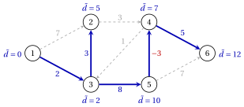
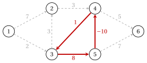

# 3.5 The Bellman–Ford algorithm { #sez-sec-sp-bf }

**Part 2 · Trees and paths · Chapter 3** · [:material-book-open-variant: Chapter 3: Shortest paths](index.md) · [:material-file-pdf-box: Lecture notes, volume 2 (PDF)](../../pdf/lecture-notes-2-trees-and-paths.pdf) · [:material-presentation: Slides](../../pdf/slides-shortest-paths.pdf) · [:material-pencil: Exercises: Shortest paths](../../exercises/shortest-paths.md) · [:material-gesture-tap: App: Shortest paths: Dijkstra, Bellman–Ford, acyclic graphs](../../lab/shortest-paths-dijkstra-bellman-ford.md)

!!! definizione "Definition 3.16: labels with at most $k$ arcs"

    For $k \ge 0$ and $j \in N$, $d^k(j)$ is the minimum length of a walk from $s$ to $j$ with at most $k$ arcs, and $d^k(j)=+\infty$ if there is none.

!!! teorema "Lemma 3.17: recursion of the labels"

    $d^0(s)=0$, $d^0(j)=+\infty$ for $j \neq s$, and for every $k \ge 1$

    $$
    d^k(j)=\min\Big\{\, d^{k-1}(j),\; \min_{(i,j) \in \delta^-(j)} \big( d^{k-1}(i)+d_{ij} \big) \Big\},
    \qquad \forall j \in N .
    $$

??? dimostrazione "Proof"

    The only walk with $0$ arcs is the walk $s$. For $k \ge 1$, a walk to $j$ with at most $k$ arcs either has at most $k-1$ arcs, with minimum length $d^{k-1}(j)$, or has exactly $k$ arcs and last arc $(i,j)$: it is a walk to $i$ with $k-1$ arcs followed by $(i,j)$, and its minimum length is $\min_{(i,j)}\big(d^{k-1}(i)+d_{ij}\big)$. □

!!! algoritmo "Algorithm: Bellman–Ford algorithm"

    

<strong>Input:</strong> a directed graph \(G=(N,A)\) with lengths \(d_{ij}\) of any sign, a source \(s \in N\)

<strong>Output:</strong> the distances \(\tilde{d}(j)\) and the predecessors, or a negative cycle reachable from \(s\)

1<strong>Step 0 (initialization).</strong> Set \(d^0(s):=0\), \(d^0(j):=+\infty\) for \(j \neq s\), and \(k:=1\).

2<strong>Step 1 (pass \(k\)).</strong> Compute \(d^k(j)\) for every \(j \in N\) with the recursion of
    [Lemma 3.17](#box-23-sp-lem-recursion);

3  if \(d^k(j)<d^{k-1}(j)\), set \(\mathit{pred}(j)\) to the tail \(i\) of the arc that attains the minimum.

4<strong>Step 2 (test).</strong> If \(d^k=d^{k-1}\), <code>STOP</code>: \(\tilde{d}=d^k\).

5  If \(k=n\), <code>STOP</code>: a negative cycle is reachable from \(s\). Otherwise set \(k:=k+1\) and go to Step 1.

- Each pass depends only on the labels of the previous pass: if $d^k=d^{k-1}$, all the following passes repeat the same labels, and the algorithm can stop.

- In the examples, ties in the minimum are broken by the smallest tail $i$, and the predecessor changes only when the label strictly decreases.

!!! teorema "Theorem 3.18: correctness of Bellman–Ford"

    If no negative cycle is reachable from $s$, then $d^{n-1}(j)=\tilde{d}(j)$ for every $j \in N$, and the algorithm stops at a pass $k \le n$ with $d^k=d^{k-1}=\tilde{d}$.

??? dimostrazione "Proof"

    A path has at most $n-1$ arcs, so $d^{n-1}(j) \le \tilde{d}(j)$. By [Lemma 3.3](shortest-path-problems.md#box-4-sp-lem-walk) (which needs only the cycles reachable from $s$) every walk from $s$ to $j$ contains a path not longer, so $d^k(j) \ge \tilde{d}(j)$ for every $k$.

    - Hence $d^{n-1}=d^{n}=\tilde{d}$.

    - The labels never increase, and the algorithm stops at the first pass $k$ with $d^k=d^{k-1}$, which is at most $n$; from that pass on the labels no longer change, so $d^k=d^{n-1}=\tilde{d}$.

    
□

!!! teorema "Theorem 3.19: detection of a negative cycle"

    A negative cycle is reachable from $s$ if and only if $d^n \neq d^{n-1}$. In that case, let $d^n(j)<d^{n-1}(j)$; reading the predecessors backwards from $j$, one row per pass, starting from row $n$ of the table, gives a walk from $s$ to $j$ with $n$ arcs that contains a negative cycle.

??? dimostrazione "Proof"

    If no negative cycle is reachable from $s$, then $d^n=d^{n-1}$ by [Theorem 3.18](#box-24-sp-th-bf). Conversely, let $d^n(j)<d^{n-1}(j)$.

    1. Every walk to $j$ of length $d^n(j)$ with at most $n$ arcs has exactly $n$ arcs, otherwise $d^{n-1}(j) \le d^n(j)$.

    2. Let $i$ be the predecessor of $j$ in row $n$, so $d^n(j)=d^{n-1}(i)+d_{ij}$. A walk realizing $d^{n-1}(i)$ followed by $(i,j)$ realizes $d^n(j)$, so it has exactly $n-1$ arcs: $d^{n-1}(i)<d^{n-2}(i)$, and $i$ has a predecessor in row $n-1$.

    3. Repeating the argument down to row $1$, whose predecessor is $s$, gives a walk $W$ from $s$ to $j$ with $n$ arcs and $d(W)=d^n(j)$.

    4. $W$ has $n+1$ nodes, so it repeats a node and contains a cycle $C$. Deleting $C$ gives a walk to $j$ with fewer than $n$ arcs, of length $d(W)-d(C) \ge d^{n-1}(j)>d^n(j)=d(W)$. Hence $d(C)<0$, and $C$ is reachable from $s$ along $W$. □

!!! teorema "Proposition 3.20: the predecessor tree of Bellman–Ford"

    If no negative cycle is reachable from $s$, at the stop the arcs $(\mathit{pred}(j),j)$, for the nodes $j \neq s$ with finite label, form a shortest path tree of the reachable nodes.

??? dimostrazione "Proof"

    Let $d=\tilde{d}$ be the final labels, and let $t(j)$ be the last pass in which the label of $j$ decreased; $t(s)=0$, since $d^k(s)=0$ for all $k$. Let $p=\mathit{pred}(j)$.

    1. In pass $t(j)$, $d(j)=d^{t(j)-1}(p)+d_{pj} \ge d(p)+d_{pj}$, since labels never increase.

    2. By [Theorem 3.5](shortest-path-problems.md#box-7-sp-th-bellman), $d(j) \le d(p)+d_{pj}$. Hence $d(j)=d(p)+d_{pj}$ and $d(p)=d^{t(j)-1}(p)$: the label of $p$ did not change after pass $t(j)-1$, so $t(p)<t(j)$.

    3. Moving to the predecessor $t$ strictly decreases, so the sequence ends in $s$, along tight arcs: the tree path from $s$ to $j$ has length $d(j)$. □

!!! teorema "Theorem 3.21: running time of Bellman–Ford"

    The Bellman–Ford algorithm runs in $O(n\,m)$ time.

??? dimostrazione "Proof"

    A pass computes $d^k(j)$ for every $j$ by scanning the backward star $\delta^-(j)$, so it scans every arc once: $O(n+m)$ time. There are at most $n$ passes, and the total is $O(n(n+m))$, which is $O(n\,m)$ when $m \ge n-1$, as under (A1). □

## 3.5.1 Bellman–Ford on the reference graph

!!! esempio "Example 3.7: Bellman–Ford with a negative arc"

    We use the lengths $d'$ of [Example 3.1](shortest-path-problems.md#box-2-sp-ex-ref) with $d'_{54}=-3$ in place of $2$. The two cycles have lengths $7$ and $8-3+1=6$, so there is no negative cycle. Each row is a pass $k$; next to a label that decreased, the new predecessor in brackets:

    $$
    \begin{array}{c|cccccc}
    \hline {k} & {d^k(1)} & {d^k(2)} & {d^k(3)} & {d^k(4)} & {d^k(5)} & {d^k(6)} \\
    \hline {0} & {0} & {\infty} & {\infty} & {\infty} & {\infty} & {\infty} \\
    {1} & {0} & {7} ({1}) & {2} ({1}) & {\infty} & {\infty} & {\infty} \\
    {2} & {0} & {5} ({3}) & {2} & {10} ({2}) & {10} ({3}) & {\infty} \\
    {3} & {0} & {5} & {2} & {7} ({5}) & {10} & {15} ({4}) \\
    {4} & {0} & {5} & {2} & {7} & {10} & {12} ({4}) \\
    {5} & {0} & {5} & {2} & {7} & {10} & {12} \\
    \hline
    \end{array}
    $$

    - In pass $3$, $d^3(4)=\min\{10,\; d^2(2)+3,\; d^2(5)-3\}=\min\{10,8,7\}=7$, with predecessor $5$.

    - Pass $5$ repeats the labels of pass $4$: the algorithm stops with $\tilde{d}=(0,5,2,7,10,12)$, after $5$ passes instead of the $n=6$ allowed.

    - The shortest path tree has the arcs $(1,3)$, $(3,2)$, $(3,5)$, $(5,4)$, $(4,6)$, and the shortest path to $6$ is $1,3,5,4,6$, of length $2+8-3+5=12$.

    { .fig loading=lazy  }

!!! esempio "Example 3.8: Bellman–Ford detects a negative cycle"

    With the lengths $d''$ of [Example 3.2](shortest-path-problems.md#box-5-sp-ex-negcycle) ($d''_{54}=-10$) the algorithm runs all the $n=6$ passes:

    $$
    \begin{array}{c|cccccc}
    \hline {k} & {d^k(1)} & {d^k(2)} & {d^k(3)} & {d^k(4)} & {d^k(5)} & {d^k(6)} \\
    \hline {0} & {0} & {\infty} & {\infty} & {\infty} & {\infty} & {\infty} \\
    {1} & {0} & {7} ({1}) & {\mathbf{2}} ({\mathbf{1}}) & {\infty} & {\infty} & {\infty} \\
    {2} & {0} & {5} ({3}) & {2} & {10} ({2}) & {\mathbf{10}} ({\mathbf{3}}) & {\infty} \\
    {3} & {0} & {5} & {2} & {\mathbf{0}} ({\mathbf{5}}) & {10} & {15} ({4}) \\
    {4} & {0} & {5} & {\mathbf{1}} ({\mathbf{4}}) & {0} & {10} & {5} ({4}) \\
    {5} & {0} & {4} ({3}) & {1} & {0} & {\mathbf{9}} ({\mathbf{3}}) & {5} \\
    {6} & {0} & {4} & {1} & {\mathbf{-1}} ({\mathbf{5}}) & {9} & {5} \\
    \hline
    \end{array}
    $$

    - In pass $6$ the label of node $4$ decreases from $0$ to $-1$: $d^6 \neq d^5$, and a negative cycle is reachable from $1$.

    - Reading backwards from node $4$ (bold entries): row $6$ gives $\mathit{pred}=5$, row $5$ for node $5$ gives $3$, row $4$ for node $3$ gives $4$, then $5$, $3$, $1$. The walk is

        $$
        1,\;3,\;5,\;4,\;3,\;5,\;4, \qquad\text{of length } 2+8-10+1+8-10=-1=d^6(4).
        $$

    - Node $3$ repeats: the walk contains the cycle $3,5,4,3$, of length $-1$ (red).

    { .fig loading=lazy  }

!!! chiave ""

    The Bellman–Ford algorithm computes $d^k$, the shortest walks with at most $k$ arcs, in $O(n\,m)$ time. Without negative cycles reachable from $s$ it stops within $n$ passes with the distances; a change in pass $n$ reveals a negative cycle, found by reading the predecessors backwards.

---

**Next:** [3.6 Dijkstra's algorithm](dijkstra-s-algorithm.md)
